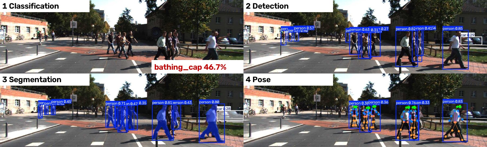
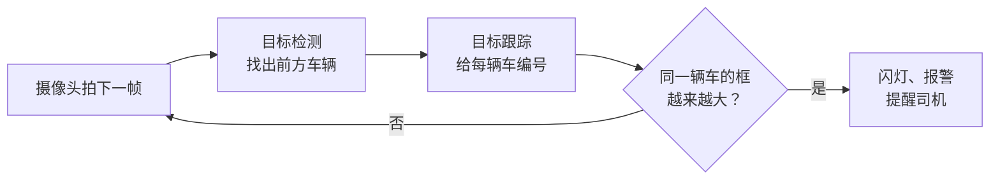
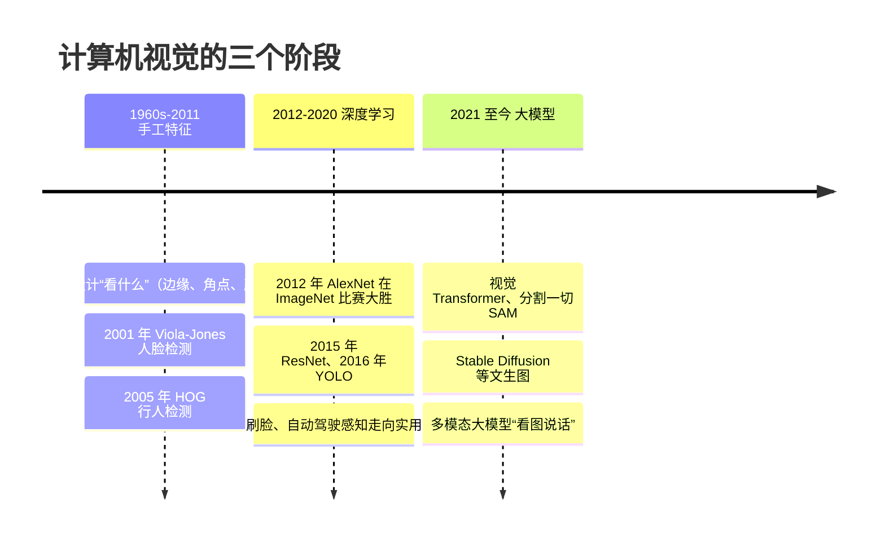
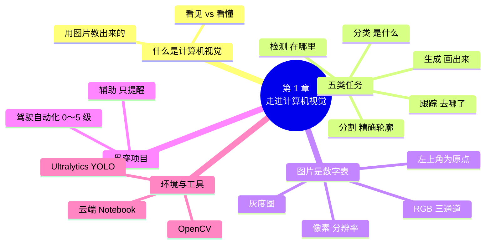

# 第 1 章 走进计算机视觉

!!! abstract "本章学时"
    理论 4 学时（线上 3 + 线下 1）· 实验 4 学时（本章共 4 个实验，★ 必做 3 个）

## 学习目标

学完本章，你应该能够：

1. **说出**计算机视觉的五类常见任务，并各举一个生活中的例子（记忆）；
2. **解释**一张彩色图片怎样变成一张“数字表”，读懂形状 `(高, 宽, 通道)`（理解）；
3. **运行**给定代码，读入并显示一张图片，取出一个像素的值（应用）；
4. **比较**同一张照片交给分类、检测、分割、姿态估计四种模型后输出的不同（分析）；
5. **区分**“辅助驾驶”和“自动驾驶”，说出驾驶自动化分为几级（理解）。

!!! info "先修要求"
    本章从零开始，不需要任何编程基础。学过“Python 程序设计”的同学可以跳过 1.6.3 的“Python 小课堂”；没学过的同学，遇到不懂的语法可以随时翻附录 A。

??? abstract "本章概念清单（18 个，点击查看定义和例子）"
    1. [计算机视觉](../../appendix/glossary.md#g-计算机视觉)
    2. [像素](../../appendix/glossary.md#g-像素)
    3. [分辨率](../../appendix/glossary.md#g-分辨率)
    4. [RGB](../../appendix/glossary.md#g-RGB)
    5. [通道](../../appendix/glossary.md#g-通道)
    6. [灰度图](../../appendix/glossary.md#g-灰度图)
    7. [图像分类](../../appendix/glossary.md#g-图像分类)
    8. [目标检测](../../appendix/glossary.md#g-目标检测)
    9. [图像分割](../../appendix/glossary.md#g-图像分割)
    10. [目标跟踪](../../appendix/glossary.md#g-目标跟踪)
    11. [图像生成](../../appendix/glossary.md#g-图像生成)
    12. [姿态估计](../../appendix/glossary.md#g-姿态估计)
    13. [驾驶自动化分级](../../appendix/glossary.md#g-驾驶自动化分级)
    14. [高级驾驶辅助系统](../../appendix/glossary.md#g-高级驾驶辅助系统)
    15. [Notebook](../../appendix/glossary.md#g-Notebook)
    16. [OpenCV](../../appendix/glossary.md#g-OpenCV)
    17. [预训练模型](../../appendix/glossary.md#g-预训练模型)
    18. [多模态大模型](../../appendix/glossary.md#g-多模态大模型)

## 情景导入

小林在一家物流公司做调度，最近公司给货车装了一套“主动安全系统”：车道偏了，仪表盘会“嘀嘀”响；离前车太近，会闪红灯提醒；司机低头看手机超过两秒，系统会语音提醒“请注意前方”。

小林很好奇：“它是怎么知道车偏了、前面有车、司机在看手机的？”

车队的技术员老王指了指挡风玻璃上方的小黑盒子：“全靠这几个摄像头。一个朝外看路，一个朝里看司机。摄像头拍下来的只是一张张照片，真正‘看懂’照片的，是里面的计算机视觉程序。”

“那我能学会做这种程序吗？我连 Python 都没怎么写过。”

“能。现在的视觉工具已经很好用了，很多事情几行代码就能做出来。你先学会让电脑‘看’一张照片，后面一步步来。”

这一章，我们就从“电脑怎么看一张照片”开始，认识计算机视觉能做什么，搭好实验环境，并且亲手运行第一段代码。整本书会一直跟着小林，一章一章地做出一个“智能辅助驾驶助手”。

## 1.1 什么是计算机视觉 { #11 }

### 1.1.1 让机器“看懂”图片和视频 { #111 }

[**计算机视觉**](../../appendix/glossary.md#g-计算机视觉 "让计算机从图片和视频中“看懂”内容（有什么、在哪里、在做什么）的技术"){ .term }（Computer Vision，简称 CV）就是让计算机从图片和视频中“看懂”内容的技术：照片里有什么、在哪里、在做什么、有多远。

“看见”和“看懂”是两回事。手机摄像头早就能“看见”，拍下的照片清清楚楚；但对计算机来说，一张照片只是几百万个数字（1.3 节会看到），它并不知道哪些数字组成了一辆车、哪些组成了一个人。计算机视觉要做的，就是从这一大堆数字里找出有用的信息。

可以把计算机视觉程序想象成一个刚入职的“看图员”：

| 人看图 | 计算机视觉程序看图 |
|---|---|
| 眼睛接收光线 | 摄像头把光线变成数字 |
| 大脑认出“这是一辆车” | 模型根据数字算出“这是车，把握 92%” |
| 根据经验判断“它离我很近，要减速” | 程序按规则判断“框很大，提醒司机” |
| 从小看过无数东西，所以认得 | 用大量标好答案的图片训练过，所以认得 |

最后一行最关键：今天的计算机视觉程序，大多数是**用大量图片“教”出来的**，这就是后面各章要讲的“模型”和“训练”。

### 1.1.2 身边的计算机视觉 { #112 }

计算机视觉其实早就在你身边了：

| 场景 | 它在“看”什么 | 属于哪类任务（见 1.2 节） |
|---|---|---|
| 刷脸支付、刷脸进站 | 这张脸是不是本人 | 人脸识别（检测 + 比对） |
| 停车场自动抬杆 | 车牌上写的是什么 | 检测 + 文字识别 |
| 手机相册“人物”“宠物”分组 | 每张照片里有什么 | 分类、检测 |
| 倒车影像、车道偏离提醒 | 车道线和障碍物在哪里 | 检测、分割 |
| 美颜相机、抠图换背景 | 人的轮廓、五官在哪里 | 分割、关键点 |
| 拍照搜题、扫描文档 | 纸上写了什么字 | 文字识别 |
| 健身 App 数深蹲 | 人的关节怎么动 | 姿态估计、动作识别 |
| 输入一句话生成一张画 | 按文字“画”出图片 | 图像生成 |

这些应用看起来五花八门，拆开来看都是由少数几种“基本任务”组合起来的。下一节就来认识它们。

### 1.1.3 计算机视觉和其他课程的关系 { #113 }

本专业的课程里，有好几门都会碰到图片：

- “人工智能导论”第 6 章用体验的方式介绍过计算机视觉；
- “机器学习”第 11 章讲卷积神经网络的原理；
- “人工智能开发框架技术”第 8 章用现成模型做过一次检测和文字识别；
- “人工智能数据分析与处理”讲图片怎样标注。

本课是视觉方向的“主讲课”：从图片处理、特征、分类、检测、分割、视频分析到图像生成，系统地讲一遍，**重在会用**。原理只讲到“能说清楚为什么”的程度，公式推导留给机器学习和深度学习课程。

## 1.2 五类常见的视觉任务 { #12 }

### 1.2.1 同一张照片，四种答案 { #121 }

先看一个实际的例子。我们把同一张“行人过马路”的照片，分别交给四个不同的模型（实验 1-3 会让你亲手运行）：



*图 1-1　同一张照片的四种答案（编者用 YOLO26n 的四个版本在 CPU 上实际运行；照片来自 KITTI 数据集，CC BY-NC-SA 3.0）*

四种模型给出的答案完全不同：

1. [**图像分类**](../../appendix/glossary.md#g-图像分类 "给整张图片一个类别和把握的任务，回答“是什么”"){ .term }：给整张照片一个答案。模型的回答是“bathing_cap（泳帽），把握 46.7%”，显然答非所问。这不怪模型：它只学过“一张照片里只有一样主要东西”的图片，面对一整条街，只能硬挑一个最像的。
2. [**目标检测**](../../appendix/glossary.md#g-目标检测 "找出图片中有哪些物体、各在什么位置的任务，每个物体用一个框加类别和置信度表示"){ .term }：找出照片里的每个东西，用一个**框**把它圈起来，写上类别和把握。这张照片里找到了 12 个人、1 辆车。
3. [**图像分割**](../../appendix/glossary.md#g-图像分割 "判断图片中每个像素属于哪个物体或类别，得到精确轮廓的任务"){ .term }：比框更精细，把每个人的**轮廓**一个像素一个像素地描出来（图中蓝色的部分）。
4. [**姿态估计**](../../appendix/glossary.md#g-姿态估计 "找出人体关节（关键点）位置的任务，连起来像一个“火柴人”"){ .term }：找出每个人的**关节**（头、肩、肘、膝……共 17 个点），连起来就是一个“火柴人”。

!!! tip "任务选对了，才谈得上好不好"
    同样是“看懂”，问的问题不同，就要用不同的任务。想知道“这张照片拍的是什么” → 分类；想知道“有几个人、在哪里” → 检测；想把人抠出来 → 分割；想知道人在做什么动作 → 姿态估计。

### 1.2.2 五类任务一览 { #122 }

把上面四种加上“视频里的跟踪”和“画出新图片的生成”，就是本书要学的五大类任务：

| 任务 | 回答的问题 | 输出长什么样 | 辅助驾驶里的用途 | 本书章节 |
|---|---|---|---|---|
| **图像分类** | 是什么？ | 一个类别 + 把握 | 判断前方是轿车还是卡车 | 第 4 章 |
| **目标检测** | 有什么？在哪里？ | 很多个框，每个框带类别和把握 | 找出车辆、行人、红绿灯 | 第 5 章 |
| **图像分割** | 精确轮廓是什么？ | 每个像素属于谁 | 找出哪里是能开的路面 | 第 6 章 |
| [**目标跟踪**](../../appendix/glossary.md#g-目标跟踪 "在视频的连续画面中给每个目标编号，并保持同一目标的编号不变的任务"){ .term } | 它去哪了？ | 每个目标一个编号，跨帧不变 | 盯住前车，看它是否越来越近 | 第 7 章 |
| [**图像生成**](../../appendix/glossary.md#g-图像生成 "让模型按要求画出一张新图片的任务"){ .term } | 能画出来吗？ | 一张新图片 | 生成雨天、夜间画面扩充训练数据 | 第 8 章 |

此外还有几种常见任务，可以看成上面任务的“变体”：**姿态估计**（找人的关节，第 7 章）、文字识别（找字和认字）、深度估计（估计每个像素有多远，第 6 章）、人脸识别（找脸再比对）。

### 1.2.3 先有“看图”，再有“应用” { #123 }

一个真正能用的视觉应用，通常是“几种任务 + 一些规则”的组合。以货车上的“前车碰撞提醒”为例：



检测和跟踪是“看图”，判断“框越来越大”是规则，报警是应用。本书每一章学一种“看图”的本领，最后在第 9 章把它们组合起来。

## 1.3 图片在计算机里的样子 { #13 }

### 1.3.1 像素：一张图就是一张数字表 { #131 }

把手机里的照片一直放大，最后会看到一个个小方格，每个方格只有一种颜色。这样的小方格叫[**像素**](../../appendix/glossary.md#g-像素 "组成数字图片的最小方格，每个像素只有一种颜色"){ .term }（Pixel）。一张照片就是由很多很多像素排成的一张大表格，像一幅十字绣：每一针一个颜色，远看就是一幅画。

<iframe class="sim-frame" src="../../sims/pixel-zoom/main.html" height="520" loading="lazy" title="像素放大镜"></iframe>

动画：像素放大镜。在照片上点一点，看每个像素的三个数字；拖动“分辨率”滑块，看照片被缩成多少个格子。
{ .sim-caption }

[**分辨率**](../../appendix/glossary.md#g-分辨率 "图片横向和纵向各有多少个像素"){ .term }指一张图片横向和纵向各有多少个像素。手机照片常见 4000×3000（约 1200 万像素）；本书用的城市街道照片 `drive_city.jpg` 是 1242×375，行车视频画面是 1280×720。

### 1.3.2 颜色：红、绿、蓝三个数 { #132 }

每个像素的颜色，用三个数字表示：红（Red）、绿（Green）、蓝（Blue）各有多少，简称 [**RGB**](../../appendix/glossary.md#g-RGB "用红、绿、蓝三个 0～255 的数表示一种颜色的方法"){ .term }。每个数在 0～255 之间，0 表示一点没有，255 表示最多：

| 颜色 | 红 | 绿 | 蓝 |
|---|---|---|---|
| 黑 | 0 | 0 | 0 |
| 白 | 255 | 255 | 255 |
| 纯红 | 255 | 0 | 0 |
| 黄（红 + 绿） | 255 | 255 | 0 |
| 灰 | 128 | 128 | 128 |

为什么是 0～255？因为每个数用 8 个二进制位（1 个字节）存，8 位正好能表示 2⁸ = 256 个数。程序里这种类型写作 `uint8`（无符号 8 位整数）。

把所有像素的“红”放在一起，就是一张“红色表”；“绿”“蓝”也一样。这三张表叫三个[**通道**](../../appendix/glossary.md#g-通道 "图片中同一种颜色分量组成的一张数字表，彩色图有 3 个通道"){ .term }（Channel）。所以一张彩色图片在计算机里是一个“高 × 宽 × 3”的数字块：

```text
         宽（列）→
    ┌──────────────┐
 高 │ 蓝 绿 红 │ 蓝 绿 红 │ …      每个格子存 3 个数
（行）│ 蓝 绿 红 │ 蓝 绿 红 │ …
 ↓  │   …               │
    └──────────────┘
```

!!! warning "OpenCV 的顺序是“蓝、绿、红”"
    本书用的图片处理工具 OpenCV 有一个历史习惯：读进来的三个通道顺序是 **B、G、R**（蓝、绿、红），不是 R、G、B。用 OpenCV 读图、再用别的工具显示时，要先把顺序换过来，否则红色的车会显示成蓝色。实验 1-1 里的 `cv2.cvtColor(img, cv2.COLOR_BGR2RGB)` 就是干这个的。

### 1.3.3 灰度图：只有一个通道 { #133 }

[**灰度图**](../../appendix/glossary.md#g-灰度图 "每个像素只有一个 0～255 的亮度值的图片"){ .term }（Grayscale Image）只有一个通道，每个像素只有一个 0～255 的数，表示有多亮：0 是黑，255 是白，中间是各种灰。

彩色转灰度，不是简单地把三个数平均，而是按人眼的感觉加权：人眼对绿色最敏感、对蓝色最不敏感，OpenCV 用的公式是：

\[
\text{灰度} = 0.299 \times \text{红} + 0.587 \times \text{绿} + 0.114 \times \text{蓝}
\]

!!! example "算一算"
    实验 1-2 读到 `drive_city.jpg` 第 100 行第 600 列的像素：红 242，绿 255，蓝 207。它的灰度值是多少？

    0.299 × 242 + 0.587 × 255 + 0.114 × 207 = 72.4 + 149.7 + 23.6 = 245.7，四舍五入约 246。

    实验 1-2 第 4 步程序输出的灰度值正是 246。

为什么要用灰度图？因为很多任务（找边缘、找车道线）只关心“亮暗变化”，不关心颜色。灰度图的数字只有彩色图的三分之一，处理起来更快。

### 1.3.4 坐标：从左上角算起 { #134 }

数学课上的坐标原点在左下角，y 轴向上。图片不一样：**原点在左上角，往右是 x（列）增大，往下是 y（行）增大**。

用代码取像素时，要先写行、再写列：`img[行, 列]`，也就是 `img[y, x]`。这一点特别容易搞反：

| 写法 | 意思 |
|---|---|
| `img[100, 600]` | 第 100 行、第 600 列的像素（3 个数） |
| `img[100, 600, 2]` | 这个像素的第 2 个通道（OpenCV 里是红色） |
| `img[0:3, 0:3]` | 左上角 3 行 × 3 列的一小块 |
| `img.shape` | `(375, 1242, 3)`：高 375、宽 1242、3 个通道 |

!!! example "算一算"
    `drive_city.jpg` 的形状是 `(375, 1242, 3)`，一共有多少个数字？

    375 × 1242 × 3 = 1,397,250，约 140 万个数字。实验 1-2 第 1 步的输出“一共 1397250 个数字”与此一致。一张 4000×3000 的手机照片则有 3600 万个数字。

## 1.4 计算机视觉简史 { #14 }

计算机视觉已经发展了六十多年，大致可以分成三个阶段：



**第一阶段：手工特征。** 人来告诉计算机“看什么”：边缘在哪里、角点在哪里、颜色是什么。第 2、3 章学的 OpenCV 图像处理和特征，就是这一阶段的成果，今天在简单场景里仍然好用、而且很快。

**第二阶段：深度学习。** 2012 年，一个叫 AlexNet 的卷积神经网络在 ImageNet 图片识别比赛中把错误率从 26% 左右降到 15% 左右，比第二名好出一大截。<sup class="cite">[[2]](#ref1-2)</sup><sup class="cite">[[3]](#ref1-3)</sup> 从此，“让机器自己从大量图片中学会看什么”成为主流。第 4～7 章的分类、检测、分割、跟踪，用的都是深度学习模型。

**第三阶段：大模型。** 模型越来越大、学过的图片越来越多，出现了“一个模型能做很多事”的通用模型：点一下就能分割任何东西的 SAM（第 6 章）、输入文字就能画图的 Stable Diffusion（第 8 章）、能看图回答问题的多模态大模型（1.7 节）。

## 1.5 贯穿项目：智能辅助驾驶助手 { #15 }

### 1.5.1 “辅助”和“自动”不一样 { #151 }

新闻里常说“自动驾驶”“智能驾驶”“辅助驾驶”，它们是一回事吗？不是。我国国家标准 GB/T 40429—2021《汽车[驾驶自动化分级](../../appendix/glossary.md#g-驾驶自动化分级 "按“谁在开车”把驾驶自动化分为 0～5 级的标准，我国标准为 GB/T 40429—2021"){ .term }》把驾驶自动化分为 0～5 级：<sup class="cite">[[5]](#ref1-5)</sup>

| 等级 | 名称 | 谁在开车 | 例子 |
|---|---|---|---|
| 0 级 | 应急辅助 | 驾驶员，系统只报警或短暂介入 | 车道偏离报警、前车碰撞报警 |
| 1 级 | 部分驾驶辅助 | 驾驶员，系统帮忙控制方向**或**速度 | 自适应巡航、车道保持 |
| 2 级 | 组合驾驶辅助 | 驾驶员，系统同时控制方向**和**速度 | 高速公路“辅助驾驶” |
| 3 级 | 有条件自动驾驶 | 系统，但驾驶员要随时准备接管 | 特定路段的自动驾驶 |
| 4 级 | 高度自动驾驶 | 系统，限定区域内不需要人 | 特定区域的无人出租车 |
| 5 级 | 完全自动驾驶 | 系统，任何道路 | 目前还没有 |

0～2 级叫“**驾驶辅助**”，开车的始终是人，系统只是帮忙和提醒。我们常说的[**高级驾驶辅助系统**](../../appendix/glossary.md#g-高级驾驶辅助系统 "用摄像头、雷达等感知周围情况，提醒或帮助驾驶员的系统，属于驾驶自动化 0～2 级"){ .term }（Advanced Driver Assistance System，ADAS）就在这个范围里。

!!! warning "本书做的是“辅助”，而且只做“提醒”"
    本书的“智能辅助驾驶助手”只做 0 级的“看懂和提醒”，不控制车辆。书中的所有程序都是学习用的示例，**不能用在真实驾驶中**。即使是市面上的 2 级辅助驾驶，驾驶员也必须双手握方向盘、眼睛看路，对行车安全负全责。

### 1.5.2 一章做一块 { #152 }

辅助驾驶里几乎用到了计算机视觉的所有任务，所以本书选它作为贯穿项目。每一章做其中一块：

| 章 | 本章学的本领 | 给“辅助驾驶助手”添上的功能 |
|---|---|---|
| 1 | 图片是什么 | 读入一张行车照片，看懂它的数字 |
| 2 | 图像处理 | 把夜间画面调亮；按颜色找出车道线 |
| 3 | 图像特征 | 用边缘和直线检测找车道线 |
| 4 | 图像分类 | 认出一辆车是轿车、厢式车还是卡车 |
| 5 | 目标检测 | 找出画面里的车辆和行人 |
| 6 | 图像分割、深度估计 | 分出能开的路面，估计谁离我更近 |
| 7 | 视频分析 | 跟踪前车、提醒“前车过近”；驾驶员分心提醒 |
| 8 | 图像生成与修复 | 生成雨天、夜间的道路画面 |
| 9 | 应用实战 | 做成一个网页小工具，发给同学用 |

本书用到的行车素材有两类：Udacity 自动驾驶课程公开的高速公路行车视频（MIT 许可）<sup class="cite">[[6]](#ref1-6)</sup>，以及德国卡尔斯鲁厄理工学院和美国丰田工业大学芝加哥分校发布的 KITTI 数据集（城市街道照片，CC BY-NC-SA 3.0，仅限非商业用途）<sup class="cite">[[4]](#ref1-4)</sup>。来源和许可见 `labs/data/README.md`。

## 1.6 实验环境与工具 { #16 }

### 1.6.1 两种做实验的方式 { #161 }

本书的实验可以在两种地方做：

| 方式 | 怎么用 | 优点 | 缺点 |
|---|---|---|---|
| **云端 Notebook**（推荐） | 浏览器打开魔搭社区、飞桨 AI Studio 等平台的 Notebook | 不用安装，打开就能用；有的平台送免费 GPU 时长 | 要联网；免费资源有时要排队 |
| 本机 | 在自己电脑上装 Python 和工具（附录 C） | 不依赖网络，文件都在自己手里 | 第一次安装要花半小时左右 |

[**Notebook**](../../appendix/glossary.md#g-Notebook "网页里的编程环境，代码分成单元格逐个运行，结果直接显示在下面"){ .term }（笔记本）是一种网页里的编程环境：代码分成一个个“单元格”，选中一个单元格按 Shift + Enter 就运行它，结果直接显示在下面。图片、表格都能直接显示，特别适合边学边试。本书每个实验都配了一份 `.ipynb` 文件（Notebook 文件），上传到平台、打开就能运行。

本书的必做实验都能在**普通电脑的 CPU** 上完成，编者在 4 核 CPU 上实测：用最小的模型看一张行车照片不到 1 秒。只有第 8 章的图像生成需要显卡（GPU），会在云端 Notebook 或学校的 A40 服务器上演示。

### 1.6.2 本书用到的工具 { #162 }

| 工具 | 做什么 | 第一次出现 |
|---|---|---|
| Python 3.12 | 编程语言 | 第 1 章 |
| [**OpenCV**](../../appendix/glossary.md#g-OpenCV "开源的计算机视觉工具库，在 Python 中写作 `cv2`，用于读写、处理图片和视频"){ .term }（`cv2`） | 读图、改图、读视频，传统视觉算法 | 第 1、2 章 |
| NumPy（`numpy`） | 处理数字表格（图片就是数字表格） | 第 2 章 |
| Matplotlib | 在 Notebook 里显示图片、画曲线 | 第 1 章 |
| Ultralytics YOLO（`ultralytics`） | 分类、检测、分割、姿态、跟踪，一套写法 | 第 1 章 |
| MobileSAM | 点一下就分割 | 第 6 章 |
| Real-ESRGAN、diffusers | 超分辨率、图像生成 | 第 8 章 |
| Gradio | 做网页小工具 | 第 9 章 |

其中最重要的是两样：**OpenCV** 负责“处理图片和视频”，**Ultralytics YOLO** 负责“识别”。YOLO 的各种任务写法几乎一样：

```python
from ultralytics import YOLO
model = YOLO("yolo26n.pt")        # 换成 -cls / -seg / -pose 就是分类 / 分割 / 姿态
results = model("照片.jpg")       # 看一张照片
```

文件名里的 `26` 是版本（2026 年 1 月发布的 YOLO26），`n` 是大小（nano，最小号，最快）。这些模型都是别人已经用几十万张图片训练好的，叫[**预训练模型**](../../appendix/glossary.md#g-预训练模型 "别人已经用大量数据训练好、下载后可直接使用或继续训练的模型"){ .term }（Pre-trained Model），第一次运行时自动下载，每个只有 5～7 MB。

### 1.6.3 Python 小课堂①：运行第一行代码 { #163 }

没写过代码不要紧，本章只需要认识下面几样东西：

| 写法 | 意思 | 例子 |
|---|---|---|
| `print(…)` | 把括号里的东西显示出来 | `print("你好")` 显示“你好” |
| `变量 = 值` | 给一个东西起名字，后面用名字代替它 | `y = 100`，之后 `y` 就是 100 |
| `# 文字` | 注释，给人看的说明，电脑会跳过 | `# 读入图片` |
| `import 工具名` | 请出一个工具箱 | `import cv2` |
| `工具.功能(…)` | 用工具箱里的某个功能 | `cv2.imread("a.jpg")` |
| `f"…{变量}…"` | 把变量的值填进一句话 | `f"宽 {w} 像素"` → “宽 1242 像素” |

三个最常犯的错误：

1. **用了中文标点**。代码里的括号、引号、逗号、冒号必须是英文半角的：`print("你好")` 对，`print（“你好”）` 错。
2. **大小写写错**。`cv2.imread` 和 `cv2.Imread` 是两回事。
3. **路径写错**。`"../data/images/drive_city.jpg"` 中的 `..` 表示“上一级文件夹”。本书的实验都在 `labs/chNN/` 文件夹里运行，所以 `../data/` 就是 `labs/data/`。

**报错不可怕。** 代码出错时，屏幕上会出现一大段红字，**只看最后一行**就够了：它说明了是什么错。下一节的对照表列出了本章最常见的几种。

## 1.7 本章常见报错对照 { #17 }

| 报错原文（最后一行） | 用大白话说 | 怎么改 |
|---|---|---|
| `ModuleNotFoundError: No module named 'cv2'` | 没装 OpenCV | 运行 `pip install opencv-python` |
| `AttributeError: 'NoneType' object has no attribute 'shape'` | 图片没读进来（`imread` 找不到文件时不报错，只返回“空”） | 检查文件名和路径，看看当前文件夹对不对 |
| `SyntaxError: invalid character '（' (U+FF08)` | 用了中文括号 | 换成英文半角 `(` |
| `IndexError: index 400 is out of bounds for axis 0 with size 375` | 取的行号超出了图片高度 | 行号要小于高度（这里最大 374） |
| `ConnectionError: … Download failure …` | 第一次运行要下载模型，但没联网 | 检查网络；或从老师处拷贝 `.pt` 文件放到代码同一文件夹 |

## 1.8 前沿视窗：会“看图说话”的多模态大模型 { #18 }

前面说的模型，各管一件事：分类模型只会说类别，检测模型只会画框。2023 年以来，出现了一类“什么都能聊”的模型：把一张照片发给它，再用中文问它问题，它就能用中文回答。这类能同时理解图片和文字的模型叫[**多模态大模型**](../../appendix/glossary.md#g-多模态大模型 "能同时理解图片、文字等多种信息的大模型，可以看图回答问题"){ .term }（Multimodal Large Model）。

国内的通义千问 Qwen-VL 系列就是代表：它能描述照片内容、读出照片里的文字、回答“图中左边的车是什么颜色”，还能给出物体的位置框。<sup class="cite">[[7]](#ref1-7)</sup> 2025 年发布的 Qwen2.5-VL 还能看懂长视频、操作手机和电脑界面。<sup class="cite">[[8]](#ref1-8)</sup> 豆包、文心、智谱等国产大模型 App 也都支持“拍照提问”。

那还学传统视觉干什么？至少有三个原因：

1. **速度和成本**。辅助驾驶每秒要处理几十帧画面，必须在车上的小芯片里几十毫秒内给出结果。一个 YOLO nano 模型只有 5 MB，大模型动辄几 GB，还要联网调用。
2. **可靠和可控**。检测模型的输出是固定格式的框和数字，好检查、好统计；大模型的回答是一段话，偶尔会“一本正经地胡说”。
3. **听得懂原理才用得好**。会给大模型提问的人很多，知道它为什么认错、该换什么方法的人才是企业需要的。

实际产品里，两者常常配合使用：小模型在车上实时看路，大模型在云端做复杂场景的理解和数据整理。

## 本章实验

!!! abstract "实验总览"
    | 实验 | 类型 | 建议时长 | 内容 |
    |---|---|---|---|
    | 实验 1-1 | ★ 必做 | 40 分钟 | 打开 Notebook，显示第一张图片 |
    | 实验 1-2 | ★ 必做 | 45 分钟 | 图片变数字 |
    | 实验 1-3 | ★ 必做 | 45 分钟 | 一行代码体验四种视觉任务 |
    | 实验 1-4 | ☆ 选做 | 60 分钟 | 在自己电脑上安装环境 |

    代码见配套资源 `labs/ch01/` 目录，每个实验都有 `.py` 和 `.ipynb` 两种文件，内容相同。所有实验都在 `labs/ch01/` 文件夹里运行。

### 实验 1-1 ★ 打开 Notebook，显示第一张图片 { #1-1 }

**实验目的**

1. 学会在云端 Notebook 上传文件、运行单元格；
2. 用 OpenCV 读入一张图片，用 Matplotlib 显示出来。

**实验环境**：云端 Notebook 或本机，CPU 即可。

**实验数据**：`labs/data/images/drive_city.jpg`（KITTI 数据集，CC BY-NC-SA 3.0）。

**实验步骤与代码**

第一档 · 跑通：

1. 打开魔搭社区（modelscope.cn）或飞桨 AI Studio，注册登录后新建一个 Notebook（选 CPU 环境即可）；
2. 把配套资源中的 `labs` 文件夹整个上传（或用老师给的压缩包上传后解压），进入 `labs/ch01/`；
3. 打开 `lab1_1_show_image.ipynb`，从上到下依次选中每个单元格，按 Shift + Enter 运行。

```python
import cv2                          # OpenCV：读图、处理图片的工具箱
import matplotlib.pyplot as plt     # Matplotlib：在 Notebook 里画图、显示图片

img = cv2.imread("../data/images/drive_city.jpg")   # ← 改这里：换成别的图片
print("图片的形状：", img.shape)                     # (高, 宽, 通道数)

rgb = cv2.cvtColor(img, cv2.COLOR_BGR2RGB)  # OpenCV 按“蓝绿红”存，显示前要换成“红绿蓝”
plt.figure(figsize=(10, 3))                 # 画布大小：宽 10、高 3（英寸）
plt.imshow(rgb)                             # 把图片放到画布上
plt.axis("off")                             # 不显示坐标轴
plt.show()
```

完整代码：`labs/ch01/lab1_1_show_image.py`（`.ipynb` 同名）

**运行结果**

```text
图片的形状： (375, 1242, 3)
```

下面显示出一张城市街道的照片：左边停着几辆车，右边人行道上有一位老人。

第二档 · 改一改：

1. 把 `drive_city.jpg` 换成 `lane_yellow.jpg`，记录它的形状；
2. 删掉 `cvtColor` 那一行，把 `plt.imshow(rgb)` 改成 `plt.imshow(img)`，看看颜色有什么变化，说说为什么；
3. 用手机拍一张街道或校园的照片，上传后显示出来。

**实验记录表**

| 图片 | 形状（高, 宽, 通道） | 一共多少个数字 |
|---|---|---|
| drive_city.jpg | (375, 1242, 3) | |
| lane_yellow.jpg | | |
| 自己拍的照片 | | |

**常见问题排查**

| 现象 | 原因 | 解决办法 |
|---|---|---|
| 报 `'NoneType' object has no attribute 'shape'` | 路径不对，图片没读进来 | 确认 Notebook 在 `labs/ch01/` 里，`labs/data/images/` 里有这张图 |
| 图片颜色发蓝、人脸发紫 | 少了 BGR 转 RGB 那一步 | 加上 `cv2.cvtColor(img, cv2.COLOR_BGR2RGB)` |
| 图片显示得很小 | 画布太小 | 把 `figsize=(10, 3)` 改大 |

**思考与练习**

1. 自己拍的手机照片，形状里的高和宽哪个大？竖着拍和横着拍有什么不同？

**实验报告要求**

提交显示出的图片截图（三张）和填好的实验记录表，回答“改一改”第 2 题。

### 实验 1-2 ★ 图片变数字 { #1-2 }

**实验目的**

1. 读出图片的高、宽、通道数和数字类型；
2. 学会用 `img[行, 列]` 取像素，用切片改一块区域；
3. 体会彩色图和灰度图的区别。

**实验环境**：云端 Notebook 或本机，CPU 即可。

**实验数据**：同实验 1-1。

**实验步骤与代码**

第一档 · 跑通：打开 `lab1_2_image_numbers.ipynb`，依次运行四个单元格。

```python
import cv2

img = cv2.imread("../data/images/drive_city.jpg")
h, w, c = img.shape                  # 高、宽、通道数
print(f"高 {h} 像素，宽 {w} 像素，{c} 个通道，一共 {h * w * c} 个数字")
print("数字的类型：", img.dtype)     # uint8：0～255 的整数

y, x = 100, 600                      # ← 改这里：第 100 行、第 600 列
b, g, r = img[y, x]                  # OpenCV 的顺序是 蓝、绿、红
print(f"第 {y} 行第 {x} 列：红 {r}，绿 {g}，蓝 {b}")
print("左上角 3×3 个像素的蓝色通道：")
print(img[0:3, 0:3, 0])

painted = img.copy()                 # 复制一份，不改原图
painted[250:330, 560:700] = (0, 0, 255)     # 这一块改成纯红（蓝0 绿0 红255）  ← 改这里
cv2.imwrite("lab1_2_painted.jpg", painted)

gray = cv2.cvtColor(img, cv2.COLOR_BGR2GRAY)
print("灰度图的形状：", gray.shape, " 同一位置的灰度值：", gray[y, x])
```

完整代码：`labs/ch01/lab1_2_image_numbers.py`

**运行结果**

```text
高 375 像素，宽 1242 像素，3 个通道，一共 1397250 个数字
数字的类型： uint8
第 100 行第 600 列：红 242，绿 255，蓝 207
左上角 3×3 个像素的蓝色通道：
[[66 66 66]
 [66 66 66]
 [65 65 65]]
涂好的图片存为 lab1_2_painted.jpg
灰度图的形状： (375, 1242)  同一位置的灰度值： 246
```

第 100 行第 600 列落在远处一栋浅色楼房上，所以三个数都很大（接近白色）。打开 `lab1_2_painted.jpg`，路面中间多了一块红色长方形。

第二档 · 改一改：

1. 把 `y, x` 改成路面上的一个点（例如 `300, 650`）和天空里的一个点（例如 `10, 900`），记录三个数，说说路面和天空的颜色有什么特点；
2. 把涂色改成 `(0, 255, 255)`，猜猜会是什么颜色，再运行验证；
3. 把涂色的区域改成左上角 50×50 的一块。

**实验记录表**

| 位置 (行, 列) | 红 | 绿 | 蓝 | 灰度 | 你看到的是什么 |
|---|---|---|---|---|---|
| (100, 600) | 242 | 255 | 207 | 246 | 远处的浅色楼房 |
| (300, 650) | | | | | |
| (10, 900) | | | | | |

**常见问题排查**

| 现象 | 原因 | 解决办法 |
|---|---|---|
| `IndexError: index 400 is out of bounds` | 行号超过了高度 375 | 行号用 0～374，列号用 0～1241 |
| 红色块没出现在想要的位置 | 把行和列写反了 | 记住先行（y）后列（x） |
| 涂的颜色不对 | 按 RGB 顺序写了颜色 | OpenCV 里写颜色是 (蓝, 绿, 红) |

**思考与练习**

1. 用“算一算”的公式验证你记录的两个点的灰度值。

**实验报告要求**

提交程序输出、涂色后的图片和实验记录表。

### 实验 1-3 ★ 一行代码体验四种视觉任务 { #1-3 }

**实验目的**

1. 用 Ultralytics YOLO 的四个预训练模型分别做分类、检测、分割、姿态估计；
2. 比较四种任务输出的不同，说出各自适合回答什么问题。

**实验环境**：云端 Notebook 或本机，CPU 即可。第一次运行要联网下载 4 个模型，共约 25 MB。

**实验数据**：`labs/data/images/street_crossing.jpg`、`drive_city.jpg`（KITTI，CC BY-NC-SA 3.0）。

**实验步骤与代码**

第一档 · 跑通：打开 `lab1_3_four_tasks.ipynb`，依次运行。

```python
from ultralytics import YOLO

PHOTO = "../data/images/street_crossing.jpg"     # ← 改这里：换成 drive_city.jpg 试试

r = YOLO("yolo26n-cls.pt")(PHOTO, verbose=False)[0]     # 分类
for i in r.probs.top5:                                   # 把握最大的 5 个类别
    print(f"分类：{r.names[i]:20s} 把握 {float(r.probs.data[i]):.1%}")

r = YOLO("yolo26n.pt")(PHOTO, verbose=False)[0]         # 检测
print("检测：找到", len(r.boxes), "个框 →", r.verbose())
r.save("lab1_3_detect.jpg")

r = YOLO("yolo26n-seg.pt")(PHOTO, verbose=False)[0]     # 分割
print("分割：找到", len(r.masks), "个轮廓，每个轮廓是一张", tuple(r.masks.data.shape[1:]), "的黑白图")
r.save("lab1_3_segment.jpg")

r = YOLO("yolo26n-pose.pt")(PHOTO, verbose=False)[0]    # 姿态估计
print("姿态：找到", len(r.keypoints), "个人，每人", r.keypoints.xy.shape[1], "个关键点")
r.save("lab1_3_pose.jpg")
```

`YOLO("文件名")` 请出一个模型；`模型(照片)` 让它看照片，返回一个结果列表，`[0]` 取第一张照片的结果。`verbose=False` 让它不要打印过程信息。

完整代码：`labs/ch01/lab1_3_four_tasks.py`

**运行结果**

```text
分类：bathing_cap          把握 46.7%
分类：unicycle             把握 4.7%
分类：swimming_trunks      把握 3.9%
分类：bearskin             把握 3.6%
分类：sundial              把握 3.4%
检测：找到 13 个框 → 12 persons, 1 car, 
分割：找到 13 个轮廓，每个轮廓是一张 (224, 640) 的黑白图
姿态：找到 6 个人，每人 17 个关键点
```

四张结果图拼在一起就是图 1-1。注意两个细节：分类模型给出了一个很离谱的答案（原因见 1.2.1 节）；姿态模型只找到了 6 个人，比检测模型少，远处很小的人它没把握，就没有画出来。

第二档 · 改一改：

1. 把 `PHOTO` 换成 `drive_city.jpg`，重新运行，填写记录表；
2. 打开三张结果图，数一数检测结果里有没有漏掉的人或车；
3. 把检测那一行改成 `YOLO("yolo26n.pt")(PHOTO, conf=0.5, verbose=False)[0]`（只保留把握 50% 以上的框），框的数量有什么变化？

**实验记录表**

| 照片 | 分类第 1 名 | 检测到的东西 | 分割的轮廓数 | 姿态找到几个人 |
|---|---|---|---|---|
| street_crossing.jpg | bathing_cap 46.7% | 12 persons, 1 car | 13 | 6 |
| drive_city.jpg | | | | |

**常见问题排查**

| 现象 | 原因 | 解决办法 |
|---|---|---|
| `ConnectionError: Download failure` | 下载模型时没联网 | 检查网络，或把老师给的 `.pt` 文件放到 `labs/ch01/` |
| 运行很慢 | 第一次运行在下载模型、加载程序 | 第二次运行就快了 |
| 结果图找不到 | 存在 Notebook 所在的文件夹 | 刷新左侧文件列表 |

**思考与练习**

1. 如果要做“数一数路口有几个行人”，四种任务中你会选哪个？为什么？

**实验报告要求**

提交程序输出、三张结果图和实验记录表，回答思考题。

### 实验 1-4 ☆ 在自己电脑上安装环境 { #1-4 }

**实验目的**

1. 在自己电脑上安装 Python 和本书用到的工具；
2. 运行环境自检程序，确认安装成功。

**实验环境**：本机（Windows、macOS 或 Linux），需要联网，约 3 GB 硬盘空间。

**实验数据**：无。

**实验步骤与代码**

1. 按附录 C 的步骤安装 Python 3.12（安装时勾选“Add Python to PATH”）；
2. 打开命令行，进入配套资源的 `labs` 文件夹，运行：

    ```text
    pip install -r requirements.txt -i https://pypi.tuna.tsinghua.edu.cn/simple
    ```

    `-i` 后面是清华大学的镜像网址，下载更快；

3. 进入 `labs/ch01/`，运行 `python lab1_4_check_env.py`。

```python
import platform
import sys

print("Python 版本：", sys.version.split()[0], " 操作系统：", platform.system())
for name in ["cv2", "numpy", "matplotlib", "ultralytics", "torch"]:
    try:
        mod = __import__(name)
        print(f"  {name:12s} 已安装，版本 {mod.__version__}")
    except ImportError:
        print(f"  {name:12s} 没有安装 → 运行 pip install -r requirements.txt")
```

完整代码：`labs/ch01/lab1_4_check_env.py`

**运行结果**（编者的环境）

```text
Python 版本： 3.12.3  操作系统： Linux
  cv2          已安装，版本 5.0.0
  numpy        已安装，版本 2.5.4
  matplotlib   已安装，版本 3.11.2
  ultralytics  已安装，版本 8.4.194
  torch        已安装，版本 2.15.0+cu132
有没有 NVIDIA 显卡（GPU）： 没有，用 CPU 也能完成本书全部必做实验
```

你的版本号可能略有不同，只要每一项都显示“已安装”就可以。

**实验记录表**

| 项目 | 你的结果 |
|---|---|
| 操作系统 | |
| Python 版本 | |
| OpenCV 版本 | |
| Ultralytics 版本 | |
| 有没有 GPU | |

**常见问题排查**

| 现象 | 原因 | 解决办法 |
|---|---|---|
| 命令行提示“python 不是内部或外部命令” | 安装时没勾选“Add Python to PATH” | 重新安装并勾选 |
| `pip install` 很慢或超时 | 网络慢 | 加上清华镜像 `-i …`，或换个时间再装 |
| torch 下载很大 | PyTorch 本身有几百 MB | 耐心等待；只用 CPU 可以装 CPU 版，见附录 C |

**思考与练习**

1. 云端 Notebook 和本机，你更喜欢哪种？说说理由。

**实验报告要求**

提交自检程序的输出截图。

## 本章小结

- **计算机视觉**让计算机从图片和视频中“看懂”内容。今天的视觉程序大多是用大量图片训练出来的。
- 五类常见任务：**图像分类**（是什么）、**目标检测**（在哪里）、**图像分割**（精确轮廓）、**目标跟踪**（去哪了）、**图像生成**（画出来）。还有姿态估计、文字识别、深度估计等变体。先选对任务，再谈效果。
- 一张彩色图片是“高 × 宽 × 3”的数字表，每个**像素**有红、绿、蓝三个 0～255 的数；**灰度图**只有一个通道。OpenCV 的通道顺序是蓝、绿、红；坐标原点在左上角，取像素写 `img[行, 列]`。
- 视觉技术经历了手工特征、深度学习、大模型三个阶段，三者今天都在用。
- 驾驶自动化分 0～5 级，0～2 级是**驾驶辅助**，人始终负责开车。本书的“智能辅助驾驶助手”只做“看懂和提醒”。
- 本书主要用 **OpenCV**（处理图片和视频）和 Ultralytics YOLO（识别），实验在云端 Notebook 或本机 CPU 上完成。



**下一章预告**

知道了图片就是一张数字表，下一章就来“改数字”：用 OpenCV 给照片裁剪、缩放、调亮、去噪、换颜色，做一个证件照换底色的小工具，把夜间的行车画面调得看清楚，再试着按颜色把车道线找出来。

## 参考文献

正文中的上标编号（如<sup class="cite">[[1]](#ref1-1)</sup>）对应下面的文献。带链接的可以直接打开；书籍可在图书馆或电子书平台查阅。

<div class="refs" markdown>

**教材与专著**

- <span id="ref1-1"></span>[1] SZELISKI R. Computer Vision: Algorithms and Applications[M]. 2nd ed. Cham: Springer, 2022.
    <span class="ref-note">计算机视觉领域最常用的教材之一，作者在官网免费提供电子版，第 1 章概述了视觉的任务和历史，对应 1.1 节和 1.4 节。</span>

**经典论文**

- <span id="ref1-2"></span>[2] KRIZHEVSKY A, SUTSKEVER I, HINTON G E. ImageNet Classification with Deep Convolutional Neural Networks[C]//Advances in Neural Information Processing Systems 25. Lake Tahoe: Curran Associates, 2012: 1097-1105.
    <span class="ref-note">AlexNet 论文，深度学习在图片识别上的第一次大胜，对应 1.4 节。</span>
- <span id="ref1-3"></span>[3] DENG J, DONG W, SOCHER R, et al. ImageNet: A Large-Scale Hierarchical Image Database[C]//2009 IEEE Conference on Computer Vision and Pattern Recognition. Miami: IEEE, 2009: 248-255.
    <span class="ref-note">ImageNet 数据集的论文，本书分类模型的 1000 个类别就来自这里，对应 1.4 节和实验 1-3。</span>
- <span id="ref1-4"></span>[4] GEIGER A, LENZ P, URTASUN R. Are We Ready for Autonomous Driving? The KITTI Vision Benchmark Suite[C]//2012 IEEE Conference on Computer Vision and Pattern Recognition. Providence: IEEE, 2012: 3354-3361.
    <span class="ref-note">KITTI 数据集的论文，本书城市街道照片和第 4、5 章的训练数据都来自这里，对应 1.5.2 节。</span>

**标准与在线资源**

- <span id="ref1-5"></span>[5] 国家市场监督管理总局, 国家标准化管理委员会. 汽车驾驶自动化分级: GB/T 40429—2021[S]. 北京: 中国标准出版社, 2021.
    <span class="ref-note">我国驾驶自动化 0～5 级的国家标准，2022 年 3 月 1 日起实施，对应 1.5.1 节。</span>
- <span id="ref1-6"></span>[6] Udacity. CarND-LaneLines-P1 / CarND-Vehicle-Detection[EB/OL]. [2026-10-31]. <https://github.com/udacity/CarND-LaneLines-P1>.
    <span class="ref-note">Udacity 自动驾驶课程的公开项目，本书的高速公路行车视频来自这里（MIT 许可），对应 1.5.2 节。</span>
- <span id="ref1-7"></span>[7] BAI J, BAI S, YANG S, et al. Qwen-VL: A Versatile Vision-Language Model for Understanding, Localization, Text Reading, and Beyond[EB/OL]. (2023-08-24)[2026-10-31]. <https://arxiv.org/abs/2308.12966>.
    <span class="ref-note">通义千问团队的多模态大模型论文，能看图回答问题、读字和给出物体位置，对应 1.8 节。</span>
- <span id="ref1-8"></span>[8] BAI S, CHEN K, LIU X, et al. Qwen2.5-VL Technical Report[EB/OL]. (2025-02-19)[2026-10-31]. <https://arxiv.org/abs/2502.13923>.
    <span class="ref-note">Qwen2.5-VL 的技术报告，介绍了长视频理解和界面操作等新能力，对应 1.8 节。</span>
- <span id="ref1-9"></span>[9] Ultralytics. Ultralytics YOLO Docs[EB/OL]. [2026-10-31]. <https://docs.ultralytics.com/>.
    <span class="ref-note">本书识别类实验所用工具的官方文档，各任务的用法和结果格式都可以在这里查到，对应 1.6.2 节和实验 1-3。</span>
- <span id="ref1-10"></span>[10] OpenCV. OpenCV Documentation[EB/OL]. [2026-10-31]. <https://docs.opencv.org/>.
    <span class="ref-note">OpenCV 官方文档，包括 BGR 通道顺序和颜色转换公式的说明，对应 1.3 节。</span>

</div>

## 课后练习

选择题和判断题可以直接点击选项作答，系统会马上告诉你对错，并展开答案与解析；多选题选好后点“提交答案”。简答和实操题请先自己作答，再点开“答案与解析”核对。每道题的解析下方都有“回看”链接，做错了可以直接跳回正文复习。

**一、单项选择题**

<div class="quiz" data-answer="B" markdown>

**1.** 小林想知道一张路口照片里“有几个行人、分别在哪里”，应该选用哪种视觉任务？（　　）

- A. 图像分类
- B. 目标检测
- C. 图像生成
- D. 灰度转换

</div>

??? tip "答案与解析"
    **答案：B**

    目标检测给每个东西一个框，数框就知道有几个、在哪里。分类只给整张照片一个答案；图像生成是画新图；灰度转换是图像处理，不是识别任务。

    考查：五类视觉任务 · 认知层次：应用 · [回看 1.2.2](#122)
    { .quiz-meta }

<div class="quiz" data-answer="C" markdown>

**2.** 一张彩色图片用 OpenCV 读入后，`img.shape` 是 `(720, 1280, 3)`，下面说法正确的是（　　）。

- A. 图片宽 720 像素、高 1280 像素
- B. 图片一共有 720 × 1280 = 921600 个数字
- C. 图片高 720 像素、宽 1280 像素，每个像素有 3 个数
- D. 3 表示图片有 3 种物体

</div>

??? tip "答案与解析"
    **答案：C**

    形状的顺序是（高, 宽, 通道数）。A 把高宽写反了；B 漏乘了通道数 3，实际有 2764800 个数字；D 把通道数理解错了。

    考查：图片的形状 · 认知层次：理解 · [回看 1.3.4](#134)
    { .quiz-meta }

<div class="quiz" data-answer="A" markdown>

**3.** 用 OpenCV 读入一个像素，得到 `(0, 0, 255)`，这个像素是什么颜色？（　　）

- A. 红色
- B. 蓝色
- C. 绿色
- D. 黑色

</div>

??? tip "答案与解析"
    **答案：A**

    OpenCV 的通道顺序是蓝、绿、红，`(0, 0, 255)` 表示蓝 0、绿 0、红 255，是纯红色。如果按 RGB 顺序理解，就会误以为是蓝色（B）。

    考查：BGR 通道顺序 · 认知层次：应用 · [回看 1.3.2](#132)
    { .quiz-meta }

<div class="quiz" data-answer="D" markdown>

**4.** 关于灰度图，下列说法正确的是（　　）。

- A. 灰度图的每个像素有 3 个数
- B. 灰度值越大，像素越暗
- C. 彩色转灰度就是把红、绿、蓝三个数平均
- D. 找边缘、找车道线这类只关心亮暗的任务，常先把图片转成灰度图

</div>

??? tip "答案与解析"
    **答案：D**

    灰度图只有一个通道（A 错）；0 是黑、255 是白，数越大越亮（B 错）；转灰度按人眼感觉加权，绿色权重最大（C 错）。

    考查：灰度图 · 认知层次：理解 · [回看 1.3.3](#133)
    { .quiz-meta }

<div class="quiz" data-answer="B" markdown>

**5.** 实验 1-3 中，分类模型把“行人过马路”的照片认成了“泳帽”，最主要的原因是（　　）。

- A. 模型太小，换大模型就能认对
- B. 分类模型只会给整张照片一个答案，不适合内容很多的街景
- C. 照片分辨率太低
- D. 模型没有联网

</div>

??? tip "答案与解析"
    **答案：B**

    分类模型学的是“一张照片一样主要东西”，面对满是行人、车辆的街景，只能硬挑一个最像的类别。这是任务选错了，换成检测模型就能正确找出 12 个人。

    考查：任务的选择 · 认知层次：分析 · [回看 1.2.1](#121)
    { .quiz-meta }

<div class="quiz" data-answer="C" markdown>

**6.** 按照 GB/T 40429—2021，下列哪一级仍然由驾驶员负责开车？（　　）

- A. 3 级
- B. 4 级
- C. 2 级
- D. 5 级

</div>

??? tip "答案与解析"
    **答案：C**

    0～2 级是驾驶辅助，开车的始终是驾驶员；3 级起由系统执行驾驶任务（3 级仍需驾驶员随时准备接管）。

    考查：驾驶自动化分级 · 认知层次：记忆 · [回看 1.5.1](#151)
    { .quiz-meta }

<div class="quiz" data-answer="A" markdown>

**7.** 运行代码时出现 `AttributeError: 'NoneType' object has no attribute 'shape'`，最可能的原因是（　　）。

- A. `cv2.imread` 没找到图片文件，返回了“空”
- B. 没有安装 OpenCV
- C. 图片太大
- D. 模型下载失败

</div>

??? tip "答案与解析"
    **答案：A**

    `cv2.imread` 找不到文件时不报错，而是返回 `None`，下一行取 `.shape` 时才报错。没装 OpenCV 会报 `ModuleNotFoundError`（B）。

    考查：常见报错 · 认知层次：应用 · [回看 1.7](#17)
    { .quiz-meta }

<div class="quiz" data-answer="D" markdown>

**8.** 辅助驾驶系统在车上通常用小型检测模型而不是多模态大模型来实时看路，下列理由中**不对**的是（　　）。

- A. 每秒要处理几十帧，小模型速度快
- B. 小模型可以装在车上的芯片里，不依赖网络
- C. 检测模型输出固定格式的框，便于程序判断
- D. 大模型完全看不懂行车照片

</div>

??? tip "答案与解析"
    **答案：D**

    多模态大模型是能看懂行车照片的，问题在于速度、成本和可控性（A、B、C 都是正确的理由）。

    考查：多模态大模型与专用模型 · 认知层次：评价 · [回看 1.8](#18)
    { .quiz-meta }

**二、多项选择题**

<div class="quiz quiz-multi" data-answer="ABD" markdown>

**9.** 下列属于计算机视觉应用的有（　　）。

- A. 停车场自动识别车牌抬杆
- B. 健身 App 数深蹲个数
- C. 手机语音助手听懂“明天天气怎么样”
- D. 相册按人物自动分组

</div>

??? tip "答案与解析"
    **答案：ABD**

    C 是语音识别和自然语言处理，不处理图片。

    考查：身边的计算机视觉 · 认知层次：理解 · [回看 1.1.2](#112)
    { .quiz-meta }

<div class="quiz quiz-multi" data-answer="ACD" markdown>

**10.** 关于图片的坐标和取像素，下列说法正确的有（　　）。

- A. 原点在图片左上角
- B. `img[x, y]` 表示第 x 行第 y 列
- C. 往下走，行号（y）增大
- D. `img[0:3, 0:3]` 取的是左上角 3 行 3 列的一块

</div>

??? tip "答案与解析"
    **答案：ACD**

    取像素要先写行（y）再写列（x），即 `img[y, x]`，B 写反了。

    考查：图片坐标 · 认知层次：理解 · [回看 1.3.4](#134)
    { .quiz-meta }

<div class="quiz quiz-multi" data-answer="BC" markdown>

**11.** 关于本书使用的 Ultralytics YOLO 模型文件 `yolo26n-seg.pt`，下列说法正确的有（　　）。

- A. 它只能在有 GPU 的电脑上运行
- B. `n` 表示最小号（nano）
- C. `-seg` 表示做图像分割
- D. 每次运行都要重新训练

</div>

??? tip "答案与解析"
    **答案：BC**

    它是预训练模型，下载后直接使用，不用重新训练（D 错）；nano 版本在 CPU 上就能运行（A 错）。

    考查：预训练模型与工具 · 认知层次：记忆 · [回看 1.6.2](#162)
    { .quiz-meta }

**三、判断题**

<div class="quiz quiz-judge" data-answer="√" markdown>

**12.** 每个像素的红、绿、蓝数值都在 0～255 之间。

</div>

??? tip "答案与解析"
    **答案：√**

    每个数用 8 位（1 个字节）存，能表示 256 个数，即 0～255。

    考查：RGB · 认知层次：记忆 · [回看 1.3.2](#132)
    { .quiz-meta }

<div class="quiz quiz-judge" data-answer="×" markdown>

**13.** 目标检测和图像分割的输出是一样的，都是一个个框。

</div>

??? tip "答案与解析"
    **答案：×**

    检测输出框，分割输出每个像素属于谁（精确轮廓），比框更精细。

    考查：五类视觉任务 · 认知层次：理解 · [回看 1.2.1](#121)
    { .quiz-meta }

<div class="quiz quiz-judge" data-answer="×" markdown>

**14.** 市面上的 2 级辅助驾驶已经可以让驾驶员在高速公路上放开方向盘看手机。

</div>

??? tip "答案与解析"
    **答案：×**

    2 级是组合驾驶辅助，驾驶员仍是开车的人，必须保持注意力、随时控制车辆，对安全负全责。

    考查：驾驶自动化分级 · 认知层次：评价 · [回看 1.5.1](#151)
    { .quiz-meta }

<div class="quiz quiz-judge" data-answer="√" markdown>

**15.** 代码报错时，通常先看红色报错信息的最后一行。

</div>

??? tip "答案与解析"
    **答案：√**

    最后一行写着错误类型和原因，是定位问题最快的地方。

    考查：看懂报错 · 认知层次：应用 · [回看 1.6.3](#163)
    { .quiz-meta }

<div class="quiz quiz-judge" data-answer="√" markdown>

**16.** 2012 年 AlexNet 在 ImageNet 比赛中的胜利，标志着深度学习成为计算机视觉的主流方法。

</div>

??? tip "答案与解析"
    **答案：√**

    AlexNet 把错误率大幅降低，此后深度学习成为主流。

    考查：视觉简史 · 认知层次：记忆 · [回看 1.4](#14)
    { .quiz-meta }

**四、简答题**

**17.** 用自己的话说明一张彩色图片在计算机里是怎样存储的，并计算一张 1920×1080 的彩色图片有多少个数字。

??? tip "答案与解析"
    **参考答案：** 图片由很多像素排成表格，每个像素有红、绿、蓝三个 0～255 的整数（OpenCV 里按蓝、绿、红存放），所以一张彩色图片是“高 × 宽 × 3”的数字块。1920×1080 的图片，高 1080、宽 1920，一共 1080 × 1920 × 3 = 6,220,800 个数字，约 622 万个。

    考查：图片是数字表 · 认知层次：应用 · [回看 1.3](#13)
    { .quiz-meta }

**18.** 货车上的“前车碰撞提醒”用到了哪几种视觉任务？各自起什么作用？

??? tip "答案与解析"
    **参考答案：** 用到目标检测和目标跟踪。检测在每一帧画面里找出前方车辆的框；跟踪给每辆车编号，跨帧盯住同一辆车。再加上一条规则：同一辆车的框越来越大，说明越来越近，就报警提醒司机。

    考查：任务的组合 · 认知层次：分析 · [回看 1.2.3](#123)
    { .quiz-meta }

**19.** 有了能“看图说话”的多模态大模型，为什么还要学检测、分割这些专用模型？请说出两条理由。

??? tip "答案与解析"
    **参考答案：** （任意两条）① 速度和成本：专用小模型几十毫秒出结果、可以装在车上，大模型大、慢，还要联网；② 可靠可控：专用模型输出固定格式的框和数字，便于检查和统计，大模型偶尔会胡说；③ 懂原理才能在出错时找到原因和改进方法。

    考查：多模态大模型与专用模型 · 认知层次：评价 · [回看 1.8](#18)
    { .quiz-meta }

**五、实操题**

**20.** 修改实验 1-2 的代码：读入 `lane_yellow.jpg`，打印它的形状；找到黄色车道线上的一个像素，打印它的蓝、绿、红三个数；再把画面最下面 50 行涂成黑色，存成新图片。

??? tip "答案与解析"
    **参考代码：**

    ```python
    import cv2
    img = cv2.imread("../data/images/lane_yellow.jpg")
    print(img.shape)                       # (540, 960, 3)
    print(img[500, 250])                   # 先打开图片找到黄线大致位置，再改这两个数
    img[-50:, :] = (0, 0, 0)               # -50: 表示最后 50 行，: 表示所有列
    cv2.imwrite("lane_black_bottom.jpg", img)
    ```

    黄色像素的特点是红、绿两个数大，蓝色数小。找不到时可以把行列号多换几次，或者用像素放大镜动画先看一看。

    考查：取像素与改像素 · 认知层次：应用 · [回看 1.3.4](#134)
    { .quiz-meta }
