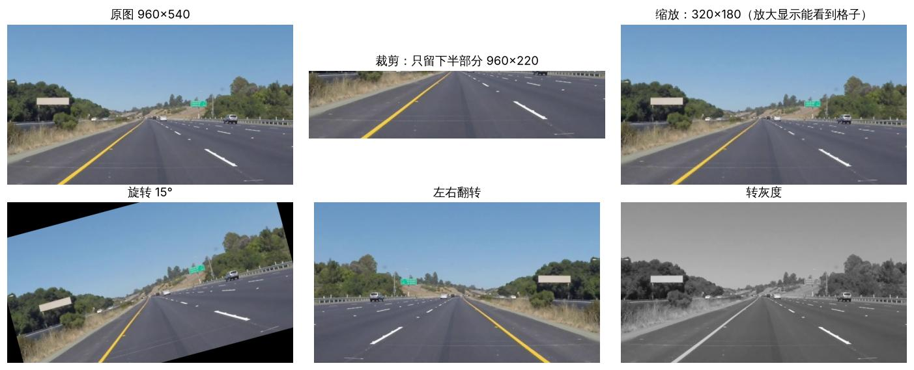
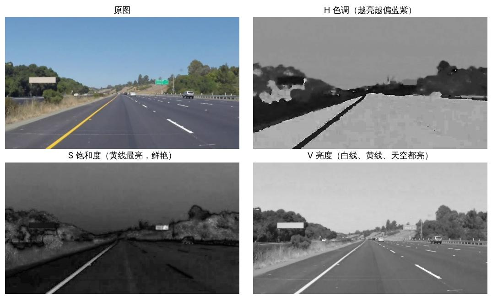
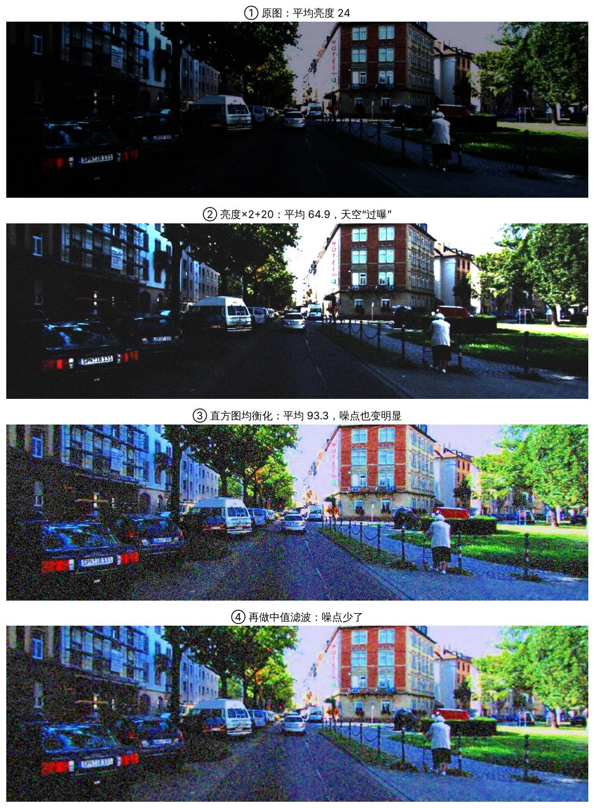
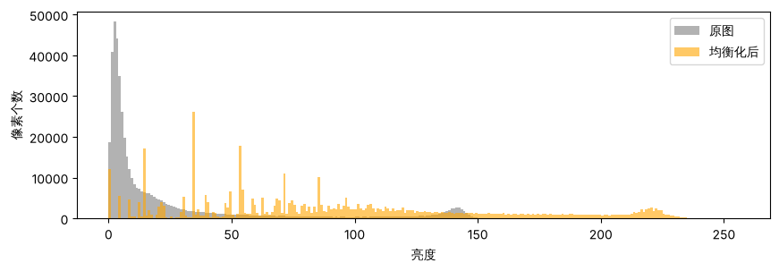
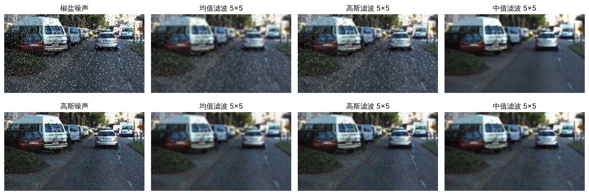
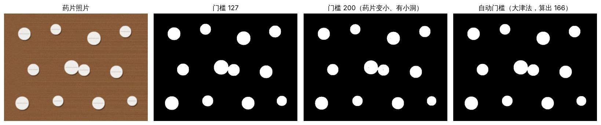
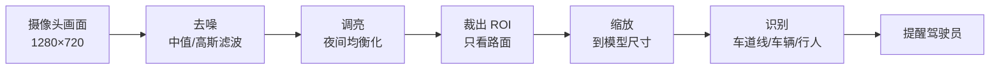
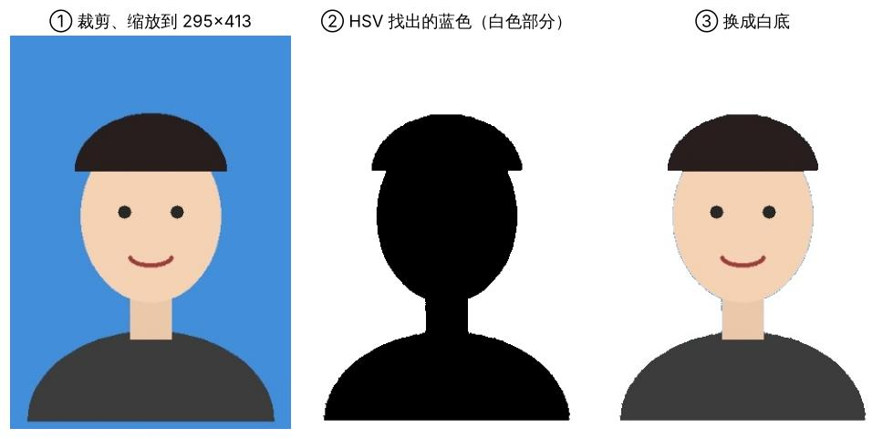
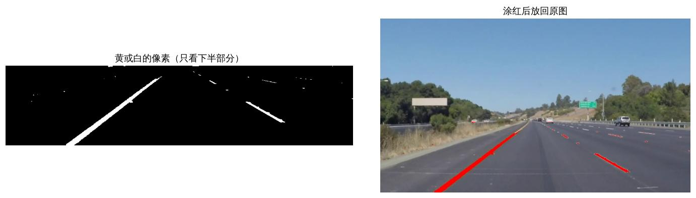
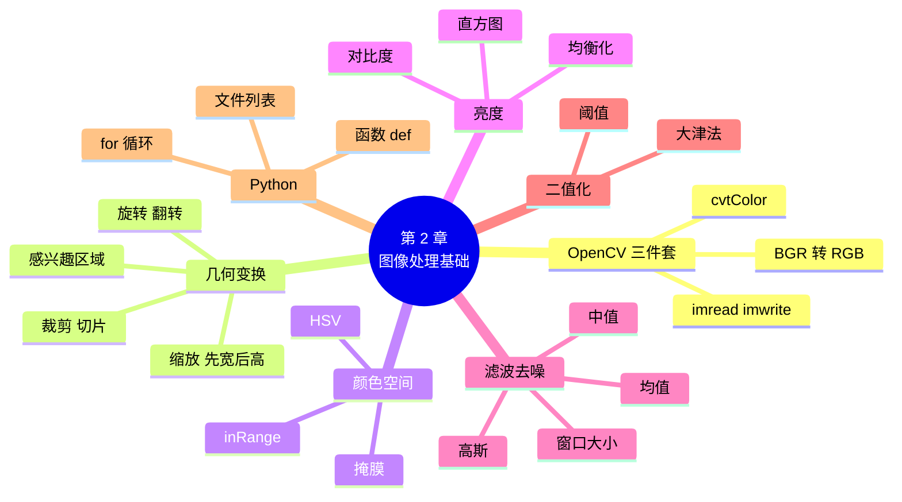

# 第 2 章 图像处理基础：用 OpenCV 修图

!!! abstract "本章学时"
    理论 4 学时（线上 3 + 线下 1）· 实验 4 学时（本章共 4 个实验，★ 必做 3 个）

## 学习目标

学完本章，你应该能够：

1. **说出** HSV 三个分量的含义，以及均值、高斯、中值三种滤波各自的做法（记忆）；
2. **解释**直方图怎样反映一张图偏亮还是偏暗，直方图均衡化为什么能让夜间画面看得清（理解）；
3. **运行并修改**给定代码，用 OpenCV 完成裁剪、缩放、调亮、去噪、按颜色选像素和二值化（应用）；
4. **比较**同一张噪声图在不同滤波方法和窗口大小下的效果，说出“去噪”和“保细节”怎样取舍（分析）；
5. **判断**用颜色找车道线这种方法在什么情况下会失效（评价）。

!!! info "先修要求"
    学习本章前，你需要掌握：

    - [1.3 图片在计算机里的样子](../01-intro/index.md#13)：像素、通道、形状 `(高, 宽, 通道)`、坐标从左上角算起；
    - 实验 1-1、1-2：会在 Notebook 里运行代码，会用 `img[行, 列]` 取像素；
    - 附录 A 中的变量、`print`、`import`。本章的“Python 小课堂②”会讲函数和 `for` 循环。

??? abstract "本章概念清单（18 个，点击查看定义和例子）"
    1. [图像处理](../../appendix/glossary.md#g-图像处理)
    2. [感兴趣区域](../../appendix/glossary.md#g-感兴趣区域)
    3. [插值](../../appendix/glossary.md#g-插值)
    4. [颜色空间](../../appendix/glossary.md#g-颜色空间)
    5. [HSV](../../appendix/glossary.md#g-HSV)
    6. [掩膜](../../appendix/glossary.md#g-掩膜)
    7. [对比度](../../appendix/glossary.md#g-对比度)
    8. [直方图](../../appendix/glossary.md#g-直方图)
    9. [直方图均衡化](../../appendix/glossary.md#g-直方图均衡化)
    10. [噪声](../../appendix/glossary.md#g-噪声)
    11. [滤波](../../appendix/glossary.md#g-滤波)
    12. [中值滤波](../../appendix/glossary.md#g-中值滤波)
    13. [高斯滤波](../../appendix/glossary.md#g-高斯滤波)
    14. [阈值](../../appendix/glossary.md#g-阈值)
    15. [二值化](../../appendix/glossary.md#g-二值化)
    16. [图像预处理](../../appendix/glossary.md#g-图像预处理)
    17. [函数](../../appendix/glossary.md#g-函数)
    18. [循环](../../appendix/glossary.md#g-循环)

## 情景导入

小林报名了这门课，第一件事是交一张白底一寸证件照。翻遍手机，只有一张去年办社保卡时拍的蓝底照片。照相馆说换底色要 20 元，小林想：“上一章说图片就是一张数字表，那把蓝色的数字改成白色的，不就换好了？”

同一周，车队的老王给小林看了一段夜里的行车记录：画面黑乎乎的，只能看到几盏车灯。“晚上出了个小剐蹭，想看看当时旁边是什么车，根本看不清。”

小林想：能不能把画面“调亮”？调亮之后满屏雪花点又怎么办？还有，上一章说辅助驾驶要找车道线，车道线不是白的就是黄的，能不能直接按颜色把它们挑出来？

这些都是[**图像处理**](../../appendix/glossary.md#g-图像处理 "对图片做裁剪、缩放、调色、去噪等加工，输出仍是一张图片"){ .term }要解决的问题。这一章，我们用 OpenCV 当“修图工具”，一个一个地把它们解决掉。

## 2.1 OpenCV 入门：读、显示、保存 { #21 }

### 2.1.1 修图的工具箱 { #211 }

**图像处理**（Image Processing）就是对图片做加工：裁剪、缩放、调色、去噪……输入是一张图，输出还是一张图。它和后面几章的“识别”不一样：识别要回答“图里有什么”，图像处理只负责把图改得更合适。

| | 图像处理 | 图像识别（第 4～7 章） |
|---|---|---|
| 输入 | 一张图 | 一张图 |
| 输出 | 一张改过的图 | 类别、框、轮廓等“答案” |
| 例子 | 调亮、去噪、换底色 | 认出这是轿车、找出行人在哪 |
| 常用工具 | OpenCV | YOLO 等深度学习模型 |

在辅助驾驶里，图像处理常常是识别的“前一步”：先把画面调亮、去掉噪点、裁出路面，再交给模型去认。

上一章已经见过 OpenCV：它是一个开源的视觉工具箱，2000 年由英特尔发起，现在有两千五百多个函数，手机、汽车、工厂的视觉程序里都有它的身影。<sup class="cite">[[1]](#ref2-1)</sup> 在 Python 里，它的名字是 `cv2`。

### 2.1.2 读、显示、保存三件套 { #212 }

几乎每个图像处理程序都是“读进来 → 改一改 → 存出去”三步：

```python
import cv2
import matplotlib.pyplot as plt

img = cv2.imread("../data/images/drive_city.jpg")      # 读：得到一张数字表
small = cv2.resize(img, (621, 188))                    # 改：缩小一半（这一步换成任何处理都行）
cv2.imwrite("small.jpg", small)                        # 存：写成图片文件

plt.imshow(cv2.cvtColor(small, cv2.COLOR_BGR2RGB))     # 显示：Notebook 里用 Matplotlib
plt.axis("off"); plt.show()
```

| 函数 | 作用 | 要注意的地方 |
|---|---|---|
| `cv2.imread(路径)` | 读图片，得到形状为 `(高, 宽, 3)` 的数字表 | 路径错了**不报错**，只返回 `None` |
| `cv2.imwrite(路径, 图)` | 把数字表存成图片，扩展名决定格式 | `.jpg` 体积小但会损失一点细节，`.png` 不损失 |
| `plt.imshow(图)` | 在 Notebook 里显示 | 要先把 BGR 转成 RGB |
| `cv2.imshow(窗口名, 图)` | 弹出一个窗口显示 | 只能在本机用，云端 Notebook 里不能用 |

### 2.1.3 BGR 和 RGB：最常见的“坑” { #213 }

第 1 章说过，OpenCV 读进来的图片按**蓝、绿、红**的顺序存放，而 Matplotlib、手机、网页都按**红、绿、蓝**理解颜色。如果直接把 OpenCV 的图交给 Matplotlib 显示，红和蓝就会互换：黄色车道线变成青色，人脸变成蓝紫色。

记住一条规则就够了：**OpenCV 进、OpenCV 出，不用转；要交给别的工具（显示、交给某些模型），先转成 RGB**。

```python
rgb = cv2.cvtColor(img, cv2.COLOR_BGR2RGB)    # cvt = convert（转换），BGR 转 RGB
```

`cv2.cvtColor` 是本章最常用的函数之一，换颜色空间都靠它：`COLOR_BGR2GRAY`（转灰度）、`COLOR_BGR2HSV`（转 HSV）……名字都是“从什么 2（to）什么”。

## 2.2 几何变换：裁剪、缩放、旋转、翻转 { #22 }

几何变换只改变像素的**位置和数量**，不改变颜色。图 2-1 把常见的几种放在一起：



*图 2-1　几何变换与灰度转换（编者用实验 2-3 的车道照片实际运行，照片来自 Udacity 公开项目，MIT 许可）*

### 2.2.1 裁剪：取表格的一块 { #221 }

图片是一张数字表，裁剪就是“取表格的一块”，用的是第 1 章学过的切片写法：

```python
crop = img[行起点:行终点, 列起点:列终点]
```

例如 `img[270:, :]` 表示“从第 270 行到最后一行，所有列”，也就是画面的下半部分；`img[:, 100:400]` 表示“所有行，第 100 到 399 列”。冒号前后不写，就表示“从头”或“到尾”。

!!! example "算一算：裁成一寸照的比例"
    一寸证件照的尺寸是宽 25 毫米、高 35 毫米，宽 : 高 = 25 : 35。手上的照片宽 360、高 480 像素，宽高比 360 ÷ 480 = 0.75，比一寸照（25 ÷ 35 ≈ 0.714）“胖”了一点，要切掉左右两边。

    高不变，新的宽 = 480 × 25 ÷ 35 ≈ 342.9，取整为 342 像素。要切掉 360 − 342 = 18 列，左右各切 9 列，人像保持居中：`img[:, 9:351]`。

    实验 2-1 第 2 步输出“裁剪后：(480, 342, 3)”，与此一致。

### 2.2.2 缩放：先宽后高 { #222 }

```python
small = cv2.resize(img, (宽, 高))
```

`cv2.resize` 有一个和切片**相反**的地方：切片和 `shape` 都是“先行（高）后列（宽）”，而 `resize` 的尺寸是**先宽后高**。把 `(295, 413)` 写成 `(413, 295)`，证件照就变成了“横着的”。

缩小的时候，几个像素要合并成一个；放大的时候，要凭空“造”出新像素。根据周围已有像素估算新像素的方法叫[**插值**](../../appendix/glossary.md#g-插值 "缩放图片时，根据周围已有像素估算新像素值的方法"){ .term }（Interpolation）。OpenCV 默认用“双线性插值”（取周围 4 个像素按距离加权平均），放大后边缘比较平滑；如果用“最近邻插值”（直接照抄最近的一个像素），放大后能看到一个个方格，图 2-1 中的“缩放”就是这样显示的。

!!! tip "缩放会丢掉细节"
    把 960×540 的画面缩成 320×180，像素数只剩九分之一。远处的小车可能只剩几个像素，模型就认不出来了。辅助驾驶要看清远处的车，所以不能把画面缩得太小，这也是后面各章模型输入尺寸常用 640 的原因之一。

### 2.2.3 旋转与翻转 { #223 }

```python
flip = cv2.flip(img, 1)                               # 1 左右翻转，0 上下翻转，-1 上下左右都翻
rot90 = cv2.rotate(img, cv2.ROTATE_90_CLOCKWISE)      # 顺时针转 90 度
```

手机竖着拍的照片，有时读进来是“躺着的”，用 `cv2.rotate` 转正就行。旋转任意角度要先算一个“旋转矩阵”，写法稍复杂，用到时查附录 B 即可。

翻转在训练模型时很有用：把一张“车在左边”的照片左右翻转，就多了一张“车在右边”的照片，相当于免费多了一份训练数据。这叫“数据增强”，第 4 章会再讲。

### 2.2.4 感兴趣区域：只看有用的那一块 { #224 }

找车道线的时候，天空、树木、广告牌都没有用，还会捣乱（白色的云、黄色的广告牌会被误认成车道线）。车道线只会出现在画面下半部分的路面上，所以先把下半部分裁出来再处理。

这块“只处理这里，其余不管”的区域叫[**感兴趣区域**](../../appendix/glossary.md#g-感兴趣区域 "只对图片中有用的一块区域做处理，其余部分不管"){ .term }（Region of Interest，ROI）。裁出 ROI 有两个好处：一是排除干扰，二是像素少了，处理更快。实验 2-3 用的 ROI 是“画面中线往下 50 行，一直到底”：

```python
h, w = img.shape[:2]          # shape 的前两个数：高、宽
roi = img[h // 2 + 50:, :]    # // 是整除：540 // 2 = 270，再加 50 就是从第 320 行开始
```

第 3 章会把 ROI 从“长方形”升级成更贴合路面的“梯形”。

## 2.3 颜色空间：换一种方式描述颜色 { #23 }

### 2.3.1 为什么 RGB 不好找颜色 { #231 }

假设要找出画面里的黄色车道线。黄色的 RGB 大约是（红 220，绿 190，蓝 40）。但车道线有的在阳光下，有的在树荫里，阴影里的黄色可能变成（红 110，绿 95，蓝 20）——三个数都变了。用 RGB 写“什么是黄色”，要同时规定三个数的范围，而且光线一变，三个数一起变，很难写准。

人描述颜色的方式不是“红多少、绿多少、蓝多少”，而是“什么颜色、鲜不鲜艳、亮不亮”。按这种方式描述颜色的方法，就是 [**HSV**](../../appendix/glossary.md#g-HSV "用色调、饱和度、亮度三个数描述颜色的方法，更接近人说颜色的方式；OpenCV 中 H 取 0～180"){ .term }。

一套用几个数描述颜色的方法叫[**颜色空间**](../../appendix/glossary.md#g-颜色空间 "用几个数描述颜色的一套方法，常见的有 RGB、灰度、HSV"){ .term }（Color Space）。RGB、灰度、HSV 都是颜色空间，同一个像素在不同颜色空间里只是“换了一种说法”。

### 2.3.2 HSV：色调、饱和度、亮度 { #232 }

| 分量 | 英文 | 意思 | OpenCV 中的范围 | 生活中的说法 |
|---|---|---|---|---|
| H 色调 | Hue | 是什么颜色 | 0～180 | 红、橙、黄、绿、青、蓝、紫 |
| S 饱和度 | Saturation | 颜色鲜不鲜艳 | 0～255 | 0 是灰白黑，越大越“艳” |
| V 亮度 | Value | 亮不亮 | 0～255 | 0 是黑，越大越亮 |

色调可以想象成一个色环：红 → 黄 → 绿 → 青 → 蓝 → 紫 → 又回到红，一圈 360°。OpenCV 的 8 位图片每个数最大只能存 255，存不下 360，就把角度**除以 2**，所以 H 的范围是 0～180。常用颜色的 H 大致是：

| 颜色 | 红 | 橙 | 黄 | 绿 | 青 | 蓝 | 紫 |
|---|---|---|---|---|---|---|---|
| H（OpenCV） | 0～10 和 170～180 | 10～20 | 20～35 | 35～80 | 80～100 | 100～130 | 130～170 |

!!! example "算一算：白色和黄色有什么不同"
    白色车道线：RGB 约（230, 230, 230），三个数差不多，所以**饱和度很低**（接近 0），亮度很高（约 230），色调没有意义。

    黄色车道线：RGB 约（220, 190, 40），红绿大、蓝小，**饱和度高**（S = 255 ×（220 − 40）÷ 220 ≈ 209），色调 H 约为 25。

    所以找白色看“S 小、V 大”，找黄色看“H 在 15～35、S 比较大”。这正是实验 2-3 用的门槛。

图 2-2 把车道照片拆成 H、S、V 三张灰度图。可以看到：黄线在 S 图里最亮（最鲜艳），白线、黄线和天空在 V 图里都很亮。单看亮度分不出车道线和天空，加上饱和度和 ROI 就能分开了。



*图 2-2　HSV 三个分量（编者用 OpenCV 实际转换，H 乘以 1.4 后显示）*

### 2.3.3 按颜色选像素：inRange 与掩膜 { #233 }

OpenCV 用 `cv2.inRange` 按范围选像素：

```python
hsv = cv2.cvtColor(img, cv2.COLOR_BGR2HSV)                     # 先转到 HSV
mask = cv2.inRange(hsv, (15, 80, 120), (35, 255, 255))         # 下限 (H, S, V)，上限 (H, S, V)
```

H、S、V 三个数**都在**范围内的像素记为 255（白），否则记为 0（黑）。得到的这张和原图一样大的黑白图叫[**掩膜**](../../appendix/glossary.md#g-掩膜 "和原图一样大的黑白图，白色（255）表示选中的像素，黑色（0）表示没选中"){ .term }（Mask），白色表示“选中了”。“掩膜”这个词来自印刷和喷漆：把一张镂空的板子盖在纸上，只有镂空的地方能喷上颜色。

有了掩膜，就能“只改选中的像素”：

```python
img[mask == 255] = (255, 255, 255)     # 掩膜是白色的地方，颜色改成白色
```

这一行就是证件照换底色的核心（实验 2-1）。`mask == 255` 会得到一张“是 / 否”表，`img[是否表]` 就选出了所有“是”的像素。

<iframe class="sim-frame" src="../../sims/hsv-picker/main.html" height="640" loading="lazy" title="HSV 调色板"></iframe>

动画：HSV 调色板。拖动三组滑块，看哪些像素被选中；在左图上点一下，可以读出那个点的 H、S、V。试试换成“夜间”画面，原来的门槛还管用吗？
{ .sim-caption }

## 2.4 亮度、对比度与直方图 { #24 }

### 2.4.1 调亮度和对比度 { #241 }

调亮一张图，最简单的想法是：每个像素都乘一个数、再加一个数。

```python
bright = cv2.convertScaleAbs(img, alpha=2.0, beta=20)    # 新值 = 原值 × alpha + beta
```

- `beta` 管**亮度**：每个像素都加 20，整张图变亮；
- `alpha` 管[**对比度**](../../appendix/glossary.md#g-对比度 "图片中亮的地方和暗的地方相差多少，相差越大越“鲜明”"){ .term }：亮的和暗的差距被放大 2 倍，图片更“鲜明”。

**对比度**（Contrast）就是亮的地方和暗的地方相差多少。雾天的照片对比度低，看起来发灰；正午阳光下对比度高，黑白分明。

!!! example "算一算：调亮后会“过曝”"
    按 `alpha=2.0, beta=20` 调整：

    - 原来亮度 30 的像素 → 30 × 2 + 20 = 80，暗处变亮了，好；
    - 原来亮度 140 的像素 → 140 × 2 + 20 = 300，超过了 255，只能存成 255。

    凡是原值大于 (255 − 20) ÷ 2 = 117.5 的像素，调完都变成了 255（纯白），它们原来的明暗差别全丢了，这叫“过曝”。实验 2-2 第 2 步输出“变成 255 的像素占 5.8%”，这些就是夜间画面里的天空和灯光。

问题在于：同样的 `alpha` 和 `beta` 对整张图一视同仁，暗的地方提不够，亮的地方又过曝了。要“暗的多提、亮的少提”，就需要先看清一张图的亮度是怎么分布的。

### 2.4.2 直方图：一张图的“亮度体检单” { #242 }

[**直方图**](../../appendix/glossary.md#g-直方图 "统计图片中每个亮度值各有多少个像素的柱状图，用来判断图片偏亮还是偏暗"){ .term }（Histogram）统计的是：亮度为 0 的像素有几个、亮度为 1 的有几个……亮度为 255 的有几个，画成 256 根柱子。横轴是亮度，纵轴是像素个数。

看直方图，一眼就能判断一张图的“体质”：

| 直方图的样子 | 说明 | 典型场景 |
|---|---|---|
| 柱子挤在左边 | 整体偏暗 | 夜间、隧道里 |
| 柱子挤在右边 | 整体偏亮 | 逆光、过曝 |
| 柱子挤在中间一小段 | 对比度低，发灰 | 雾天、隔着脏玻璃 |
| 柱子铺满 0～255 | 亮暗分明 | 晴天正常曝光 |

实验 2-2 的夜间画面平均亮度只有 24.0，85.1% 的像素亮度低于 50，直方图（图 2-4 中的灰色）几乎全挤在最左边。

### 2.4.3 直方图均衡化：把挤在一起的亮度拉开 { #243 }

既然柱子都挤在左边，那就把它们“拉开”，铺满 0～255。这种方法叫[**直方图均衡化**](../../appendix/glossary.md#g-直方图均衡化 "把挤在一起的亮度值拉开、铺满 0～255 的方法，能让偏暗或发灰的图片看得更清"){ .term }（Histogram Equalization）。

打个比方：一个班 40 个人的考试成绩全挤在 50～60 分，老师想区分出好坏，就按名次重新打分：第 1 名 100 分、最后一名 0 分，中间的按名次均匀排开。原来只差 1 分的两个人，现在可能差了 10 分，差别被“放大”了；但名次（谁比谁亮）没有变。直方图均衡化就是按“亮度名次”重新给每个像素打分。

```python
gray_eq = cv2.equalizeHist(gray)         # 只能处理单通道（灰度）图
```

彩色图怎么办？不要分别均衡红、绿、蓝三个通道（颜色会变怪），而是转到 HSV，**只均衡亮度 V**，色调和饱和度不动：

```python
hsv = cv2.cvtColor(img, cv2.COLOR_BGR2HSV)
hsv[:, :, 2] = cv2.equalizeHist(hsv[:, :, 2])   # [:, :, 2] 表示所有行、所有列的第 2 号通道，也就是 V
equal = cv2.cvtColor(hsv, cv2.COLOR_HSV2BGR)    # 再转回 BGR
```



*图 2-3　夜间画面的三种处理（编者运行实验 2-2 的结果；原图由 KITTI 照片压暗、加噪声得到）*



*图 2-4　均衡化前后的直方图：灰色挤在左边，橙色被拉开铺满（实验 2-2 第 5 步输出）*

对比图 2-3 的②和③：直接调亮让天空“过曝”成一片白，左边的暗处却还是黑的；均衡化后平均亮度从 24.0 升到 93.3，左边停着的车、右边的老人和栏杆都看清了，天空也没有全白。

但均衡化也有副作用：它把原来藏在暗处的**噪点**也一起放大了，画面上满是彩色颗粒。这就要靠下一节的滤波来解决。

!!! info "进阶：自适应均衡化 CLAHE"
    普通均衡化对整张图用一套“打分规则”。OpenCV 还有一种 CLAHE（限制对比度的自适应直方图均衡化），把图分成很多小块分别均衡，并限制放大的幅度，噪点放大得少一些，在医学影像和夜间画面中很常用。用法见实验 2-2 的“挑战”。

## 2.5 滤波去噪 { #25 }

### 2.5.1 噪声从哪里来 { #251 }

[**噪声**](../../appendix/glossary.md#g-噪声 "图片中不属于真实画面、随机出现的亮点、暗点或颗粒"){ .term }（Noise）是图片中不属于真实画面、随机出现的亮点、暗点或颗粒。光线越暗，相机越要“使劲放大”信号，噪声就越明显，所以夜里拍的照片总是一片颗粒。常见的两种：

- **椒盐噪声**：随机出现的纯黑、纯白小点，像撒了一把胡椒和盐。传输出错、传感器坏点会产生它；
- **高斯噪声**：每个像素都有一点随机的偏差，看起来像一层细细的颗粒。夜间拍摄的噪声主要是这种。

### 2.5.2 滤波：用邻居的值替换自己 { #252 }

去噪的思路很朴素：噪点是“孤立”的，它和周围的邻居都不一样。那就**用周围邻居的值来重新算自己**。具体做法是：拿一个小窗口（比如 3×3）罩在每个像素上，用窗口里 9 个像素算出一个新值，替换中间那个像素；然后窗口挪到下一个像素，再算一遍……直到走遍整张图。这种做法叫[**滤波**](../../appendix/glossary.md#g-滤波 "用每个像素周围一小块（窗口）里的像素重新算出它的值，常用来去噪或模糊"){ .term }（Filtering）。

按“怎么算新值”，有三种常用滤波：

| 滤波 | 怎么算 | OpenCV 写法 | 特点 |
|---|---|---|---|
| 均值滤波 | 窗口里所有像素取平均 | `cv2.blur(img, (5, 5))` | 简单；会把边缘也抹模糊 |
| [**高斯滤波**](../../appendix/glossary.md#g-高斯滤波 "按“离中心越近权重越大”给窗口里的像素加权平均的滤波方法"){ .term } | 加权平均，离中心越近权重越大 | `cv2.GaussianBlur(img, (5, 5), 0)` | 比均值自然，最常用；常用在找边缘之前 |
| [**中值滤波**](../../appendix/glossary.md#g-中值滤波 "把窗口里的像素值从小到大排好，取正中间那个作为新值的滤波方法，特别适合去除椒盐噪声"){ .term } | 窗口里的数从小到大排好，取正中间那个 | `cv2.medianBlur(img, 5)` | 去椒盐噪声效果最好，边缘保持得较好 |

!!! example "算一算：均值和中值，谁能去掉噪点"
    下面是一块 3×3 的灰度值，中间本来应该是 65 左右，右下角混进了一个白色噪点 255：

    | | | |
    |---|---|---|
    | 64 | 63 | 60 |
    | 65 | **65** | 61 |
    | 69 | 70 | 255 |

    - 均值：(64 + 63 + 60 + 65 + 65 + 61 + 69 + 70 + 255) ÷ 9 = 772 ÷ 9 ≈ 85.8。被噪点“拉高”了 20 多，噪点的影响扩散到了邻居身上；
    - 中值：排好是 60, 61, 63, 64, 65, 65, 69, 70, 255，正中间（第 5 个）是 **65**。噪点 255 排在最后，根本没机会被选中。

    这就是中值滤波对付椒盐噪声特别好的原因。下面的“滤波器对比”动画里点一个噪点，可以看到同样的计算。

图 2-5 对比了两种噪声下三种滤波的效果。椒盐噪声：中值滤波几乎完全去干净，均值和高斯只是把噪点“摊开”成了灰斑。高斯噪声：三种都能减轻，但也都让车牌、车道线变模糊了。



*图 2-5　三种滤波对比（窗口 5×5，编者用 OpenCV 实际运行；照片裁自 KITTI 数据集）*

### 2.5.3 窗口大小：去噪和保细节的取舍 { #253 }

窗口越大，参与“投票”的邻居越多，去噪越彻底，但图片也越模糊，车牌上的字、远处的车道线都会被抹掉。窗口大小一般用 3 或 5，**必须是奇数**（这样才有“正中间”那个像素）。

| 窗口 | 去噪 | 细节 | 适合 |
|---|---|---|---|
| 3×3 | 轻微 | 保留得好 | 噪声不重，后面还要看细节 |
| 5×5 | 明显 | 有点模糊 | 最常用的折中 |
| 7×7 及以上 | 很强 | 很模糊 | 只关心大块区域，不关心细节 |

实验 2-2 对均衡化后的夜间画面用 3×3 中值滤波，路面一块区域的“毛糙程度”（标准差）从 27.0 降到 16.2，车辆的轮廓基本保住了。

<iframe class="sim-frame" src="../../sims/filter-compare/main.html" height="640" loading="lazy" title="滤波器对比"></iframe>

动画：滤波器对比。换不同的噪声、滤波方法和窗口大小，看效果；点一个像素，看它的 3×3 邻居怎样算出新值。
{ .sim-caption }

!!! tip "滤波和卷积"
    均值滤波、高斯滤波都是“窗口里的数乘一组权重再加起来”，这个计算叫**卷积**，那组权重叫“卷积核”。下一章会看到：换一组权重，同样的计算就能找出边缘；而卷积神经网络，就是让模型自己学出成百上千组权重。

## 2.6 阈值与二值化 { #26 }

### 2.6.1 把图片变成黑白两色 { #261 }

很多任务只关心“是不是”：这个像素是药片还是桌面？是车道线还是路面？这时可以定一个[**阈值**](../../appendix/glossary.md#g-阈值 "用来划分两类像素的分界值（门槛）"){ .term }（Threshold），也就是门槛：灰度大于门槛的算白（255），否则算黑（0）。把图片变成只有黑白两种值的过程叫[**二值化**](../../appendix/glossary.md#g-二值化 "按阈值把图片变成只有黑（0）、白（255）两种值的图片"){ .term }（Binarization）。

```python
gray = cv2.cvtColor(img, cv2.COLOR_BGR2GRAY)
t, binary = cv2.threshold(gray, 127, 255, cv2.THRESH_BINARY)   # 大于 127 的变 255，其余变 0
```

`cv2.threshold` 返回两个东西：用的门槛 `t` 和二值图 `binary`。上一节的 `inRange` 也是一种二值化，只不过它有上下两个门槛，还能同时看三个通道。

### 2.6.2 门槛怎么定 { #262 }

门槛定得不对，结果就不对。图 2-6 用一张药片照片做了对比：门槛 127 时药片完整；门槛 200 时，药片边缘偏暗的部分被当成了桌面，药片变小，中间的刻痕也成了小洞。



*图 2-6　门槛不同，结果不同（药片照片是编者用程序画的，用于第 3 章数药片实验）*

不想自己试门槛，可以让 OpenCV 自动算。最常用的是**大津法**（Otsu，1979 年由日本学者大津展之提出）：它把所有可能的门槛都试一遍，找出让“黑的一类内部尽量像、白的一类内部尽量像”的那个。<sup class="cite">[[4]](#ref2-4)</sup>

```python
t, binary = cv2.threshold(gray, 0, 255, cv2.THRESH_BINARY + cv2.THRESH_OTSU)   # 门槛写 0，让它自己算
print(t)        # 药片照片算出 166
```

大津法适合“前景和背景亮度差别明显”的图，比如白药片放在深色桌面上。光照不均匀的图（一半在阴影里），一个门槛管不了全图，可以用“自适应阈值”（`cv2.adaptiveThreshold`），每一小块单独定门槛，用法见附录 B。

二值化之后，就能数出有几块白色区域、量出每块有多大，这是下一章“数药片”的第一步。

## 2.7 预处理在视觉任务中的作用 { #27 }

在把图片交给模型或算法之前做的准备工作，统称[**图像预处理**](../../appendix/glossary.md#g-图像预处理 "在把图片交给模型或算法之前，统一尺寸、调整亮度、去噪等准备工作"){ .term }（Image Preprocessing）。本章学的裁剪、缩放、调色、去噪，都是常用的预处理。

为什么要预处理？主要有三个原因：

1. **模型要求固定的输入**。神经网络像一台“定尺寸的模具”，只接受固定大小的图片。YOLO 默认把图片缩放到 640 像素宽（不够的地方补灰边），分类模型常用 224×224。像素值还要从 0～255 除以 255 变成 0～1。好在 Ultralytics 会自动完成这些，我们直接给照片就行；
2. **让关键信息更明显**。夜间画面先均衡化，模型才“看得见”暗处的行人；
3. **去掉干扰、减少计算**。裁出 ROI，天空和树木就不会捣乱，要处理的像素也少了。

以辅助驾驶为例，一帧画面从摄像头到“提醒驾驶员”，前面往往有这样一串预处理：



!!! warning "预处理不是越多越好"
    每做一步预处理都要花时间，还可能丢信息（缩小丢细节、滤波变模糊）。辅助驾驶每秒要处理 25～30 帧画面，每一步都要“值得”。白天光线好时就不必均衡化，这也是为什么实际产品会根据环境亮度自动切换处理方式。

## 2.8 Python 小课堂②：函数、循环和文件列表 { #28 }

实验 2-4 要把一个文件夹里的所有照片都处理一遍。如果有 100 张照片，总不能把代码复制 100 遍。这时需要三样新东西。

**1. 函数：把一段代码打包起来**

[**函数**](../../appendix/glossary.md#g-函数 "把一段做好某件事的代码打包起来、起个名字，以后用名字就能反复调用"){ .term }（Function）就是给一段代码起个名字，以后用名字就能反复调用。前面用的 `cv2.resize`、`print` 都是别人写好的函数，我们也可以自己写：

```python
def make_small(img, width=640):          # def 定义函数：名字 make_small，两个参数
    h, w = img.shape[:2]
    new_h = int(h * width / w)           # 按比例算出新的高
    return cv2.resize(img, (width, new_h))   # return 把结果交回去

small = make_small(img)                  # 调用：width 不写就用默认值 640
smaller = make_small(img, width=320)     # 也可以指定参数
```

要点：`def` 那一行末尾有**冒号**，函数里面的代码要**缩进 4 个空格**；`width=640` 是参数的默认值，调用时不写就用它。

**2. for 循环：对一组东西逐个做同样的事**

[**循环**](../../appendix/glossary.md#g-循环 "让一段代码对一组东西逐个重复执行的写法，Python 中常用 for"){ .term }（Loop）让一段代码重复执行。`for` 循环最常用：

```python
for name in ["drive_city.jpg", "lane_white.jpg", "lane_yellow.jpg"]:
    img = cv2.imread("../data/images/" + name)
    print(name, img.shape)               # 这两行缩进了，每张图都会执行一次
print("全部完成")                         # 没缩进，循环结束后只执行一次
```

`for name in 一组东西:` 的意思是“把这组东西一个一个拿出来，每次叫它 `name`，执行一遍下面缩进的代码”。方括号 `[…]` 写的是一个**列表**，就是“一组东西”。

**3. 文件列表：找出文件夹里的所有图片**

手写文件名太麻烦，可以让 Python 自己找：

```python
from pathlib import Path
files = sorted(Path("../data/images").glob("*.jpg"))   # 找出所有 .jpg，按名字排好
for f in files:
    print(f.name)                                      # f.name 是文件名，str(f) 是完整路径
```

`*.jpg` 中的星号表示“任意文字”，所以 `*.jpg` 匹配所有以 `.jpg` 结尾的文件。

把三样东西组合起来，就是一个批量处理程序：**找出所有文件 → 用 for 逐个拿出来 → 交给函数处理 → 存出去**。实验 2-4 就是这样写的。

!!! tip "缩进是 Python 的“括号”"
    Python 用缩进表示“哪些代码属于这个函数 / 这个循环”。同一层的代码缩进必须一样多（通常 4 个空格），不要空格和 Tab 混用。缩进错了会报 `IndentationError`。

## 2.9 本章常见报错对照 { #29 }

| 报错原文（最后一行） | 用大白话说 | 怎么改 |
|---|---|---|
| `error: (-215:Assertion failed) !_src.empty() in function 'cvtColor'` | 交给 `cvtColor` 的图是空的，通常是前面 `imread` 没读到图 | 检查路径；在 `imread` 后加 `print(img.shape)` 确认 |
| `error: (-215:Assertion failed) … in function 'medianBlur'` 或 `ksize.width > 0 && ksize.width % 2 == 1` | 滤波窗口不是正奇数 | 窗口改成 3、5、7 这样的奇数 |
| `TypeError: … 'float' object cannot be interpreted as an integer` | `resize` 的宽高写成了小数 | 用 `int(…)` 取整，或用 `//` 整除 |
| `error: … in function 'equalizeHist'` | 均衡化只能处理单通道图，给了彩色图 | 先转灰度，或只取 HSV 的 V 通道 |
| `IndentationError: expected an indented block` | 函数或循环下面的代码没缩进 | 冒号下一行开始缩进 4 个空格 |
| 证件照变成了“横着的” | `resize` 的宽高写反了 | `resize` 是先宽后高：`(295, 413)` |
| 显示出来颜色怪（黄变青、肤色变蓝） | 没把 BGR 转成 RGB 就交给 Matplotlib | 显示前加 `cv2.cvtColor(img, cv2.COLOR_BGR2RGB)` |
| 图上的中文显示成方块 | Matplotlib 没有中文字体 | 代码开头加 `plt.rcParams["font.sans-serif"] = ["SimHei"]`（Windows）等，见实验 2-2 |

## 2.10 前沿视窗：手机里的“计算摄影” { #210 }

你可能发现，现在的手机夜景模式拍出来的照片几乎没有噪点，比本章“均衡化 + 去噪”的效果好得多。它是怎么做到的？

秘密在于**连拍多张再合成**。按下快门的一两秒里，手机其实拍了十几张照片，然后对齐、合并：真实的画面每张都一样，噪声每张都不同，把十几张平均一下，噪声就互相抵消了。谷歌 2019 年公开的“夜视”（Night Sight）技术，就是在拍摄时快速连拍最多 15 帧，再对齐合并、自动调色。<sup class="cite">[[5]](#ref2-5)</sup> 国内手机厂商的夜景模式也是类似的思路，再加上深度学习模型去噪和调色。

这类“用计算弥补镜头和传感器不足”的技术叫**计算摄影**。它的基础正是本章学的这些操作：对齐（几何变换）、合并（平均滤波的“时间版”）、调亮（直方图和对比度）、去噪（滤波）。只不过，手机把它们做得又快又精细，有的环节交给了训练好的神经网络。

车载摄像头也在用类似技术：高动态范围（HDR）摄像头同时拍长、短两次曝光，出隧道时既能看清隧道里的暗处，又不会被洞口的强光照成一片白。

## 本章实验

!!! abstract "实验总览"
    | 实验 | 类型 | 建议时长 | 内容 |
    |---|---|---|---|
    | 实验 2-1 | ★ 必做 | 45 分钟 | 证件照小工具：裁剪、缩放、换底色 |
    | 实验 2-2 | ★ 必做 | 45 分钟 | 让夜间行车画面看得清 |
    | 实验 2-3 | ★ 必做 | 45 分钟 | 用颜色找车道线 |
    | 实验 2-4 | ☆ 选做 | 45 分钟 | 批量处理一个文件夹的照片 |

    代码见配套资源 `labs/ch02/` 目录，每个实验都有 `.py` 和 `.ipynb` 两种文件，内容相同。所有实验都在 `labs/ch02/` 文件夹里运行，只用 OpenCV，CPU 上几秒钟就能跑完。

### 实验 2-1 ★ 证件照小工具 { #2-1 }

**实验目的**

1. 用切片裁剪、用 `cv2.resize` 缩放，把照片做成一寸照的比例和尺寸；
2. 用 HSV 和 `cv2.inRange` 找出蓝色背景，得到掩膜；
3. 用掩膜把蓝底换成白底。

**实验环境**：云端 Notebook 或本机，CPU 即可。

**实验数据**：`labs/data/images/portrait_blue.jpg`（编者用程序画的卡通头像，蓝底，360×480）。

**实验步骤与代码**

第一档 · 跑通：打开 `lab2_1_id_photo.ipynb`，依次运行五个单元格。前三步裁剪和缩放：

```python
import cv2

img = cv2.imread("../data/images/portrait_blue.jpg")   # ← 改这里：换成自己的蓝底照片
h, w = img.shape[:2]                                   # 只要高和宽
print(f"原图：宽 {w}，高 {h}，宽高比 {w / h:.3f}")

new_w = int(h * 25 / 35)             # 高不变，按 25:35 的比例算出新的宽
x0 = (w - new_w) // 2                # 左右各切掉一样多，人像保持居中
crop = img[:, x0:x0 + new_w]         # 所有行，第 x0 列到第 x0+new_w 列
print("裁剪后：", crop.shape)

photo = cv2.resize(crop, (295, 413))         # 一寸照 295×413 像素，先宽后高
print("缩放后：", photo.shape)
cv2.imwrite("lab2_1_blue.jpg", photo)
```

后两步找蓝色、换白色：

```python
hsv = cv2.cvtColor(photo, cv2.COLOR_BGR2HSV)       # 换到 HSV 颜色空间
lower = (100, 100, 50)                             # 蓝色的下限 (H, S, V)  ← 改这里
upper = (130, 255, 255)                            # 蓝色的上限
mask = cv2.inRange(hsv, lower, upper)              # 在范围内的记为 255（白），否则 0（黑）
print(f"蓝色像素有 {cv2.countNonZero(mask)} 个，占 {cv2.countNonZero(mask) / mask.size:.1%}")
cv2.imwrite("lab2_1_mask.png", mask)

white = photo.copy()
white[mask == 255] = (255, 255, 255)       # 掩膜是白的地方改成白色（蓝, 绿, 红）  ← 改这里
cv2.imwrite("lab2_1_white.jpg", white)
```

完整代码：`labs/ch02/lab2_1_id_photo.py`（`.ipynb` 同名）

**运行结果**

```text
原图：宽 360，高 480，宽高比 0.750
裁剪后： (480, 342, 3)
缩放后： (413, 295, 3)
蓝色像素有 76957 个，占 63.2%
白底证件照存为 lab2_1_white.jpg
```



*图 2-7　实验 2-1 的三个输出文件*

`countNonZero` 数的是掩膜里不是 0（也就是白色）的像素个数。295 × 413 = 121835 个像素中，有 63.2% 是蓝色背景。

第二档 · 改一改：

1. 把第 5 步的 `(255, 255, 255)` 改成红底 `(0, 0, 255)`，再改成另一种你喜欢的颜色，记录 BGR 值；
2. 把 `lower` 的 S 下限从 100 改成 200，看看蓝色像素的比例怎样变化，掩膜上出现了什么问题；
3. 把缩放尺寸改成二寸照 `(413, 579)`，并相应修改裁剪比例（二寸照宽 : 高 = 35 : 49）。

第三档 · 挑战（选做）：用手机拍一张自己在纯色墙前的照片，先在 [HSV 调色板](../../sims/hsv-picker/index.md) 里点背景读出 H、S、V，再修改门槛完成换底色。头发边缘有没有残留的背景色？试试先对掩膜做一次 `cv2.medianBlur(mask, 5)` 会怎样。

**实验记录表**

| 修改内容 | 蓝色像素比例 | 结果描述（背景干净吗？人像有没有被误改？） |
|---|---|---|
| 原始门槛 (100,100,50)～(130,255,255) | 63.2% | |
| S 下限改成 200 | | |
| 换成红底 | — | |

**常见问题排查**

| 现象 | 原因 | 解决办法 |
|---|---|---|
| 换完底色，人物衣服也变白了 | 衣服颜色也在蓝色范围里 | 缩小 H 范围，或提高 S 下限；实在分不开要用第 6 章的分割模型 |
| 头发边缘一圈蓝边 | 边缘像素是蓝和黑的混合色，不在门槛内 | 适当放宽门槛，或对掩膜做中值滤波、膨胀（第 3 章） |
| 证件照变成横的 | `resize` 宽高写反 | 先宽后高：`(295, 413)` |

**思考与练习**

1. 为什么用 HSV 找蓝色，而不直接用 RGB 写“蓝色大于 200、红绿小于 100”？用光线不均匀的背景（一边亮、一边暗）说明理由。

**实验报告要求**

提交三个输出图片（蓝底、掩膜、白底）和实验记录表，回答“思考与练习”。

### 实验 2-2 ★ 让夜间行车画面看得清 { #2-2 }

**实验目的**

1. 用平均亮度和直方图判断一张图偏暗的程度；
2. 比较“直接调亮”和“直方图均衡化”的效果；
3. 用中值滤波去掉均衡化放大的噪点。

**实验环境**：云端 Notebook 或本机，CPU 即可。

**实验数据**：`labs/data/images/drive_night.jpg`（由 KITTI 城市街道照片压暗、偏蓝、加噪声得到，模拟夜间画面，CC BY-NC-SA 3.0）。

**实验步骤与代码**

第一档 · 跑通：打开 `lab2_2_night.ipynb`，依次运行五个单元格。核心是第 2～4 步：

```python
bright = cv2.convertScaleAbs(img, alpha=2.0, beta=20)   # ← 改这里：alpha 管对比度，beta 管亮度
cv2.imwrite("lab2_2_bright.jpg", bright)

hsv = cv2.cvtColor(img, cv2.COLOR_BGR2HSV)
hsv[:, :, 2] = cv2.equalizeHist(hsv[:, :, 2])     # 只均衡亮度 V，颜色不动
equal = cv2.cvtColor(hsv, cv2.COLOR_HSV2BGR)
cv2.imwrite("lab2_2_equal.jpg", equal)

clean = cv2.medianBlur(equal, 3)           # ← 改这里：窗口大小 3、5、7（必须是奇数）
g3 = cv2.cvtColor(equal, cv2.COLOR_BGR2GRAY)
g4 = cv2.cvtColor(clean, cv2.COLOR_BGR2GRAY)
before = g3[300:360, 450:600].std()       # 取路面上的一块，算“毛糙程度”（标准差）
after = g4[300:360, 450:600].std()
print(f"路面这块的毛糙程度：去噪前 {before:.1f}，去噪后 {after:.1f}")
```

第 5 步画出调整前后的直方图（图 2-4）。完整代码：`labs/ch02/lab2_2_night.py`

**运行结果**

```text
平均亮度：24.0（0 最暗，255 最亮）
亮度低于 50 的像素占 85.1%
调亮后平均亮度：64.9，变成 255 的像素占 5.8%
均衡化后平均亮度：93.3
路面这块的毛糙程度：去噪前 27.0，去噪后 16.2
```

四张图的对比见图 2-3。**标准差**（`std`）衡量一组数“散不散”：路面本来是平整的一片灰，数字应该差不多；噪点越多，数字越散，标准差越大。

第二档 · 改一改：

1. 把第 2 步改成 `alpha=3.0, beta=0` 和 `alpha=1.5, beta=60`，记录平均亮度和“变成 255 的比例”，说说哪种过曝更严重；
2. 把第 4 步的窗口依次改成 5、7，记录“毛糙程度”，并放大看车牌是否还能看清；
3. 把第 4 步的 `cv2.medianBlur(equal, 3)` 换成 `cv2.GaussianBlur(equal, (3, 3), 0)`，比较毛糙程度。

第三档 · 挑战（选做）：用 CLAHE 代替普通均衡化，比较噪点：

```python
clahe = cv2.createCLAHE(clipLimit=2.0, tileGridSize=(8, 8))   # 分成 8×8 块，限制放大倍数 2
hsv[:, :, 2] = clahe.apply(hsv[:, :, 2])
```

**实验记录表**

| 处理方法 | 参数 | 平均亮度 | 变成 255 的比例 / 毛糙程度 | 主观评价 |
|---|---|---|---|---|
| 原图 | — | 24.0 | — | 几乎看不清 |
| 直接调亮 | alpha=2.0, beta=20 | 64.9 | 5.8% | |
| 均衡化 | — | 93.3 | 毛糙 27.0 | |
| 均衡化 + 中值 3 | | | 毛糙 16.2 | |
| 均衡化 + 中值 5 | | | | |

**常见问题排查**

| 现象 | 原因 | 解决办法 |
|---|---|---|
| `equalizeHist` 报错 | 给了三通道彩色图 | 只对 `hsv[:, :, 2]` 或灰度图做 |
| 均衡化后颜色发怪 | 对 B、G、R 三个通道分别均衡了 | 转到 HSV，只均衡 V |
| 直方图上的中文变成方块 | 没有中文字体 | 代码开头的 `rcParams` 一行换成本机有的字体，或把标签改成英文 |

**思考与练习**

1. 夜间画面调亮后，天空几乎变白，而左边停着的车仍然发黑。用直方图解释：为什么同一个 `alpha`、`beta` 不能同时照顾亮处和暗处？

**实验报告要求**

提交四张处理结果、直方图和实验记录表，回答“思考与练习”。

### 实验 2-3 ★ 用颜色找车道线 { #2-3 }

**实验目的**

1. 用切片裁出感兴趣区域（画面下半部分）；
2. 用 HSV 门槛分别找出黄线和白线，再合成一张掩膜；
3. 观察颜色方法在夜间画面上失效，理解它的局限。

**实验环境**：云端 Notebook 或本机，CPU 即可。

**实验数据**：`labs/data/images/lane_yellow.jpg`、`lane_white.jpg`（Udacity 车道线检测项目的视频截图，960×540，MIT 许可）。

**实验步骤与代码**

第一档 · 跑通：打开 `lab2_3_lane_color.ipynb`，依次运行四个单元格。

```python
img = cv2.imread("../data/images/lane_yellow.jpg")   # ← 改这里：换成 lane_white.jpg
h, w = img.shape[:2]
roi = img[h // 2 + 50:, :]          # 从中线再往下 50 行开始，到最底下，所有列

hsv = cv2.cvtColor(roi, cv2.COLOR_BGR2HSV)
yellow = cv2.inRange(hsv, (15, 80, 120), (35, 255, 255))   # 黄：色调 15～35，比较鲜艳  ← 改这里
white = cv2.inRange(hsv, (0, 0, 200), (180, 40, 255))      # 白：不管色调，不鲜艳，很亮  ← 改这里
print(f"黄色像素 {cv2.countNonZero(yellow)} 个，白色像素 {cv2.countNonZero(white)} 个")

lanes = cv2.bitwise_or(yellow, white)     # “或”：黄或白，都算车道线
show = img.copy()
show[h // 2 + 50:][lanes == 255] = (0, 0, 255)   # 在原图下半部分对应位置涂红
cv2.imwrite("lab2_3_lanes.jpg", show)
```

`cv2.bitwise_or` 把两张掩膜“合并”：只要在其中一张上是白的，结果就是白的。

第 4 步把画面亮度乘 0.35 模拟夜间，用同样的门槛再找一次。完整代码：`labs/ch02/lab2_3_lane_color.py`

**运行结果**

```text
感兴趣区域的形状： (220, 960, 3)
黄色像素 3496 个，白色像素 956 个
夜间：黄色像素 0 个，白色像素 0 个
```



*图 2-8　实验 2-3 的结果：黄线和近处的白色虚线都找到了*

白天的效果不错：左边的黄色实线完整，右边的白色虚线也找到了。但画面一暗，**同样的门槛一个像素也找不到**：编者统计了白天被选中的那些像素：亮度乘 0.35 后，白线的 V 从 244 左右掉到 85 左右，远低于门槛 200；黄线的 V 从 219 左右掉到 77 左右，也低于门槛 120。

第二档 · 改一改：

1. 换成 `lane_white.jpg`，记录黄色和白色像素各多少；
2. 把白色门槛的 V 下限从 200 改成 160，涂红的图上多出了什么？（提示：看路面上反光的地方）
3. 去掉 ROI（把 `h // 2 + 50` 改成 `0`，第 3 步的涂色位置也一起改），看看天空、广告牌有没有被误认成车道线。

第三档 · 挑战（选做）：在第 4 步的“夜间”画面上，先做一次实验 2-2 的直方图均衡化，再用原来的门槛找车道线，能找回来多少？用 [HSV 调色板](../../sims/hsv-picker/index.md) 的“夜间”画面辅助调门槛。

**实验记录表**

| 图片 / 修改 | 黄色像素 | 白色像素 | 有没有误认？误认了什么？ |
|---|---|---|---|
| lane_yellow.jpg 原始门槛 | 3496 | 956 | |
| lane_white.jpg 原始门槛 | | | |
| 白色 V 下限改 160 | | | |
| 去掉 ROI | | | |
| 夜间 | 0 | 0 | 全部漏掉 |

**常见问题排查**

| 现象 | 原因 | 解决办法 |
|---|---|---|
| 涂红的位置和车道线对不上 | 涂色时没有加上 ROI 的起始行 | 涂色时也要用 `show[h // 2 + 50:]` |
| 白色像素特别多，路面也被选中 | V 下限太低或 S 上限太高 | 提高 V 下限、降低 S 上限 |
| 黄线只找到一半 | 树荫下的黄线变暗了 | 适当降低 V 下限，在调色板里点阴影处的黄线看看 |

**思考与练习**

1. 除了夜间，你还能想到哪些情况会让“按颜色找车道线”失效？（提示：雨天、积雪、新旧车道线、施工路段的临时标线）
2. 下一章会改用“按形状找车道线”（找边缘和直线），你觉得它能解决哪些问题？

**实验报告要求**

提交两张车道线涂红结果和实验记录表，回答“思考与练习”。

### 实验 2-4 ☆ 批量处理 { #2-4 }

**实验目的**

1. 用 `Path.glob` 找出文件夹里的所有图片；
2. 自己写一个处理函数，用 `for` 循环批量调用；
3. 学会按比例缩放和用 `cv2.putText` 加水印。

**实验环境**：云端 Notebook 或本机，CPU 即可。

**实验数据**：`labs/data/images/` 下的 9 张 `.jpg` 图片，或你自己的照片文件夹。

**实验步骤与代码**

第一档 · 跑通：打开 `lab2_4_batch.ipynb`，依次运行三个单元格。

```python
def process(path, width=640, text="CV Lab"):
    img = cv2.imread(str(path))
    h, w = img.shape[:2]
    new_h = int(h * width / w)                         # 宽改成 width，高按比例算
    small = cv2.resize(img, (width, new_h))
    cv2.putText(small, text, (10, new_h - 15), cv2.FONT_HERSHEY_SIMPLEX,
                0.8, (255, 255, 255), 2)               # 左下角写白色水印
    return small

for f in files:
    out = process(f, width=640, text="CV Lab 2026")    # ← 改这里：宽度和水印文字
    cv2.imwrite(str(dst / f.name), out)
    print(f"{f.name:20s} → {out.shape[1]}×{out.shape[0]}")
```

`cv2.putText` 的参数依次是：图片、文字、左下角位置 (x, y)、字体、字号、颜色、线条粗细。注意它只能写英文和数字，写中文会变成问号（中文水印见附录 B）。

完整代码：`labs/ch02/lab2_4_batch.py`

**运行结果**

```text
找到 9 张图片： ['drive_city.jpg', 'drive_highway.jpg', 'drive_night.jpg', 'lane_white.jpg', 'lane_yellow.jpg', 'old_photo.jpg', 'pills.jpg', 'portrait_blue.jpg', 'street_crossing.jpg']
drive_city.jpg       → 640×193
drive_highway.jpg    → 640×360
drive_night.jpg      → 640×193
lane_white.jpg       → 640×360
lane_yellow.jpg      → 640×360
old_photo.jpg        → 640×394
pills.jpg            → 640×480
portrait_blue.jpg    → 640×853
street_crossing.jpg  → 640×193
全部完成，结果在 lab2_4_output
```

每张图的宽都变成了 640，高按原来的比例算出，所以各不相同。`portrait_blue.jpg` 原来只有 360 宽，被放大了。

第二档 · 改一改：

1. 改成“长边不超过 640”：横图宽 640，竖图高 640（提示：在函数里用 `if w >= h:` 分两种情况）；
2. 把水印改成右下角、半透明（提示：先在副本上写字，再用 `cv2.addWeighted(副本, 0.5, 原图, 0.5, 0)` 混合）；
3. 在 `for` 循环里加一行，把每张图同时另存一份灰度版。

**实验记录表**

| 修改内容 | 你改了哪几行 | 结果是否正确 |
|---|---|---|
| 长边不超过 640 | | |
| 半透明水印 | | |
| 另存灰度版 | | |

**常见问题排查**

| 现象 | 原因 | 解决办法 |
|---|---|---|
| “找到 0 张图片” | 路径不对，或图片是 `.JPG`、`.png` | 检查路径；用 `glob("*.*")` 或分别找各种扩展名 |
| `imread` 返回 `None`（路径有中文） | Windows 上 OpenCV 不认中文路径 | 文件夹改成英文名，或见附录 B 的中文路径读法 |
| `IndentationError` | 函数或循环里的代码没对齐 | 同一层缩进 4 个空格 |

**思考与练习**

1. 第 5 章训练检测模型前，要把几百张照片统一处理。本实验的哪些写法可以直接用上？

**实验报告要求**

提交修改后的代码和输出文件夹截图。

## 本章小结

- **图像处理**输入一张图、输出一张改过的图，常作为识别的前一步。OpenCV 三件套：`imread` 读、`imwrite` 存、`cvtColor` 换颜色空间；显示前要把 BGR 转成 RGB。
- 几何变换：裁剪就是切片 `img[行, 列]`；`resize` **先宽后高**，缩放会丢细节；只处理**感兴趣区域**能排除干扰、加快速度。
- **HSV** 用色调、饱和度、亮度描述颜色，OpenCV 中 H 是 0～180。`inRange` 按范围选出像素得到**掩膜**，用掩膜可以只改选中的像素（换底色、找车道线）。
- **直方图**是亮度的“体检单”，挤在左边就是偏暗。**直方图均衡化**把挤在一起的亮度拉开，彩色图只均衡 V；它会把噪点一起放大。
- **滤波**用邻居的值替换自己：均值、**高斯**（加权平均）、**中值**（取中间数，去椒盐噪声最好）。窗口越大越干净也越模糊，窗口必须是奇数。
- **阈值**把图片**二值化**成黑白两色；门槛可以手定，也可以用大津法自动算。
- 预处理的三个目的：满足模型的固定输入、让关键信息更明显、去掉干扰。但预处理要“值得”，不是越多越好。
- 按颜色找车道线简单有效，但一到夜间、阴影就失效，需要下一章“按形状找”的方法。



**下一章预告**

按颜色找车道线，一到夜里就“失明”。但不管白天黑夜，车道线和路面之间总有一条明显的**边界**。下一章就来找边界：先用卷积核找出边缘，再数出药片有几颗，然后用“边缘 + 直线检测”在行车视频里画出车道线，最后看看卷积神经网络是怎样自己学会找特征的。

## 参考文献

正文中的上标编号（如<sup class="cite">[[1]](#ref2-1)</sup>）对应下面的文献。带链接的可以直接打开；书籍可在图书馆或电子书平台查阅。

<div class="refs" markdown>

**教材与专著**

- <span id="ref2-1"></span>[1] BRADSKI G, KAEHLER A. Learning OpenCV: Computer Vision with the OpenCV Library[M]. Sebastopol: O'Reilly Media, 2008.
    <span class="ref-note">OpenCV 发起人写的入门书，介绍了 OpenCV 的来历和基本图像处理函数，对应 2.1 节。</span>
- <span id="ref2-2"></span>[2] GONZALEZ R C, WOODS R E. Digital Image Processing[M]. 4th ed. New York: Pearson, 2018.
    <span class="ref-note">数字图像处理的经典教材（有中译本《数字图像处理》），直方图均衡化、空间滤波、阈值分割都有详细讲解，对应 2.4～2.6 节。</span>

**经典论文**

- <span id="ref2-3"></span>[3] ZUIDERVELD K. Contrast Limited Adaptive Histogram Equalization[M]//HECKBERT P S. Graphics Gems IV. San Diego: Academic Press, 1994: 474-485.
    <span class="ref-note">CLAHE 方法的经典介绍，对应 2.4.3 节的“进阶”和实验 2-2 的挑战。</span>
- <span id="ref2-4"></span>[4] OTSU N. A Threshold Selection Method from Gray-Level Histograms[J]. IEEE Transactions on Systems, Man, and Cybernetics, 1979, 9(1): 62-66.
    <span class="ref-note">大津法的原始论文，用直方图自动选门槛，对应 2.6.2 节。</span>
- <span id="ref2-5"></span>[5] LIBA O, MURTHY K, TSAI Y T, et al. Handheld Mobile Photography in Very Low Light[J]. ACM Transactions on Graphics, 2019, 38(6): 164.
    <span class="ref-note">谷歌“夜视”模式的论文，讲手机怎样连拍多帧、对齐合并来拍清夜景，对应 2.10 节。</span>

**在线资源**

- <span id="ref2-6"></span>[6] OpenCV. Image Processing in OpenCV (OpenCV-Python Tutorials)[EB/OL]. [2026-10-31]. <https://docs.opencv.org/4.x/d2/d96/tutorial_py_table_of_contents_imgproc.html>.
    <span class="ref-note">OpenCV 官方的图像处理教程，颜色空间、几何变换、阈值、滤波、直方图各有一节，带 Python 示例，对应本章各节。</span>
- <span id="ref2-7"></span>[7] Udacity. CarND-LaneLines-P1[EB/OL]. [2026-10-31]. <https://github.com/udacity/CarND-LaneLines-P1>.
    <span class="ref-note">车道线检测入门项目，实验 2-3 的车道照片来自它的测试视频（MIT 许可），对应实验 2-3。</span>

</div>

## 课后练习

选择题和判断题可以直接点击选项作答，系统会马上告诉你对错，并展开答案与解析；多选题选好后点“提交答案”。简答和实操题请先自己作答，再点开“答案与解析”核对。每道题的解析下方都有“回看”链接，做错了可以直接跳回正文复习。

**一、单项选择题**

<div class="quiz" data-answer="C" markdown>

**1.** 要把一张照片缩放成宽 640、高 360，正确的写法是（　　）。

- A. `cv2.resize(img, (360, 640))`
- B. `img[640, 360]`
- C. `cv2.resize(img, (640, 360))`
- D. `img.shape = (360, 640, 3)`

</div>

??? tip "答案与解析"
    **答案：C**

    `cv2.resize` 的尺寸是先宽后高。A 把宽高写反了，会得到竖着的图；B 是取一个像素；D 不能直接改形状来缩放。

    考查：缩放 · 认知层次：应用 · [回看 2.2.2](#222)
    { .quiz-meta }

<div class="quiz" data-answer="B" markdown>

**2.** 图片 `img` 的形状是 `(540, 960, 3)`，`img[320:, :]` 取出的是（　　）。

- A. 左边 320 列
- B. 第 320 行到最后一行、所有列，即画面下面的 220 行
- C. 上面 320 行
- D. 第 320 个像素

</div>

??? tip "答案与解析"
    **答案：B**

    切片先写行、后写列。`320:` 表示从第 320 行到最后，`:` 表示所有列，得到 540 − 320 = 220 行，形状 `(220, 960, 3)`，也就是实验 2-3 的感兴趣区域。

    考查：裁剪与感兴趣区域 · 认知层次：理解 · [回看 2.2.4](#224)
    { .quiz-meta }

<div class="quiz" data-answer="D" markdown>

**3.** 在 OpenCV 的 HSV 颜色空间中，H（色调）的取值范围是（　　）。

- A. 0～100
- B. 0～255
- C. 0～360
- D. 0～180

</div>

??? tip "答案与解析"
    **答案：D**

    色环一圈是 360°，但 8 位图片每个数最大只能存 255，OpenCV 就把角度除以 2，H 的范围是 0～180。S 和 V 的范围是 0～255。

    考查：HSV 颜色空间 · 认知层次：记忆 · [回看 2.3.2](#232)
    { .quiz-meta }

<div class="quiz" data-answer="A" markdown>

**4.** 用 HSV 找白色车道线，最合适的条件是（　　）。

- A. 饱和度 S 很低，亮度 V 很高
- B. 色调 H 在 20～35 之间
- C. 饱和度 S 很高，亮度 V 很低
- D. 色调 H 等于 0

</div>

??? tip "答案与解析"
    **答案：A**

    白色的红绿蓝三个数差不多，所以不鲜艳（S 低）而且很亮（V 高），色调没有意义。B 是黄色的条件；C 是深色鲜艳的颜色；D 是红色。

    考查：HSV 选颜色 · 认知层次：应用 · [回看 2.3.2](#232)
    { .quiz-meta }

<div class="quiz" data-answer="B" markdown>

**5.** 一张图片的直方图几乎全部挤在左边（亮度 0～50），说明这张图（　　）。

- A. 过曝，太亮
- B. 整体偏暗
- C. 对比度很高
- D. 颜色很鲜艳

</div>

??? tip "答案与解析"
    **答案：B**

    直方图的横轴是亮度，从左（0，黑）到右（255，白）。柱子挤在左边，说明大部分像素都很暗，典型场景是夜间画面。

    考查：直方图 · 认知层次：理解 · [回看 2.4.2](#242)
    { .quiz-meta }

<div class="quiz" data-answer="C" markdown>

**6.** 用 `cv2.convertScaleAbs(img, alpha=2.0, beta=20)` 调整图片，原来亮度为 150 的像素调整后是（　　）。

- A. 150
- B. 320
- C. 255
- D. 170

</div>

??? tip "答案与解析"
    **答案：C**

    150 × 2 + 20 = 320，超过了 255，只能存成 255，这就是“过曝”。B 是没有考虑上限的计算结果；D 是只加了 beta 没乘 alpha。

    考查：亮度与对比度 · 认知层次：应用 · [回看 2.4.1](#241)
    { .quiz-meta }

<div class="quiz" data-answer="D" markdown>

**7.** 一张照片上有很多随机的纯黑、纯白小点（椒盐噪声），去除效果最好的是（　　）。

- A. 直方图均衡化
- B. 均值滤波
- C. 把图片调亮
- D. 中值滤波

</div>

??? tip "答案与解析"
    **答案：D**

    中值滤波取窗口里排在正中间的数，纯黑（0）和纯白（255）的噪点排在两头，几乎不会被选中。均值滤波会把噪点“摊开”成灰斑；A 和 C 不能去噪，还会让噪点更明显。

    考查：中值滤波 · 认知层次：应用 · [回看 2.5.2](#252)
    { .quiz-meta }

<div class="quiz" data-answer="A" markdown>

**8.** 运行 `cv2.medianBlur(img, 4)` 报错，最可能的原因是（　　）。

- A. 窗口大小必须是奇数
- B. 图片必须是灰度图
- C. 窗口大小不能小于 5
- D. 中值滤波只能处理 PNG 图片

</div>

??? tip "答案与解析"
    **答案：A**

    滤波窗口要有“正中间”的那个像素，所以大小必须是 3、5、7 这样的正奇数。`medianBlur` 可以处理彩色图，窗口 3 也可以用，和图片格式无关。

    考查：滤波窗口 · 认知层次：应用 · [回看 2.5.3](#253)
    { .quiz-meta }

**二、多项选择题**

<div class="quiz quiz-multi" data-answer="ABD" markdown>

**9.** 关于掩膜（mask），下列说法正确的有（　　）。

- A. 掩膜和原图一样大
- B. `cv2.inRange` 的结果就是一张掩膜
- C. 掩膜是彩色图，有三个通道
- D. 可以用 `img[mask == 255] = (255, 255, 255)` 只修改选中的像素

</div>

??? tip "答案与解析"
    **答案：ABD**

    掩膜是和原图一样大的黑白图，只有一个通道，白色（255）表示选中。C 错误。

    考查：掩膜 · 认知层次：理解 · [回看 2.3.3](#233)
    { .quiz-meta }

<div class="quiz quiz-multi" data-answer="ACD" markdown>

**10.** 找车道线之前先裁出画面下半部分（感兴趣区域），好处有（　　）。

- A. 排除天空、广告牌等干扰
- B. 让车道线的颜色更鲜艳
- C. 要处理的像素少了，速度更快
- D. 车道线只出现在路面上，不会漏掉

</div>

??? tip "答案与解析"
    **答案：ACD**

    裁剪只改变处理的范围，不改变像素的颜色，B 错误。感兴趣区域的两个好处是排除干扰和加快速度；因为车道线只在路面上，所以裁掉上半部分不会漏掉它。

    考查：感兴趣区域 · 认知层次：理解 · [回看 2.2.4](#224)
    { .quiz-meta }

<div class="quiz quiz-multi" data-answer="BC" markdown>

**11.** 关于直方图均衡化，下列说法正确的有（　　）。

- A. 可以直接对彩色图的 B、G、R 三个通道分别做，颜色不会变
- B. 能把挤在一起的亮度拉开，让偏暗的图看得更清
- C. 会把暗处的噪点一起放大
- D. 会改变像素之间“谁比谁亮”的顺序

</div>

??? tip "答案与解析"
    **答案：BC**

    分别均衡三个颜色通道会让颜色变怪，应该转到 HSV 只均衡 V，A 错误。均衡化按“亮度名次”重新打分，名次不变，D 错误。

    考查：直方图均衡化 · 认知层次：理解 · [回看 2.4.3](#243)
    { .quiz-meta }

**三、判断题**

<div class="quiz quiz-judge" data-answer="×" markdown>

**12.** `cv2.imread` 读取一个不存在的文件时，会立即报错提示“文件不存在”。

</div>

??? tip "答案与解析"
    **答案：×**

    `imread` 找不到文件时**不报错**，只返回 `None`，要等到后面使用这张图（如 `img.shape`、`cvtColor`）时才报错。所以读图后最好先 `print(img.shape)` 确认一下。

    考查：读图 · 认知层次：记忆 · [回看 2.1.2](#212)
    { .quiz-meta }

<div class="quiz quiz-judge" data-answer="√" markdown>

**13.** 滤波窗口越大，去噪越彻底，但图片也越模糊。

</div>

??? tip "答案与解析"
    **答案：√**

    窗口越大，参与计算的邻居越多，噪点被抹得越干净，但边缘和细节（车牌上的字）也被抹掉了。这是去噪和保细节之间的取舍。

    考查：窗口大小 · 认知层次：理解 · [回看 2.5.3](#253)
    { .quiz-meta }

<div class="quiz quiz-judge" data-answer="×" markdown>

**14.** 用颜色找车道线的方法，白天和夜间用同一组 HSV 门槛效果一样好。

</div>

??? tip "答案与解析"
    **答案：×**

    实验 2-3 中，画面压暗后同样的门槛一个车道线像素也找不到，因为车道线的亮度 V 掉到了门槛以下。颜色方法对光照很敏感。

    考查：颜色方法的局限 · 认知层次：分析 · [回看实验 2-3](#2-3)
    { .quiz-meta }

<div class="quiz quiz-judge" data-answer="√" markdown>

**15.** 大津法可以根据图片的直方图自动算出二值化的门槛。

</div>

??? tip "答案与解析"
    **答案：√**

    大津法把所有可能的门槛都试一遍，找出让黑白两类各自内部最“像”的那个。用法是 `cv2.threshold(gray, 0, 255, cv2.THRESH_BINARY + cv2.THRESH_OTSU)`。

    考查：阈值与大津法 · 认知层次：记忆 · [回看 2.6.2](#262)
    { .quiz-meta }

<div class="quiz quiz-judge" data-answer="×" markdown>

**16.** 预处理做得越多越好，所以辅助驾驶系统应该对每一帧画面都做均衡化、去噪、锐化等所有处理。

</div>

??? tip "答案与解析"
    **答案：×**

    每一步预处理都要花时间，还可能丢信息。辅助驾驶每秒要处理几十帧，预处理要“值得”，白天光线好时不必均衡化。

    考查：预处理的作用 · 认知层次：评价 · [回看 2.7](#27)
    { .quiz-meta }

**四、简答题**

**17.** 用自己的话说明：为什么找黄色车道线时用 HSV 比用 RGB 方便？

??? tip "答案与解析"
    **参考答案：** RGB 用红、绿、蓝三个数描述颜色，光线一变（比如进了树荫），三个数会一起变，很难用固定范围写出“什么是黄色”。HSV 把颜色拆成色调（是什么颜色）、饱和度（鲜不鲜艳）、亮度（亮不亮）三部分，光线变化主要影响亮度 V，色调 H 基本不变。所以找黄色只要规定 H 在 15～35、S 比较大，再给 V 一个宽松的范围就行。

    考查：颜色空间 · 认知层次：理解 · [回看 2.3](#23)
    { .quiz-meta }

**18.** 下面是一块 3×3 的灰度值，分别计算均值滤波和中值滤波后中间像素的新值，并说明哪种方法更适合去掉这个噪点。

| | | |
|---|---|---|
| 100 | 102 | 98 |
| 101 | 0 | 99 |
| 103 | 100 | 97 |

??? tip "答案与解析"
    **参考答案：** 均值：(100 + 102 + 98 + 101 + 0 + 99 + 103 + 100 + 97) ÷ 9 = 800 ÷ 9 ≈ 88.9。中值：排好是 0, 97, 98, 99, 100, 100, 101, 102, 103，正中间（第 5 个）是 100。中间的 0 是一个黑色噪点，周围都在 100 左右。中值滤波得到 100，完全恢复；均值滤波得到 88.9，仍然偏暗。所以中值滤波更适合。

    考查：均值与中值滤波 · 认知层次：应用 · [回看 2.5.2](#252)
    { .quiz-meta }

**19.** 小林想让辅助驾驶助手在夜间也能看清路面。请为一帧夜间画面设计一个预处理流程（至少三步），并说明每一步的作用和可能的副作用。

??? tip "答案与解析"
    **参考答案（合理即可）：** ① 把 BGR 转 HSV，对亮度 V 做直方图均衡化（或 CLAHE），作用是把暗处拉亮，副作用是噪点也被放大；② 用 3×3 中值滤波去噪，作用是去掉放大的噪点，副作用是图片略微变模糊，窗口不宜太大；③ 裁出画面下半部分的感兴趣区域，作用是排除路灯、招牌等干扰并加快速度，副作用是如果感兴趣区域定得太小，可能漏掉旁边车道的车辆；④ 缩放到模型需要的尺寸，副作用是缩得太小会丢掉远处目标的细节。

    考查：图像预处理 · 认知层次：创造 · [回看 2.7](#27)
    { .quiz-meta }

**五、实操题**

**20.** 修改实验 2-1 的代码：读入 `pills.jpg`，转成灰度图，用大津法自动二值化，打印算出的门槛和白色像素所占的比例，并保存二值图。

??? tip "答案与解析"
    **参考代码：**

    ```python
    import cv2
    img = cv2.imread("../data/images/pills.jpg")
    gray = cv2.cvtColor(img, cv2.COLOR_BGR2GRAY)
    t, binary = cv2.threshold(gray, 0, 255, cv2.THRESH_BINARY + cv2.THRESH_OTSU)
    print("自动门槛：", t)                                         # 166.0
    print(f"白色像素占 {cv2.countNonZero(binary) / binary.size:.1%}")       # 8.9%
    cv2.imwrite("pills_binary.png", binary)
    ```

    门槛 0 只是占位，加上 `THRESH_OTSU` 后 OpenCV 会自己算门槛并通过 `t` 返回。白色部分就是药片，下一章会数出它们有几颗。

    考查：阈值与二值化 · 认知层次：应用 · [回看 2.6](#26)
    { .quiz-meta }
