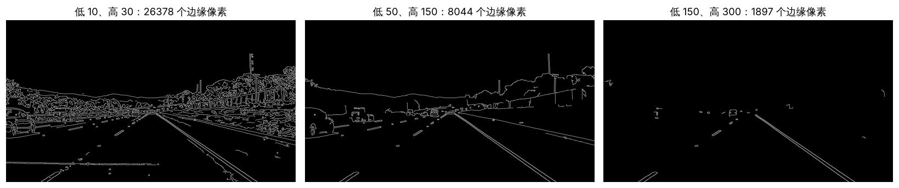
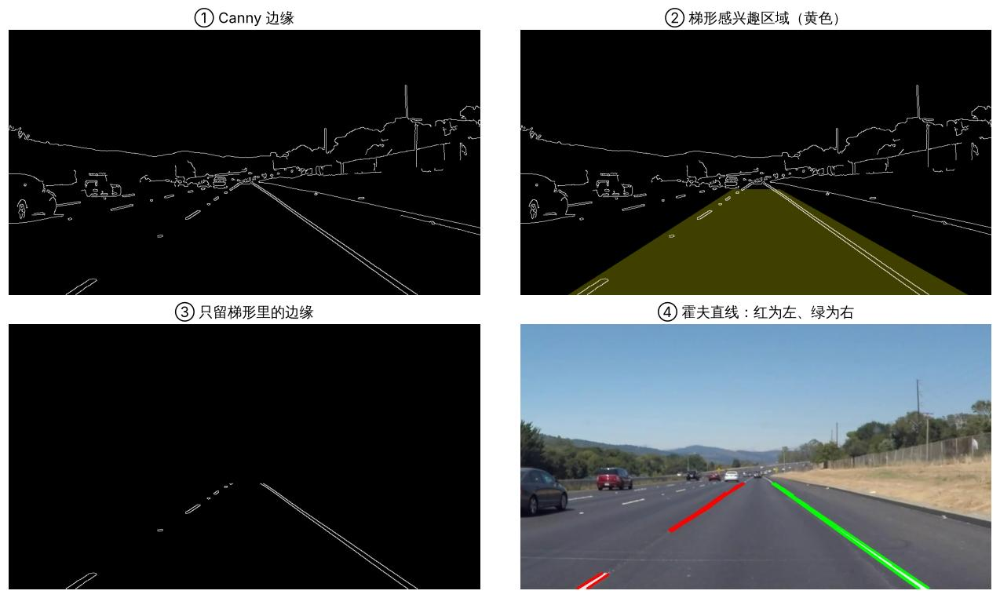
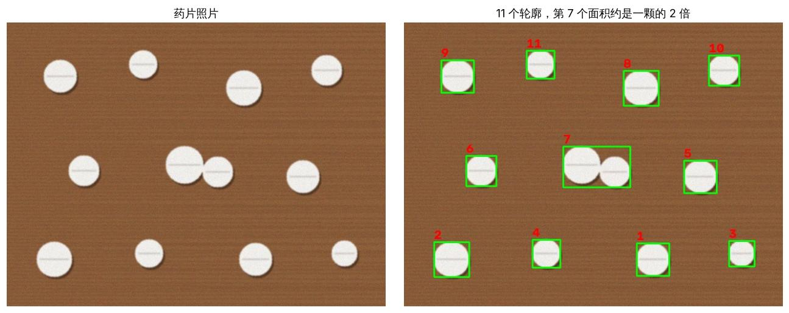
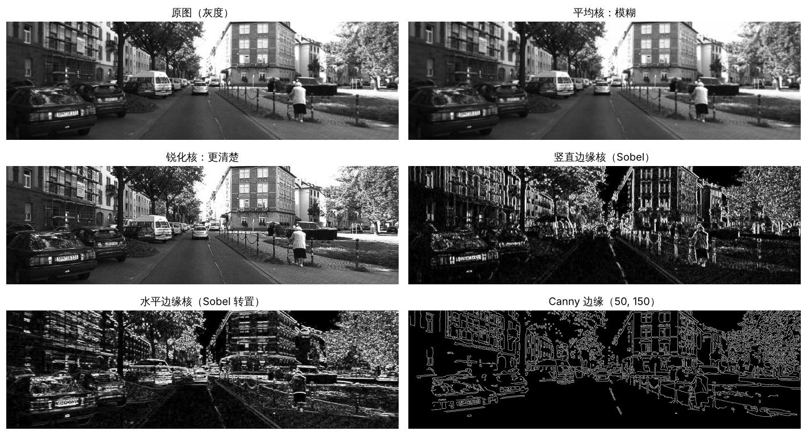
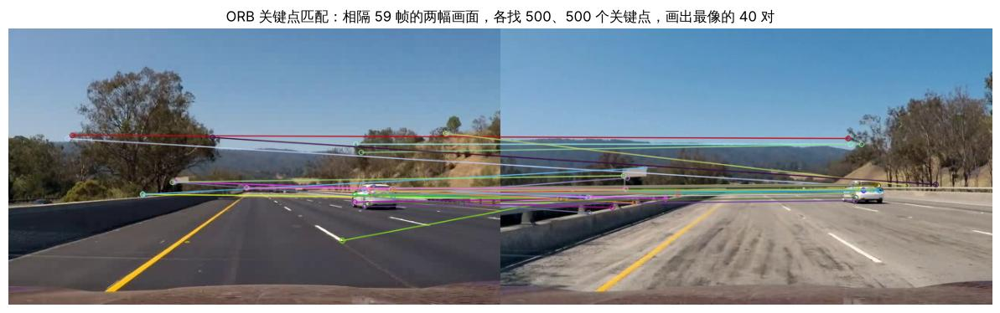
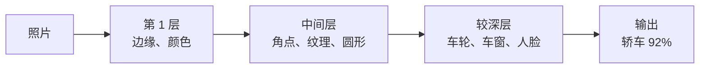
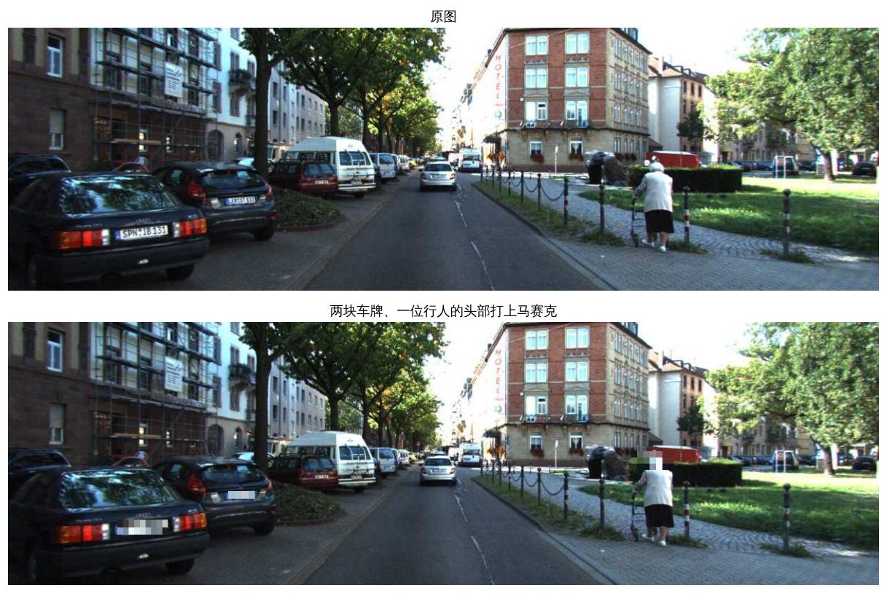
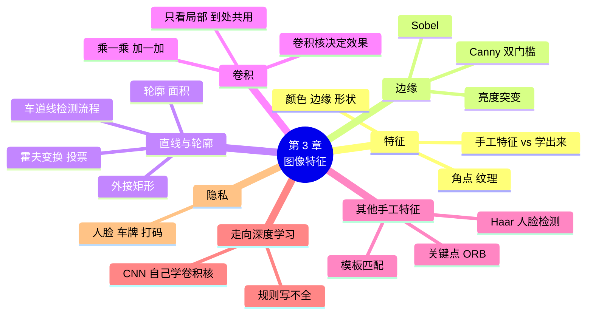

# 第 3 章 图像特征：从边缘到卷积

!!! abstract "本章学时"
    理论 4 学时（线上 3 + 线下 1）· 实验 4 学时（本章共 4 个实验，★ 必做 3 个）

## 学习目标

学完本章，你应该能够：

1. **说出**常见的图像特征（颜色、边缘、角点、纹理、形状），以及 Canny 两个门槛各自的作用（记忆）；
2. **解释**卷积核在图上滑动“乘一乘、加一加”的过程，并手算一格（理解、应用）；
3. **运行并修改**给定代码，用轮廓数药片，用“边缘 + 霍夫直线”在照片和视频里找车道线（应用）；
4. **比较**按颜色和按边缘找车道线的优缺点，分析手工规则为什么容易误判（分析）；
5. **判断**行车画面中哪些内容属于个人信息，需要打码后才能分享（评价）。

!!! info "先修要求"
    学习本章前，你需要掌握：

    - [2.3 颜色空间](../02-image-processing/index.md#23)、[2.5 滤波去噪](../02-image-processing/index.md#25)、[2.6 阈值与二值化](../02-image-processing/index.md#26)；
    - 实验 2-3：会裁感兴趣区域，知道按颜色找车道线在夜间会失效；
    - 第 2 章的 Python 小课堂：函数、`for` 循环。本章的“Python 小课堂③”会讲列表和 `if` 判断。

??? abstract "本章概念清单（15 个，点击查看定义和例子）"
    1. [特征](../../appendix/glossary.md#g-特征)
    2. [手工特征](../../appendix/glossary.md#g-手工特征)
    3. [边缘](../../appendix/glossary.md#g-边缘)
    4. [边缘检测](../../appendix/glossary.md#g-边缘检测)
    5. [霍夫变换](../../appendix/glossary.md#g-霍夫变换)
    6. [轮廓](../../appendix/glossary.md#g-轮廓)
    7. [外接矩形](../../appendix/glossary.md#g-外接矩形)
    8. [卷积](../../appendix/glossary.md#g-卷积)
    9. [卷积核](../../appendix/glossary.md#g-卷积核)
    10. [关键点](../../appendix/glossary.md#g-关键点)
    11. [模板匹配](../../appendix/glossary.md#g-模板匹配)
    12. [人脸检测](../../appendix/glossary.md#g-人脸检测)
    13. [个人信息](../../appendix/glossary.md#g-个人信息)
    14. [卷积神经网络](../../appendix/glossary.md#g-卷积神经网络)
    15. [条件判断](../../appendix/glossary.md#g-条件判断)

## 情景导入

上一章，小林按颜色找车道线，白天效果不错，一到夜里就一根也找不到了。

老王看了说：“你想想，人开夜车的时候，看到的车道线也不是‘白色’的，是灰蒙蒙的。可你为什么还能认出来？”

小林想了想：“因为车道线比旁边的路面亮一点，有一条‘边’，而且是直的，从车头一直伸到远处。”

“对喽。不管白天黑夜，车道线和路面之间总有一条亮暗分界线，而且它是一条斜着的直线。颜色会变，这个‘形状’不会变。”

这种“能把一样东西和别的东西区分开的线索”，就叫[**特征**](../../appendix/glossary.md#g-特征 "图片中能帮助区分物体的线索，如颜色、边缘、形状、角点、纹理"){ .term }。这一章，我们先学几种经典的手工特征：边缘、直线、轮廓，用它们找车道线、数药片、给车牌打码；再学这些特征背后共同的计算——卷积；最后看看，为什么今天的视觉模型不再靠人来设计特征，而是自己学。

## 3.1 什么是特征 { #31 }

### 3.1.1 机器靠什么区分物体 { #311 }

你是怎么认出一辆车的？可能是它的形状（方方的车身、圆圆的轮子），可能是它的颜色（红色、白色），也可能是一些局部细节（车灯、车牌、后视镜）。这些能帮助区分物体的线索，就是**特征**（Feature）。

| 特征 | 看什么 | 例子 | 本书在哪里用 |
|---|---|---|---|
| 颜色 | 像素的颜色 | 黄色车道线、红色刹车灯 | 第 2 章 HSV 找车道线 |
| 边缘 | 亮暗突变的地方 | 车道线和路面的分界、车身的轮廓线 | 3.2 节 |
| 形状 | 边缘围成的样子 | 直线、圆形药片、扁长方形车牌 | 3.3 节 |
| 角点 | 两条边缘相交的点 | 窗户的角、车牌的四个角 | 3.5 节 |
| 纹理 | 一片区域的花纹规律 | 草地、砖墙、柏油路面 | 第 4 章 |

### 3.1.2 手工特征和学出来的特征 { #312 }

2012 年以前，视觉研究者的主要工作就是**设计特征**：想办法用数学公式描述“车道线是什么样的”“人脸是什么样的”，再写成程序。这种由人设计规则的特征叫[**手工特征**](../../appendix/glossary.md#g-手工特征 "由人设计规则、用公式提取的特征，看得懂、不需要训练，但规则难以写全"){ .term }（Hand-crafted Feature）。本章学的边缘、直线、轮廓、关键点都属于手工特征。

手工特征的好处是**看得懂、算得快、不需要训练数据**。今天很多工厂的质检设备、简单的车道线报警器还在用它们。缺点是**规则写不全**：车道线被车挡住一半怎么办？路面上有一条和车道线平行的裂缝怎么办？每种情况都得人来想、来补规则。

3.6 节会看到，深度学习换了一种思路：不再让人设计特征，而是让模型从大量图片中**自己学出特征**。但学出来的特征，第一层恰恰就是“边缘”。所以理解了本章的手工特征，也就理解了卷积神经网络在“看”什么。

## 3.2 边缘检测 { #32 }

### 3.2.1 边缘就是亮度突变的地方 { #321 }

[**边缘**](../../appendix/glossary.md#g-边缘 "图片中亮度变化剧烈的地方，通常对应物体的边界"){ .term }（Edge）是图片中亮度变化剧烈的地方，通常对应物体的边界：车道线的两侧、车身的轮廓、窗户的框。

怎么找“变化剧烈”的地方？最简单的办法是**算相邻像素的差**：差很小，说明这里平坦；差很大，说明这里有边缘。

!!! example "算一算：从一行像素里找边缘"
    下面是车道照片中某一行连续 8 个像素的灰度值，从左边的路面走到白色车道线上：

    | 位置 | 1 | 2 | 3 | 4 | 5 | 6 | 7 | 8 |
    |---|---|---|---|---|---|---|---|---|
    | 灰度 | 80 | 82 | 81 | 85 | 200 | 205 | 203 | 204 |
    | 和左边的差 | — | 2 | −1 | 4 | **115** | 5 | −2 | 1 |

    大部分差都在 ±5 以内，只有位置 4 到 5 之间差了 115，这里就是车道线的左边缘。到了车道线的右边缘，会出现一个很大的**负数**（从亮变暗）。

    夜间画面亮度整体变暗，这两个数可能变成 28 和 70，差变成了 42，虽然小了，但仍然比周围的 ±2 大得多。这就是边缘比颜色更“抗光照变化”的原因。

### 3.2.2 Sobel：用卷积核算差 { #322 }

“算相邻像素的差”可以写成一个 3×3 的小表格，叫 Sobel 核：

| | | |
|---|---|---|
| −1 | 0 | 1 |
| −2 | 0 | 2 |
| −1 | 0 | 1 |

把它罩在图上，“右边一列减左边一列”（中间一行算两遍，更看重正中间），算出的数越大，说明这里从左到右变亮得越厉害，也就是一条**竖直方向的边缘**。把这个表格转 90°，就能找水平方向的边缘。这种“罩上去、乘一乘、加一加”的计算就是 3.4 节要细讲的卷积。

### 3.2.3 Canny 边缘检测 { #323 }

Sobel 找出的边缘又粗又乱（见图 3-4 中的“竖直边缘核”），还夹着很多噪点。1986 年，约翰·坎尼（John Canny）提出了一套更好的方法，至今仍是最常用的[**边缘检测**](../../appendix/glossary.md#g-边缘检测 "找出图片中边缘像素的方法，最常用的是 Canny 算法（去噪、算变化、细化、双门槛连接）"){ .term }（Edge Detection）算法。<sup class="cite">[[1]](#ref3-1)</sup> 它分四步：

1. **去噪**：先用高斯滤波把噪点抹掉（第 2 章学过）；
2. **算变化强度和方向**：用 Sobel 算出每个像素的亮度变化有多大、朝哪个方向；
3. **细化**：一条边缘往往有好几个像素宽，只保留其中变化最强的那一个，把“粗线”变成“细线”；
4. **双门槛连接**：这是 Canny 的精华。

**双门槛**是怎么回事？想象学校评“优秀学生”：成绩高于 90 分的直接入选（**强边缘**）；成绩在 60～90 分之间的，如果他和某个已入选的同学是“同桌”（相邻），也可以入选（**连上的弱边缘**）；低于 60 分的直接淘汰。这样，一条车道线即使中间有一段比较淡，只要它两头连着清楚的部分，就能被完整地保留下来；而路面上孤零零的一点杂纹，没有“靠山”，就被丢掉了。

```python
blur = cv2.GaussianBlur(gray, (5, 5), 0)     # 第 1 步：去噪
edges = cv2.Canny(blur, 50, 150)             # 第 2～4 步：低门槛 50、高门槛 150
```

`cv2.Canny` 的结果是一张黑白图：白色是边缘，黑色不是。两个门槛怎么定？一般**高门槛是低门槛的 2～3 倍**，再根据画面调整：



*图 3-1　门槛太低，路面纹理全变成了边缘；门槛太高，远处的车道线断了（编者用 OpenCV 实际运行）*

| 门槛（低, 高） | 边缘像素 | 效果 |
|---|---|---|
| (10, 30) | 26378 | 太多，路面纹理、树叶都成了边缘 |
| (50, 150) | 8044 | 车道线清楚，杂边不多 |
| (150, 300) | 1897 | 太少，远处的车道线和虚线断了 |

<iframe class="sim-frame" src="../../sims/canny-threshold/main.html" height="640" loading="lazy" title="Canny 双门槛"></iframe>

动画：Canny 双门槛。白色是强边缘，黄色是连到强边缘而保留下来的弱边缘，暗红色是被丢掉的弱边缘。试试“夜间”画面，要把门槛调到多少才能看清车道线？
{ .sim-caption }

编者把车道照片压暗到 35%，用 (50, 150) 只找到 1459 个边缘像素，车道线断断续续；降到 (20, 60) 后找到 6676 个，车道线又完整了。所以**边缘方法在夜间也能用，只是门槛要跟着调低**。这比颜色方法“一个都找不到”好得多。

## 3.3 直线与轮廓 { #33 }

### 3.3.1 霍夫变换：每个边缘点为直线“投票” { #331 }

Canny 找到的是一个个白色的点，我们想要的是“车道线是哪一条直线”。从一堆点里找直线，经典方法是[**霍夫变换**](../../appendix/glossary.md#g-霍夫变换 "让每个边缘点为穿过它的直线投票、票数最多的就是图中直线的方法"){ .term }（Hough Transform），1962 年由霍夫申请专利，1972 年杜达和哈特把它改造成今天常用的形式。<sup class="cite">[[2]](#ref3-2)</sup>

它的思路像“选举”：

1. 每一条可能的直线都是一个“候选人”；
2. 每个边缘点都去投票：凡是穿过我的直线，我都投一票；
3. 最后数票：票数最多的直线，说明有很多边缘点都排在它上面，它就是一条真实的直线。

一条车道线上有几百个边缘点，它们都投给了同一条直线，这条直线的票数就会遥遥领先；路面上零散的杂点各投各的，形不成气候。

OpenCV 的 `cv2.HoughLinesP` 直接给出线段的两个端点：

```python
lines = cv2.HoughLinesP(edges, rho=2, theta=np.pi / 180, threshold=30,
                        minLineLength=20, maxLineGap=100)
```

| 参数 | 意思 | 调大会怎样 |
|---|---|---|
| `rho`、`theta` | 投票的“格子”有多细（距离 2 像素、角度 1°） | 一般不用改 |
| `threshold` | 至少多少票才算一条线 | 线更少、更可靠 |
| `minLineLength` | 线段至少多长 | 短的碎线被丢掉 |
| `maxLineGap` | 同一条线上断开多远仍算一条 | 虚线更容易连成一条 |

### 3.3.2 传统车道线检测的完整流程 { #332 }

把第 2 章和本章学的拼起来，就是一个完整的传统车道线检测流程（实验 3-3）：




*图 3-2　车道线检测的四步（实验 3-3 的中间结果，照片来自 Udacity，MIT 许可）*

这里有两个小技巧：

- **梯形感兴趣区域**。第 2 章用的是长方形，但路面在画面里是“近宽远窄”的梯形，用梯形能把路边的护栏、旁边车道的车排除得更干净。做法是先画一张全黑的图，用 `cv2.fillPoly` 把梯形涂白，再和边缘图做“与”运算（`cv2.bitwise_and`），两张图都是白的地方才留下。
- **按斜率分左右**。从驾驶员的视角看，左车道线从左下往右上斜（图片坐标中斜率为负），右车道线从右下往左上斜（斜率为正）。太平的线（斜率接近 0）多半是路面上的横向裂缝或阴影，直接丢掉。

!!! example "算一算：这条线是左车道线还是右车道线"
    霍夫变换找到一条线段，两个端点是 (300, 420) 和 (450, 320)。

    斜率 = (320 − 420) ÷ (450 − 300) = −100 ÷ 150 ≈ −0.67。斜率为负，而且绝对值大于 0.5，所以是**左车道线**。

    注意图片的 y 轴向下，所以“往右上斜”在图片坐标里斜率是负的，和数学课上的习惯正好相反。

### 3.3.3 轮廓：找出、数一数、量一量 { #333 }

边缘是零散的点和线，[**轮廓**](../../appendix/glossary.md#g-轮廓 "二值图中一块区域首尾相连的闭合边界，可以用来计数和量面积"){ .term }（Contour）则是一个物体完整的边界，是一条首尾相连的闭合曲线。在二值图上找轮廓，就能把每一块白色区域“圈”出来：

```python
contours, _ = cv2.findContours(binary, cv2.RETR_EXTERNAL, cv2.CHAIN_APPROX_SIMPLE)
print(len(contours))                       # 有几块
area = cv2.contourArea(contours[0])        # 第一块的面积（像素个数）
x, y, w, h = cv2.boundingRect(contours[0]) # 第一块的外接矩形
```

- `RETR_EXTERNAL` 表示只要最外层的轮廓（药片上的刻痕形成的“洞”不算）；
- `contourArea` 量面积，可以用来去掉太小的碎屑、发现太大的“粘连”；
- `boundingRect` 给出刚好把轮廓框住的[**外接矩形**](../../appendix/glossary.md#g-外接矩形 "刚好把一个轮廓或物体框住的矩形，用左上角坐标和宽、高表示，是检测框的前身"){ .term }（Bounding Rectangle）：左上角 `(x, y)`、宽 `w`、高 `h`。

外接矩形看起来很普通，却是第 5 章“目标检测”中**检测框**的前身：检测模型输出的，正是每个物体的外接矩形加上类别。区别在于，这里的框是靠“二值化 + 找轮廓”的手工规则得到的，只能用在背景简单的场景（白药片放在深色桌面上）；检测模型则能在复杂的街景里框出车辆和行人。



*图 3-3　实验 3-1 的结果：11 个轮廓中，第 7 个是两颗挨在一起的药片（药片照片是编者用程序画的）*

图 3-3 中有两颗药片挨在一起，被当成了一个轮廓，所以只数出 11 个。实验 3-1 用了一个简单办法补救：先算出“一颗药片大约多大”（面积的中位数 2350），面积是它的几倍，就算几颗。第 7 个轮廓面积 5146，约是 2.2 倍，算 2 颗，总数就对了。这又是一条手工规则：药片大小差不多时管用，大小不一时就会出错。

## 3.4 卷积：一个小窗口的乘加 { #34 }

### 3.4.1 卷积怎么算 { #341 }

第 2 章的均值滤波、高斯滤波，3.2 节的 Sobel，背后都是同一种计算：拿一个 3×3 的小表格罩在图上，**对应位置相乘，再全部加起来**，得到的数写到输出的对应位置；然后小表格往右挪一格，再算一遍……直到走遍整张图。这种计算叫[**卷积**](../../appendix/glossary.md#g-卷积 "卷积核在图片上逐格滑动，每到一处把对应位置的数相乘再全部相加，得到输出的计算"){ .term }（Convolution），那个小表格叫[**卷积核**](../../appendix/glossary.md#g-卷积核 "卷积中使用的小表格（如 3×3），里面的数决定卷积起模糊、锐化还是找边缘的作用"){ .term }（Kernel）。

可以把卷积核想象成一个“放大镜”，在图上一格一格地挪，每到一处就按自己的规则“看一眼”，给出一个分数。

!!! example "算一算：手算一格卷积"
    实验 3-2 从 `drive_city.jpg` 第 200 行第 640 列（车顶边缘附近）取出 3×3 的灰度值，用竖直边缘核（Sobel）去算：

    | 图片小块 | | | | 卷积核 | | |
    |---|---|---|---|---|---|---|
    | 176 | 199 | 121 | | −1 | 0 | 1 |
    | 207 | 214 | 119 | | −2 | 0 | 2 |
    | 228 | 241 | 150 | | −1 | 0 | 1 |

    对应位置相乘再相加（0 的位置可以跳过）：

    176×(−1) + 121×1 + 207×(−2) + 119×2 + 228×(−1) + 150×1

    = −176 + 121 − 414 + 238 − 228 + 150 = **−309**

    结果是一个绝对值很大的负数，说明这里**从左到右明显变暗**：左边亮（车顶反光），右边暗。实验 3-2 第 2 步输出“手算这一格：−309.0，filter2D 算的：−309.0”，两者一致。

### 3.4.2 换一组数，换一种效果 { #342 }

卷积的计算方法永远一样，**卷积核里的九个数决定了它做什么**：

| 卷积核 | 九个数 | 效果 |
|---|---|---|
| 原样 | 中间 1，其余 0 | 输出和输入一样 |
| 平均（模糊） | 全是 1/9 | 就是第 2 章的均值滤波 |
| 锐化 | 中间 5，上下左右 −1 | 中间加强、邻居减掉，边界更清楚 |
| 竖直边缘（Sobel） | 左列 −1 −2 −1，右列 1 2 1 | 找左右亮暗变化 |
| 水平边缘 | 上行 −1 −2 −1，下行 1 2 1 | 找上下亮暗变化 |



*图 3-4　五个卷积核和 Canny 的效果对比（实验 3-2 的输出）。竖直边缘核让车身侧面、楼房竖线变亮；水平边缘核让车顶、窗台变亮*

OpenCV 用 `cv2.filter2D` 做任意卷积，卷积核用 NumPy 数组写：

```python
import numpy as np
kernel = np.array([[0, -1, 0],
                   [-1, 5, -1],
                   [0, -1, 0]], dtype=np.float32)       # 锐化核
sharp = cv2.filter2D(gray, -1, kernel)                  # -1 表示输出和输入的数字类型一样
```

<iframe class="sim-frame" src="../../sims/conv-kernel/main.html" height="760" loading="lazy" title="卷积核滑动"></iframe>

动画：卷积核滑动。点“下一步”看窗口一格格滑动、输出逐格出现，下方写出这一格的完整算式。试着改卷积核的九个数，看整张图怎样变化。
{ .sim-caption }

### 3.4.3 卷积为什么适合图片 { #343 }

卷积有两个特别适合图片的性质：

1. **只看局部**。判断一个像素是不是边缘，只需要看它和邻居，不用看整张图。这和人眼看图的方式很像；
2. **到处用同一个核**。同一个竖直边缘核从左上角滑到右下角，图上所有的竖直边缘都被找了出来，不管车在画面左边还是右边。

记住这两点，下一节就能理解卷积神经网络为什么那么擅长看图。

## 3.5 关键点、模板匹配与传统人脸检测 { #35 }

### 3.5.1 关键点与特征匹配（了解） { #351 }

边缘是“线”，[**关键点**](../../appendix/glossary.md#g-关键点 "图片中很有特点、换个角度或距离也能认出的点，可用于两张图之间的配对"){ .term }（Keypoint）则是图上“很有特点的点”，比如窗户的角、招牌上的字、树干和地面的交界。它们的特点是：从哪个方向看、离远一点近一点，都还能认出来。

找到关键点后，再用一串数字描述它周围的样子（叫“描述子”），就能在两张图之间**配对**：这张图上的这个窗角，对应那张图上的哪个窗角？OpenCV 自带的 ORB 算法又快又免费，常用来做图片拼接（全景照片）、视频防抖和第 9 章的增强现实。<sup class="cite">[[3]](#ref3-3)</sup>



*图 3-5　ORB 关键点匹配（编者在高速公路行车视频上实际运行）：远处的山和树变化小，配对多；近处的路面变化大，配对少*

### 3.5.2 模板匹配：拿着照片找一模一样的 { #352 }

如果事先有一小块“样板图”，想在大图里找它在哪，最直接的办法是[**模板匹配**](../../appendix/glossary.md#g-模板匹配 "把一小块样板图在大图上逐格滑动比较，找出最相似位置的方法，只适合找一模一样的东西"){ .term }（Template Matching）：把样板图在大图上一格格滑过，每到一处算一下“像不像”，最像的地方就是答案。

```python
result = cv2.matchTemplate(big, small, cv2.TM_CCOEFF_NORMED)    # 每个位置的相似度（-1～1）
_, score, _, (x, y) = cv2.minMaxLoc(result)                     # 最大相似度和它的位置
```

模板匹配适合找“长得一模一样”的东西，比如屏幕上的某个按钮、生产线上同一型号的零件。物体一旦变大变小、转了角度、换了光照，它就不灵了。

### 3.5.3 传统人脸检测：Haar 级联（了解） { #353 }

[**人脸检测**](../../appendix/glossary.md#g-人脸检测 "找出图片中人脸位置的任务，传统方法有 Haar 级联，现在多用深度学习模型"){ .term }（Face Detection）就是找出图中人脸的位置。2001 年，维奥拉（Viola）和琼斯（Jones）提出了一种又快又准的方法，第一次让普通电脑能**实时**检测人脸，数码相机的“人脸对焦”就是靠它普及的。<sup class="cite">[[4]](#ref3-4)</sup>

它的思路是：人脸有一些固定的亮暗规律，比如眼睛比脸颊暗、鼻梁比两侧亮。用很多个黑白相间的小矩形（Haar 特征）去检查这些规律，再把检查排成一串“关卡”（级联）：第一关只用几个特征，快速排除明显不是脸的区域；通过的再进下一关，越往后检查越细。绝大部分区域在前几关就被淘汰了，所以非常快。

但 Haar 级联的局限也很明显：

- 只认正脸，侧脸、低头、戴口罩就容易漏掉；
- 光线差、脸很小时误检多，衣服上的花纹也可能被当成脸；
- 想检测别的东西（如车辆），要重新设计和训练一整套。

今天的人脸检测已经换成了深度学习模型，准确率高得多。OpenCV 5 甚至把 Haar 级联从主程序包中去掉了，只保留了基于深度学习的人脸检测器 YuNet（编者用 OpenCV 5.0 实测，`cv2.CascadeClassifier` 已不存在）。<sup class="cite">[[7]](#ref3-7)</sup> 实验 3-4 因此改用第 5 章的检测模型来找行人，这里只要求理解 Haar 级联的思路。

!!! warning "行车画面里的个人信息"
    行车记录仪、辅助驾驶摄像头会拍到路人的脸和其他车辆的车牌。按照《中华人民共和国个人信息保护法》，能识别特定个人的信息都属于[**个人信息**](../../appendix/glossary.md#g-个人信息 "以电子或其他方式记录的、与已识别或可识别的自然人有关的各种信息；人脸等生物识别信息属于敏感个人信息"){ .term }（Personal Information），其中人脸属于生物识别信息，是“敏感个人信息”，处理时要求更严格。<sup class="cite">[[6]](#ref3-6)</sup> 把行车视频发到网上、交给别人做数据集之前，应该给人脸和车牌打码。实验 3-4 就做这件事。

## 3.6 从手工特征到卷积神经网络 { #36 }

### 3.6.1 手工特征的天花板 { #361 }

回顾本章，每一个任务都需要人想出一套规则：

| 任务 | 人设计的规则 | 规则什么时候失灵 |
|---|---|---|
| 找车道线 | 边缘 + 梯形区域 + 斜率大于 0.5 的直线 | 弯道、车道线被车挡住、路面有平行的裂缝 |
| 数药片 | 二值化 + 轮廓 + 面积 | 药片大小不一、颜色和桌面相近 |
| 找车牌 | 亮 + 扁长方形 + 宽高比 2.5～6 | 斑马线、白色招牌也符合（实验 3-4） |
| 找人脸 | 眼睛比脸颊暗…… | 侧脸、口罩、暗光 |

规则越写越多，例外永远补不完。更麻烦的是，有些东西根本说不清规则：“猫和狗的区别是什么？”“轿车和厢式车的区别是什么？”人一眼就能看出来，却很难写成程序。

### 3.6.2 让机器自己学卷积核 { #362 }

3.4 节说过：卷积核的九个数决定了它找什么。那么，能不能**不让人来定这九个数，而是让机器从大量图片中自己学**？

这就是[**卷积神经网络**](../../appendix/glossary.md#g-卷积神经网络 "由多层卷积等运算组成、卷积核的数从大量图片中自动学出来的神经网络，是深度学习视觉模型的基础"){ .term }（Convolutional Neural Network，CNN）的思路：

1. 第一层放几十个卷积核，九个数一开始是随机的；
2. 给它看成千上万张标好答案的图片（这是轿车、这是卡车），每认错一次，就把这些数往“能认对”的方向调一点点；
3. 训练完一看，第一层的卷积核自己变成了各种方向的边缘检测器和颜色检测器，和人设计的 Sobel 很像；
4. 再往后的层，在边缘的基础上组合出角点、纹理、车轮、车窗，最后组合出“整辆车”。

2012 年，用卷积神经网络的 AlexNet 在 ImageNet 图片识别比赛中把错误率从 26% 降到 15%，大幅领先第二名的手工特征方法，从此视觉领域全面转向深度学习。<sup class="cite">[[5]](#ref3-5)</sup>



下一章就来用卷积神经网络认图，并训练一个自己的车辆行人类型分类器。

## 3.7 Python 小课堂③：列表、下标和 if 判断 { #37 }

**1. 列表和下标**

第 2 章见过列表：用方括号把一组东西括起来。`cv2.findContours` 返回的 `contours` 也是一个列表，每个元素是一个轮廓。

```python
areas = [2030, 1438, 5146, 2350]   # 一个列表，4 个数
print(len(areas))                  # 有几个：4
print(areas[0])                    # 第一个：2030（下标从 0 开始！）
print(areas[-1])                   # 最后一个：2350（负数从后往前数）
print(sorted(areas))               # 排好序的新列表：[1438, 2030, 2350, 5146]
areas.append(1706)                 # 在末尾加一个
```

**下标从 0 开始**是初学者最容易错的地方：4 个元素的下标是 0、1、2、3，写 `areas[4]` 会报 `IndexError`。

**2. if 判断**

`if` 让程序“看情况办事”，叫[**条件判断**](../../appendix/glossary.md#g-条件判断 "按条件是否成立决定执行哪段代码的写法，Python 中用 if、elif、else"){ .term }：

```python
k = -0.67                          # 一条线的斜率
if k < -0.5:                       # 条件成立，执行下面缩进的代码
    print("左车道线")
elif k > 0.5:                      # elif = else if：上面不成立，再看这个
    print("右车道线")
else:                              # 都不成立
    print("太平了，不要")
```

条件里常用的比较符号：`>` 大于、`<` 小于、`>=` 大于等于、`==` 等于（**两个等号**，一个等号是赋值）、`!=` 不等于。多个条件用 `and`（并且）、`or`（或者）连接，例如实验 3-4 找车牌的条件：`8 <= h <= 40 and 2.5 <= w / h <= 6`。

**3. 一行写完的 for：列表推导式**

实验 3-1 里有这样一行：

```python
areas = [cv2.contourArea(c) for c in contours]          # 每个轮廓的面积，组成一个列表
pills = [c for c in contours if cv2.contourArea(c) > 300]   # 只留面积大于 300 的轮廓
```

它等价于下面的三四行，只是写得更紧凑：

```python
pills = []                              # 先准备一个空列表
for c in contours:
    if cv2.contourArea(c) > 300:
        pills.append(c)                 # 符合条件的才放进去
```

看不惯一行的写法，完全可以写成多行，效果一样。

**4. enumerate：同时拿到编号**

```python
for i, c in enumerate(pills):           # i 是编号 0, 1, 2…，c 是轮廓
    print(i + 1, cv2.contourArea(c))    # 给人看的编号从 1 开始，所以 +1
```

## 3.8 本章常见报错对照 { #38 }

| 报错原文（最后一行） | 用大白话说 | 怎么改 |
|---|---|---|
| `TypeError: 'NoneType' object is not subscriptable`（在 `lines[…]` 处） | 霍夫变换一条线也没找到，返回了 `None` | 先判断 `if lines is not None:`；或调低 `threshold`、Canny 门槛 |
| `error: … (-210:Unsupported format or combination of formats) … findContours` | 找轮廓要用单通道的黑白图 | 先转灰度、二值化，再 `findContours` |
| `ValueError: not enough values to unpack (expected 3, got 2)` | 不同版本的 `findContours` 返回值个数不同 | 本书写法 `contours, _ = …` 适用于 OpenCV 4 和 5 |
| `IndexError: list index out of range` | 下标超出了列表长度 | 下标从 0 开始，最大是 `len(列表) - 1` |
| `SyntaxError: invalid syntax`（在 `if` 那一行） | `if` 末尾少了冒号，或把 `==` 写成了 `=` | 写成 `if k == 0:` |
| `AttributeError: module 'cv2' has no attribute 'CascadeClassifier'` | OpenCV 5 已去掉 Haar 级联 | 用实验 3-4 的检测模型方法，或安装 OpenCV 4 |
| 视频写出来打不开，或只有几 KB | 编码器或画面尺寸不对 | 写视频的尺寸必须和每一帧的宽高一致；Windows 上可把 `mp4v` 换成 `XVID`、扩展名改 `.avi` |

## 3.9 前沿视窗：车道线检测走向深度学习 { #39 }

本章的“边缘 + 霍夫直线”方法只能找**直线**，碰到弯道、车道线被前车挡住、路面被雨水反光时就容易出错。深度学习方法把车道线检测当成一种“分割”或“检测”任务，让模型从大量标好的行车画面中学习。

2018 年，香港中文大学和商汤科技的研究者发布了 CULane 数据集，包含 13 万多帧北京街头的行车画面，分为正常、拥堵、夜间、阴影、无车道线、弯道等 9 类场景，并提出了 SCNN 模型，让信息在画面中沿行、列方向传递，即使车道线被车挡住一段，也能根据前后“推测”出来。<sup class="cite">[[8]](#ref3-8)</sup> 此后的模型越来越快、越来越准，现在的量产辅助驾驶系统多用深度学习做车道线检测，并进一步在“鸟瞰图”（BEV）中直接画出车道线，第 9 章会再介绍。

但本章的方法并没有过时：它不需要训练数据、不需要显卡、每一步都看得懂，非常适合教学、做原型，或在算力很小的设备上使用。很多深度学习系统的预处理和后处理（感兴趣区域、按斜率分左右、拟合曲线）也仍然是本章这些“手工”步骤。

## 本章实验

!!! abstract "实验总览"
    | 实验 | 类型 | 建议时长 | 内容 |
    |---|---|---|---|
    | 实验 3-1 | ★ 必做 | 45 分钟 | 数一数有几颗药片 |
    | 实验 3-2 | ★ 必做 | 40 分钟 | 自己写卷积核 |
    | 实验 3-3 | ★ 必做 | 50 分钟 | 车道线检测（照片 + 视频） |
    | 实验 3-4 | ☆ 选做 | 45 分钟 | 给行车照片打码 |

    代码见配套资源 `labs/ch03/` 目录，每个实验都有 `.py` 和 `.ipynb` 两种文件，内容相同。所有实验都在 `labs/ch03/` 文件夹里运行，CPU 即可；实验 3-4 第一次运行要联网下载约 5 MB 的检测模型。

### 实验 3-1 ★ 数一数有几颗药片 { #3-1 }

**实验目的**

1. 复习灰度、去噪、二值化，作为找轮廓的准备；
2. 用 `cv2.findContours` 找轮廓、数个数、量面积；
3. 用外接矩形和编号把结果画出来，并处理两颗药片粘连的情况。

**实验环境**：云端 Notebook 或本机，CPU 即可。

**实验数据**：`labs/data/images/pills.jpg`（编者用程序画的 12 颗白色药片，其中两颗挨在一起，640×480）。

**实验步骤与代码**

第一档 · 跑通：打开 `lab3_1_count_pills.ipynb`，依次运行五个单元格。前三步：

```python
img = cv2.imread("../data/images/pills.jpg")
gray = cv2.cvtColor(img, cv2.COLOR_BGR2GRAY)
blur = cv2.GaussianBlur(gray, (5, 5), 0)                    # 先去掉木纹的细小纹理
t, binary = cv2.threshold(blur, 0, 255, cv2.THRESH_BINARY + cv2.THRESH_OTSU)

contours, _ = cv2.findContours(binary, cv2.RETR_EXTERNAL, cv2.CHAIN_APPROX_SIMPLE)
print("找到轮廓：", len(contours), "个")

areas = [cv2.contourArea(c) for c in contours]    # 列表：每个轮廓的面积
print("面积：", sorted(int(a) for a in areas))
pills = [c for c in contours if cv2.contourArea(c) > 300]   # ← 改这里：小于 300 的不算
```

第 4 步处理粘连，第 5 步画框和编号：

```python
one = sorted(cv2.contourArea(c) for c in pills)[len(pills) // 2]   # 面积的中位数：一颗大概多大
total = 0
for c in pills:
    n = max(1, round(cv2.contourArea(c) / one))    # 面积是一颗的几倍，就算几颗
    total = total + n
print(f"一颗药片约 {one:.0f} 像素，按面积估算共 {total} 颗")

for i, c in enumerate(pills):                     # 同时拿到编号 i 和轮廓 c
    x, y, w, h = cv2.boundingRect(c)              # 外接矩形
    cv2.rectangle(show, (x, y), (x + w, y + h), (0, 255, 0), 2)
    cv2.putText(show, str(i + 1), (x, y - 5), cv2.FONT_HERSHEY_SIMPLEX, 0.7, (0, 0, 255), 2)
```

完整代码：`labs/ch03/lab3_1_count_pills.py`（`.ipynb` 同名）

**运行结果**

```text
大津法算出的门槛： 165.0
找到轮廓： 11 个
面积： [1438, 1706, 1708, 2030, 2031, 2350, 2351, 2352, 2712, 2714, 5146]
面积大于 300 的： 11 个
一颗药片约 2350 像素，按面积估算共 12 颗
```

结果图见图 3-3。11 个轮廓的面积中，前 10 个在 1438～2714 之间（药片有大有小），最后一个 5146 明显偏大，正是两颗粘在一起的药片。

第二档 · 改一改：

1. 去掉第 1 步的高斯去噪（把 `blur` 直接换成 `gray`），轮廓数有没有变化？面积列表里多出了什么？
2. 把 `cv2.RETR_EXTERNAL` 改成 `cv2.RETR_LIST`，轮廓数变成多少？为什么？（提示：药片中间的刻痕）
3. 把第 4 步的 `round` 改成 `int`（直接去掉小数），估算的总数会变吗？用面积 5146 ÷ 2350 算一算。

第三档 · 挑战（选做）：用 `cv2.minEnclosingCircle(c)` 求每颗药片的外接圆半径，按半径把药片分成“大”“小”两类，分别计数。

**实验记录表**

| 修改内容 | 轮廓数 | 估算颗数 | 原因分析 |
|---|---|---|---|
| 原始代码 | 11 | 12 | 有两颗粘连 |
| 去掉高斯去噪 | | | |
| 改成 RETR_LIST | | | |
| round 改成 int | | | |

**常见问题排查**

| 现象 | 原因 | 解决办法 |
|---|---|---|
| 只找到 1 个特别大的轮廓 | 二值化后桌面是白的、药片是黑的（反了） | 用 `cv2.THRESH_BINARY_INV` 反转，让要找的东西是白色 |
| 轮廓数特别多（几百个） | 噪点、木纹也被当成了轮廓 | 先去噪；用面积过滤掉小的 |
| `findContours` 报格式错误 | 给了彩色图或灰度图，不是二值图 | 先做 `threshold` |

**思考与练习**

1. 如果桌上的药片有大有小（一种大药片的面积正好是小药片的两倍），本实验“按面积估算颗数”的方法会出什么问题？

**实验报告要求**

提交带编号的结果图和实验记录表，回答“思考与练习”。

### 实验 3-2 ★ 自己写卷积核 { #3-2 }

**实验目的**

1. 手算一格卷积，并和 `cv2.filter2D` 的结果对照；
2. 修改卷积核的九个数，观察模糊、锐化、边缘等效果；
3. 理解“卷积核决定了它找什么”。

**实验环境**：云端 Notebook 或本机，CPU 即可。

**实验数据**：`labs/data/images/drive_city.jpg`（KITTI，CC BY-NC-SA 3.0）。

**实验步骤与代码**

第一档 · 跑通：打开 `lab3_2_kernels.ipynb`，依次运行三个单元格。

```python
gray = cv2.imread("../data/images/drive_city.jpg", cv2.IMREAD_GRAYSCALE)   # 直接按灰度读
y, x = 200, 640                                      # 车顶边缘附近的一个点  ← 改这里
patch = gray[y - 1:y + 2, x - 1:x + 2]               # 以 (y, x) 为中心的 3×3 小块
print("3×3 小块：\n", patch)

kernel = np.array([[-1, 0, 1],
                   [-2, 0, 2],
                   [-1, 0, 1]], dtype=np.float32)    # ← 改这里：九个数（找竖直边缘的核）
out = cv2.filter2D(gray.astype(np.float32), -1, kernel)
print("手算这一格：", float((patch * kernel).sum()), "  filter2D 算的：", out[y, x])
```

`patch * kernel` 把两个 3×3 表格的对应位置相乘，`.sum()` 再全部加起来，正好是卷积一格的计算。`gray.astype(np.float32)` 把整数换成小数，这样结果可以是负数（0～255 的整数存不下 −309）。

第 3 步用一个**字典**（`{名字: 卷积核}`）存了四个卷积核，用 `for` 循环逐个算完存图，第 4 章会细讲字典。完整代码：`labs/ch03/lab3_2_kernels.py`

**运行结果**

```text
3×3 小块：
 [[176 199 121]
 [207 214 119]
 [228 241 150]]
手算这一格： -309.0   filter2D 算的： -309.0
blur     输出的平均值   94.1
sharpen  输出的平均值   95.7
edge_v   输出的平均值   48.4
edge_h   输出的平均值   55.7
```

四张输出图见图 3-4。模糊和锐化的平均值和原图差不多（亮度基本不变），两个边缘核的平均值小得多：平坦的地方输出接近 0（黑），只有边缘处是亮的。

第二档 · 改一改：

1. 把 `y, x` 改成路面上的一点（例如 `330, 620`），手算这一格，说说为什么结果接近 0；
2. 把锐化核中间的 5 改成 9（其余不变），再改成 3，看图片变成什么样，说说中间这个数起什么作用；
3. 自己设计一个找“左上到右下斜线”的卷积核，用车道照片 `lane_white.jpg` 测试，看哪条车道线更亮。

**实验记录表**

| 卷积核 | 九个数 | 选定点的手算结果 | 整张图的效果 |
|---|---|---|---|
| 竖直边缘 | −1 0 1 / −2 0 2 / −1 0 1 | −309 | |
| 竖直边缘（路面点） | 同上 | | |
| 锐化（中间改 9） | | | |
| 自己设计的斜线核 | | | |

**常见问题排查**

| 现象 | 原因 | 解决办法 |
|---|---|---|
| 边缘图几乎全黑 | 负数被截成了 0 | 用 `astype(np.float32)` 算，存图前取绝对值 `np.abs` |
| 手算和 filter2D 不一致 | 行列取反了，或卷积核写错一个符号 | 检查 `gray[y-1:y+2, x-1:x+2]` 先行后列 |
| 锐化后满是噪点 | 锐化也会放大噪声 | 先高斯去噪再锐化 |

**思考与练习**

1. 一个卷积核九个数全部加起来等于 1（如平均核、锐化核）和等于 0（如 Sobel 核），输出图片的整体亮度有什么区别？为什么？

**实验报告要求**

提交手算过程、四张输出图和实验记录表，回答“思考与练习”。

### 实验 3-3 ★ 车道线检测 { #3-3 }

**实验目的**

1. 按“灰度 → 去噪 → Canny → 梯形区域 → 霍夫直线”完成车道线检测；
2. 按斜率把线段分成左右两组，画回原图；
3. 把流程写成函数，用到一段行车视频的每一帧上。

**实验环境**：云端 Notebook 或本机，CPU 即可（视频 200 帧几秒钟就能处理完）。

**实验数据**：`labs/data/images/lane_white.jpg`、`lane_yellow.jpg`；`labs/data/videos/lane_8s.mp4`（640×360，8 秒，200 帧）。均来自 Udacity 车道线检测项目，MIT 许可。

**实验步骤与代码**

第一档 · 跑通：打开 `lab3_3_lane_lines.ipynb`，依次运行四个单元格。前三步：

```python
edges = cv2.Canny(cv2.GaussianBlur(gray, (5, 5), 0), 50, 150)   # ← 改这里：低门槛、高门槛

h, w = edges.shape
top = int(h * 0.6)                                         # 梯形上边：画面 60% 高度处  ← 改这里
trapezoid = np.array([[(int(w * 0.1), h), (int(w * 0.45), top), (int(w * 0.55), top), (int(w * 0.95), h)]])
roi_mask = np.zeros_like(edges)                            # 一张全黑的图
cv2.fillPoly(roi_mask, trapezoid, 255)                     # 把梯形涂白
roi_edges = cv2.bitwise_and(edges, roi_mask)               # 两张都是白的地方才留下

lines = cv2.HoughLinesP(roi_edges, rho=2, theta=np.pi / 180, threshold=30,
                        minLineLength=20, maxLineGap=100)   # ← 改这里：threshold 越大要求票数越多
print("找到线段：", len(lines))
```

第 4 步按斜率分左右：

```python
for x1, y1, x2, y2 in lines.reshape(-1, 4):               # 每条线段的两个端点
    k = (y2 - y1) / (x2 - x1 + 1e-6)                       # 斜率（加一个极小数防止除以 0）
    if k < -0.5: left += 1; color = (0, 0, 255)            # 左车道线：红
    elif k > 0.5: right += 1; color = (0, 255, 0)          # 右车道线：绿
    else: continue                                         # 太平的线不要，跳到下一条
    cv2.line(show, (x1, y1), (x2, y2), color, 4)
```

再打开 `lab3_3b_lane_video.ipynb`，把上面的步骤写成函数 `find_lanes(img)`，对视频逐帧处理并写出新视频：

```python
cap = cv2.VideoCapture("../data/videos/lane_8s.mp4")       # 打开视频
out = cv2.VideoWriter("lab3_3_lanes.mp4", cv2.VideoWriter_fourcc(*"mp4v"), fps, (w, h))
while True:
    ok, frame = cap.read()                       # 读一帧；读完了 ok 就是 False
    if not ok:
        break                                    # 跳出循环
    frame, n = find_lanes(frame)
    out.write(frame)                             # 写一帧
cap.release(); out.release()                     # 关闭文件
```

视频的读写第 7 章会细讲，这里先照着用。完整代码：`labs/ch03/lab3_3_lane_lines.py`、`lab3_3b_lane_video.py`

**运行结果**

```text
边缘像素： 8044
梯形里的边缘像素： 1408
找到线段： 15
左边 8 条，右边 7 条
```

```text
共 200 帧（640×360，25 帧/秒），其中 0 帧没找到车道线
```

照片的结果见图 3-2 ④。梯形区域把边缘像素从 8044 减少到 1408，只剩路面上的。打开 `lab3_3_lanes.mp4`，200 帧画面中每一帧都画出了左右车道线。

第二档 · 改一改：

1. 把 Canny 门槛改成 `(10, 30)` 和 `(150, 300)`，记录找到的线段数，看画面上多了还是少了什么；
2. 把霍夫变换的 `threshold` 从 30 改成 80，再把 `maxLineGap` 从 100 改成 5，看右边的白色虚线有什么变化；
3. 把图片换成 `lane_yellow.jpg`，同样的参数还管用吗？

第三档 · 挑战（选做）：把左边所有线段的端点合在一起，用 `np.polyfit` 拟合成一条直线，从画面底部画到梯形上边，让每边只显示一条干净的车道线（提示：每边一条直线 `x = a·y + b`）。

**实验记录表**

| 修改内容 | 线段数（左 / 右） | 观察到的变化 |
|---|---|---|
| 原始参数 | 8 / 7 | 左右车道线都找到 |
| Canny (10, 30) | | |
| Canny (150, 300) | | |
| threshold 80 | | |
| maxLineGap 5 | | |
| lane_yellow.jpg | | |

**常见问题排查**

| 现象 | 原因 | 解决办法 |
|---|---|---|
| `TypeError: 'NoneType' …` | 一条线也没找到，`lines` 是 `None` | 调低 Canny 门槛或 `threshold`；视频版用 `if lines is None` 跳过 |
| 画出很多横着的线 | 斜率过滤没起作用 | 检查 `k < -0.5`、`k > 0.5` 两个条件 |
| 换了视频后什么都找不到 | 梯形是按比例算的，但新视频的路面位置不同 | 调整 `top` 和梯形四个角的比例 |
| 视频写不出来 | 尺寸 `(w, h)` 和每一帧不一致 | 用 `cap.get` 读出原视频的宽高 |

**思考与练习**

1. 本实验的方法遇到弯道会怎样？遇到前车压住车道线呢？对比实验 2-3，按边缘找车道线比按颜色找好在哪里？

**实验报告要求**

提交照片结果图、视频截图（三帧）和实验记录表，回答“思考与练习”。

### 实验 3-4 ☆ 给行车照片打码 { #3-4 }

**实验目的**

1. 用“二值化 + 轮廓 + 宽高比”的手工规则找出车牌；
2. 用检测模型找出行人，取框的上部作为头部区域；
3. 写一个打马赛克的函数，给车牌和人脸打码，理解行车画面中的个人信息保护。

**实验环境**：云端 Notebook 或本机，CPU 即可。第一次运行要联网下载检测模型 `yolo26n.pt`（约 5 MB）。

**实验数据**：`labs/data/images/drive_city.jpg`、`street_crossing.jpg`（KITTI，CC BY-NC-SA 3.0）。

**实验步骤与代码**

第一档 · 跑通：打开 `lab3_4_privacy.ipynb`，依次运行四个单元格。打马赛克的函数：

```python
def mosaic(img, x, y, w, h, block=8):
    part = img[y:y + h, x:x + w]
    small = cv2.resize(part, (max(1, w // block), max(1, h // block)))           # 缩小到 1/8
    img[y:y + h, x:x + w] = cv2.resize(small, (w, h), interpolation=cv2.INTER_NEAREST)  # 再放大
```

“先缩小再放大”就是马赛克：缩小时细节丢了，用最近邻插值放大回去，就成了一个个色块。

按规则找车牌：

```python
_, binary = cv2.threshold(gray, 140, 255, cv2.THRESH_BINARY)       # 车牌底色亮
binary = cv2.morphologyEx(binary, cv2.MORPH_CLOSE, cv2.getStructuringElement(cv2.MORPH_RECT, (9, 3)))
contours, _ = cv2.findContours(binary, cv2.RETR_EXTERNAL, cv2.CHAIN_APPROX_SIMPLE)
for c in contours:
    x, y, w, h = cv2.boundingRect(c)
    if 8 <= h <= 40 and 2.5 <= w / h <= 6 and cv2.contourArea(c) > 0.45 * w * h:  # 高度、宽高比、填充度
        plates.append((x, y, w, h))
```

`morphologyEx(… MORPH_CLOSE …)` 叫“闭运算”：车牌上的黑色字母把白色底板切成了碎块，闭运算用一个 9×3 的小矩形把这些缝“补上”，让整块车牌连成一个轮廓。三个条件的意思是：高度 8～40 像素、宽是高的 2.5～6 倍（扁长方形）、轮廓占外接矩形的面积要超过 45%（形状比较“实”）。

找行人头部只需要两行（检测模型第 5 章细讲）：

```python
r = YOLO("yolo26n.pt")(img, classes=[0], verbose=False)[0]     # 只找类别 0：人
for x1, y1, x2, y2 in r.boxes.xyxy.int().tolist():
    heads.append((x1, y1, x2 - x1, max(1, (y2 - y1) // 5)))    # 框的上 1/5 大约是头
```

完整代码：`labs/ch03/lab3_4_privacy.py`

**运行结果**

```text
像车牌的区域： [(156, 282, 72, 21), (314, 241, 38, 11)]
行人头部区域： [(888, 184, 62, 27)]
已打码 2 块车牌、1 个行人头部
```



*图 3-6　实验 3-4 的结果：左边两辆车的车牌和右边老人的头部被打上马赛克*

第二档 · 改一改：

1. 把照片换成 `street_crossing.jpg`，规则找到了几个“车牌”？打开结果图看看它们到底是什么（提示：路口）；
2. 把 `block` 从 8 改成 3 和 20，比较马赛克的效果，多大才能保证认不出？
3. 把头部区域从“上 1/5”改成“上 1/4”，看看效果。

第三档 · 挑战（选做）：如果你的电脑装的是 OpenCV 4（`print(cv2.__version__)` 显示 4.x），可以试试 Haar 级联人脸检测：

```python
face = cv2.CascadeClassifier(cv2.data.haarcascades + "haarcascade_frontalface_default.xml")
boxes = face.detectMultiScale(gray, scaleFactor=1.1, minNeighbors=5)   # 每个框是 (x, y, w, h)
```

用一张自己的正脸照片和一张侧脸照片测试，记录各检测到几张脸。

**实验记录表**

| 照片 / 修改 | 找到的“车牌”数 | 其中真的是车牌 | 行人数 | 打码效果 |
|---|---|---|---|---|
| drive_city.jpg | 2 | 2 | 1 | |
| street_crossing.jpg | | | | |
| block = 3 | — | — | — | |
| block = 20 | — | — | — | |

**常见问题排查**

| 现象 | 原因 | 解决办法 |
|---|---|---|
| 车牌一个也没找到 | 车牌太暗，二值化门槛 140 太高 | 降低门槛，或先做第 2 章的均衡化 |
| 找到很多不是车牌的区域 | 斑马线、白色招牌也是“亮的扁长方形” | 加条件（如位置在画面下半部分）；更可靠的办法是训练车牌检测模型 |
| 下载模型失败 | 没联网 | 从老师处拷贝 `yolo26n.pt` 放在 `labs/ch03/` |

**思考与练习**

1. 改一改第 1 题中，手工规则把斑马线当成了车牌。如果要可靠地找车牌，你认为应该继续加规则，还是换成训练出来的检测模型？说说理由。
2. 行车记录仪拍到的视频，在什么情况下可以不打码直接使用？查阅《个人信息保护法》第十三条，说说你的理解。

**实验报告要求**

提交两张照片的打码结果和实验记录表，回答“思考与练习”。

## 本章小结

- **特征**是区分物体的线索：颜色、边缘、形状、角点、纹理。人设计规则提取的叫**手工特征**，看得懂、算得快、不需要训练，但规则写不全。
- **边缘**是亮度突变的地方，比颜色更抗光照变化。**边缘检测**最常用 Canny：去噪 → 算变化 → 细化 → 双门槛连接。高门槛决定“谁一定是边缘”，低门槛决定“谁有资格连上”。
- **霍夫变换**让每个边缘点为穿过它的直线投票，票数最多的就是真实的直线。传统车道线检测：灰度 → 去噪 → Canny → 梯形区域 → 霍夫直线 → 按斜率分左右。
- **轮廓**是物体的闭合边界，可以数个数、量面积；**外接矩形**是检测框的前身。
- **卷积**就是卷积核在图上滑动“对应位置相乘、再加起来”。**卷积核**的九个数决定它做什么：模糊、锐化、找边缘。
- **关键点**能在两张图之间配对；**模板匹配**只能找一模一样的东西；Haar 级联开启了实时**人脸检测**，但只认正脸，已逐渐被深度学习取代。
- 行车画面中的人脸、车牌属于**个人信息**，分享前要打码。
- **卷积神经网络**不再由人定卷积核，而是从大量图片中自己学：第一层学出边缘，越往后越抽象。



**下一章预告**

本章最后说到，卷积神经网络能自己学出特征。下一章就来用它：先用一个预训练模型认出 1000 种东西，再从 KITTI 行车照片里裁出轿车、厢式车、卡车、行人、骑车人五类小图，训练一个属于自己的“道路目标类型分类器”，并看看它在哪里会认错。

## 参考文献

正文中的上标编号（如<sup class="cite">[[1]](#ref3-1)</sup>）对应下面的文献。带链接的可以直接打开；书籍可在图书馆或电子书平台查阅。

<div class="refs" markdown>

**经典论文**

- <span id="ref3-1"></span>[1] CANNY J. A Computational Approach to Edge Detection[J]. IEEE Transactions on Pattern Analysis and Machine Intelligence, 1986, PAMI-8(6): 679-698.
    <span class="ref-note">Canny 边缘检测的原始论文，提出了去噪、细化和双门槛连接的方法，对应 3.2.3 节。</span>
- <span id="ref3-2"></span>[2] DUDA R O, HART P E. Use of the Hough Transformation to Detect Lines and Curves in Pictures[J]. Communications of the ACM, 1972, 15(1): 11-15.
    <span class="ref-note">把霍夫变换改造成今天常用的“距离 + 角度”形式的论文，对应 3.3.1 节。</span>
- <span id="ref3-3"></span>[3] RUBLEE E, RABAUD V, KONOLIGE K, et al. ORB: An Efficient Alternative to SIFT or SURF[C]//2011 International Conference on Computer Vision. Barcelona: IEEE, 2011: 2564-2571.
    <span class="ref-note">ORB 关键点算法的论文，由 OpenCV 的开发团队提出，又快又免费，对应 3.5.1 节。</span>
- <span id="ref3-4"></span>[4] VIOLA P, JONES M. Rapid Object Detection Using a Boosted Cascade of Simple Features[C]//Proceedings of the 2001 IEEE Computer Society Conference on Computer Vision and Pattern Recognition. Kauai: IEEE, 2001: I-511-I-518.
    <span class="ref-note">Haar 级联人脸检测的论文，第一次实现了普通电脑上的实时人脸检测，对应 3.5.3 节。</span>
- <span id="ref3-5"></span>[5] KRIZHEVSKY A, SUTSKEVER I, HINTON G E. ImageNet Classification with Deep Convolutional Neural Networks[C]//Advances in Neural Information Processing Systems 25. Lake Tahoe: Curran Associates, 2012: 1097-1105.
    <span class="ref-note">AlexNet 论文，卷积神经网络在 ImageNet 比赛中大胜手工特征方法，对应 3.6.2 节。</span>
- <span id="ref3-8"></span>[8] PAN X, SHI J, LUO P, et al. Spatial As Deep: Spatial CNN for Traffic Scene Understanding[C]//Proceedings of the AAAI Conference on Artificial Intelligence. New Orleans: AAAI Press, 2018: 7276-7283.
    <span class="ref-note">提出 SCNN 模型并发布 CULane 车道线数据集的论文，对应 3.9 节。</span>

**法律法规与在线资源**

- <span id="ref3-6"></span>[6] 中华人民共和国个人信息保护法[Z]. 2021-08-20.
    <span class="ref-note">2021 年 11 月 1 日起施行。第四条定义个人信息，第二十八条把生物识别信息列为敏感个人信息，对应 3.5.3 节和实验 3-4。</span>
- <span id="ref3-7"></span>[7] OpenCV. OpenCV Documentation: Feature Detection, Object Detection and DNN Face Detection[EB/OL]. [2026-10-31]. <https://docs.opencv.org/>.
    <span class="ref-note">OpenCV 官方文档，包括 Canny、霍夫变换、轮廓、ORB、模板匹配和 YuNet 人脸检测的用法，对应本章各节。</span>

</div>

## 课后练习

选择题和判断题可以直接点击选项作答，系统会马上告诉你对错，并展开答案与解析；多选题选好后点“提交答案”。简答和实操题请先自己作答，再点开“答案与解析”核对。每道题的解析下方都有“回看”链接，做错了可以直接跳回正文复习。

**一、单项选择题**

<div class="quiz" data-answer="B" markdown>

**1.** 图片中的“边缘”指的是（　　）。

- A. 图片最外面一圈像素
- B. 亮度变化剧烈的地方
- C. 颜色最鲜艳的地方
- D. 亮度最高的地方

</div>

??? tip "答案与解析"
    **答案：B**

    边缘是亮度突变的地方，通常对应物体的边界。A 是图片的边框；C、D 是颜色和亮度本身，不是“变化”。

    考查：边缘 · 认知层次：记忆 · [回看 3.2.1](#321)
    { .quiz-meta }

<div class="quiz" data-answer="C" markdown>

**2.** `cv2.Canny(blur, 50, 150)` 中，一个变化强度为 100 的像素，最终会不会成为边缘？（　　）

- A. 一定会，因为大于 50
- B. 一定不会，因为小于 150
- C. 要看它是否和强度大于 150 的边缘相连
- D. 要看它的颜色

</div>

??? tip "答案与解析"
    **答案：C**

    强度介于两个门槛之间的是“弱边缘”，只有连到强边缘（大于高门槛）才保留，孤立的就丢掉。这就是双门槛的作用。

    考查：Canny 双门槛 · 认知层次：理解 · [回看 3.2.3](#323)
    { .quiz-meta }

<div class="quiz" data-answer="A" markdown>

**3.** 霍夫变换找直线的基本思路是（　　）。

- A. 每个边缘点为穿过它的所有直线投票，票数最多的直线就是找到的直线
- B. 把图片中最亮的像素连起来
- C. 按颜色把直线选出来
- D. 用模型学习直线长什么样

</div>

??? tip "答案与解析"
    **答案：A**

    霍夫变换像选举：边缘点投票，很多点都排在同一条直线上，这条线的票数就最多。B、C 不是霍夫变换的做法；D 是深度学习方法。

    考查：霍夫变换 · 认知层次：理解 · [回看 3.3.1](#331)
    { .quiz-meta }

<div class="quiz" data-answer="D" markdown>

**4.** 霍夫变换找到一条线段，端点是 (200, 500) 和 (400, 300)（图片坐标，y 轴向下），按实验 3-3 的规则它是（　　）。

- A. 右车道线
- B. 太平的线，丢掉
- C. 竖直的线，丢掉
- D. 左车道线

</div>

??? tip "答案与解析"
    **答案：D**

    斜率 = (300 − 500) ÷ (400 − 200) = −1，小于 −0.5，是左车道线（在画面中从左下往右上斜）。

    考查：按斜率分左右 · 认知层次：应用 · [回看 3.3.2](#332)
    { .quiz-meta }

<div class="quiz" data-answer="B" markdown>

**5.** 下面的 3×3 灰度小块与卷积核做卷积，中间位置的输出是（　　）。

小块：第一行 10 10 10，第二行 10 10 10，第三行 50 50 50；卷积核：第一行 −1 −2 −1，第二行 0 0 0，第三行 1 2 1。

- A. 0
- B. 160
- C. −160
- D. 40

</div>

??? tip "答案与解析"
    **答案：B**

    上一行：10×(−1) + 10×(−2) + 10×(−1) = −40；中间一行全乘 0；下一行：50×1 + 50×2 + 50×1 = 200。合计 −40 + 200 = 160。这是水平边缘核，下面比上面亮，输出是大正数。

    考查：卷积计算 · 认知层次：应用 · [回看 3.4.1](#341)
    { .quiz-meta }

<div class="quiz" data-answer="C" markdown>

**6.** 卷积核九个数都是 1/9，它的作用是（　　）。

- A. 锐化
- B. 找竖直边缘
- C. 模糊（均值滤波）
- D. 让图片变亮 9 倍

</div>

??? tip "答案与解析"
    **答案：C**

    九个数都是 1/9，相当于把九个像素加起来除以 9，也就是取平均，就是第 2 章的均值滤波。九个数之和为 1，亮度基本不变，D 错误。

    考查：卷积核的作用 · 认知层次：理解 · [回看 3.4.2](#342)
    { .quiz-meta }

<div class="quiz" data-answer="A" markdown>

**7.** `x, y, w, h = cv2.boundingRect(c)` 得到的是（　　）。

- A. 刚好框住轮廓 c 的矩形：左上角坐标和宽、高
- B. 轮廓 c 的面积
- C. 轮廓 c 的中心点和半径
- D. 轮廓 c 包含的像素个数

</div>

??? tip "答案与解析"
    **答案：A**

    `boundingRect` 返回外接矩形的左上角 (x, y) 和宽 w、高 h。面积用 `contourArea`，外接圆用 `minEnclosingCircle`。

    考查：外接矩形 · 认知层次：记忆 · [回看 3.3.3](#333)
    { .quiz-meta }

<div class="quiz" data-answer="D" markdown>

**8.** 关于 Haar 级联人脸检测，下列说法错误的是（　　）。

- A. 它在 2001 年第一次让普通电脑能实时检测人脸
- B. 它用“关卡”快速排除大部分不是脸的区域
- C. 它对侧脸、戴口罩的人脸容易漏检
- D. 它是由卷积神经网络自己学出来的

</div>

??? tip "答案与解析"
    **答案：D**

    Haar 特征是人设计的黑白矩形，属于手工特征，再用机器学习方法挑选和组合，不是卷积神经网络。A、B、C 都是正确的描述。

    考查：传统人脸检测 · 认知层次：理解 · [回看 3.5.3](#353)
    { .quiz-meta }

**二、多项选择题**

<div class="quiz quiz-multi" data-answer="ABC" markdown>

**9.** 实验 3-3 的车道线检测流程中，用到了下列哪些操作？（　　）

- A. 高斯滤波去噪
- B. Canny 边缘检测
- C. 梯形感兴趣区域
- D. 按 HSV 颜色选像素

</div>

??? tip "答案与解析"
    **答案：ABC**

    流程是灰度 → 高斯去噪 → Canny → 梯形区域 → 霍夫直线 → 按斜率分左右。按颜色选像素是第 2 章实验 2-3 的方法。

    考查：车道线检测流程 · 认知层次：记忆 · [回看 3.3.2](#332)
    { .quiz-meta }

<div class="quiz quiz-multi" data-answer="ACD" markdown>

**10.** 关于卷积，下列说法正确的有（　　）。

- A. 卷积核里的数决定了卷积的效果
- B. 每个位置要用不同的卷积核
- C. 判断一个像素只需要看它周围的一小块
- D. 第 2 章的均值滤波、高斯滤波都是卷积

</div>

??? tip "答案与解析"
    **答案：ACD**

    卷积的特点之一是同一个卷积核在整张图上共用，所以 B 错误。共用一个核，才能把画面各处的同类特征都找出来。

    考查：卷积的性质 · 认知层次：理解 · [回看 3.4.3](#343)
    { .quiz-meta }

<div class="quiz quiz-multi" data-answer="ABD" markdown>

**11.** 用手工规则（亮 + 扁长方形）找车牌，可能出现的问题有（　　）。

- A. 斑马线、白色招牌也符合规则，被误认成车牌
- B. 夜间车牌太暗，二值化后找不到
- C. 规则的每一步都看不懂
- D. 车牌倾斜或被遮挡一半时，宽高比不符合

</div>

??? tip "答案与解析"
    **答案：ABD**

    手工规则的优点恰恰是每一步都看得懂，C 错误。A 在实验 3-4 中真实出现过；B、D 也是规则“写不全”的典型例子。

    考查：手工特征的局限 · 认知层次：分析 · [回看 3.6.1](#361)
    { .quiz-meta }

**三、判断题**

<div class="quiz quiz-judge" data-answer="√" markdown>

**12.** 夜间画面整体变暗时，适当降低 Canny 的两个门槛，仍然可以找到车道线的边缘。

</div>

??? tip "答案与解析"
    **答案：√**

    画面变暗后，车道线和路面的亮度差变小，但仍比周围的变化大。编者把车道照片压暗到 35%，门槛从 (50, 150) 降到 (20, 60) 后，车道线又完整了。

    考查：边缘的抗光照能力 · 认知层次：分析 · [回看 3.2.3](#323)
    { .quiz-meta }

<div class="quiz quiz-judge" data-answer="×" markdown>

**13.** 在 Python 中，列表 `a = [3, 5, 7]` 的第一个元素是 `a[1]`。

</div>

??? tip "答案与解析"
    **答案：×**

    下标从 0 开始，第一个元素是 `a[0]`（即 3），`a[1]` 是 5。

    考查：列表下标 · 认知层次：记忆 · [回看 3.7](#37)
    { .quiz-meta }

<div class="quiz quiz-judge" data-answer="×" markdown>

**14.** 模板匹配可以找出画面中任意大小、任意角度的同类物体。

</div>

??? tip "答案与解析"
    **答案：×**

    模板匹配只能找“长得一模一样”的东西，物体变大变小、转角度、换光照就不灵了。

    考查：模板匹配 · 认知层次：理解 · [回看 3.5.2](#352)
    { .quiz-meta }

<div class="quiz quiz-judge" data-answer="√" markdown>

**15.** 训练好的卷积神经网络，第一层的卷积核往往类似边缘检测器。

</div>

??? tip "答案与解析"
    **答案：√**

    卷积核的数是从图片中学出来的，第一层通常学成各种方向的边缘和颜色检测器，与人设计的 Sobel 相似；越往后的层越抽象。

    考查：卷积神经网络 · 认知层次：理解 · [回看 3.6.2](#362)
    { .quiz-meta }

<div class="quiz quiz-judge" data-answer="√" markdown>

**16.** 行车视频中清晰的路人人脸属于敏感个人信息，公开分享前应当打码。

</div>

??? tip "答案与解析"
    **答案：√**

    《个人信息保护法》把生物识别信息列为敏感个人信息，人脸就属于这一类。车牌也能关联到特定的人，同样应当打码。

    考查：个人信息保护 · 认知层次：评价 · [回看 3.5.3](#353)
    { .quiz-meta }

**四、简答题**

**17.** 用“评优秀学生”的比喻，说明 Canny 双门槛中高门槛和低门槛各起什么作用。

??? tip "答案与解析"
    **参考答案：** 高门槛像“直接入选线”：变化强度高于它的像素一定是边缘（强边缘）。低门槛像“候补线”：强度介于两个门槛之间的像素是弱边缘，只有和已入选的强边缘相邻（连在一起）才能入选；低于低门槛的直接淘汰。这样既能把一条中间有点淡的车道线完整保留，又能丢掉路面上孤立的杂纹。

    考查：Canny 双门槛 · 认知层次：理解 · [回看 3.2.3](#323)
    { .quiz-meta }

**18.** 比较第 2 章“按颜色找车道线”和本章“按边缘 + 直线找车道线”两种方法，各说出一个优点和一个缺点。

??? tip "答案与解析"
    **参考答案：** 按颜色：优点是简单直观，几行代码就能把黄线、白线分别找出来；缺点是对光照很敏感，夜间、阴影中同样的门槛会完全失效。按边缘 + 直线：优点是边缘反映亮暗变化，夜间降低门槛后仍能找到，霍夫变换还能把虚线连成一条；缺点是只能找直线，弯道不行，路面上平行的裂缝、阴影也可能被当成车道线，参数也更多。

    考查：两种车道线方法比较 · 认知层次：分析 · [回看 3.3.2](#332)
    { .quiz-meta }

**19.** 为什么说“卷积神经网络让机器自己学卷积核”是视觉技术的一次转折？结合手工特征的局限说明。

??? tip "答案与解析"
    **参考答案：** 手工特征要靠人想规则、定卷积核，规则写不全（车道线被挡、斑马线像车牌），有些东西（轿车和厢式车的区别）根本说不清规则。卷积神经网络把卷积核的数当成可以调的参数，用大量标好答案的图片训练，让机器自己找出最有用的特征：第一层学出边缘，后面的层组合出部件和整体。这样，换一个任务只需要换数据重新训练，不用重新设计规则，准确率也大幅提高（2012 年 AlexNet 把 ImageNet 错误率从 26% 降到 15%）。

    考查：从手工特征到 CNN · 认知层次：理解 · [回看 3.6](#36)
    { .quiz-meta }

**五、实操题**

**20.** 修改实验 3-1 的代码：只统计面积小于 2000 像素的“小药片”有几颗，并把它们的外接矩形画成红色、其余画成绿色。

??? tip "答案与解析"
    **参考代码：**

    ```python
    small = 0
    for c in pills:
        x, y, w, h = cv2.boundingRect(c)
        if cv2.contourArea(c) < 2000:
            small += 1
            color = (0, 0, 255)                  # 红色（蓝, 绿, 红）
        else:
            color = (0, 255, 0)                  # 绿色
        cv2.rectangle(show, (x, y), (x + w, y + h), color, 2)
    print("小药片：", small, "颗")               # 面积 1438、1706、1708 三颗
    ```

    从实验 3-1 输出的面积列表可以直接数出：小于 2000 的有 1438、1706、1708 三个。

    考查：轮廓面积与 if 判断 · 认知层次：应用 · [回看 3.3.3](#333)
    { .quiz-meta }
