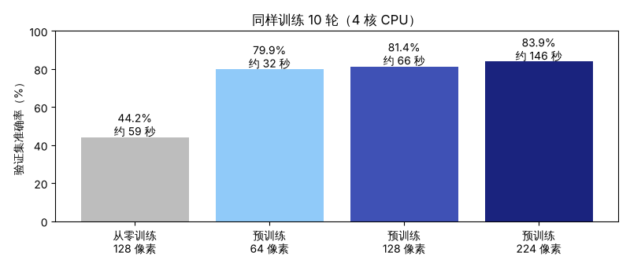
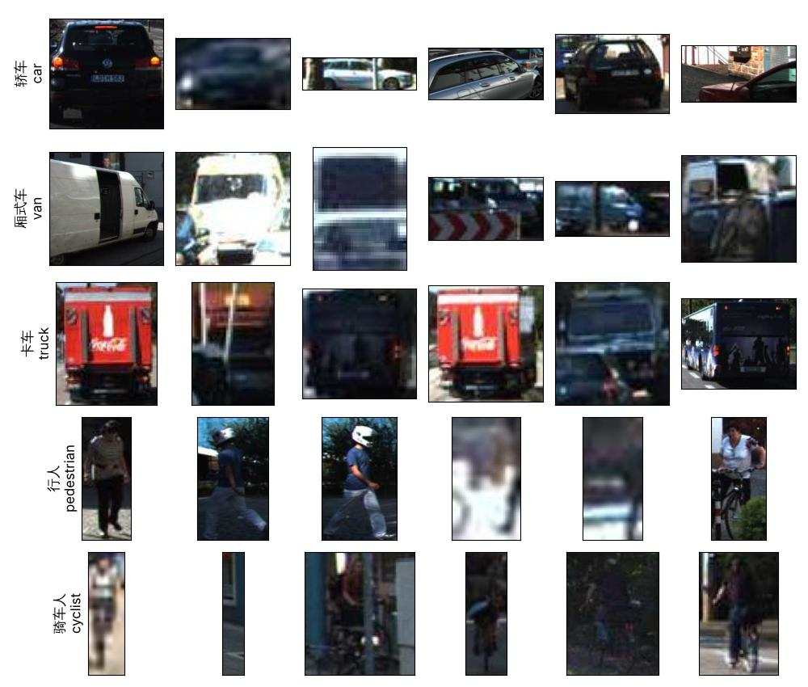
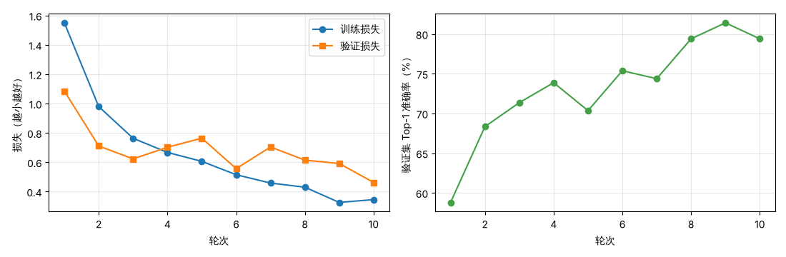
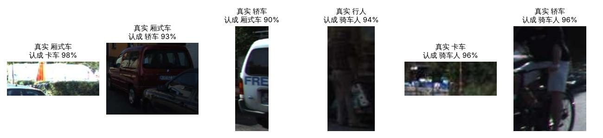
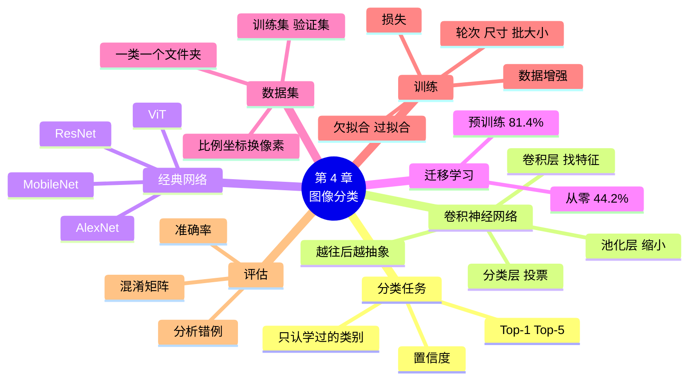

# 第 4 章 图像分类：让模型认出图片

!!! abstract "本章学时"
    理论 4 学时（线上 3 + 线下 1）· 实验 4 学时（本章共 4 个实验，★ 必做 3 个）

## 学习目标

学完本章，你应该能够：

1. **说出**图像分类的输入和输出，解释 Top-1、Top-5 准确率的含义（记忆、理解）；
2. **解释**卷积神经网络中卷积层、池化层、分类层各做什么，为什么越往后看到的东西越抽象（理解）；
3. **运行并修改**给定代码，用预训练模型认图，按“一类一个文件夹”整理数据集，训练一个五类道路目标分类器（应用）；
4. **读懂**训练输出和训练曲线，判断模型是欠拟合还是过拟合（分析）；
5. **根据**混淆矩阵找出最容易混淆的类别，分析认错的原因并提出改进办法（分析、评价）。

!!! info "先修要求"
    学习本章前，你需要掌握：

    - [3.4 卷积](../03-features/index.md#34) 和 [3.6 从手工特征到卷积神经网络](../03-features/index.md#36)；
    - [1.6.2 本书用到的工具](../01-intro/index.md#162)：会用 `YOLO("模型文件")` 载入模型；
    - 第 2、3 章的 Python 小课堂：函数、`for`、列表、`if`。本章的“Python 小课堂④”会讲字典和文件路径。

??? abstract "本章概念清单（17 个，点击查看定义和例子）"
    1. [置信度](../../appendix/glossary.md#g-置信度)
    2. [准确率](../../appendix/glossary.md#g-准确率)
    3. [Top-5 准确率](../../appendix/glossary.md#g-Top-5-准确率)
    4. [卷积层](../../appendix/glossary.md#g-卷积层)
    5. [池化层](../../appendix/glossary.md#g-池化层)
    6. [参数](../../appendix/glossary.md#g-参数)
    7. [迁移学习](../../appendix/glossary.md#g-迁移学习)
    8. [训练集](../../appendix/glossary.md#g-训练集)
    9. [验证集](../../appendix/glossary.md#g-验证集)
    10. [轮次](../../appendix/glossary.md#g-轮次)
    11. [批大小](../../appendix/glossary.md#g-批大小)
    12. [损失](../../appendix/glossary.md#g-损失)
    13. [欠拟合](../../appendix/glossary.md#g-欠拟合)
    14. [过拟合](../../appendix/glossary.md#g-过拟合)
    15. [数据增强](../../appendix/glossary.md#g-数据增强)
    16. [混淆矩阵](../../appendix/glossary.md#g-混淆矩阵)
    17. [字典](../../appendix/glossary.md#g-字典)

## 情景导入

小林的车队要给每辆货车的行车记录做“路况统计”：一天下来，前方出现过多少辆轿车、厢式车、卡车，遇到过多少行人和骑车人。车队已经有一个检测程序，能把画面里的每个“东西”框出来，但它只会说“这是一辆车”，分不清轿车、厢式车和卡车。

老王说：“把框里的小图裁出来，再交给一个‘分类模型’认一下是哪一种，不就行了？”

小林先试了网上现成的模型：一辆白色厢式车，它认成了“搬家货车”，还挺准；一位推着助行车的老人，它却说是“防弹背心”。

“现成的模型学的是它自己的 1000 种东西，里面根本没有‘行人’这一类，”老王说，“你得用我们自己的数据，教它认我们要的五种。”

这一章，我们先弄懂分类模型是怎么“看”图的，再用 KITTI 行车照片做一个五类数据集，训练一个属于自己的分类器，最后看看它在哪里认错、为什么认错。

## 4.1 图像分类任务 { #41 }

### 4.1.1 输入一张图，输出一个类别 { #411 }

第 1 章介绍过，**图像分类**回答的是“这张图是什么”：输入一张图片，输出一个类别和模型对这个答案的把握。这个“把握”叫[**置信度**](../../appendix/glossary.md#g-置信度 "模型对自己给出的答案有多大把握，是 0～1 之间的数，常写成百分数"){ .term }（Confidence），是一个 0～1 之间的数，常写成百分数。

更准确地说，分类模型给**每一个**类别都打一个分，所有类别的分加起来等于 100%。例如实验 4-1 中，白色厢式车的结果是：

| 排名 | 类别 | 置信度 |
|---|---|---|
| 1 | moving_van（搬家货车） | 93.0% |
| 2 | recreational_vehicle（房车） | 6.2% |
| 3 | ambulance（救护车） | 0.2% |
| 4 | trolleybus（无轨电车） | 0.1% |
| 5 | passenger_car（客车车厢） | 0.1% |

排第一的就是模型的答案。

### 4.1.2 Top-1 与 Top-5 { #412 }

衡量分类模型好不好，最常用的是[**准确率**](../../appendix/glossary.md#g-准确率 "预测正确的样本占全部样本的比例"){ .term }（Accuracy）：认对的图片占全部图片的比例。分类任务里又分两种：

- **Top-1 准确率**：模型排第一的答案正好是对的，才算认对；
- [**Top-5 准确率**](../../appendix/glossary.md#g-Top-5-准确率 "正确答案出现在模型置信度最高的前 5 个类别中就算认对，以此计算的准确率；只看第一名的叫 Top-1 准确率"){ .term }：正确答案出现在模型的前 5 名里，就算认对。

为什么要有 Top-5？因为 ImageNet 的 1000 个类别分得很细，光狗就有一百多种。一张照片是“西伯利亚雪橇犬”还是“阿拉斯加雪橇犬”，人都难分；只要前 5 名里有正确答案，说明模型“大方向”是对的。我们自己的五类分类器，Top-5 永远是 100%（一共只有 5 类），所以只看 Top-1。

### 4.1.3 预训练模型认识什么 { #413 }

第 1 章用过的 `yolo26n-cls.pt` 是一个**预训练模型**：它在 ImageNet 数据集的 128 万张图片上训练过，认识 1000 种东西。<sup class="cite">[[1]](#ref4-1)</sup> 这 1000 类里有很多动物、日用品、交通工具，但有几个“出人意料”的特点：

- **没有“人”这一类**。所以实验 4-1 里推着助行车的老人被认成了“防弹背心”（bulletproof_vest），模型只能从它认识的东西里挑一个最像的；
- **车分得很细**：搬家货车、警车、救护车、跑车、出租车……却没有“轿车”这个大类；
- **只看“一张图里最主要的一样东西”**。一整条街交给它，它会答非所问（第 1 章的“泳帽”）；一辆车的车尾在暗处特写，它会认成“磁带播放机”。

!!! tip "预训练模型的答案都来自它学过的类别"
    分类模型不会说“我不知道”。不管你给它看什么，它都会从自己学过的类别里挑一个“最像的”。所以，**先确认你要认的东西在不在它的类别表里**。不在，就要用自己的数据重新训练，这就是 4.4 节的迁移学习。

## 4.2 卷积神经网络的直观理解 { #42 }

第 3 章说过，卷积神经网络（CNN）的关键是“让机器自己学卷积核”。这一节看看一个 CNN 由哪几种“零件”组成。不推导公式，只讲每个零件在做什么。<sup class="cite">[[2]](#ref4-2)</sup>

### 4.2.1 三种零件 { #421 }

| 零件 | 做什么 | 生活比喻 |
|---|---|---|
| [**卷积层**](../../appendix/glossary.md#g-卷积层 "卷积神经网络中用一组卷积核在图上滑动、输出多张特征图的层"){ .term } | 用几十上百个卷积核在图上滑动，每个核输出一张“特征图”，表示它要找的东西在哪里 | 一群“侦探”，每人拿一个放大镜，专找一种线索 |
| [**池化层**](../../appendix/glossary.md#g-池化层 "把特征图缩小（如每 2×2 取最大值）的层，保留“有没有”，丢掉精确位置"){ .term } | 把特征图缩小（如每 2×2 取最大值），保留“有没有”，丢掉“精确在哪” | 看完一页书只记要点，不记每个字的位置 |
| **分类层**（全连接层） | 把最后的特征汇总，给每个类别打分 | 侦探们开会，投票决定“这是什么” |

现代网络常用“步长为 2 的卷积”（卷积核每次挪 2 格）代替池化来缩小特征图，作用是一样的。

### 4.2.2 越往后，看得越大、越抽象 { #422 }

一张 224×224 的彩色图进入网络后，每经过一次缩小，特征图的宽高减半、通道数（卷积核个数）增多：

!!! example "算一算：特征图怎样变小"
    `yolo26n-cls` 第 0 层用 16 个卷积核、步长 2，输入 224×224×3：

    输出宽高 = 224 ÷ 2 = 112，通道数 = 卷积核个数 = 16，形状是 112×112×16。

    以后每一次步长为 2 的卷积，宽高都再减半：112 → 56 → 28 → 14 → 7。到第 8 层时形状是 7×7×256：只剩 49 个位置，却有 256 种特征。

宽高越小，特征图上的一个点就对应原图上越大的一块区域。所以：

- **前面的层**看得“小”，找的是边缘、颜色、简单纹理，和第 3 章的 Sobel 很像；
- **中间的层**把边缘组合成角点、圆弧、格子，开始对“部件”（车轮、车窗）有反应；
- **后面的层**看得“大”，特征已经抽象到人看不懂，但能回答“这一大块里有没有车的样子”。

<iframe class="sim-frame" src="../../sims/cnn-layers/main.html" height="620" loading="lazy" title="CNN 逐层看到了什么"></iframe>

动画：CNN 逐层看到了什么。点上方的流程条切换层，看特征图怎样从“能看出原图的边缘”变成“人看不懂的抽象特征”。
{ .sim-caption }

### 4.2.3 模型有多“大” { #423 }

卷积核里的每一个数、分类层里的每一个权重，都是训练时要调的[**参数**](../../appendix/glossary.md#g-参数 "模型中由训练学习得到的数，如卷积核里的每个数和分类层的权重"){ .term }。`yolo26n-cls` 有约 153 万个参数，模型文件只有 3 MB 左右；而 2012 年的 AlexNet 有约 6000 万个参数。参数越多，模型“记性”越好，但也越慢、越需要数据。辅助驾驶要在车上实时运行，所以常用 n（nano）、s（small）这类小模型。

## 4.3 经典网络一览 { #43 }

不需要记住每个网络的结构，认得名字、知道它的特点就够了：

| 年份 | 网络 | 特点 | 一句话 |
|---|---|---|---|
| 1998 | LeNet | 最早成功的 CNN 之一，识别手写数字 | 用在银行支票上 |
| 2012 | AlexNet | 用 GPU 训练、层数更深，ImageNet 夺冠 | 深度学习的“起点” |
| 2014 | VGG | 全部用 3×3 小卷积核堆叠 | 结构简单整齐 |
| 2015 | ResNet | 加“捷径连接”，网络可以深到 100 层以上 | 解决了“太深训不动”<sup class="cite">[[3]](#ref4-3)</sup> |
| 2017 | MobileNet | 用更省计算的卷积，适合手机 | 小而快 |
| 2020 | 视觉 Transformer（ViT） | 把图片切成小块，用大语言模型同款结构处理 | 数据越多越强 |
| 2023 起 | YOLO 系列分类模型 | 与检测、分割共用一套主干，一行代码切换任务 | 本书使用 |

2015 年的 ResNet 在 ImageNet 上的 Top-5 错误率降到 3.57%，已经低于人类在同一测试中的约 5%。今天的模型已经不再比拼 ImageNet 准确率，而是比拼速度、大小和在各种实际任务上的表现。

## 4.4 预训练模型与迁移学习 { #44 }

### 4.4.1 会骑自行车的人学电动车 { #441 }

会骑自行车的人学电动车，只要半天：平衡感、看路、拐弯这些本事是现成的，只需要学怎么拧把手。没骑过车的人，就得从头学平衡。

训练分类模型也是这样。预训练模型已经从 128 万张图片里学会了找边缘、纹理、车轮、车窗……这些“本事”对认轿车和卡车同样有用。我们只需要换掉最后的分类层（从 1000 类改成 5 类），再用自己的少量数据训练一会儿。这种做法叫[**迁移学习**](../../appendix/glossary.md#g-迁移学习 "从在大数据集上预训练好的模型出发，换掉输出层、用少量新数据继续训练的方法"){ .term }（Transfer Learning）。

### 4.4.2 迁移学习到底有多大用 { #442 }

编者用同样的 799 张训练图、同样训练 10 轮，对比了“从零开始”和“从预训练模型出发”：



*图 4-1　迁移学习的效果（编者在 4 核 CPU 上实测，验证集 199 张）*

| 起点 | 图片尺寸 | 验证集准确率 | 用时 |
|---|---|---|---|
| 从零开始（随机卷积核） | 128 | 44.2% | 约 59 秒 |
| 预训练模型 | 64 | 79.9% | 约 32 秒 |
| 预训练模型 | 128 | 81.4% | 约 66 秒 |
| 预训练模型 | 224 | 83.9% | 约 146 秒 |

从零开始只有 44.2%，比瞎猜（五选一，20%）好不了多少；从预训练模型出发，同样 10 轮就到了 81.4%。**数据少的时候，迁移学习几乎是唯一可行的办法。**

在 Ultralytics 里，两者的区别只有一个文件名：

```python
model = YOLO("yolo26n-cls.pt")      # .pt：带着学好的参数（预训练），推荐
model = YOLO("yolo26n-cls.yaml")    # .yaml：只有结构，参数随机（从零开始）
```

## 4.5 准备分类数据集 { #45 }

### 4.5.1 一类一个文件夹 { #451 }

分类数据集的格式非常简单：**一个类别一个文件夹，文件夹名就是类别名**。

```text
road_objects/
├── train/              训练集：模型用来学习
│   ├── car/            160 张轿车小图
│   ├── cyclist/
│   ├── pedestrian/
│   ├── truck/
│   └── van/
└── val/                验证集：每轮训练完用来检查
    ├── car/            40 张
    └── ……
```

数据集分成几份，各有用途：

| 名称 | 用途 | 比喻 |
|---|---|---|
| [**训练集**](../../appendix/glossary.md#g-训练集 "用来训练模型的数据，相当于“课本和练习题”"){ .term } | 模型从中学习，调整参数 | 课本和练习册 |
| [**验证集**](../../appendix/glossary.md#g-验证集 "训练过程中用来检查效果、挑选最好一版模型的数据，相当于“模拟考试”"){ .term } | 训练过程中检查效果、挑出最好的一版模型 | 单元测验 |
| 测试集 | 训练全部结束后，用从没见过的数据最终打分 | 期末考试 |

验证集和训练集**不能有重复的图**，否则就像考试题和练习题一样，分数会虚高。本书数据量小，只分了训练集和验证集。

### 4.5.2 从行车照片裁出小图 { #452 }

本书的五类小图是这样来的：KITTI 数据集为每张行车照片都标注了物体的类别和位置（标注框），编者按标注框把物体裁出来，按类别放进文件夹。<sup class="cite">[[4]](#ref4-4)</sup>

标注文件每一行描述一个物体，格式是“类别编号 中心x 中心y 宽 高”，后四个数都是 0～1 的**比例**（除以了照片的宽或高）。这种格式第 5 章还会用到。

!!! example "算一算：比例坐标换成像素坐标"
    照片 `000380.jpg` 宽 1242、高 375。标注文件第一行是 `0 0.514187 0.569520 0.058615 0.159520`：

    - 类别 0，在 KITTI 中是 car（轿车）；
    - 中心 x = 0.514187 × 1242 ≈ 638.6，中心 y = 0.569520 × 375 ≈ 213.6；
    - 宽 = 0.058615 × 1242 ≈ 72.8，高 = 0.159520 × 375 ≈ 59.8；
    - 左上角 = (638.6 − 72.8 ÷ 2, 213.6 − 59.8 ÷ 2) ≈ (602, 183)，右下角 ≈ (675, 243)。

    实验 4-2 第 2 步的输出“左上 (602, 183) 右下 (675, 243) 大小 73×60”与此一致。



*图 4-2　road_objects 数据集样例（裁自 KITTI 数据集，CC BY-NC-SA 3.0）*

### 4.5.3 好数据集的几个要求 { #453 }

1. **每类数量差不多**。如果轿车 1000 张、卡车只有 20 张，模型会倾向于什么都猜“轿车”。本书每类训练 160 张、验证 40 张；
2. **贴近实际使用的场景**。要认行车画面里的车，就用行车画面裁的图，不要用汽车广告照片；
3. **标注要准**。图 4-6 会看到，一张标成“轿车”的小图里其实挡着一位骑车人，模型就“糊涂”了；
4. **注意许可**。KITTI 只允许非商业用途（CC BY-NC-SA 3.0），做产品要另找数据或自己采集，并遵守第 3 章说的个人信息保护要求。

## 4.6 训练：轮次、图片尺寸、批大小 { #46 }

### 4.6.1 一行代码开始训练 { #461 }

```python
model = YOLO("yolo26n-cls.pt")
model.train(data="../data/road_objects", epochs=10, imgsz=128, batch=32)
```

三个最常调的参数：

| 参数 | 意思 | 比喻 | 调大会怎样 |
|---|---|---|---|
| `epochs` | [**轮次**](../../appendix/glossary.md#g-轮次 "把整个训练集完整使用一遍称为一轮"){ .term }：把整个训练集从头到尾学几遍 | 练习册做几遍 | 学得更充分，但太多会“死记硬背”，也更费时间 |
| `imgsz` | 图片缩放到多大 | 用放大镜还是缩小镜看图 | 细节多、往往更准，但更慢（224 比 128 慢约一倍） |
| `batch` | [**批大小**](../../appendix/glossary.md#g-批大小 "每次更新参数时所用的一小组样本的数量"){ .term }：每次看几张图再调一次参数 | 做几道题对一次答案 | 更稳更快，但更占内存 |

本书的小图平均只有一百多像素宽，所以 `imgsz=128` 就够用了。799 张图、批大小 32，每一轮要调 799 ÷ 32 ≈ 25 次参数，训练输出中的“25/25”就是这个意思。

### 4.6.2 读懂训练输出 { #462 }

训练时每一轮会打印两行：

```text
      Epoch    GPU_mem       loss  Instances       Size
       10/10         0G     0.3452         31        128: 100% ━━━━━━━━━━━━ 25/25 5.1it/s 4.9s
               classes   top1_acc   top5_acc: 100% ━━━━━━━━━━━━ 4/4 10.8it/s 0.4s
                   all      0.794          1
```

- 第一行是**训练**：第 10 轮（共 10 轮），没用 GPU，[**损失**](../../appendix/glossary.md#g-损失 "由损失函数算出的、衡量模型预测与真实答案差距的数，训练就是让它变小"){ .term }（loss）0.3452，用时 4.9 秒；
- 第二行是**验证**：在验证集上 Top-1 准确率 0.794（79.4%），Top-5 是 1（100%）。

**损失**是模型“错得有多离谱”的分数：认对了而且很有把握，损失接近 0；认错了还很自信，损失很大。训练就是不断调参数让损失变小。

训练结束后，结果保存在 `runs/road5/` 文件夹里，最重要的是 `weights/best.pt`：它是**验证准确率最高的那一轮**的模型，不一定是最后一轮。本次训练第 9 轮最高（81.4%），第 10 轮反而降到 79.4%，所以 `best.pt` 保存的是第 9 轮。

### 4.6.3 看训练曲线：欠拟合与过拟合 { #463 }



*图 4-3　实验 4-3 的训练曲线（编者实际运行，数据来自 runs/road5/results.csv）*

从图 4-3 可以看出：训练损失从 1.55 一路降到 0.35 左右；验证准确率从第 1 轮的 58.8% 上升到 80% 左右，后几轮上下波动。怎样判断训练得好不好？

| 现象 | 名称 | 比喻 | 怎么办 |
|---|---|---|---|
| 训练损失、验证准确率都还在明显改善 | 还没学完 | 书还没看完 | 多训练几轮 |
| 训练损失很高、验证准确率很低 | [**欠拟合**](../../appendix/glossary.md#g-欠拟合 "模型太简单或训练不够、没学到规律，训练集和验证集成绩都差的现象"){ .term } | 没学会 | 多训练、换大一点的模型、加大图片尺寸 |
| 训练损失一直降，验证损失却开始上升、准确率不升反降 | [**过拟合**](../../appendix/glossary.md#g-过拟合 "模型在训练集上表现好、在新数据上表现差的现象"){ .term } | 死记硬背练习题，换了题就不会 | 多找数据、加数据增强、少训练几轮 |

我们的模型在第 8 轮以后基本稳定在 80% 左右，再多训练提升有限：编者把轮次加到 20 轮，最好的一轮也只有 81.9%。要进一步提高，更有效的办法是加数据、加大图片尺寸（224 时为 83.9%）。

!!! info "数据增强"
    训练时，Ultralytics 会自动对每张图做随机的左右翻转、裁剪、调亮度等变化（第 2 章学过的那些操作），让模型每一轮看到的都是“略有不同”的图，相当于免费增加了数据，能减轻过拟合。这叫[**数据增强**](../../appendix/glossary.md#g-数据增强 "训练时对图片随机翻转、裁剪、调亮度等，让模型每次看到略有不同的图，以减轻过拟合的方法"){ .term }（Data Augmentation）。

## 4.7 评估：准确率与混淆矩阵 { #47 }

### 4.7.1 只看准确率不够 { #471 }

验证集准确率 81.4%，听起来不错。但它没有回答：认错的那 18.6% 都错在哪里？是每类都错一点，还是某两类总分不清？要回答这个问题，需要[**混淆矩阵**](../../appendix/glossary.md#g-混淆矩阵 "按“真实类别 × 预测类别”交叉统计样本数量的表格，对角线是认对的"){ .term }（Confusion Matrix）。

### 4.7.2 读混淆矩阵 { #472 }

混淆矩阵是一张表：**行是真实类别，列是模型的预测**，每一格写“真实是这一行、被认成这一列”的图片张数。对角线上的格子是认对的，其余格子都是认错的。

实验 4-4 得到的混淆矩阵：

| 真实＼预测 | 轿车 | 骑车人 | 行人 | 卡车 | 厢式车 | 认对比例 |
|---|---|---|---|---|---|---|
| **轿车** | **30** | 2 | 3 | 0 | 5 | 75.0% |
| **骑车人** | 0 | **37** | 3 | 0 | 0 | 92.5% |
| **行人** | 0 | 6 | **30** | 3 | 1 | 75.0% |
| **卡车** | 0 | 1 | 0 | **39** | 0 | 97.5% |
| **厢式车** | 5 | 0 | 0 | 8 | **26** | 66.7% |

!!! example "算一算：从混淆矩阵读出信息"
    - 总准确率 = 对角线之和 ÷ 总张数 = (30 + 37 + 30 + 39 + 26) ÷ 199 = 162 ÷ 199 ≈ 81.4%；
    - 厢式车这一行：39 张中认对 26 张，26 ÷ 39 ≈ 67%，是最差的一类；
    - 厢式车认错的 13 张里，8 张被认成卡车、5 张被认成轿车；反过来，轿车也有 5 张被认成厢式车。

    结论：**厢式车夹在轿车和卡车之间**，最容易混淆。行人和骑车人之间也有 6 + 3 = 9 张互相认错。

<iframe class="sim-frame" src="../../sims/confusion-matrix/main.html" height="560" loading="lazy" title="混淆矩阵读图"></iframe>

动画：混淆矩阵读图。点任意一格，看这一格里是哪些图片。先点“厢式车 → 卡车”，看看它们有什么共同点。
{ .sim-caption }

### 4.7.3 模型为什么会认错 { #473 }

把认错的图片一张张看过去，原因大致有这几类：



*图 4-4　实验 4-4 找出的几张“很自信地认错”的图片*

| 原因 | 例子 | 改进办法 |
|---|---|---|
| **类别本身相似** | 红色的小型厢式车和两厢轿车外形接近；大型厢式车和小卡车也很像 | 多收集这两类的样本；或干脆合并成一类（第 5 章检测时就把轿车和厢式车合成了 car） |
| **被遮挡、被截断** | 卡车只露出一角，被树篱挡住大半 | 增加遮挡样本；或丢掉太小、太残缺的样本 |
| **太小、太暗、太模糊** | 远处的行人只有十几像素宽，又在阴影里 | 加大图片尺寸；先做第 2 章的调亮处理 |
| **标注框里混着别的东西** | 一张标成“轿车”的小图，前面其实挡着一位骑车人 | 检查和清洗标注；这类“噪声”在真实数据集里很常见 |

**分析错误比提高准确率更重要。** 知道了错在哪，才知道该去补什么数据、改什么设置。实际项目中，工程师花在“看错例、补数据”上的时间，往往比调参数多得多。

## 4.8 Python 小课堂④：字典与文件路径 { #48 }

**1. 字典：按名字查东西**

列表按位置（下标）查，[**字典**](../../appendix/glossary.md#g-字典 "用“键: 值”成对存放数据、按键查找值的 Python 数据"){ .term }（Dictionary）按名字查。字典用花括号写，每一项是“键: 值”：

```python
NAMES = {0: "car", 1: "van", 2: "truck"}      # 键是编号，值是类别名
print(NAMES[1])                              # van：按键查值
counts = {}                                  # 空字典
counts["car"] = 160                          # 加一项（键不存在就新建）
counts["car"] = counts["car"] + 1            # 改一项
print(counts)                                # {'car': 161}
for name, n in counts.items():               # 同时取出每一项的键和值
    print(name, n)
```

本章的实验里，字典用得很多：类别编号查类别名（实验 4-2）、统计每类数量（实验 4-2）、存放裁出的小图（实验 4-1）、记录混淆矩阵（实验 4-4 用的是“字典套字典”，`matrix["van"]["truck"]` 表示真实是厢式车、认成卡车的张数）。

**2. 文件路径：pathlib 的三个用法**

第 2 章用 `Path(…).glob("*.jpg")` 找过图片，再补三个常用写法：

```python
from pathlib import Path
root = Path("../data/road_objects")
p = root / "train" / "car"                    # 用 / 拼路径，不用管 Windows 和 Mac 的差别
print(p.exists(), p.name)                    # 路径存不存在；最后一段的名字 car
for folder in sorted((root / "train").iterdir()):   # 列出文件夹里的每一项
    print(folder.name, len(list(folder.glob("*.jpg"))))
```

| 写法 | 作用 |
|---|---|
| `Path("a") / "b"` | 拼路径 |
| `p.exists()` | 路径存不存在 |
| `p.name`、`p.stem`、`p.suffix` | 文件名（`000380.jpg`）、不带扩展名（`000380`）、扩展名（`.jpg`） |
| `p.iterdir()` | 列出文件夹里的所有项 |
| `p.glob("*.jpg")` | 找出符合条件的文件 |
| `p.read_text()` | 读出文本文件的全部内容 |
| `p.mkdir(exist_ok=True)` | 建文件夹，已有就不管 |

## 4.9 本章常见报错对照 { #49 }

| 报错原文（最后一行） | 用大白话说 | 怎么改 |
|---|---|---|
| `FileNotFoundError: … best.pt` | 训练还没做，或结果不在这个文件夹 | 先运行实验 4-3；看训练结束时打印的“Results saved to”路径 |
| `Dataset '…' error ❌ … not found` | 数据集路径不对 | 确认在 `labs/ch04/` 里运行，`../data/road_objects` 下有 train、val |
| `KeyError: 'bus'` | 字典里没有这个键 | 先 `print(字典.keys())` 看有哪些键 |
| `RuntimeError: … out of memory` 或电脑卡死 | 批大小或图片尺寸太大，内存不够 | 把 `batch` 改成 16 或 8，`imgsz` 改小 |
| 训练特别慢（一轮几分钟） | 图片尺寸太大，或没关掉别的程序 | 用 `imgsz=128`；云端可以选 GPU 环境 |
| Top-5 准确率总是 1 | 不是错误：一共只有 5 类 | 只看 Top-1 |
| `ValueError: … ':' expected after dictionary key` | 字典写法错了 | 每一项写成 `键: 值`，用英文冒号和逗号 |

## 4.10 前沿视窗：不用训练也能分类的 CLIP { #410 }

本章的分类器只认我们教过的 5 类，想加一类“公交车”，就得重新收集数据、重新训练。有没有不用训练就能认新类别的模型？

2021 年，OpenAI 发布了 CLIP 模型。<sup class="cite">[[5]](#ref4-5)</sup> 它用从网上收集的 4 亿对“图片 + 文字说明”训练，学会了把图片和文字放到同一个“意思空间”里比较。用它分类时，不需要训练，只要写几句话：“一张轿车的照片”“一张公交车的照片”“一张行人的照片”，模型就会算出图片和哪句话最接近。这种“没见过这一类的训练样本也能认”的能力，叫“零样本分类”。

国内也有类似的中文模型，例如阿里达摩院发布的中文 CLIP（Chinese-CLIP），可以直接用中文写类别描述。<sup class="cite">[[6]](#ref4-6)</sup> 第 1 章介绍的多模态大模型，也是在这类模型的基础上发展起来的。

零样本分类很方便，但在专业场景（区分厢式车和小卡车、识别某种零件缺陷）中，用自己的数据训练的小模型通常更准、更快。两者常常配合：先用 CLIP 这类模型帮忙给大量图片“粗分类”，人再检查修正，然后训练专用的小模型。

## 本章实验

!!! abstract "实验总览"
    | 实验 | 类型 | 建议时长 | 内容 |
    |---|---|---|---|
    | 实验 4-1 | ★ 必做 | 35 分钟 | 认出 1000 种东西 |
    | 实验 4-2 | ★ 必做 | 45 分钟 | 整理道路目标数据集 |
    | 实验 4-3 | ★ 必做 | 45 分钟 | 训练车辆行人类型分类器 |
    | 实验 4-4 | ☆ 选做 | 45 分钟 | 看看错在哪里 |

    代码见配套资源 `labs/ch04/` 目录，每个实验都有 `.py` 和 `.ipynb` 两种文件，内容相同。所有实验都在 `labs/ch04/` 文件夹里运行，CPU 即可。实验 4-3 训练 10 轮，编者在 4 核 CPU 上约 1 分钟；普通笔记本电脑可能要 2～5 分钟。

### 实验 4-1 ★ 认出 1000 种东西 { #4-1 }

**实验目的**

1. 用预训练分类模型识别图片，读出 Top-5 类别和置信度；
2. 体会预训练模型“只认识它学过的类别”。

**实验环境**：云端 Notebook 或本机，CPU 即可。第一次运行要联网下载 `yolo26n-cls.pt`（约 6 MB）。

**实验数据**：`labs/data/images/drive_city.jpg`（KITTI，CC BY-NC-SA 3.0），或你自己拍的照片。

**实验步骤与代码**

第一档 · 跑通：打开 `lab4_1_imagenet_top5.ipynb`，依次运行三个单元格。

```python
model = YOLO("yolo26n-cls.pt")
print("模型认识", len(model.names), "种东西")

img = cv2.imread("../data/images/drive_city.jpg")
crops = {                                   # 字典：名字 → 裁出的小图
    "白色厢式车": img[150:240, 385:530],     # ← 改这里：换一块区域试试
    "停着的轿车": img[190:370, 0:300],
    "推车的老人": img[180:325, 885:955],
}
for name, crop in crops.items():
    r = model(crop, verbose=False)[0]          # 直接把图片（数字表）交给模型
    print(f"【{name}】")
    for i in r.probs.top5:                     # 把握最大的 5 个类别的编号
        print(f"    {r.names[i]:22s} {float(r.probs.data[i]):6.1%}")
```

`r.probs.top5` 是置信度最高的 5 个类别的编号，`r.names[i]` 把编号换成类别名，`r.probs.data[i]` 是这个类别的置信度。完整代码：`labs/ch04/lab4_1_imagenet_top5.py`

**运行结果**

```text
模型认识 1000 种东西，前 5 种是： ['tench', 'goldfish', 'great_white_shark', 'tiger_shark', 'hammerhead']
【白色厢式车】
    moving_van              93.0%
    recreational_vehicle     6.2%
    ambulance                0.2%
    trolleybus               0.1%
    passenger_car            0.1%
【停着的轿车】
    cassette_player         44.2%
    cassette                13.1%
    digital_clock           11.5%
    harmonica                6.6%
    tape_player              4.8%
【推车的老人】
    bulletproof_vest        45.0%
    abaya                   17.4%
    knee_pad                10.2%
    bearskin                 4.3%
    overskirt                3.5%
```

白色厢式车认成“搬家货车”，相当准确。停着的轿车只拍到暗处的车尾和车牌，被认成“磁带播放机”（黑色方盒子 + 一排亮的“按键”）；老人被认成“防弹背心”，因为 1000 类里没有“人”。

第二档 · 改一改：

1. 把裁剪区域改成 `img[185:235, 585:645]`（远处的白色轿车），记录 Top-5；
2. 把“停着的轿车”的区域扩大到 `img[100:375, 0:400]`，让车身露得更多，结果有没有变好？
3. 用手机拍三样身边的东西（水杯、键盘、绿植等），上传后识别，记录 Top-1 是否正确。

**实验记录表**

| 图片 | Top-1 类别 | 置信度 | 对不对？不对的原因 |
|---|---|---|---|
| 白色厢式车 | moving_van | 93.0% | 对 |
| 停着的轿车 | cassette_player | 44.2% | 不对：只有暗处的车尾特写 |
| 推车的老人 | bulletproof_vest | 45.0% | 不对：1000 类里没有“人” |
| 远处的白色轿车 | | | |
| 自己的照片 1～3 | | | |

**常见问题排查**

| 现象 | 原因 | 解决办法 |
|---|---|---|
| 识别结果都是奇怪的类别 | 照片里东西太多，或要认的东西不在 1000 类里 | 裁出单个物体再识别；查看 `model.names` |
| `IndexError` 或裁出的图是空的 | 裁剪的行列超出了图片范围 | 行用 0～374，列用 0～1241 |
| 下载模型失败 | 没联网 | 从老师处拷贝 `yolo26n-cls.pt` 到 `labs/ch04/` |

**思考与练习**

1. 预训练模型认错“停着的轿车”和“推车的老人”，原因一样吗？分别该怎么解决？

**实验报告要求**

提交程序输出和实验记录表，回答“思考与练习”。

### 实验 4-2 ★ 整理道路目标数据集 { #4-2 }

**实验目的**

1. 读懂“类别 中心x 中心y 宽 高”的标注格式，把比例坐标换算成像素坐标；
2. 按标注框裁出小图，理解分类数据集是怎样做出来的；
3. 用字典统计数据集中每类的数量和平均大小。

**实验环境**：云端 Notebook 或本机，CPU 即可。

**实验数据**：`labs/data/kitti_sample/000380.jpg` 和 `000380.txt`（一张 KITTI 照片及其标注）；`labs/data/road_objects/`（编者用同样方法从 KITTI 裁好的五类小图，训练 799 张、验证 199 张）。以上均为 KITTI 数据集，CC BY-NC-SA 3.0。

**实验步骤与代码**

第一档 · 跑通：打开 `lab4_2_dataset.ipynb`，依次运行四个单元格。第 2 步裁小图：

```python
for k, line in enumerate(lines):
    c, x, y, w, h = line.split()                          # 类别、中心 x、中心 y、宽、高（都是比例）
    x, y, w, h = float(x) * W, float(y) * H, float(w) * W, float(h) * H
    x1, y1, x2, y2 = int(x - w / 2), int(y - h / 2), int(x + w / 2), int(y + h / 2)
    name = NAMES[int(c)]                                  # 字典：编号 → 类别名
    cv2.imwrite(str(out / f"{k}_{name}.jpg"), img[y1:y2, x1:x2])
```

第 3 步统计每类数量：

```python
for split in ["train", "val"]:
    counts = {}                                           # 空字典
    for folder in sorted((root / split).iterdir()):       # 每个类别一个文件夹
        counts[folder.name] = len(list(folder.glob("*.jpg")))
    print(split, counts, "合计", sum(counts.values()))
```

完整代码：`labs/ch04/lab4_2_dataset.py`

**运行结果**

```text
照片 1242×375，标注了 9 个物体；第一行：0 0.514187 0.569520 0.058615 0.159520
0: car         左上 (602, 183)  右下 (675, 243)  大小 73×60
1: pedestrian  左上 (998, 163)  右下 (1034, 250)  大小 36×87
2: car         左上 (1074, 174)  右下 (1235, 220)  大小 161×46
3: car         左上 (364, 184)  右下 (419, 216)  大小 55×32
4: cyclist     左上 (760, 174)  右下 (815, 217)  大小 55×43
5: van         左上 (654, 167)  右下 (696, 211)  大小 42×44
6: pedestrian  左上 (529, 173)  右下 (541, 218)  大小 12×45
7: van         左上 (455, 179)  右下 (484, 201)  大小 29×22
8: car         左上 (584, 182)  右下 (628, 223)  大小 44×41
train {'car': 160, 'cyclist': 160, 'pedestrian': 159, 'truck': 160, 'van': 160} 合计 799
val {'car': 40, 'cyclist': 40, 'pedestrian': 40, 'truck': 40, 'van': 39} 合计 199
car         平均 宽 116.1 × 高  71.7
cyclist     平均 宽  59.9 × 高  92.4
pedestrian  平均 宽  51.5 × 高 125.4
truck       平均 宽 109.7 × 高  91.2
van         平均 宽 106.2 × 高  79.8
```

打开 `lab4_2_crops` 文件夹，能看到 9 张小图。第 6 号行人只有 12×45 像素，几乎看不清。平均宽高也很有规律：行人“瘦高”（高是宽的 2 倍多），轿车“扁宽”，这本身就是一种可以区分类别的特征。行人和厢式车各少一张，是编者裁剪时去掉了太小（宽或高不足 8 像素）的框。

第二档 · 改一改：

1. 用“算一算”的方法，手算第 1 行（pedestrian）的左上角和右下角，和程序输出对照；
2. 修改第 2 步，跳过宽或高小于 20 像素的框（提示：`if x2 - x1 < 20 or y2 - y1 < 20: continue`），这张照片还剩几个物体？
3. 修改第 4 步，同时打印每类的“最小宽度”（提示：`min(...)`）。

第三档 · 挑战（选做）：阅读 `labs/data/get_kitti_small.py` 中的 `make_classification` 函数，说说它和本实验第 2 步有哪些相同、哪些不同（提示：太小的图被放大到短边 32 像素；前 80% 放训练集，后 20% 放验证集）。

**实验记录表**

| 类别 | 训练张数 | 验证张数 | 平均宽 × 高 | 你观察到的特点 |
|---|---|---|---|---|
| car | 160 | 40 | 116.1 × 71.7 | |
| van | | | | |
| truck | | | | |
| pedestrian | | | | |
| cyclist | | | | |

**常见问题排查**

| 现象 | 原因 | 解决办法 |
|---|---|---|
| 裁出的小图位置不对 | 把中心坐标当成了左上角 | 左上角 = 中心 − 宽（高）÷ 2 |
| 裁出的小图是空的 | 宽高乘反了（x 乘了高、y 乘了宽） | x 和 w 乘照片宽 W，y 和 h 乘照片高 H |
| `KeyError: 8` | 类别编号不在字典里 | 检查标注文件，或用 `NAMES.get(int(c), "unknown")` |

**思考与练习**

1. 如果把 KITTI 的 8 类全部裁出来，“tram（有轨电车）”只有很少几张，直接训练会有什么问题？

**实验报告要求**

提交程序输出、裁出的 9 张小图截图和实验记录表，回答“思考与练习”。

### 实验 4-3 ★ 训练车辆行人类型分类器 { #4-3 }

**实验目的**

1. 在预训练模型的基础上，用自己的数据集训练五类分类器（迁移学习）；
2. 读懂训练输出，找到训练结果和最好的模型；
3. 比较不同轮次、图片尺寸、起点对准确率和用时的影响。

**实验环境**：云端 Notebook 或本机，CPU 即可。编者在 4 核 CPU 上训练 10 轮约 1 分钟。

**实验数据**：`labs/data/road_objects/`（同实验 4-2）。

**实验步骤与代码**

第一档 · 跑通：打开 `lab4_3_train.ipynb`，依次运行三个单元格。

```python
model = YOLO("yolo26n-cls.pt")                    # 从“会认 1000 种东西”的模型出发
model.train(
    data="../data/road_objects",                  # 数据集文件夹
    epochs=10,                                    # ← 改这里：训练几轮
    imgsz=128,                                    # ← 改这里：图片缩放到多大
    batch=32,                                     # 每次看 32 张
    device="cpu", workers=2, seed=0,
    project=Path("runs").resolve(), name="road5", exist_ok=True,  # 结果存到 runs/road5
)
best = YOLO("runs/road5/weights/best.pt")         # 训练中验证准确率最高的那一版
metrics = best.val(data="../data/road_objects", imgsz=128, verbose=False)
print(f"验证集 Top-1 准确率：{metrics.top1:.1%}，Top-5 准确率：{metrics.top5:.1%}")
```

`seed=0` 固定随机数，让每次训练的结果尽量一样（不同电脑上仍可能有小差别）。第 3 步用训练好的模型认实验 4-1 的白色厢式车。完整代码：`labs/ch04/lab4_3_train.py`

**运行结果**

训练过程中每轮打印两行（见 4.6.2 节），最后：

```text
验证集 Top-1 准确率：81.4%，Top-5 准确率：100.0%
    van          99.2%
    car           0.6%
    truck         0.2%
    cyclist       0.0%
    pedestrian    0.0%
```

每轮的验证准确率依次是 58.8%、68.3%、71.4%、73.9%、70.4%、75.4%、74.4%、79.4%、81.4%、79.4%，第 9 轮最好，`best.pt` 就是第 9 轮的模型。训练曲线见图 4-3，`runs/road5/` 里还有 Ultralytics 自动画的 `results.png`、`confusion_matrix.png` 等图。

同一辆白色厢式车，预训练模型说“搬家货车 93.0%”，现在我们的模型说“van 99.2%”：它已经学会了我们要的五个类别。

第二档 · 改一改（每次只改一处，改完记得把 `name` 也改掉，免得覆盖之前的结果）：

1. 把 `epochs` 改成 20，记录最好的准确率和用时；
2. 把 `imgsz` 改成 64 和 224，记录准确率和用时；
3. 把第一行改成 `YOLO("yolo26n-cls.yaml")`（从零开始），记录准确率，和预训练对比。

**实验记录表**

| 起点 | epochs | imgsz | 最好的验证准确率 | 用时 | 编者实测（4 核 CPU） |
|---|---|---|---|---|---|
| 预训练 .pt | 10 | 128 | | | 81.4%，约 66 秒 |
| 预训练 .pt | 20 | 128 | | | 81.9%，约 113 秒 |
| 预训练 .pt | 10 | 64 | | | 79.9%，约 32 秒 |
| 预训练 .pt | 10 | 224 | | | 83.9%，约 146 秒 |
| 从零 .yaml | 10 | 128 | | | 44.2%，约 59 秒 |

**常见问题排查**

| 现象 | 原因 | 解决办法 |
|---|---|---|
| 准确率和编者的差几个百分点 | 随机性、电脑不同 | 正常现象，差别在 5% 以内不用管 |
| 找不到 `runs/road5/weights/best.pt` | `project` 没有写成 `Path("runs").resolve()`，结果存到了别处 | 看训练结束时打印的“Results saved to”路径 |
| 电脑卡死或内存不足 | 批大小、图片尺寸太大 | 改成 `batch=16`、`imgsz=128`，`workers=0` |

**思考与练习**

1. 从零训练只有 44.2%，预训练有 81.4%。用“会骑自行车的人学电动车”的比喻解释这个差距。
2. 把 `imgsz` 从 128 提到 224，准确率提高了 2.5 个百分点，用时却多了一倍多。如果要在车上实时运行，你会怎么选？

**实验报告要求**

提交训练输出截图、`results.png` 和填好的实验记录表，回答“思考与练习”。

### 实验 4-4 ☆ 看看错在哪里 { #4-4 }

**实验目的**

1. 自己逐张预测验证集，用“字典套字典”数出混淆矩阵；
2. 找出最容易混淆的类别和最“自信”的错误；
3. 分析认错的原因，提出改进办法。

**实验环境**：云端 Notebook 或本机，CPU 即可。需要先完成实验 4-3。

**实验数据**：`labs/data/road_objects/val/`（199 张）。

**实验步骤与代码**

第一档 · 跑通：打开 `lab4_4_confusion.ipynb`，依次运行三个单元格。

```python
model = YOLO("runs/road5/weights/best.pt")
names = ["car", "cyclist", "pedestrian", "truck", "van"]
matrix = {t: {p: 0 for p in names} for t in names}    # matrix[真实][预测] = 张数，先全设成 0
wrong = []
for t in names:
    for f in sorted(Path(f"../data/road_objects/val/{t}").glob("*.jpg")):
        p = model(str(f), imgsz=128, verbose=False)[0]
        pred = p.names[p.probs.top1]                  # 把握最大的那一类
        matrix[t][pred] += 1                          # += 1 就是“加 1”
        if pred != t:
            wrong.append((f.name, t, pred, float(p.probs.top1conf)))
```

第 2 步把 `matrix` 打印成表格，第 3 步把认错的图按把握从大到小排序，打印前 8 张。完整代码：`labs/ch04/lab4_4_confusion.py`

**运行结果**

```text
真实＼预测            car  cyclis  pedest   truck     van   准确率
car               30       2       3       0       5    75.0%
cyclist            0      37       3       0       0    92.5%
pedestrian         0       6      30       3       1    75.0%
truck              0       1       0      39       0    97.5%
van                5       0       0       8      26    66.7%
总共认对 162 张，认错 37 张，准确率 81.4%
003993_182.jpg   真实 van        → 认成 truck     （把握 98%）
000424_173.jpg   真实 car        → 认成 cyclist   （把握 96%）
006219_179.jpg   真实 truck      → 认成 cyclist   （把握 96%）
001454_195.jpg   真实 pedestrian → 认成 cyclist   （把握 94%）
007412_189.jpg   真实 pedestrian → 认成 cyclist   （把握 93%）
007403_185.jpg   真实 van        → 认成 car       （把握 93%）
001142_164.jpg   真实 van        → 认成 truck     （把握 91%）
000424_174.jpg   真实 car        → 认成 van       （把握 90%）
```

几张认错的图见图 4-4，也可以在“混淆矩阵读图”动画中逐格查看。

第二档 · 改一改：

1. 打开 `../data/road_objects/val/` 下排名前 4 的认错图片，逐张写出你认为的原因（类别相似 / 遮挡截断 / 太小太暗 / 标注有问题）；
2. 修改第 3 步，只打印“真实是 van”的错误；
3. 修改第 2 步，再打印每一**列**的“预测为这一类时有多少是真的”（第 5 章会把它叫作“精确率”）。

**实验记录表**

| 认错的图片 | 真实 | 认成 | 把握 | 你判断的原因 | 改进办法 |
|---|---|---|---|---|---|
| 003993_182.jpg | van | truck | 98% | | |
| 000424_173.jpg | car | cyclist | 96% | | |
| 006219_179.jpg | truck | cyclist | 96% | | |
| 001454_195.jpg | pedestrian | cyclist | 94% | | |

**常见问题排查**

| 现象 | 原因 | 解决办法 |
|---|---|---|
| 混淆矩阵和编者的不一样 | 自己训练的模型和编者的有随机差别 | 正常现象，按自己的结果分析 |
| `FileNotFoundError: best.pt` | 没做实验 4-3 | 先完成实验 4-3 |
| 运行很慢 | 199 张图逐张预测 | CPU 上约 10～20 秒，耐心等待 |

**思考与练习**

1. 如果车队的统计只关心“机动车”和“行人骑车人”两大类，你会怎样修改数据集？预计准确率会怎样变化？

**实验报告要求**

提交混淆矩阵输出和实验记录表，回答“思考与练习”。

## 本章小结

- **图像分类**输入一张图，输出每个类别的**置信度**，排第一的就是答案。**准确率**分 Top-1 和 Top-5。预训练模型只能从它学过的类别中挑答案，ImageNet 的 1000 类里没有“人”。
- 卷积神经网络由**卷积层**（找特征）、**池化层**（缩小）、**分类层**（投票）组成。越往后，特征图越小、通道越多、看到的东西越大越抽象。卷积核里的数都是训练出来的**参数**。
- 经典网络：LeNet → AlexNet（2012，深度学习起点）→ VGG → ResNet（捷径连接）→ MobileNet（轻量）→ ViT。
- **迁移学习**：从预训练模型出发、换掉分类层、用少量自己的数据训练。同样 10 轮，预训练 81.4%，从零只有 44.2%。
- 分类数据集“一类一个文件夹”，分**训练集**、**验证集**（和测试集），每类数量要均衡、贴近实际、标注要准。
- 训练三个参数：**轮次**、图片尺寸、**批大小**。**损失**越小越好；`best.pt` 是验证准确率最高的一轮。训练和验证都差是**欠拟合**，训练好验证差是**过拟合**。**数据增强**能减轻过拟合。
- **混淆矩阵**的行是真实、列是预测，对角线是认对的。我们的模型最容易把厢式车和轿车、卡车混淆。认错的原因：类别相似、遮挡截断、太小太暗、标注有问题。



**下一章预告**

本章的分类器要先有人把物体“裁出来”才能认。下一章学**目标检测**：模型自己在整张行车画面里找出每一辆车、每一个行人，画上框、写上类别。我们会用 KITTI 的 400 张行车照片训练一个道路目标检测器，并学会用交并比、精确率、召回率和 mAP 评价它。

## 参考文献

正文中的上标编号（如<sup class="cite">[[1]](#ref4-1)</sup>）对应下面的文献。带链接的可以直接打开；书籍可在图书馆或电子书平台查阅。

<div class="refs" markdown>

**教材与专著**

- <span id="ref4-2"></span>[2] 邱锡鹏. 神经网络与深度学习[M]. 北京: 机械工业出版社, 2020.
    <span class="ref-note">国内经典的深度学习教材，第 5 章讲卷积神经网络的卷积层、池化层和经典结构，作者官网可免费阅读，对应 4.2 节和 4.3 节。</span>

**经典论文**

- <span id="ref4-1"></span>[1] RUSSAKOVSKY O, DENG J, SU H, et al. ImageNet Large Scale Visual Recognition Challenge[J]. International Journal of Computer Vision, 2015, 115(3): 211-252.
    <span class="ref-note">ImageNet 比赛的总结论文，介绍了 1000 类、128 万张训练图的数据集和 Top-1、Top-5 的评价方法，对应 4.1 节。</span>
- <span id="ref4-3"></span>[3] HE K, ZHANG X, REN S, et al. Deep Residual Learning for Image Recognition[C]//2016 IEEE Conference on Computer Vision and Pattern Recognition. Las Vegas: IEEE, 2016: 770-778.
    <span class="ref-note">ResNet 论文，提出捷径连接，在 ImageNet 上 Top-5 错误率降到 3.57%，对应 4.3 节。</span>
- <span id="ref4-4"></span>[4] GEIGER A, LENZ P, URTASUN R. Are We Ready for Autonomous Driving? The KITTI Vision Benchmark Suite[C]//2012 IEEE Conference on Computer Vision and Pattern Recognition. Providence: IEEE, 2012: 3354-3361.
    <span class="ref-note">KITTI 数据集的论文，本章的五类道路目标小图从它的检测标注中裁出，对应 4.5 节和实验 4-2。</span>
- <span id="ref4-5"></span>[5] RADFORD A, KIM J W, HALLACY C, et al. Learning Transferable Visual Models From Natural Language Supervision[C]//Proceedings of the 38th International Conference on Machine Learning. PMLR, 2021: 8748-8763.
    <span class="ref-note">CLIP 论文，用 4 亿对图文数据训练，实现零样本分类，对应 4.10 节。</span>
- <span id="ref4-6"></span>[6] YANG A, PAN J, LIN J, et al. Chinese CLIP: Contrastive Vision-Language Pretraining in Chinese[EB/OL]. (2022-11-02)[2026-10-31]. <https://arxiv.org/abs/2211.01335>.
    <span class="ref-note">中文 CLIP 的技术报告，可以用中文描述做零样本分类，对应 4.10 节。</span>

**在线资源**

- <span id="ref4-7"></span>[7] Ultralytics. Image Classification[EB/OL]. [2026-10-31]. <https://docs.ultralytics.com/tasks/classify/>.
    <span class="ref-note">Ultralytics 分类任务的官方文档，包括数据集文件夹格式、训练参数和结果说明，对应 4.5～4.7 节和实验 4-3。</span>

</div>

## 课后练习

选择题和判断题可以直接点击选项作答，系统会马上告诉你对错，并展开答案与解析；多选题选好后点“提交答案”。简答和实操题请先自己作答，再点开“答案与解析”核对。每道题的解析下方都有“回看”链接，做错了可以直接跳回正文复习。

**一、单项选择题**

<div class="quiz" data-answer="C" markdown>

**1.** 一个分类模型对某张图的 Top-5 结果依次是：卡车、厢式车、轿车、公交车、房车。这张图的真实类别是“轿车”，那么（　　）。

- A. Top-1 和 Top-5 都算认对
- B. Top-1 和 Top-5 都算认错
- C. Top-1 算认错，Top-5 算认对
- D. Top-1 算认对，Top-5 算认错

</div>

??? tip "答案与解析"
    **答案：C**

    Top-1 只看排第一的“卡车”，不对；Top-5 只要正确答案在前 5 名里，“轿车”排第 3，算对。

    考查：Top-1 与 Top-5 · 认知层次：应用 · [回看 4.1.2](#412)
    { .quiz-meta }

<div class="quiz" data-answer="B" markdown>

**2.** 用 ImageNet 预训练的分类模型识别一张行人照片，结果是“防弹背心”，最主要的原因是（　　）。

- A. 照片太大
- B. 模型学过的 1000 类里没有“人”这一类
- C. 模型没有联网
- D. 照片是彩色的

</div>

??? tip "答案与解析"
    **答案：B**

    分类模型只能从学过的类别里挑一个最像的，ImageNet 的 1000 类里没有“人”。要认行人，就要用包含行人类别的数据重新训练。

    考查：预训练模型的类别 · 认知层次：理解 · [回看 4.1.3](#413)
    { .quiz-meta }

<div class="quiz" data-answer="A" markdown>

**3.** 卷积神经网络中，池化层的主要作用是（　　）。

- A. 缩小特征图，保留“有没有”，丢掉精确位置
- B. 给每个类别打分
- C. 把图片从彩色转成灰度
- D. 增加训练数据

</div>

??? tip "答案与解析"
    **答案：A**

    池化层把特征图缩小（如每 2×2 取最大值）。B 是分类层的作用；C 是图像处理；D 是数据增强。

    考查：CNN 的零件 · 认知层次：记忆 · [回看 4.2.1](#421)
    { .quiz-meta }

<div class="quiz" data-answer="D" markdown>

**4.** 一张 224×224×3 的图片经过一个有 32 个卷积核、步长为 2 的卷积层，输出的形状是（　　）。

- A. 224×224×32
- B. 112×112×3
- C. 224×224×3
- D. 112×112×32

</div>

??? tip "答案与解析"
    **答案：D**

    步长 2 让宽高减半：224 ÷ 2 = 112；通道数等于卷积核个数 32。

    考查：特征图的形状 · 认知层次：应用 · [回看 4.2.2](#422)
    { .quiz-meta }

<div class="quiz" data-answer="C" markdown>

**5.** 下列做法中，属于迁移学习的是（　　）。

- A. 用随机参数的模型从零开始训练
- B. 只用预训练模型直接识别，不做任何训练
- C. 从 ImageNet 预训练模型出发，换掉分类层，用自己的五类数据继续训练
- D. 把训练集复制一份当验证集

</div>

??? tip "答案与解析"
    **答案：C**

    迁移学习是把预训练模型学到的“本事”迁移到新任务上，再用少量新数据训练。A 是从零训练；B 没有训练；D 是错误做法。

    考查：迁移学习 · 认知层次：理解 · [回看 4.4.1](#441)
    { .quiz-meta }

<div class="quiz" data-answer="B" markdown>

**6.** KITTI 照片宽 1242、高 375，一行标注是 `3 0.5 0.6 0.04 0.2`，这个物体的中心像素坐标约为（　　）。

- A. (187, 745)
- B. (621, 225)
- C. (0.5, 0.6)
- D. (50, 75)

</div>

??? tip "答案与解析"
    **答案：B**

    中心 x = 0.5 × 1242 = 621，中心 y = 0.6 × 375 = 225。A 把宽和高乘反了；C 是比例坐标本身。

    考查：比例坐标换算 · 认知层次：应用 · [回看 4.5.2](#452)
    { .quiz-meta }

<div class="quiz" data-answer="A" markdown>

**7.** 训练过程中，训练损失一直下降，但验证准确率在第 15 轮以后不升反降，这说明模型可能（　　）。

- A. 过拟合了
- B. 欠拟合了
- C. 训练得刚刚好，应该继续训练到 100 轮
- D. 数据集格式错了

</div>

??? tip "答案与解析"
    **答案：A**

    在训练数据上越来越好、在没见过的验证数据上反而变差，就是“死记硬背”的过拟合。应该多找数据、加数据增强，或少训练几轮。

    考查：欠拟合与过拟合 · 认知层次：分析 · [回看 4.6.3](#463)
    { .quiz-meta }

<div class="quiz" data-answer="D" markdown>

**8.** 在混淆矩阵中，“真实为厢式车、预测为卡车”这一格的数字是 8，它表示（　　）。

- A. 有 8 张卡车被认成了厢式车
- B. 厢式车的准确率是 8%
- C. 有 8 张厢式车被认对了
- D. 有 8 张厢式车被认成了卡车

</div>

??? tip "答案与解析"
    **答案：D**

    行是真实类别，列是预测类别。这一格在“厢式车”行、“卡车”列，表示真实是厢式车、被认成卡车的有 8 张。A 把行列弄反了。

    考查：读混淆矩阵 · 认知层次：理解 · [回看 4.7.2](#472)
    { .quiz-meta }

**二、多项选择题**

<div class="quiz quiz-multi" data-answer="ABD" markdown>

**9.** 关于分类数据集，下列说法正确的有（　　）。

- A. Ultralytics 的分类数据集按“一类一个文件夹”组织，文件夹名就是类别名
- B. 验证集和训练集不能有重复的图片
- C. 每类数量差得越多越好，这样模型见识更广
- D. 训练数据最好贴近实际使用的场景

</div>

??? tip "答案与解析"
    **答案：ABD**

    每类数量应该大致均衡，否则模型会偏向数量多的类别，C 错误。

    考查：准备数据集 · 认知层次：理解 · [回看 4.5](#45)
    { .quiz-meta }

<div class="quiz quiz-multi" data-answer="AC" markdown>

**10.** 把训练参数 `imgsz` 从 128 改成 224，可能出现的变化有（　　）。

- A. 训练变慢
- B. 类别数变多
- C. 准确率可能提高
- D. 数据集的图片数量增加

</div>

??? tip "答案与解析"
    **答案：AC**

    图片放大后细节更多，准确率可能提高（编者实测 81.4% → 83.9%），但计算量变大，训练变慢（约 66 秒 → 146 秒）。类别数和图片数量都不变。

    考查：训练参数 · 认知层次：分析 · [回看 4.6.1](#461)
    { .quiz-meta }

<div class="quiz quiz-multi" data-answer="ABCD" markdown>

**11.** 分类模型认错的常见原因有（　　）。

- A. 两类本身外形相似，如厢式车和小卡车
- B. 物体被遮挡或只露出一部分
- C. 图片太小、太暗
- D. 标注框里混进了别的物体

</div>

??? tip "答案与解析"
    **答案：ABCD**

    四种都是实验 4-4 中真实出现过的原因。

    考查：分析错例 · 认知层次：分析 · [回看 4.7.3](#473)
    { .quiz-meta }

**三、判断题**

<div class="quiz quiz-judge" data-answer="×" markdown>

**12.** 分类模型遇到没见过的东西时，会回答“我不知道”。

</div>

??? tip "答案与解析"
    **答案：×**

    分类模型总是从学过的类别里挑一个“最像的”，不会说“不知道”。所以要先确认要认的东西在不在它的类别表里。

    考查：分类模型的输出 · 认知层次：理解 · [回看 4.1.3](#413)
    { .quiz-meta }

<div class="quiz quiz-judge" data-answer="√" markdown>

**13.** 卷积神经网络越往后的层，特征图的宽高越小，一个点对应原图上的区域越大。

</div>

??? tip "答案与解析"
    **答案：√**

    每次缩小宽高减半，后面层的一个点“汇总”了原图上一大块区域的信息，所以能看到更大、更抽象的东西。

    考查：CNN 逐层抽象 · 认知层次：理解 · [回看 4.2.2](#422)
    { .quiz-meta }

<div class="quiz quiz-judge" data-answer="×" markdown>

**14.** 训练结束后保存的 `best.pt` 一定是最后一轮的模型。

</div>

??? tip "答案与解析"
    **答案：×**

    `best.pt` 是验证准确率最高的那一轮，`last.pt` 才是最后一轮。实验 4-3 中第 9 轮最高（81.4%），第 10 轮是 79.4%。

    考查：训练结果 · 认知层次：记忆 · [回看 4.6.2](#462)
    { .quiz-meta }

<div class="quiz quiz-judge" data-answer="√" markdown>

**15.** 训练时对图片随机翻转、裁剪、调亮度，可以减轻过拟合。

</div>

??? tip "答案与解析"
    **答案：√**

    这是数据增强，让模型每轮看到“略有不同”的图，相当于增加了数据，不容易死记硬背。

    考查：数据增强 · 认知层次：理解 · [回看 4.6.3](#463)
    { .quiz-meta }

<div class="quiz quiz-judge" data-answer="×" markdown>

**16.** 只要准确率达到 80% 以上，就不需要再看混淆矩阵了。

</div>

??? tip "答案与解析"
    **答案：×**

    总准确率掩盖了“错在哪里”。我们的模型总准确率 81.4%，但厢式车只有 67%。看混淆矩阵才能知道该补什么数据、怎样改进。

    考查：混淆矩阵的作用 · 认知层次：评价 · [回看 4.7.1](#471)
    { .quiz-meta }

**四、简答题**

**17.** 用“会骑自行车的人学电动车”的比喻，解释什么是迁移学习，以及为什么数据少时要用迁移学习。

??? tip "答案与解析"
    **参考答案：** 会骑自行车的人已经有平衡感、会看路，学电动车只要学怎么拧把手，很快就会；没骑过车的人要从平衡学起。预训练模型在 128 万张图上学会了找边缘、纹理、部件等通用“本事”，迁移学习就是保留这些本事，只换掉最后的分类层，用少量自己的数据训练。数据少时，从零训练学不会这些通用本事（实验中只有 44.2%），而迁移学习同样 10 轮就有 81.4%。

    考查：迁移学习 · 认知层次：理解 · [回看 4.4](#44)
    { .quiz-meta }

**18.** 根据下面的混淆矩阵（行是真实，列是预测），计算总准确率和“猫”这一类认对的比例，并指出最容易混淆的两类。

| 真实＼预测 | 猫 | 狗 | 兔 |
|---|---|---|---|
| 猫 | 40 | 8 | 2 |
| 狗 | 6 | 42 | 2 |
| 兔 | 1 | 1 | 48 |

??? tip "答案与解析"
    **参考答案：** 总准确率 = (40 + 42 + 48) ÷ 150 = 130 ÷ 150 ≈ 86.7%。猫这一行共 50 张，认对 40 张，比例 80%。最容易混淆的是猫和狗：猫被认成狗 8 张，狗被认成猫 6 张，合计 14 张。

    考查：读混淆矩阵 · 认知层次：应用 · [回看 4.7.2](#472)
    { .quiz-meta }

**19.** 实验 4-3 的模型最容易把厢式车和轿车、卡车混淆。请提出至少三条改进办法，并说明理由。

??? tip "答案与解析"
    **参考答案（合理即可）：** ① 增加厢式车的训练样本，特别是外形接近轿车或卡车的那些，让模型多见；② 加大图片尺寸（如 224），让车身细节更清楚；③ 清洗数据，去掉太小、遮挡严重或标注错误的样本；④ 如果实际应用不需要区分，可以把厢式车并入轿车（第 5 章检测就是这样做的）；⑤ 换更大的模型（如 s 号），提高区分细微差别的能力，但会变慢。

    考查：分析错误并改进 · 认知层次：评价 · [回看 4.7.3](#473)
    { .quiz-meta }

**五、实操题**

**20.** 修改实验 4-3：用 `yolo26n-cls.pt` 训练 5 轮、图片尺寸 96，结果存到 `runs/road5_e5`，并打印验证集 Top-1 准确率。

??? tip "答案与解析"
    **参考代码：**

    ```python
    from pathlib import Path
    from ultralytics import YOLO
    model = YOLO("yolo26n-cls.pt")
    model.train(data="../data/road_objects", epochs=5, imgsz=96, batch=32,
                device="cpu", workers=2, seed=0,
                project=Path("runs").resolve(), name="road5_e5", exist_ok=True)
    best = YOLO("runs/road5_e5/weights/best.pt")
    print(best.val(data="../data/road_objects", imgsz=96, verbose=False).top1)
    ```

    要点：`epochs`、`imgsz`、`name` 三处要改，评估时的 `imgsz` 要和训练时一致。轮次少、尺寸小，准确率预计比 81.4% 低一些。

    考查：训练参数 · 认知层次：应用 · [回看 4.6.1](#461)
    { .quiz-meta }
