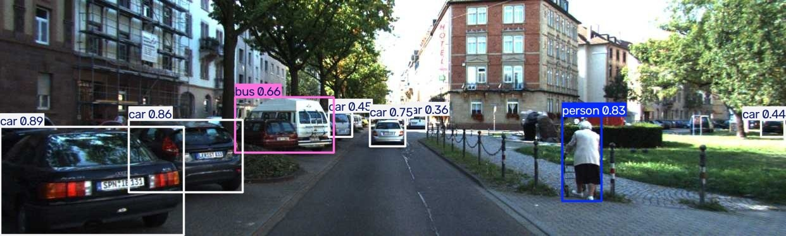
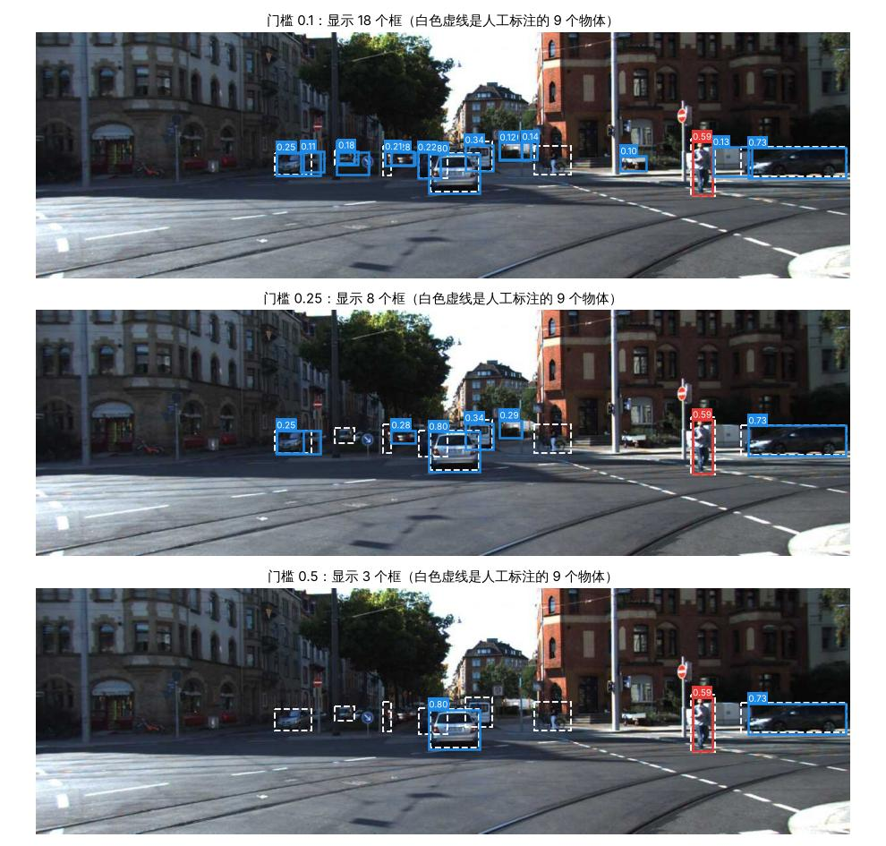
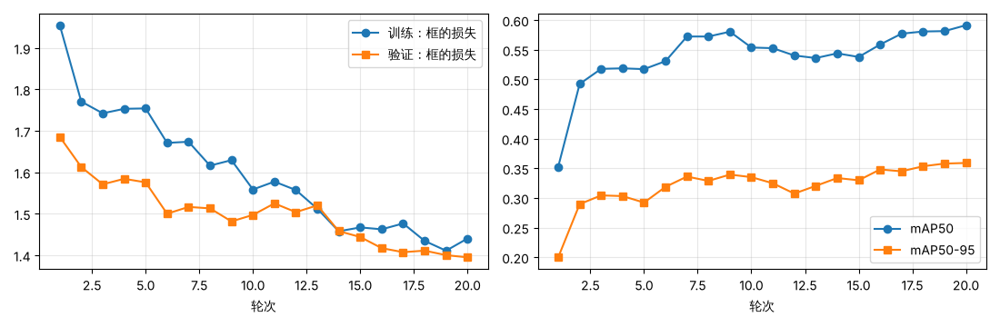
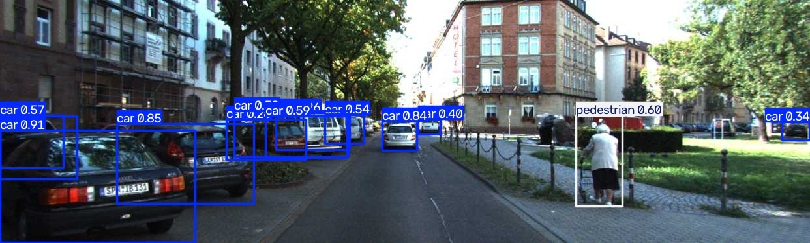
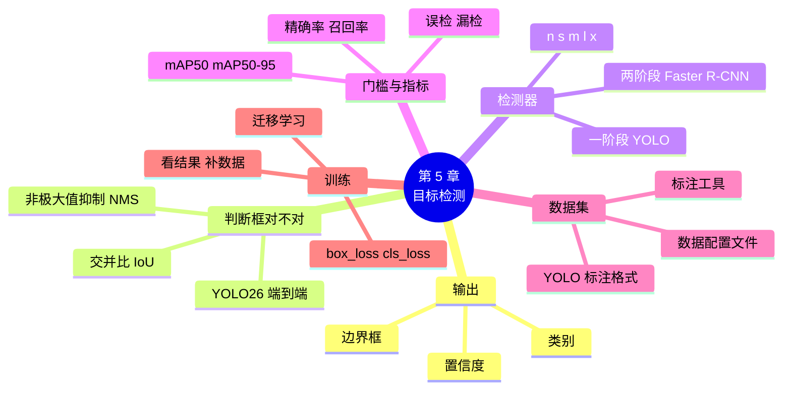

# 第 5 章 目标检测：找出图中的物体

!!! abstract "本章学时"
    理论 4 学时（线上 2 + 线下 2）· 实验 4 学时（本章共 4 个实验，★ 必做 3 个）

## 学习目标

学完本章，你应该能够：

1. **说出**检测结果的三要素（边界框、类别、置信度），以及检测和分类的区别（记忆）；
2. **计算**两个框的交并比，**解释**非极大值抑制为什么能去掉重复框（应用、理解）；
3. **运行并修改**给定代码，用 YOLO 找出行车画面里的车辆和行人、按类别计数（应用）；
4. **读懂**精确率、召回率、mAP50 和 mAP50-95，**判断**辅助驾驶中置信度门槛应该偏高还是偏低（分析、评价）；
5. **按步骤**准备 YOLO 格式的数据集，训练并评估一个道路目标检测器（应用）。

!!! info "先修要求"
    学习本章前，你需要掌握：

    - [3.3.3 轮廓与外接矩形](../03-features/index.md#333)：外接矩形是检测框的前身；
    - [4.5 准备分类数据集](../04-classification/index.md#45)：“类别 中心x 中心y 宽 高”的标注格式和比例坐标换算；
    - [4.6 训练](../04-classification/index.md#46) 和 [4.7 评估](../04-classification/index.md#47)：轮次、批大小、损失、混淆矩阵；
    - 第 2～4 章的 Python 小课堂：函数、`for`、列表、`if`、字典。

??? abstract "本章概念清单（14 个，点击查看定义和例子）"
    1. [边界框](../../appendix/glossary.md#g-边界框)
    2. [交并比](../../appendix/glossary.md#g-交并比)
    3. [非极大值抑制](../../appendix/glossary.md#g-非极大值抑制)
    4. [两阶段检测器](../../appendix/glossary.md#g-两阶段检测器)
    5. [一阶段检测器](../../appendix/glossary.md#g-一阶段检测器)
    6. [置信度门槛](../../appendix/glossary.md#g-置信度门槛)
    7. [误检](../../appendix/glossary.md#g-误检)
    8. [漏检](../../appendix/glossary.md#g-漏检)
    9. [精确率](../../appendix/glossary.md#g-精确率)
    10. [召回率](../../appendix/glossary.md#g-召回率)
    11. [平均精度](../../appendix/glossary.md#g-平均精度)
    12. [数据配置文件](../../appendix/glossary.md#g-数据配置文件)
    13. [标注工具](../../appendix/glossary.md#g-标注工具)
    14. [开放词汇检测](../../appendix/glossary.md#g-开放词汇检测)

## 情景导入

上一章，小林做了一个“认车型”的分类器，但它有个前提：得有人先把每辆车从画面里裁出来。

“能不能让模型自己在画面里找？”小林问。

老王打开车上的辅助驾驶设置界面：“你看，前车碰撞预警、行人提醒，都是先在整个画面里把车和人‘框’出来，再根据框的大小和位置判断危险不危险。这一步叫**目标检测**。”

“那它会不会看漏？或者把路边的垃圾桶当成人？”

“都会。厂家要在‘漏报’和‘乱报’之间找平衡。乱报多了，司机嫌烦就把功能关了；漏报一次行人，可能就出事。”

这一章，我们先用现成的检测模型把行车画面里的车和人框出来，学会怎样判断一个框“对不对”，怎样调门槛、怎样打分；然后用 KITTI 的行车照片训练一个自己的道路目标检测器。这是“智能辅助驾驶助手”最核心的一块。

## 5.1 目标检测的输出 { #51 }

### 5.1.1 框、类别、置信度 { #511 }

**目标检测**回答两个问题：画面里**有什么**，各自**在哪里**。它的输出是一组框，每个框带三样东西：

| 输出 | 含义 | 例子 |
|---|---|---|
| [**边界框**](../../appendix/glossary.md#g-边界框 "框住一个物体的最小矩形，常用左上角和右下角坐标表示"){ .term }（Bounding Box） | 刚好把物体框住的矩形，常用左上角和右下角两个点 `(x1, y1, x2, y2)` 表示 | (888, 184)～(950, 319) |
| 类别 | 这个框里是什么 | person（人） |
| 置信度 | 模型有多大把握 | 0.83 |

边界框就是第 3 章“外接矩形”的升级版：外接矩形靠二值化和轮廓的手工规则，只能用在白药片放在深色桌面上这种简单场景；检测模型的框是学出来的，能在复杂的街景里找出被挡住一半的车、站在树荫里的人。

### 5.1.2 检测和分类有什么不同 { #512 }

| | 图像分类（第 4 章） | 目标检测（本章） |
|---|---|---|
| 一张图的输出 | 一个答案 | 很多个框，个数不固定（可能是 0） |
| 回答的问题 | 是什么 | 有什么、在哪里、有几个 |
| 标注方式 | 图片放进类别文件夹 | 每个物体画一个框，写一行“类别 中心x 中心y 宽 高” |
| 评价指标 | 准确率、混淆矩阵 | 精确率、召回率、mAP（5.4 节） |
| 辅助驾驶中的用途 | 认出一辆车是轿车还是卡车 | 找出前方所有车辆、行人，看它们离自己多近 |

### 5.1.3 用 YOLO 检测一张行车照片 { #513 }

```python
from ultralytics import YOLO
model = YOLO("yolo26n.pt")                           # COCO 预训练，认识 80 类
r = model("../data/images/drive_city.jpg")[0]        # [0]：第一张图的结果
print(r.boxes.xyxy)    # 每个框的左上角和右下角
print(r.boxes.cls)     # 每个框的类别编号
print(r.boxes.conf)    # 每个框的置信度
r.save("result.jpg")   # 存一张画好框的图
```



*图 5-1　预训练 YOLO26n 对城市街道照片的检测结果（实验 5-1，照片来自 KITTI，CC BY-NC-SA 3.0）*

`yolo26n.pt` 在 COCO 数据集上训练过。COCO 有 80 个类别，包括人（person）、自行车（bicycle）、汽车（car）、摩托车、公交车（bus）、卡车（truck）、红绿灯（traffic light）、停车标志（stop sign）等，正好覆盖了道路上最常见的东西。<sup class="cite">[[1]](#ref5-1)</sup> 图 5-1 中，模型找到了 6 辆车、1 个人，还把那辆白色厢式车认成了公交车（bus，置信度 0.66）：COCO 里没有“厢式车”这一类。

## 5.2 交并比与非极大值抑制 { #52 }

### 5.2.1 怎样判断一个框“框得对不对” { #521 }

模型画了一个框，人工标注也画了一个框（标准答案），两个框不可能一个像素都不差。差多少算“对”？标准的做法是算两个框的[**交并比**](../../appendix/glossary.md#g-交并比 "两个框重叠部分的面积除以两个框合起来的面积，取值 0～1，衡量两个框有多吻合"){ .term }（Intersection over Union，IoU）：

**交并比 = 两个框重叠部分的面积 ÷ 两个框合起来覆盖的面积**

- 完全重合：交并比 = 1；
- 完全不挨着：交并比 = 0；
- 通常约定**交并比 ≥ 0.5** 就算框对了。

!!! example "算一算：交并比"
    KITTI 照片 000380 中一辆车的标注框是 (602, 183)～(675, 243)，模型画的框是 (608, 188)～(680, 246)：

    - 标注框面积：(675 − 602) × (243 − 183) = 73 × 60 = 4380；
    - 检测框面积：(680 − 608) × (246 − 188) = 72 × 58 = 4176；
    - 重叠部分：左边取较大的 608，右边取较小的 675，宽 67；上边取较大的 188，下边取较小的 243，高 55；面积 67 × 55 = 3685；
    - 合起来的面积 = 4380 + 4176 − 3685 = 4871（重叠部分被算了两次，要减掉一次）；
    - 交并比 = 3685 ÷ 4871 ≈ 0.757，大于 0.5，算框对了。

0.5 其实是一个比较宽松的要求。下面的动画里，把框放大一圈（“框太大”），交并比就掉到了 0.39，虽然物体还在框里，却不算对。

<iframe class="sim-frame" src="../../sims/iou-calculator/main.html" height="820" loading="lazy" title="IoU 计算器"></iframe>

动画：IoU 计算器。拖动彩色框、拖它的右下角改大小，看交集（黄色）、并集和交并比怎样变化。
{ .sim-caption }

### 5.2.2 非极大值抑制：去掉重复的框 { #522 }

很多检测模型对同一辆车会画出好几个差不多的框，置信度分别是 0.9、0.85、0.7……如果都显示出来，一辆车就会被数成三辆。传统的做法是[**非极大值抑制**](../../appendix/glossary.md#g-非极大值抑制 "对同一物体的多个重叠框，只保留置信度最高的一个、删掉与它交并比过高的其余框的去重方法"){ .term }（Non-Maximum Suppression，NMS）：

1. 把所有框按置信度从高到低排好；
2. 留下置信度最高的框 A；
3. 和 A 的交并比超过某个值（如 0.7）的其他框，认为是“重复的”，删掉；
4. 在剩下的框里重复第 2、3 步，直到处理完。

就像选班长：先选票数最多的人，和他“太像”的（同一个宿舍、同一个提名）就不再考虑，再从剩下的人里选。

### 5.2.3 YOLO26 为什么不需要 NMS { #523 }

NMS 虽然简单，却有两个麻烦：一是要额外花时间，框越多越慢，在车载芯片上尤其明显；二是“交并比超过多少算重复”这个值不好定，两个人挨得很近时，可能把其中一个当成重复框删掉。

2024 年清华大学团队提出的 YOLOv10，在训练时就要求模型**一个物体只输出一个框**，推理时不再需要 NMS，称为“端到端”检测。<sup class="cite">[[4]](#ref5-4)</sup> 本书使用的 YOLO26 也采用了这种设计，直接输出去重后的结果，部署到车载、手机等设备上更简单、更快。<sup class="cite">[[5]](#ref5-5)</sup> 所以在本书的代码里你看不到 NMS 这一步，但理解它，才能读懂其他检测模型和很多老项目的代码。

## 5.3 检测器的家族 { #53 }

### 5.3.1 两阶段与一阶段 { #531 }

深度学习检测器大致分两类：

| | [**两阶段检测器**](../../appendix/glossary.md#g-两阶段检测器 "先找出可能有物体的候选区域，再对每个区域分类和修正框的检测器"){ .term } | [**一阶段检测器**](../../appendix/glossary.md#g-一阶段检测器 "看一遍整张图就直接输出所有框和类别的检测器，速度快"){ .term } |
|---|---|---|
| 代表 | Faster R-CNN（2015）<sup class="cite">[[2]](#ref5-2)</sup>、Mask R-CNN | YOLO 系列、SSD、RetinaNet |
| 做法 | 第一步先找出“可能有东西”的候选区域，第二步再对每个候选区域分类、修正框 | 一步到位：看一遍整张图，直接输出所有框和类别 |
| 比喻 | 先粗筛简历，再逐个面试 | 群面，一次定结果 |
| 特点 | 早期更准，但较慢 | 更快，现在精度也已经很高 |

YOLO 的名字就是 “You Only Look Once”（只看一次）的缩写。2016 年第一版发布时，它能在 GPU 上每秒处理 45 帧，第一次让检测达到了视频的实时速度。<sup class="cite">[[3]](#ref5-3)</sup>

**辅助驾驶为什么更看重速度？** 汽车以 60 千米/时行驶，每秒前进约 16.7 米。如果检测一帧要 0.5 秒，结果出来时车已经开出 8 米多了。所以车载检测一般要求每帧几十毫秒以内，一阶段检测器是主流。

### 5.3.2 YOLO 系列简史 { #532 }

| 年份 | 版本 | 发布者 | 说明 |
|---|---|---|---|
| 2016～2018 | YOLOv1～v3 | 约瑟夫·雷德蒙（Joseph Redmon）等 | 开创“只看一次”的思路 |
| 2020 | YOLOv4、YOLOv5 | 博奇科夫斯基等；Ultralytics 公司 | v5 用 PyTorch 编写，简单易用，非常流行 |
| 2022 | YOLOv6、YOLOv7 | 美团；王建尧等 | 国内企业开始推出自己的版本 |
| 2023 | YOLOv8 | Ultralytics | 检测、分割、分类、姿态一套代码 |
| 2024 | YOLOv10、YOLO11 | 清华大学；Ultralytics | v10 去掉了 NMS |
| 2026 | YOLO26 | Ultralytics | 端到端、面向边缘设备，本书使用 |

此外，百度飞桨的 PP-YOLOE、阿里达摩院的 DAMO-YOLO 等也是常用的国产检测模型，第 9 章会介绍飞桨的检测工具。版本号并不代表“越大越好”：不同团队各自命名，选模型要看实际测试结果。

### 5.3.3 模型大小怎么选 { #533 }

每个版本都有 n、s、m、l、x 五种大小（nano、small、medium、large、extra large）。越大越准，也越慢、越占内存：

| 大小 | 适合 |
|---|---|
| n（本书使用） | CPU、手机、车载小芯片；教学实验 |
| s | 普通显卡或较好的嵌入式设备，速度和精度的折中 |
| m | 服务器上处理视频，精度要求较高 |
| l、x | 精度优先、不在乎速度，如离线分析大量录像 |

选模型的方法：先用 n 跑通流程，速度有富余、精度不够时，再换 s、m 对比。

## 5.4 置信度门槛与评估指标 { #54 }

### 5.4.1 置信度门槛：多报还是少报 { #541 }

模型其实会输出很多候选框，置信度从 0.01 到 0.99 都有。只有置信度高于[**置信度门槛**](../../appendix/glossary.md#g-置信度门槛 "只保留置信度不低于这个值的检测框；调高少误检，调低少漏检"){ .term }的框才显示出来。Ultralytics 默认的门槛是 0.25，可以用 `conf` 参数修改：

```python
r = model("照片.jpg", conf=0.5)[0]       # 只保留置信度 ≥ 0.5 的框
```

门槛怎么定，是一个取舍：

- **门槛调低**：框变多，不容易漏掉真的物体，但会混进更多“误检”（把垃圾桶当成人）；
- **门槛调高**：框变少，留下的大多是对的，但会“漏检”一些真的物体（远处的、被挡住的）。

判断一个框的结果，有三种情况：

| 情况 | 名称 | 例子 |
|---|---|---|
| 模型框了，也确实有这个物体（交并比 ≥ 0.5） | 认对（TP） | 框住了路口的白车 |
| 模型框了，但那里没有这个物体 | [**误检**](../../appendix/glossary.md#g-误检 "把不是目标的东西报成了目标，或框的位置对不上"){ .term }（FP） | 把树影框成了人 |
| 有这个物体，模型却没框 | [**漏检**](../../appendix/glossary.md#g-漏检 "真实存在的目标没有被检测出来"){ .term }（FN） | 远处的骑车人没找到 |

实验 5-2 用照片 000380 的人工标注（9 个车和人）做了对比：



*图 5-2　门槛 0.1、0.25、0.5 下的检测结果（实验 5-2；白色虚线是人工标注）*

| 门槛 | 显示的框 | 认对 | 误检 | 漏检 | 精确率 | 召回率 |
|---|---|---|---|---|---|---|
| 0.10 | 18 | 7 | 11 | 2 | 39% | 78% |
| 0.25 | 8 | 5 | 3 | 4 | 62% | 56% |
| 0.50 | 3 | 3 | 0 | 6 | 100% | 33% |
| 0.70 | 2 | 2 | 0 | 7 | 100% | 22% |

### 5.4.2 精确率与召回率 { #542 }

上表最后两列是检测最常用的两个指标：

- [**精确率**](../../appendix/glossary.md#g-精确率 "预测为某类的样本中，真正属于该类的比例（判得准不准）"){ .term }（Precision）= 认对的框 ÷ 显示的框。回答“**报出来的，有多少是真的**”，衡量“乱报”的程度；
- [**召回率**](../../appendix/glossary.md#g-召回率 "某类的全部样本中，被正确找出来的比例（找得全不全）"){ .term }（Recall）= 认对的框 ÷ 实际物体总数。回答“**真的物体，找出来了多少**”，衡量“漏报”的程度。

!!! example "算一算：精确率和召回率"
    门槛 0.25 时，显示 8 个框，其中 5 个认对；照片里实际有 9 个车和人。

    - 精确率 = 5 ÷ 8 = 62.5%：报出来的 8 个里，有 3 个是误检；
    - 召回率 = 5 ÷ 9 ≈ 55.6%：9 个物体里，找到了 5 个，漏了 4 个。

    门槛提到 0.5：精确率 3 ÷ 3 = 100%，召回率 3 ÷ 9 ≈ 33.3%。报得更准了，但漏得更多了。

精确率和召回率**此消彼长**：门槛越高，精确率越高、召回率越低。在辅助驾驶里怎么选？

- **行人提醒**：漏掉一个行人可能出事故，误报一次只是让司机多看一眼。所以门槛宜**偏低**，宁可多报，保证召回率；
- **自动紧急刹车**：误报会让车在高速上突然急刹，可能引发追尾，所以触发刹车的判断要更**谨慎**，通常还要结合雷达等其他传感器确认。

<iframe class="sim-frame" src="../../sims/confidence-threshold/main.html" height="600" loading="lazy" title="置信度门槛"></iframe>

动画：置信度门槛。拖动门槛，对照人工标注看认对（绿）、误检（红）、漏检（橙色虚线）的变化。切换到“只看人”，想一想行人提醒该用多大的门槛。
{ .sim-caption }

### 5.4.3 mAP：一个数概括检测器的好坏 { #543 }

精确率和召回率随门槛变化，比较两个模型时，总不能每个门槛都比一遍。于是人们把门槛从高到低滑一遍，记下每个门槛的精确率和召回率，画成一条曲线，再算曲线下的面积，叫[**平均精度**](../../appendix/glossary.md#g-平均精度 "把门槛从高到低滑一遍得到的精确率-召回率曲线下的面积；各类别 AP 的平均叫 mAP"){ .term }（Average Precision，AP）。AP 越接近 1，说明这个类别在各种门槛下都既准又全。

- **mAP**（mean AP）：把每个类别的 AP 再取平均；
- **mAP50**：交并比 ≥ 0.5 才算框对时的 mAP，要求比较宽松；
- **mAP50-95**：交并比门槛从 0.5、0.55、0.6……一直到 0.95，各算一次 mAP 再平均，要求框得**非常准**，所以数值比 mAP50 低得多。

不需要会算 mAP，只要会读：**同一个数据集上，mAP 越高，检测器越好**；mAP50 高而 mAP50-95 低，说明“找得到，但框得不够准”。

!!! tip "指标只在同一个数据集上可比"
    YOLO 官方公布的 COCO mAP 和我们在 KITTI 小样本上算出的 mAP 不能直接比较：数据集不同、类别不同、难度不同。比较模型时，要在同一个验证集上、用同样的设置测。

## 5.5 检测数据集 { #55 }

### 5.5.1 YOLO 标注格式 { #551 }

检测数据集要给每个物体画一个框。YOLO 格式的规则很简单：

- 每张图片配一个同名的 `.txt` 标注文件（`000380.jpg` ↔ `000380.txt`）；
- 文件里**一行一个框**，每行五个数：`类别编号 中心x 中心y 宽 高`；
- 后四个数都是**比例**（除以图片的宽或高），在 0～1 之间；
- 图片里没有任何目标，就放一个空的 `.txt` 文件。

这和第 4 章实验 4-2 读的 KITTI 标注是同一种格式。文件夹这样放：

```text
kitti_small/
├── kitti_small.yaml        数据配置文件
├── images/
│   ├── train/              400 张训练图片
│   └── val/                100 张验证图片
└── labels/
    ├── train/              400 个 .txt，和图片一一同名
    └── val/
```

Ultralytics 会自动把路径中的 `images` 换成 `labels`，找到每张图片对应的标注。

### 5.5.2 数据配置文件 { #552 }

检测数据集需要一个[**数据配置文件**](../../appendix/glossary.md#g-数据配置文件 "告诉 YOLO 训练集、验证集图片在哪里以及类别名称的 YAML 文本文件"){ .term }（`.yaml`），告诉训练程序图片在哪、有哪些类别：

```yaml
train: images/train      # 训练图片文件夹（相对于本文件所在的文件夹）
val: images/val          # 验证图片文件夹
names:                   # 类别编号和名字，必须和标注文件里的编号对应
  0: car
  1: truck
  2: pedestrian
  3: cyclist
```

本书的 `kitti_small` 是编者用 `labs/data/get_kitti_small.py` 从 KITTI 中随机挑出来的：训练 400 张、验证 100 张，把 KITTI 原来的 8 类合成了 4 类（轿车和厢式车合为 car，行人和坐着的人合为 pedestrian）。合并的原因第 4 章已经看到了：厢式车和轿车最容易混淆，而辅助驾驶并不需要区分它们。

### 5.5.3 标注工具 { #553 }

给自己的照片画框，要用[**标注工具**](../../appendix/glossary.md#g-标注工具 "在图片上画框、选类别并导出标注文件的软件"){ .term }。常用的有：

| 工具 | 特点 |
|---|---|
| X-AnyLabeling | 国产开源桌面软件，中文界面，能直接导出 YOLO 格式，还能用模型自动预标注 |
| Label Studio | 开源，网页界面，适合多人协作 |
| CVAT | 开源，网页界面，功能全，适合视频标注 |
| Roboflow | 在线平台，上传、标注、导出一条龙（国内访问可能较慢） |

标注的规范（框要贴紧物体、被挡住的部分要不要框、太小的物体要不要标）、质量检查和多人协作，在“人工智能数据分析与处理”课程的标注章节中有系统讲解，本章只做一个 20 张图的小练习（实验 5-4）。

## 5.6 训练自己的检测器 { #56 }

### 5.6.1 训练、验证、预测三步 { #561 }

和第 4 章的分类训练几乎一样，只是 `data` 换成了数据配置文件：

```python
model = YOLO("yolo26n.pt")                                  # 从 COCO 预训练模型出发
model.train(data="../data/kitti_small/kitti_small.yaml", epochs=20, imgsz=640, batch=16)
best = YOLO("runs/kitti20/weights/best.pt")
m = best.val(data="../data/kitti_small/kitti_small.yaml")   # 在验证集上算 mAP
r = best("新的行车照片.jpg")[0]                               # 检测新照片
```

`yolo26n.pt` 在 COCO 上学过车、人、自行车，迁移到 KITTI 的 4 类上非常自然，这又是第 4 章的迁移学习。

### 5.6.2 训练输出与结果 { #562 }

检测训练每一轮打印的内容比分类多：

```text
      Epoch    GPU_mem   box_loss   cls_loss    l1_loss  Instances       Size
       20/20         0G       1.44      1.011   0.004351         69        640: 100% ━━━━━━━━━━━━ 25/25
                 Class     Images  Instances      Box(P          R      mAP50  mAP50-95)
                   all        100        542       0.68      0.516      0.591      0.359
```

- `box_loss`：框的位置和大小差多少；`cls_loss`：类别认得对不对。两者都是越小越好；
- `Instances`：这一批图片里一共有多少个标注框；
- 第二行：验证集 100 张图、542 个物体，P 是精确率，R 是召回率，再往后是 mAP50 和 mAP50-95。

编者在 4 核 CPU 上训练 20 轮，用了约 40 分钟（2386 秒）。图 5-3 是训练曲线：第 1 轮 mAP50 只有 0.353，第 2 轮就升到 0.492，第 7 轮达到 0.572，之后在 0.54～0.59 之间小幅波动，第 20 轮为 0.591。训练损失一直在下降（box_loss 从 1.95 降到 1.44，cls_loss 从 6.44 降到 1.01）。前几轮进步最快，是因为模型在 COCO 上已经学会了找车和人，只需要适应 KITTI 的画面和 4 个类别。



*图 5-3　实验 5-3 的训练曲线（编者在 4 核 CPU 上实际运行）*



*图 5-4　用自己训练的 4 类检测器检测城市街道照片（实验 5-3 第 4 步）*

### 5.6.3 怎样让检测器更好 { #563 }

| 问题 | 办法 |
|---|---|
| 训练太慢 | 用云端 GPU（`device=0`）；先用 `epochs=5` 跑通流程 |
| mAP 还在上升就停了 | 多训练几轮 |
| 小目标（远处的行人）找不到 | 加大 `imgsz`（如 960、1280），代价是更慢 |
| 某一类特别差 | 看这一类的样本数量够不够、标注准不准；第 4 章的“分析错例”方法同样适用 |
| 换了场景效果变差 | KITTI 是德国街道，用在国内道路上，最好补充一些国内的照片重新训练 |

## 5.7 Python 小课堂：读懂结果对象 { #57 }

本章没有新的 Python 语法，但 Ultralytics 返回的结果对象层层嵌套，初学者容易绕晕。把它想成一个“文件夹”：

```text
results = model("照片.jpg")      一个列表，每张图片一个结果（只看一张图时取 [0]）
r = results[0]
├── r.names                     字典：类别编号 → 类别名
├── r.boxes                     所有的框（检测任务）
│   ├── .xyxy                   每个框的 (x1, y1, x2, y2)，像素
│   ├── .xywhn                  每个框的 (中心x, 中心y, 宽, 高)，比例，和 YOLO 标注格式一样
│   ├── .cls                    每个框的类别编号
│   └── .conf                   每个框的置信度
├── r.verbose()                 一句话总结，如 "6 cars, 1 person, 1 bus, "
├── r.save("文件名.jpg")         存一张画好框的图
└── r.plot()                    返回画好框的图（数字表），可以交给 cv2 继续处理
```

这些值是 PyTorch 的“张量”，常用三个“转换”把它们变成普通的 Python 数：

| 写法 | 作用 | 例子 |
|---|---|---|
| `int(box.cls)`、`float(box.conf)` | 一个数 → Python 整数、小数 | `0`、`0.83` |
| `.tolist()` | 一组数 → Python 列表 | `[888.0, 184.0, 950.0, 319.0]` |
| `.int()` | 小数 → 整数（还是张量） | 画框时坐标要用整数 |

字典的 `get` 方法在计数时很好用：`counts.get(name, 0)` 表示“取出 name 对应的值，如果还没有这个键，就当作 0”。

## 5.8 本章常见报错对照 { #58 }

| 报错原文（最后一行） | 用大白话说 | 怎么改 |
|---|---|---|
| `FileNotFoundError: … kitti_small.yaml` | 还没准备 KITTI 小样本 | 在 `labs/data` 下运行一次 `python get_kitti_small.py` |
| `Dataset '…yaml' images not found` | 配置文件里的图片路径不对 | `train`、`val` 是相对于 `.yaml` 所在文件夹的路径 |
| `WARNING ⚠️ … No labels found` | 标注文件没找到，或和图片不同名 | 图片在 `images/…`，标注在 `labels/…`，文件名一致 |
| `IndexError` 或 `Label class 4 exceeds dataset class count 4` | 标注里的类别编号超出了 `names` 的范围 | 编号从 0 开始，4 类就只能是 0～3 |
| 训练一轮要好几分钟 | CPU 上训练检测比分类慢得多 | 先用 `epochs=5` 跑通；有条件用云端 GPU |
| `AttributeError: 'list' object has no attribute 'boxes'` | 忘了取 `[0]` | `r = model("a.jpg")[0]` |
| 框画出来位置不对 | 把比例坐标当成了像素坐标 | 画图用 `xyxy`（像素），`xywhn` 是比例 |

## 5.9 前沿视窗：开放词汇检测 { #59 }

本章的检测器只认识训练过的类别：COCO 模型没有“厢式车”，就把它认成了公交车；我们的 KITTI 模型只认 4 类。如果路上出现一个“掉落的轮胎”“施工锥桶”，它们都会视而不见。

[**开放词汇检测**](../../appendix/glossary.md#g-开放词汇检测 "用户输入类别名称的文字，模型就能检测这些类别，无需专门训练的检测方法"){ .term }让检测器像第 4 章的 CLIP 一样“读懂文字”：用户输入想找的东西的名字，模型就去找。2024 年腾讯 AI Lab 发布的 YOLO-World 是其中的代表，它把文字理解加进了 YOLO，速度依然很快。<sup class="cite">[[6]](#ref5-6)</sup> 例如输入“traffic cone, tire, stroller”，它就能在行车画面中框出锥桶、轮胎和婴儿车，而不需要专门收集这些类别的数据训练。

Ultralytics 也提供了 YOLO-World 和后来的 YOLOE 模型，写法和本章几乎一样，只是多了一行设置类别名的代码。开放词汇检测在“长尾”场景（数量少、种类多的罕见物体）中很有用，但在常见类别上，用自己数据专门训练的模型通常更准、更稳定。

## 本章实验

!!! abstract "实验总览"
    | 实验 | 类型 | 建议时长 | 内容 |
    |---|---|---|---|
    | 实验 5-1 | ★ 必做 | 40 分钟 | 找出行车画面里的车辆和行人 |
    | 实验 5-2 | ★ 必做 | 45 分钟 | 调门槛做对比 |
    | 实验 5-3 | ★ 必做 | 50 分钟（训练时间另计） | 训练道路目标检测器 |
    | 实验 5-4 | ☆ 选做 | 90 分钟 | 标注自己的数据 |

    代码见配套资源 `labs/ch05/` 目录，每个实验都有 `.py` 和 `.ipynb` 两种文件，内容相同。所有实验都在 `labs/ch05/` 文件夹里运行。实验 5-3 第一次运行前，要在 `labs/data` 下运行 `python get_kitti_small.py` 准备数据（下载约 390 MB，只需一次）；训练在 4 核 CPU 上约 40 分钟，建议在云端 GPU 上做，或由老师课前训练好、课上直接评估。

### 实验 5-1 ★ 找出行车画面里的车辆和行人 { #5-1 }

**实验目的**

1. 用预训练 YOLO 检测行车照片，读出每个框的类别、置信度和位置；
2. 用字典按类别统计数量；
3. 体会预训练模型的类别范围（COCO 80 类）。

**实验环境**：云端 Notebook 或本机，CPU 即可。第一次运行要联网下载 `yolo26n.pt`（约 5 MB）。

**实验数据**：`labs/data/images/drive_city.jpg`、`street_crossing.jpg`、`drive_highway.jpg`（前两张来自 KITTI，CC BY-NC-SA 3.0；第三张来自 Udacity，MIT）。

**实验步骤与代码**

第一档 · 跑通：打开 `lab5_1_detect.ipynb`，依次运行三个单元格。

```python
model = YOLO("yolo26n.pt")                         # 在 COCO 数据集上训练过，认识 80 类
r = model("../data/images/drive_city.jpg", verbose=False)[0]   # ← 改这里：换一张照片
print("找到", len(r.boxes), "个框")

for box in r.boxes:
    name = r.names[int(box.cls)]                   # 类别编号 → 类别名
    conf = float(box.conf)                         # 置信度
    x1, y1, x2, y2 = box.xyxy[0].int().tolist()    # 左上角、右下角
    print(f"{name:10s} {conf:.2f}  左上 ({x1}, {y1})  右下 ({x2}, {y2})  大小 {x2 - x1}×{y2 - y1}")

counts = {}
for c in r.boxes.cls.int().tolist():
    name = r.names[c]
    counts[name] = counts.get(name, 0) + 1         # get：没有这个键时当作 0
print("统计：", counts)
r.save("lab5_1_city.jpg")
```

完整代码：`labs/ch05/lab5_1_detect.py`（`.ipynb` 同名）

**运行结果**

```text
模型认识 80 类，其中有： ['person', 'bicycle', 'car', 'motorcycle', 'bus', 'truck', 'traffic light', 'stop sign']
找到 8 个框
car        0.89  左上 (0, 201)  右下 (290, 373)  大小 290×172
car        0.86  左上 (203, 190)  右下 (383, 305)  大小 180×115
person     0.83  左上 (888, 184)  右下 (950, 319)  大小 62×135
car        0.75  左上 (584, 187)  右下 (640, 232)  大小 56×45
bus        0.66  左上 (371, 154)  右下 (527, 242)  大小 156×88
car        0.45  左上 (519, 178)  右下 (556, 217)  大小 37×39
car        0.44  左上 (1202, 190)  右下 (1239, 217)  大小 37×27
car        0.36  左上 (640, 183)  右下 (673, 207)  大小 33×24
统计： {'car': 6, 'person': 1, 'bus': 1}
```

结果图见图 5-1。框的大小和远近有关：最近的车 290×172，远处的车只有 33×24。第 7 章会用“框有多大”来判断前车是不是太近。

第二档 · 改一改：

1. 把照片换成 `street_crossing.jpg`，记录找到了多少人、多少车；
2. 换成 `drive_highway.jpg`（高速公路），找到的车和你数的一样多吗？
3. 在第 3 步的统计里只数“车类”：car、bus、truck 都算车（提示：`if name in ["car", "bus", "truck"]:`）。

**实验记录表**

| 照片 | 框数 | 人 | 车类（car + bus + truck） | 你自己数的车和人 | 漏了 / 多了什么 |
|---|---|---|---|---|---|
| drive_city.jpg | 8 | 1 | 7 | | 白色厢式车认成 bus |
| street_crossing.jpg | | | | | |
| drive_highway.jpg | | | | | |

**常见问题排查**

| 现象 | 原因 | 解决办法 |
|---|---|---|
| `AttributeError: 'list' object has no attribute 'boxes'` | 少了 `[0]` | `model(…)[0]` |
| 框很少，远处的车都没找到 | 远处的车太小，置信度低于默认门槛 0.25 | 实验 5-2 会调门槛 |
| 保存的图片找不到 | 图片存在了当前文件夹 | 确认 Notebook 在 `labs/ch05/` 里 |

**思考与练习**

1. 预训练模型把白色厢式车认成了 bus。对于“提醒驾驶员注意前方车辆”这个用途，这个错误要紧吗？对于第 4 章“统计车型”的用途呢？

**实验报告要求**

提交三张照片的检测结果图和实验记录表，回答“思考与练习”。

### 实验 5-2 ★ 调门槛做对比 { #5-2 }

**实验目的**

1. 自己写函数计算交并比；
2. 对照人工标注，数出不同门槛下的认对、误检、漏检；
3. 计算精确率和召回率，体会二者的取舍。

**实验环境**：云端 Notebook 或本机，CPU 即可。

**实验数据**：`labs/data/kitti_sample/000380.jpg` 和人工标注 `000380.txt`（KITTI，CC BY-NC-SA 3.0）。

**实验步骤与代码**

第一档 · 跑通：打开 `lab5_2_threshold.ipynb`，依次运行四个单元格。第 1 步把 KITTI 标注换算成像素框，只保留车（轿车、厢式车）和人（行人、骑车人）两大类；第 3 步用 `conf=0.01` 拿到几乎所有候选框，同样只保留车和人。第 2 步的交并比函数：

```python
def iou(a, b):
    w = max(0, min(a[2], b[2]) - max(a[0], b[0]))          # 重叠部分的宽
    h = max(0, min(a[3], b[3]) - max(a[1], b[1]))          # 重叠部分的高
    inter = w * h
    union = (a[2] - a[0]) * (a[3] - a[1]) + (b[2] - b[0]) * (b[3] - b[1]) - inter
    return inter / union
```

`max(0, …)`：两个框不重叠时，算出的宽或高是负数，用 0 代替。第 4 步对每个门槛数一数：

```python
for th in [0.1, 0.25, 0.5, 0.7]:                           # ← 改这里：试试别的门槛
    kept = [p for p in preds if p[1] >= th]
    used, tp = set(), 0                                    # used：已经被认领的标准答案
    for name, score, *box in sorted(kept, key=lambda p: -p[1]):   # 置信度高的先认领
        ious = [iou(box, t[1:]) if t[0] == name and i not in used else 0 for i, t in enumerate(truth)]
        i = ious.index(max(ious))                          # 和哪个标准答案重叠最多
        if ious[i] >= 0.5:                                 # 交并比达到 0.5 才算认对
            used.add(i); tp += 1
    fp, fn = len(kept) - tp, len(truth) - tp
```

规则是：每个检测框去找同类、交并比最大、还没被别人认领的标准答案，交并比 ≥ 0.5 就算认对。`set()` 是“集合”，用来记住哪些标准答案已经被认领过。完整代码：`labs/ch05/lab5_2_threshold.py`

**运行结果**

```text
标准答案： 9 个物体
候选框： 72 个
门槛 0.10：框 18 个，认对 7，误检 11，漏检 2，精确率 39%，召回率 78%
门槛 0.25：框  8 个，认对 5，误检 3，漏检 4，精确率 62%，召回率 56%
门槛 0.50：框  3 个，认对 3，误检 0，漏检 6，精确率 100%，召回率 33%
门槛 0.70：框  2 个，认对 2，误检 0，漏检 7，精确率 100%，召回率 22%
```

三个门槛的结果图见图 5-2，也可以在“置信度门槛”动画里拖动查看。

第二档 · 改一改：

1. 在门槛列表里加上 0.05、0.15、0.35，把 7 个门槛的精确率和召回率画成一张表，找出你认为最适合“行人提醒”的门槛；
2. 把认对的条件从 `>= 0.5` 改成 `>= 0.75`，同一个门槛下认对的框变少了还是变多了？这对应 mAP50 和 mAP50-95 的哪一个更严格？
3. 用 `iou` 函数手算验证 5.2.1 节“算一算”的例子：`iou((608, 188, 680, 246), (602, 183, 675, 243))`。

**实验记录表**

| 门槛 | 框数 | 认对 | 误检 | 漏检 | 精确率 | 召回率 |
|---|---|---|---|---|---|---|
| 0.05 | | | | | | |
| 0.10 | 18 | 7 | 11 | 2 | 39% | 78% |
| 0.15 | | | | | | |
| 0.25 | 8 | 5 | 3 | 4 | 62% | 56% |
| 0.35 | | | | | | |
| 0.50 | 3 | 3 | 0 | 6 | 100% | 33% |
| 0.70 | 2 | 2 | 0 | 7 | 100% | 22% |

**常见问题排查**

| 现象 | 原因 | 解决办法 |
|---|---|---|
| `ZeroDivisionError` | 门槛太高，一个框都没有，算精确率时除以 0 | 代码中用了 `max(1, len(kept))` 防止除以 0 |
| 认对的数比框数还多 | 同一个标准答案被认领了多次 | 检查 `used` 有没有起作用 |
| 交并比总是 0 | 两种坐标写法混用（比例和像素） | 标准答案也要换算成像素 |

**思考与练习**

1. 为什么门槛 0.1 时还有 2 个物体漏检？到“置信度门槛”动画里找一找它们，说说可能的原因。

**实验报告要求**

提交填好的实验记录表，写出你为“行人提醒”选择的门槛和理由。

### 实验 5-3 ★ 训练道路目标检测器 { #5-3 }

**实验目的**

1. 读懂 YOLO 检测数据集的文件夹结构和数据配置文件；
2. 从 COCO 预训练模型出发，训练 4 类道路目标检测器；
3. 读出 mAP50、mAP50-95 和各类的精确率、召回率，用训练好的模型检测新照片。

**实验环境**：建议使用云端 Notebook 的 GPU 环境（把 `device="cpu"` 改成 `device=0`，约 3 分钟）；CPU 也可以，编者在 4 核 CPU 上训练 20 轮约 40 分钟。

**实验数据**：`labs/data/kitti_small/`（KITTI 随机抽取的训练 400 张、验证 100 张，4 类，CC BY-NC-SA 3.0），由 `labs/data/get_kitti_small.py` 生成。

**实验步骤与代码**

第一档 · 跑通：打开 `lab5_3_train.ipynb`，依次运行四个单元格。

```python
DATA = "../data/kitti_small/kitti_small.yaml"
model = YOLO("yolo26n.pt")
model.train(data=DATA, epochs=20,                    # ← 改这里：轮次（时间紧可以先用 5）
            imgsz=640, batch=16, device="cpu",       # 有 GPU 就把 device 改成 0
            workers=2, seed=0,
            project=Path("runs").resolve(), name="kitti20", exist_ok=True)

best = YOLO("runs/kitti20/weights/best.pt")
m = best.val(data=DATA, imgsz=640, verbose=False)
print(f"mAP50 = {m.box.map50:.3f}，mAP50-95 = {m.box.map:.3f}，精确率 = {m.box.mp:.3f}，召回率 = {m.box.mr:.3f}")
for i, name in best.names.items():
    p, r, ap50, ap = m.box.class_result(i)           # 这一类的精确率、召回率、mAP50、mAP50-95
    print(f"  {name:10s} 精确率 {p:.2f}  召回率 {r:.2f}  mAP50 {ap50:.3f}  mAP50-95 {ap:.3f}")
```

第 4 步用训练好的模型检测 `drive_city.jpg`（它不在训练集里）。完整代码：`labs/ch05/lab5_3_train.py`

**运行结果**

```text
mAP50 = 0.592，mAP50-95 = 0.359，精确率 = 0.729，召回率 = 0.497
  car        精确率 0.88  召回率 0.78  mAP50 0.879  mAP50-95 0.581
  truck      精确率 0.68  召回率 0.47  mAP50 0.538  mAP50-95 0.436
  pedestrian 精确率 0.74  召回率 0.53  mAP50 0.610  mAP50-95 0.302
  cyclist    精确率 0.62  召回率 0.21  mAP50 0.340  mAP50-95 0.119
找到： 12 cars, 1 pedestrian, 
```

**读一读结果**：car 的 mAP50 达到 0.879，因为训练集中车最多（验证集里 428 个，占 542 个物体的 79%）；cyclist 只有 0.340，召回率 0.21，验证集里只有 24 个骑车人，训练集也很少，模型还没学会。这和第 4 章“样本少的类别学得差”是同一个道理，改进办法是补充骑车人的照片。

第 4 步的结果见图 5-4。自己的模型把白色厢式车认成了 car（KITTI 的 van 在本实验中并入了 car），比预训练模型认成 bus 更合理；但在厢式车和左边停着的车上出现了几个重叠的框（置信度 0.26～0.59）。YOLO26 是靠训练学会“一个物体只出一个框”的（5.2.3 节），只训练 20 轮还没学到位。重复框的置信度大多不高，把门槛调高能去掉一部分，但厢式车上 0.59 和 0.58 的两个框几乎一样高，调门槛去不掉；多训练几轮、多给些厢式车的照片，才是根本办法。

第二档 · 改一改：

1. 把 `epochs` 改成 5（`name` 改成 `kitti5`），和 20 轮对比 mAP50；
2. 第 4 步换成 `street_crossing.jpg`，和实验 5-1 的预训练模型比一比，哪个找到的行人更多？
3. 在第 4 步加上 `conf=0.1`，看看多出来的框里有没有远处的骑车人。

**实验记录表**

| 设置 | mAP50 | mAP50-95 | 用时 | 编者实测 |
|---|---|---|---|---|
| 20 轮，640，CPU | | | | mAP50 0.592，mAP50-95 0.359，约 40 分钟 |
| 5 轮，640 | | | | |
| 各类 mAP50：car / truck / pedestrian / cyclist | | | | 0.879 / 0.538 / 0.610 / 0.340 |

**常见问题排查**

| 现象 | 原因 | 解决办法 |
|---|---|---|
| `FileNotFoundError: … kitti_small.yaml` | 没准备数据 | 在 `labs/data` 下运行 `python get_kitti_small.py` |
| 下载 KITTI 很慢或失败 | 文件 390 MB，网络不稳 | 换时间重试，或从老师处拷贝 `kitti_small` 文件夹 |
| CPU 上训练太久 | 检测训练计算量大 | 先用 `epochs=5`；用云端 GPU；或直接用老师提供的 `best.pt` 做第 3、4 步 |
| mAP 和编者的差几个百分点 | 随机性、电脑不同 | 正常现象 |

**思考与练习**

1. 四个类别中哪一类 mAP 最低？结合 KITTI 照片中这类物体的大小和数量，分析原因。

**实验报告要求**

提交训练结果（mAP 输出和 `results.png`）、检测结果图和实验记录表，回答“思考与练习”。

### 实验 5-4 ☆ 标注自己的数据 { #5-4 }

**实验目的**

1. 用标注工具给自己拍的街景画框，导出 YOLO 格式；
2. 用脚本检查标注文件的格式，把框画回图片核对；
3. 把自己的数据加进训练，体会“补数据”的作用。

**实验环境**：本机安装标注工具（推荐 X-AnyLabeling，或 Label Studio）；检查和训练在云端 Notebook 或本机进行。

**实验数据**：自己用手机拍的 20 张街景、校园道路照片（拍摄时避开人脸特写，分享前按第 3 章的要求给人脸、车牌打码）。

**实验步骤与代码**

第一档 · 跑通：

1. 安装并打开标注工具，新建项目，类别按 `car`、`truck`、`pedestrian`、`cyclist` 的顺序添加（顺序决定编号 0～3，必须和 `kitti_small.yaml` 一致）；
2. 打开 20 张照片，逐个给车辆和行人画框，框要贴紧物体边缘；
3. 导出为 YOLO 格式，得到和图片同名的 `.txt` 文件；
4. 修改 `lab5_4_check_labels.py` 开头的两个文件夹路径和类别字典，运行检查：

```python
IMAGES = Path("../data/kitti_sample")          # ← 改这里：你的图片文件夹
LABELS = Path("../data/kitti_sample")          # ← 改这里：你的标注文件夹（.txt 与图片同名）
NAMES = {0: "car", 1: "van", 2: "truck", 3: "pedestrian", 5: "cyclist"}   # ← 改这里：你的类别
```

程序逐个检查每行是否是 5 个数、坐标是否在 0～1 之间，并把框画回图片，存到 `lab5_4_check` 文件夹。用编者的示例数据运行：

```text
检查完成，发现问题 0 处；画好框的图在 lab5_4_check
```

打开画好框的图片，逐张核对：框有没有贴紧？有没有漏标？类别对不对？

第二档 · 改一改：把你的 20 张图片和标注分别复制到 `kitti_small/images/train` 和 `kitti_small/labels/train`（先备份原数据），用实验 5-3 的代码训练 10 轮，比较在**你自己的另外 5 张照片**上的检测效果有没有变好。

**实验记录表**

| 项目 | 数量 / 结果 |
|---|---|
| 标注的照片数 | |
| 标注的框数（car / truck / pedestrian / cyclist） | |
| 检查程序发现的问题 | |
| 加入自己数据前后，在新照片上找到的行人数 | |

**常见问题排查**

| 现象 | 原因 | 解决办法 |
|---|---|---|
| 检查程序报“缺少标注” | 没有目标的图片没导出 `.txt`，或文件名不一致 | 没有目标也要有空的 `.txt` |
| 类别全部错位（车显示成行人） | 标注工具里类别的顺序和 `.yaml` 不一致 | 按 0 car、1 truck、2 pedestrian、3 cyclist 的顺序 |
| 坐标大于 1 | 导出成了像素坐标（VOC 或 COCO 格式） | 导出时选“YOLO”格式 |

**思考与练习**

1. 标注 20 张图花了多少时间？按这个速度，标注 KITTI 的 7000 多张训练图要多久？由此谈谈为什么开放数据集和自动预标注这么重要。

**实验报告要求**

提交 5 张画好框的检查图、实验记录表和训练前后的对比截图，回答“思考与练习”。

## 本章小结

- **目标检测**输出一组框，每个框有**边界框**、类别、置信度。它回答“有什么、在哪里、有几个”，是辅助驾驶感知的核心。
- **交并比** = 交集 ÷ 并集，用来判断框得对不对，通常 ≥ 0.5 算对。**非极大值抑制**按置信度去掉重复框；YOLOv10、YOLO26 在训练时就让一个物体只输出一个框，不再需要 NMS。
- 检测器分**两阶段**（先找候选区域再分类，如 Faster R-CNN）和**一阶段**（一次完成，如 YOLO）。辅助驾驶要求实时，一阶段是主流。模型有 n、s、m、l、x 五种大小。
- **置信度门槛**调低：误检多、漏检少；调高：误检少、漏检多。**精确率**看“报出来的有多少是真的”，**召回率**看“真的找出来了多少”。行人提醒宁可多报。
- **mAP** 用一个数概括检测器的好坏；mAP50 要求宽松，mAP50-95 要求框得很准。指标只在同一个数据集上可比。
- YOLO 标注格式：每张图一个同名 `.txt`，一行一个框，“类别 中心x 中心y 宽 高”都是比例；**数据配置文件**写明图片路径和类别名。
- 训练检测器和训练分类器写法相同，只是 `data` 换成配置文件。从 COCO 预训练模型出发，用 400 张 KITTI 图片训练 20 轮，mAP50 达到 0.59。



**下一章预告**

检测框只能告诉我们“车在这个长方形里”，但车不是长方形的。下一章学**图像分割**：把物体的轮廓一个像素一个像素地描出来，用来抠图换背景、找出画面里哪一块是可以开的路面；还会用深度估计模型看出画面里谁远谁近，这是“场景重建”的第一步。

## 参考文献

正文中的上标编号（如<sup class="cite">[[1]](#ref5-1)</sup>）对应下面的文献。带链接的可以直接打开；书籍可在图书馆或电子书平台查阅。

<div class="refs" markdown>

**经典论文**

- <span id="ref5-1"></span>[1] LIN T Y, MAIRE M, BELONGIE S, et al. Microsoft COCO: Common Objects in Context[C]//European Conference on Computer Vision (ECCV 2014). Cham: Springer, 2014: 740-755.
    <span class="ref-note">COCO 数据集的论文，本章预训练检测模型认识的 80 类和 mAP50-95 的评价方法都来自这里，对应 5.1.3 节和 5.4.3 节。</span>
- <span id="ref5-2"></span>[2] REN S, HE K, GIRSHICK R, et al. Faster R-CNN: Towards Real-Time Object Detection with Region Proposal Networks[C]//Advances in Neural Information Processing Systems 28. Montreal: Curran Associates, 2015: 91-99.
    <span class="ref-note">两阶段检测器的代表 Faster R-CNN 的论文，对应 5.3.1 节。</span>
- <span id="ref5-3"></span>[3] REDMON J, DIVVALA S, GIRSHICK R, et al. You Only Look Once: Unified, Real-Time Object Detection[C]//2016 IEEE Conference on Computer Vision and Pattern Recognition. Las Vegas: IEEE, 2016: 779-788.
    <span class="ref-note">YOLO 第一版的论文，提出“只看一次”的一阶段检测思路，对应 5.3.1 节和 5.3.2 节。</span>
- <span id="ref5-4"></span>[4] WANG A, CHEN H, LIU L, et al. YOLOv10: Real-Time End-to-End Object Detection[C]//Advances in Neural Information Processing Systems 37. Vancouver: Curran Associates, 2024.
    <span class="ref-note">清华大学团队的 YOLOv10 论文，让检测器训练时一个物体只输出一个框，推理时不再需要 NMS，对应 5.2.3 节。</span>
- <span id="ref5-6"></span>[6] CHENG T, SONG L, GE Y, et al. YOLO-World: Real-Time Open-Vocabulary Object Detection[C]//2024 IEEE/CVF Conference on Computer Vision and Pattern Recognition. Seattle: IEEE, 2024: 16901-16911.
    <span class="ref-note">腾讯 AI Lab 等提出的开放词汇检测模型，输入类别名就能检测，对应 5.9 节。</span>

**在线资源**

- <span id="ref5-5"></span>[5] Ultralytics. Ultralytics YOLO26 / Object Detection / Performance Metrics[EB/OL]. [2026-10-31]. <https://docs.ultralytics.com/>.
    <span class="ref-note">Ultralytics 官方文档中 YOLO26 模型、检测任务和评价指标（精确率、召回率、mAP）的说明，对应 5.2.3 节、5.4 节和 5.6 节。</span>
- <span id="ref5-7"></span>[7] GEIGER A, LENZ P, URTASUN R. Are We Ready for Autonomous Driving? The KITTI Vision Benchmark Suite[C]//2012 IEEE Conference on Computer Vision and Pattern Recognition. Providence: IEEE, 2012: 3354-3361.
    <span class="ref-note">KITTI 数据集的论文，实验 5-2、5-3 的照片和标注都来自 KITTI，对应 5.5 节。</span>

</div>

## 课后练习

选择题和判断题可以直接点击选项作答，系统会马上告诉你对错，并展开答案与解析；多选题选好后点“提交答案”。简答和实操题请先自己作答，再点开“答案与解析”核对。每道题的解析下方都有“回看”链接，做错了可以直接跳回正文复习。

**一、单项选择题**

<div class="quiz" data-answer="B" markdown>

**1.** 与图像分类相比，目标检测多回答了哪个问题？（　　）

- A. 图片是什么颜色
- B. 每个物体在图中的什么位置
- C. 图片拍摄的时间
- D. 图片有多少个像素

</div>

??? tip "答案与解析"
    **答案：B**

    分类只回答“是什么”，检测还回答“在哪里”，用边界框表示位置，并能数出有几个。

    考查：检测与分类的区别 · 认知层次：理解 · [回看 5.1.2](#512)
    { .quiz-meta }

<div class="quiz" data-answer="C" markdown>

**2.** 两个框的交集面积是 30，各自的面积分别是 50 和 40，它们的交并比是（　　）。

- A. 0.6
- B. 0.75
- C. 0.5
- D. 0.33

</div>

??? tip "答案与解析"
    **答案：C**

    并集 = 50 + 40 − 30 = 60，交并比 = 30 ÷ 60 = 0.5。A 是 30 ÷ 50；B 是 30 ÷ 40；都没有用并集。

    考查：交并比计算 · 认知层次：应用 · [回看 5.2.1](#521)
    { .quiz-meta }

<div class="quiz" data-answer="A" markdown>

**3.** 非极大值抑制（NMS）的作用是（　　）。

- A. 去掉同一个物体上重复的框
- B. 提高图片亮度
- C. 把框放大一圈
- D. 增加训练数据

</div>

??? tip "答案与解析"
    **答案：A**

    NMS 保留置信度最高的框，删掉与它交并比过大的其他框，避免一辆车被数成好几辆。

    考查：非极大值抑制 · 认知层次：记忆 · [回看 5.2.2](#522)
    { .quiz-meta }

<div class="quiz" data-answer="D" markdown>

**4.** 辅助驾驶中多采用 YOLO 这类一阶段检测器，主要原因是（　　）。

- A. 一阶段检测器不需要训练数据
- B. 一阶段检测器只能检测车辆
- C. 两阶段检测器不能输出边界框
- D. 一阶段检测器速度快，能满足实时要求

</div>

??? tip "答案与解析"
    **答案：D**

    一阶段检测器看一遍图就输出所有框，速度快。车以 60 千米/时行驶每秒前进约 16.7 米，检测必须足够快。

    考查：一阶段与两阶段 · 认知层次：理解 · [回看 5.3.1](#531)
    { .quiz-meta }

<div class="quiz" data-answer="B" markdown>

**5.** 把检测的置信度门槛从 0.25 调到 0.6，通常会（　　）。

- A. 框变多，误检增加
- B. 框变少，漏检增加
- C. 框的位置变得更准
- D. 模型需要重新训练

</div>

??? tip "答案与解析"
    **答案：B**

    门槛提高，只留下更有把握的框，误检减少，但一些真实物体（远处的、被挡住的）因置信度不够被漏掉。门槛不影响框的位置，也不需要重新训练。

    考查：置信度门槛 · 认知层次：理解 · [回看 5.4.1](#541)
    { .quiz-meta }

<div class="quiz" data-answer="C" markdown>

**6.** 一张照片里有 10 个行人，模型报出 8 个框，其中 6 个是真的行人。召回率是（　　）。

- A. 80%
- B. 75%
- C. 60%
- D. 20%

</div>

??? tip "答案与解析"
    **答案：C**

    召回率 = 认对 ÷ 实际总数 = 6 ÷ 10 = 60%。B 是精确率 6 ÷ 8 = 75%；A 是 8 ÷ 10。

    考查：精确率与召回率 · 认知层次：应用 · [回看 5.4.2](#542)
    { .quiz-meta }

<div class="quiz" data-answer="A" markdown>

**7.** 一个检测器的 mAP50 是 0.80，mAP50-95 只有 0.45，最合理的解释是（　　）。

- A. 物体大多能找到，但框得不够精确
- B. 模型完全不能用
- C. 模型把所有物体都漏掉了
- D. 数据集只有一个类别

</div>

??? tip "答案与解析"
    **答案：A**

    mAP50 只要求交并比 ≥ 0.5，mAP50-95 还要求交并比达到 0.75、0.9 等更高标准。前者高、后者低，说明找得到但框不够准。mAP50-95 本来就会明显低于 mAP50。

    考查：mAP 的含义 · 认知层次：分析 · [回看 5.4.3](#543)
    { .quiz-meta }

<div class="quiz" data-answer="D" markdown>

**8.** 一张宽 1000、高 500 的图片中，一个框的 YOLO 标注是 `2 0.5 0.4 0.2 0.3`，它的左上角像素坐标是（　　）。

- A. (500, 200)
- B. (300, 50)
- C. (100, 75)
- D. (400, 125)

</div>

??? tip "答案与解析"
    **答案：D**

    中心 (500, 200)，宽 200、高 150；左上角 = (500 − 100, 200 − 75) = (400, 125)，类别编号是 2。A 是中心点；B 错把整个宽、高减掉了；C 是宽、高的一半。

    考查：YOLO 标注格式 · 认知层次：应用 · [回看 5.5.1](#551)
    { .quiz-meta }

**二、多项选择题**

<div class="quiz quiz-multi" data-answer="ABD" markdown>

**9.** 每个检测结果框都包含的信息有（　　）。

- A. 边界框的位置
- B. 类别
- C. 物体的精确轮廓
- D. 置信度

</div>

??? tip "答案与解析"
    **答案：ABD**

    精确轮廓是第 6 章图像分割的输出，检测只给矩形框。

    考查：检测的输出 · 认知层次：记忆 · [回看 5.1.1](#511)
    { .quiz-meta }

<div class="quiz quiz-multi" data-answer="ACD" markdown>

**10.** 关于 YOLO 格式的检测数据集，下列说法正确的有（　　）。

- A. 每张图片配一个同名的 `.txt` 标注文件
- B. 坐标用像素表示
- C. 一行描述一个框，共五个数
- D. 数据配置文件中的 `names` 要和标注中的类别编号对应

</div>

??? tip "答案与解析"
    **答案：ACD**

    YOLO 格式的坐标是 0～1 的比例，不是像素，B 错误。

    考查：YOLO 数据集格式 · 认知层次：记忆 · [回看 5.5](#55)
    { .quiz-meta }

<div class="quiz quiz-multi" data-answer="BC" markdown>

**11.** 要提高检测器找到远处小行人的能力，可行的办法有（　　）。

- A. 把置信度门槛调到 0.9
- B. 加大训练和检测时的图片尺寸 `imgsz`
- C. 补充更多含远处行人的标注数据
- D. 把模型从 s 换成 n

</div>

??? tip "答案与解析"
    **答案：BC**

    门槛调高会漏掉更多小目标，A 错误；n 比 s 更小、更弱，D 错误。加大图片尺寸能保留小目标的细节，补充数据能让模型多见识。

    考查：改进检测器 · 认知层次：评价 · [回看 5.6.3](#563)
    { .quiz-meta }

**三、判断题**

<div class="quiz quiz-judge" data-answer="√" markdown>

**12.** 交并比等于 1，说明两个框完全重合。

</div>

??? tip "答案与解析"
    **答案：√**

    完全重合时交集等于并集，交并比 = 1；完全不挨着时交并比 = 0。

    考查：交并比 · 认知层次：理解 · [回看 5.2.1](#521)
    { .quiz-meta }

<div class="quiz quiz-judge" data-answer="×" markdown>

**13.** 在辅助驾驶的行人提醒功能中，应该把置信度门槛设得尽量高，宁可漏报也不能误报。

</div>

??? tip "答案与解析"
    **答案：×**

    漏掉行人可能导致事故，误报只是让司机多看一眼，所以行人提醒宜偏低门槛、保证召回率。需要谨慎的是会直接控制车辆的功能（如紧急刹车）。

    考查：门槛选择 · 认知层次：评价 · [回看 5.4.2](#542)
    { .quiz-meta }

<div class="quiz quiz-judge" data-answer="×" markdown>

**14.** 在 COCO 上 mAP 更高的模型，在 KITTI 小样本上的 mAP 也一定更高。

</div>

??? tip "答案与解析"
    **答案：×**

    指标只在同一个数据集上可比。数据集的类别、场景、难度不同，排名可能不同，要在自己的验证集上实际测。

    考查：评估指标 · 认知层次：评价 · [回看 5.4.3](#543)
    { .quiz-meta }

<div class="quiz quiz-judge" data-answer="√" markdown>

**15.** 用 COCO 预训练的 `yolo26n.pt` 训练 KITTI 检测器，属于迁移学习。

</div>

??? tip "答案与解析"
    **答案：√**

    从在 COCO 上学会找车、人的模型出发，用 KITTI 数据继续训练，正是第 4 章讲的迁移学习。

    考查：训练检测器 · 认知层次：理解 · [回看 5.6.1](#561)
    { .quiz-meta }

<div class="quiz quiz-judge" data-answer="√" markdown>

**16.** 在本书的代码中看不到非极大值抑制这一步，是因为 YOLO26 是端到端检测器，直接输出去重后的结果。

</div>

??? tip "答案与解析"
    **答案：√**

    YOLOv10 和 YOLO26 在训练时就要求一个物体只输出一个框，推理时不再需要 NMS。

    考查：端到端检测 · 认知层次：理解 · [回看 5.2.3](#523)
    { .quiz-meta }

**四、简答题**

**17.** 用自己的话说明精确率和召回率的区别，并分别举一个“更看重精确率”和“更看重召回率”的视觉应用。

??? tip "答案与解析"
    **参考答案：** 精确率看“报出来的有多少是真的”，衡量乱报；召回率看“真的找出来了多少”，衡量漏报。更看重召回率：辅助驾驶的行人提醒、安防中发现可疑人员、医学影像中找可疑病灶，漏掉的代价很大。更看重精确率：自动紧急刹车的触发、自动给违章车辆开罚单、商品推荐，误报的代价很大。

    考查：精确率与召回率 · 认知层次：理解 · [回看 5.4.2](#542)
    { .quiz-meta }

**18.** 简述非极大值抑制的步骤，并说明 YOLO26 为什么不需要它。

??? tip "答案与解析"
    **参考答案：** ① 把所有框按置信度从高到低排序；② 留下置信度最高的框；③ 删掉和它交并比超过设定值的其他框；④ 对剩下的框重复②③。NMS 要额外花时间，交并比的设定值也不好定，挨得很近的两个人可能被误删。YOLOv10、YOLO26 在训练时就让每个物体只对应一个输出框，推理时直接得到去重后的结果，属于端到端检测，部署更简单、更快。

    考查：非极大值抑制 · 认知层次：理解 · [回看 5.2](#52)
    { .quiz-meta }

**19.** 小林训练的检测器 mAP50 为 0.6，其中 pedestrian 类只有 0.3。请分析可能的原因，并提出改进办法。

??? tip "答案与解析"
    **参考答案（合理即可）：** 可能的原因：① KITTI 照片中行人往往离得远、很小，只有十几像素宽；② 行人数量比车少得多，模型见得少；③ 行人常被车、树挡住；④ 姿态变化大。改进办法：加大图片尺寸（如 960）；补充更多含行人的照片并检查标注；训练更多轮；换 s 号模型；检测时适当降低行人的置信度门槛。

    考查：分析检测结果 · 认知层次：分析 · [回看 5.6.3](#563)
    { .quiz-meta }

**五、实操题**

**20.** 修改实验 5-1 的代码：检测 `street_crossing.jpg`，只保留置信度 ≥ 0.4 的 person，打印人数，并把每个人的框中心点坐标打印出来。

??? tip "答案与解析"
    **参考代码：**

    ```python
    from ultralytics import YOLO
    r = YOLO("yolo26n.pt")("../data/images/street_crossing.jpg", conf=0.4, classes=[0], verbose=False)[0]
    print("人数：", len(r.boxes))
    for x1, y1, x2, y2 in r.boxes.xyxy.tolist():
        print(f"中心 ({(x1 + x2) / 2:.0f}, {(y1 + y2) / 2:.0f})")
    ```

    `conf=0.4` 设门槛，`classes=[0]` 只要类别 0（person）。中心点 = 左上和右下的平均。

    考查：检测结果的读取 · 认知层次：应用 · [回看 5.7](#57)
    { .quiz-meta }
