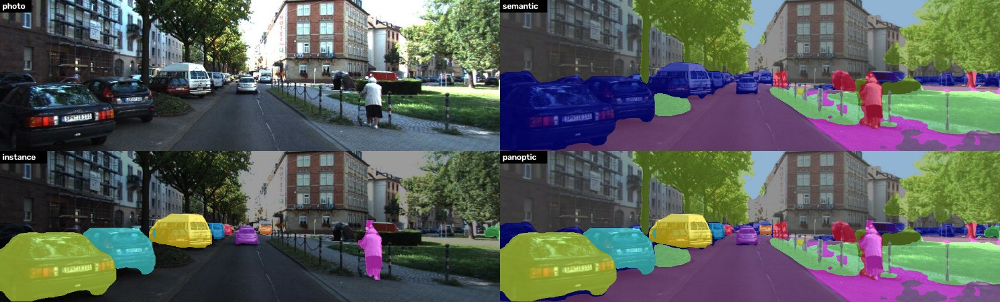
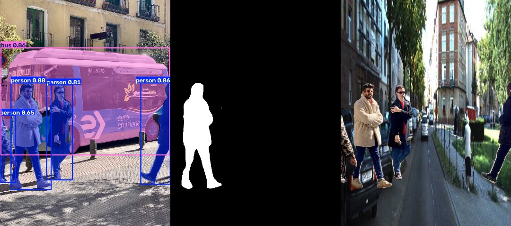
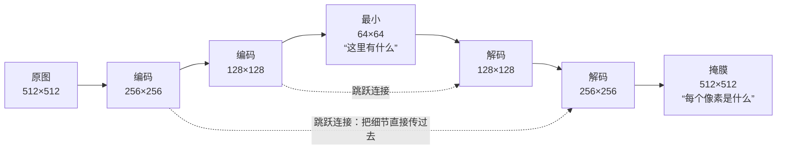
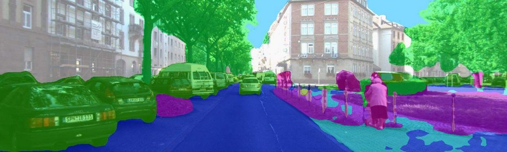
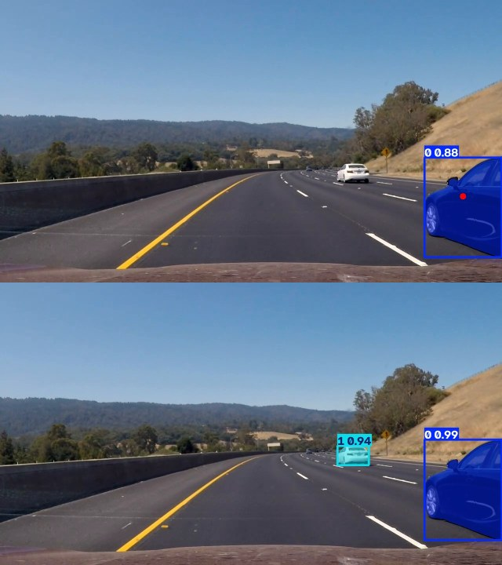
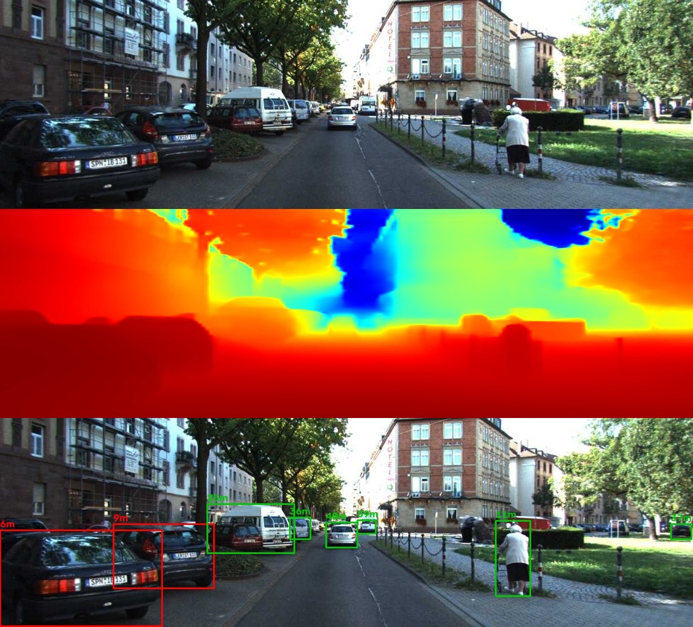
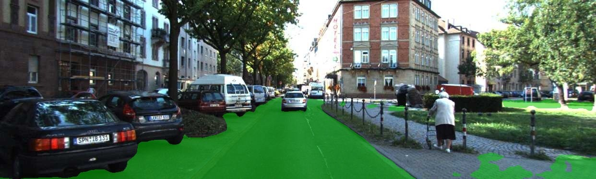
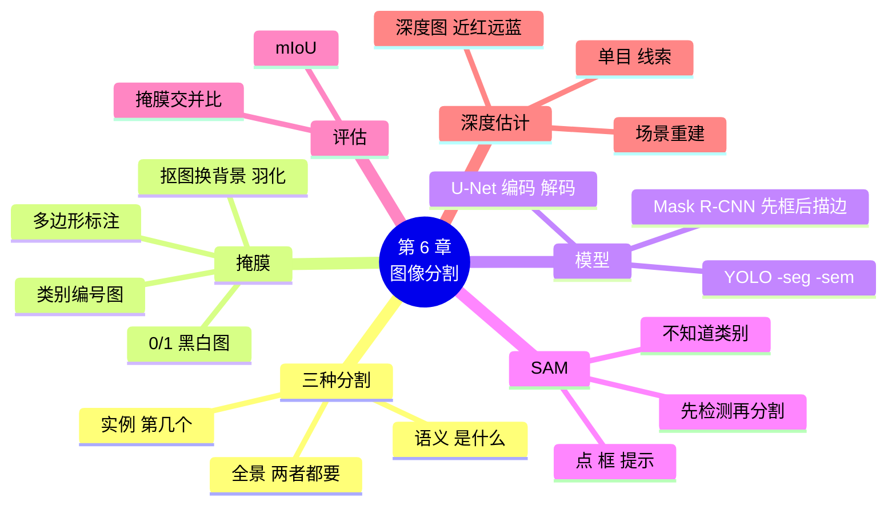

# 第 6 章 图像分割：精确到每个像素

!!! abstract "本章学时"
    理论 4 学时（线上 2 + 线下 2）· 实验 4 学时（本章共 4 个实验，★ 必做 3 个）

## 学习目标

学完本章，你应该能够：

1. **说出**语义分割、实例分割、全景分割的输出各是什么，以及分割和检测的区别（记忆）；
2. **解释**掩膜怎样用来抠图换背景，**计算**两个掩膜的交并比（理解、应用）；
3. **运行并修改**给定代码，用分割模型抠出人物、分出可行驶路面并算出路面占比（应用）；
4. **使用** SAM 通过点或框分割任意物体，**比较** SAM 和 YOLO 分割模型的用途（应用、分析）；
5. **读懂**深度图，结合检测框**判断**画面里哪辆车离自己最近（分析、评价）。

!!! info "先修要求"
    学习本章前，你需要掌握：

    - [2.3.3 按颜色选像素：inRange 与掩膜](../02-image-processing/index.md#233)：掩膜的概念和用法；
    - [5.1 目标检测的输出](../05-detection/index.md#51) 和 [5.2.1 交并比](../05-detection/index.md#521)：边界框、置信度和交并比；
    - [5.7 读懂结果对象](../05-detection/index.md#57)：`r.boxes`、`.tolist()`、`.int()`；
    - 第 2～5 章的 Python 小课堂：`for`、列表、`if`、字典。

??? abstract "本章概念清单（14 个，点击查看定义和例子）"
    1. [语义分割](../../appendix/glossary.md#g-语义分割)
    2. [实例分割](../../appendix/glossary.md#g-实例分割)
    3. [全景分割](../../appendix/glossary.md#g-全景分割)
    4. [羽化](../../appendix/glossary.md#g-羽化)
    5. [多边形标注](../../appendix/glossary.md#g-多边形标注)
    6. [编码器-解码器](../../appendix/glossary.md#g-编码器-解码器)
    7. [平均交并比](../../appendix/glossary.md#g-平均交并比)
    8. [分割一切模型](../../appendix/glossary.md#g-分割一切模型)
    9. [提示](../../appendix/glossary.md#g-提示)
    10. [深度估计](../../appendix/glossary.md#g-深度估计)
    11. [深度图](../../appendix/glossary.md#g-深度图)
    12. [单目深度估计](../../appendix/glossary.md#g-单目深度估计)
    13. [场景重建](../../appendix/glossary.md#g-场景重建)
    14. [布尔索引](../../appendix/glossary.md#g-布尔索引)

## 情景导入

小林把第 5 章训练好的检测器装进了“智能辅助驾驶助手”，画面里的车和人都框出来了。可他很快发现一个问题。

“老王，你看这个框，”小林指着屏幕，“左边停着的这辆车，框把一大片路面也框进去了。要是我想知道前面还有多少路能开，框根本说不清楚。”

“对，车不是长方形的，路更不是。”老王说，“要回答‘哪里能开’，得给画面里**每一个像素**都下个结论：这个像素是路面，那个像素是车，再那个是人行道。这叫**图像分割**。”

“每个像素？一张照片几十万个像素呢。”

“模型干这个很快，你手机拍照时的人像模式，就是先把人分割出来，再把背景虚化。”老王顿了顿，“还有一件事，框也看不出远近。同样大小的框，可能是近处的一辆小轿车，也可能是远处的一辆大卡车。下一步还得让模型看出画面里谁远谁近。”

这一章，我们先用分割模型抠图换背景（把第 2 章的证件照换底色做得更漂亮），再给行车照片的每个像素分类，找出可行驶的路面；然后试一试“点一下就能分割”的 SAM 模型；最后用深度估计模型看出谁离我们更近。这是“智能辅助驾驶助手”从“找到”走向“看懂”的一步。

## 6.1 为什么要分割 { #61 }

### 6.1.1 框不够用的时候 { #611 }

检测框是“有什么、在哪里”的粗略回答。下面这些场景，框就不够用了：

| 场景 | 框的问题 | 分割能做什么 |
|---|---|---|
| 手机人像模式、证件照换底色 | 框里还有背景，换背景会连背景一起换 | 精确抠出人的轮廓 |
| 辅助驾驶判断“哪里能开” | 路面形状不规则，框不住 | 标出每一个路面像素 |
| 测量面积：叶片病斑、路面裂缝、医学影像中的病灶 | 框的面积远大于实际面积 | 数一数掩膜里有多少像素 |
| 停车场里挨在一起的车 | 框互相重叠 | 每辆车单独一个轮廓 |

**图像分割**（第 1 章介绍过）就是判断图片中**每个像素**属于哪个物体或类别。实验 6-3 中，同一辆车的检测框面积是 49 671 像素，真正的车身只有 34 817 像素，只占框的 70%。

### 6.1.2 语义、实例、全景：三种分割 { #612 }



*图 6-1　同一张城市街道照片：左上原图，右上语义分割，左下实例分割，右下全景分割（编者用 yolo26n-sem 和 yolo26n-seg 实际分割，全景分割由两者合并示意）*

| | [**语义分割**](../../appendix/glossary.md#g-语义分割 "给图片中每个像素一个类别，不区分同类中的第几个"){ .term } | [**实例分割**](../../appendix/glossary.md#g-实例分割 "找出每个可数的物体，并给每个物体单独一张掩膜"){ .term } | [**全景分割**](../../appendix/glossary.md#g-全景分割 "每个像素既有类别，人、车等物体还能区分是第几个，相当于语义分割加实例分割"){ .term } |
|---|---|---|---|
| 每个像素回答 | 是什么类别 | 属于第几个物体 | 是什么类别，如果是物体还要说是第几个 |
| 挨在一起的两辆车 | 都是“车”，分不开 | 车 1、车 2，分得开 | 车 1、车 2，分得开 |
| 路面、天空、植被 | 有类别 | 不管（没有固定形状，数不清个数） | 有类别 |
| 比喻 | 给地图涂颜色：水是蓝，林是绿 | 给班上每个同学剪一个剪影 | 两件事都做 |
| 辅助驾驶中的用途 | 找出可行驶路面（实验 6-2） | 数清前方几个人、几辆车 | 完整理解整个画面 |
| 本书用的模型 | yolo26n-sem | yolo26n-seg、SAM | 两者合并 |

全景分割的说法来自 2019 年 Kirillov 等人的论文，他们把“数得清的东西”（人、车）叫 things，把“数不清的东西”（路面、天空）叫 stuff，全景分割就是把两者统一起来。<sup class="cite">[[3]](#ref6-3)</sup>

<iframe class="sim-frame" src="../../sims/seg-types/main.html" height="640" loading="lazy" title="三种分割对比"></iframe>
动画：三种分割对比。切换语义、实例、全景三种模式，把鼠标移到画面上，看每个像素被分成了什么。注意左边停着的几辆车在语义分割里是一整片，在实例分割里才分开。
{ .sim-caption }

## 6.2 掩膜：分割的答案 { #62 }

### 6.2.1 掩膜是一张黑白图 { #621 }

第 2 章用 `cv2.inRange` 按颜色找蓝色背景时，就得到过一张**掩膜**：和原图一样大的黑白图，白色表示“选中”，黑色表示“没选中”。分割模型的输出也是掩膜，只是它不再靠颜色规则，而是靠学来的“理解”。



*图 6-2　实验 6-1：左为实例分割结果（框 + 彩色掩膜），中为其中一个人的掩膜，右为把 4 个人“搬”到城市街道照片上（示例图片随 Ultralytics 安装包提供）*

| 分割类型 | 掩膜长什么样 | 例子（实验 6-1、6-2） |
|---|---|---|
| 实例分割 | 每个物体一张 0/1 掩膜，有几个物体就有几张 | 5 个物体 → 5 张 1080×810 的掩膜 |
| 语义分割 | 一张图，每个像素存一个类别编号 | 375×1242 的数字表，0 是路面、13 是轿车 |

**算一算** 实验 6-1 中，第一个人的掩膜里有 49 302 个 1，整张图有 810 × 1080 = 874 800 个像素，所以这个人占画面 49 302 ÷ 874 800 ≈ 5.6%。公交车的掩膜有 255 375 个 1，占 29.2%。

### 6.2.2 用掩膜抠图换背景 { #622 }

有了掩膜，换背景只要一个公式：

> 新图 = 原图 × 掩膜 + 新背景 × (1 − 掩膜)

掩膜是 1 的地方（人身上），1 − 掩膜 = 0，新图取原图；掩膜是 0 的地方（背景），新图取新背景。这和第 2 章证件照换底色是一回事，只是掩膜更准了：衣服上有蓝色也不会被误换。

```python
mask3 = mask[:, :, None]                        # h×w 变成 h×w×1，才能和 3 通道图片相乘
blue = np.zeros_like(img)                       # 和原图一样大的全黑图
blue[:] = (219, 142, 67)                        # 涂成证件照蓝（BGR）
out = img * mask3 + blue * (1 - mask3)          # 人身上用原图，其他地方用蓝色
```

掩膜边缘是“硬”的：要么 0 要么 1，换背景后人物边缘会有锯齿和一圈原背景的颜色。常用的办法是把掩膜边缘[**羽化**](../../appendix/glossary.md#g-羽化 "把掩膜边缘从 0/1 的硬边模糊成逐渐过渡的值，让抠图边缘更自然"){ .term }：用第 2 章学过的高斯滤波把 0 和 1 之间的边界模糊成 0.2、0.5、0.8 这样的过渡值。

**算一算** 某个边缘像素原图是 (200, 180, 160)，新背景是 (219, 142, 67)，羽化后掩膜值是 0.5：

新图 = (200, 180, 160) × 0.5 + (219, 142, 67) × 0.5 = (209.5, 161, 113.5)，取整后是 (209, 161, 113)，正好是两种颜色的“一半一半”，边缘就自然了。

### 6.2.3 分割数据怎样标注 { #623 }

第 5 章检测的标注是“画框”，分割的标注要“描边”：沿着物体的轮廓点一圈点，连成一个多边形，叫[**多边形标注**](../../appendix/glossary.md#g-多边形标注 "沿物体轮廓点一圈点、连成多边形的分割标注方式"){ .term }。YOLO 分割格式的标注文件和检测格式很像，每个物体一行：

```text
0 0.12 0.40 0.15 0.38 0.20 0.39 0.22 0.45 … 0.11 0.47
```

第一个数是类别编号，后面是多边形各个顶点的 x、y 比例坐标，一对一对排下去。描一个人往往要点几十个点，比画框慢得多，所以分割数据很贵。6.4 节的 SAM 可以帮忙：点一下物体，自动生成轮廓，人只需要检查和修改。第 5 章介绍的 X-AnyLabeling 就内置了 SAM 辅助标注。

## 6.3 分割模型 { #63 }

### 6.3.1 U-Net：先缩小、再放大 { #631 }

第 4 章的分类网络一层层把图片“压缩”，最后只剩一个答案。分割要给每个像素一个答案，输出必须和原图一样大。2015 年提出的 U-Net 想了一个办法：先压缩（编码器），把图片变小、提取“这里有什么”；再放大（解码器），一步步恢复到原图大小，告诉每个像素“你是什么”。<sup class="cite">[[1]](#ref6-1)</sup> 这种结构叫[**编码器-解码器**](../../appendix/glossary.md#g-编码器-解码器 "编码器负责理解并压缩输入，解码器负责逐步还原出输出的网络结构"){ .term }。



画出来像一个字母 U，所以叫 U-Net。虚线是“跳跃连接”：压缩时丢掉的细节（边缘在哪里）直接送给对应的解码层，所以边缘描得很准。U-Net 最早用在医学影像上，至今仍是医学图像分割最常用的结构之一。

### 6.3.2 Mask R-CNN：先框、再描边 { #632 }

2017 年何恺明等人提出的 Mask R-CNN，在第 5 章的两阶段检测器 Faster R-CNN 后面加了一个小分支：先找出每个物体的框，再在每个框里画出掩膜。<sup class="cite">[[2]](#ref6-2)</sup> 这就是实例分割最直接的思路：检测 + 框内分割。它很长时间是实例分割的标杆，Detectron2、MMDetection 等开源工具都提供了它。

### 6.3.3 YOLO 的分割模型 { #633 }

Ultralytics 把分割也做进了 YOLO 家族，用法和第 5 章几乎一样，只是模型名字不同：

| 模型文件 | 任务 | 训练数据 | 输出 |
|---|---|---|---|
| `yolo26n.pt` | 检测 | COCO 80 类 | `r.boxes` |
| `yolo26n-seg.pt` | 实例分割 | COCO 80 类 | `r.boxes` + `r.masks` |
| `yolo26n-sem.pt` | 语义分割 | 城市道路 19 类 | `r.semantic_mask` |

```python
model = YOLO("yolo26n-seg.pt")                  # 名字带 -seg 的是实例分割模型
r = model(img, retina_masks=True)[0]            # retina_masks=True：掩膜和原图一样大
print(r.masks.data.shape)                       # torch.Size([5, 1080, 810])：5 个物体
mask = r.masks.data[0].cpu().numpy()            # 第 0 个物体的掩膜，变成 NumPy 数组
```

`yolo26n-sem.pt` 是在城市道路数据上训练的语义分割模型，认识路面、人行道、建筑、植被、天空、行人、轿车、卡车等 19 类，正好用来做辅助驾驶的可行驶区域分割（实验 6-2）。这 19 类来自德国等欧洲城市拍摄的 Cityscapes 数据集。<sup class="cite">[[4]](#ref6-4)</sup>



*图 6-3　yolo26n-sem 对城市街道照片的语义分割（实验 6-2 第 1 步）：紫色路面、粉色人行道、深蓝轿车、绿色植被*

### 6.3.4 分割的评估 { #634 }

检测用框的交并比判断“框得对不对”，分割用**掩膜的交并比**：把两张掩膜重叠，数一数交集和并集各有多少个像素。

**算一算** 下面是两张 4×4 的掩膜，A 是标准答案，B 是模型预测：

```text
A（答案）     B（预测）     A 和 B 都是 1（交集）
0 1 1 0      0 0 1 1      0 0 1 0
0 1 1 0      0 1 1 1      0 1 1 0
0 1 1 0      0 1 1 0      0 1 1 0
0 0 0 0      0 0 0 0      0 0 0 0
```

A 有 6 个 1，B 有 7 个 1，交集 5 个，并集 = 6 + 7 − 5 = 8 个，交并比 = 5 ÷ 8 = 0.625。

| 指标 | 用在哪里 | 含义 |
|---|---|---|
| 掩膜 mAP | 实例分割 | 和第 5 章检测的 mAP 一样，只是把框的交并比换成掩膜的交并比 |
| [**平均交并比**](../../appendix/glossary.md#g-平均交并比 "语义分割中每个类别分别算交并比，再取平均"){ .term }（mIoU） | 语义分割 | 每一类算一个交并比（路面一个、天空一个……），再取平均 |

训练分割模型的写法和第 5 章完全一样（`model.train(data=…)`），验证时会同时报告框的 mAP 和掩膜的 mAP。本书不训练分割模型，你会读数即可。

## 6.4 分割一切模型 SAM { #64 }

### 6.4.1 点一下就能分割 { #641 }

前面的分割模型都只认识训练过的类别。2023 年 Meta 发布的 [**分割一切模型**](../../appendix/glossary.md#g-分割一切模型 "根据点、框等提示分割任意物体、不需要专门训练的基础模型，只给掩膜不给类别"){ .term }（Segment Anything Model，SAM）换了一种思路：它不管物体叫什么，只要你给一个[**提示**](../../appendix/glossary.md#g-提示 "告诉模型要做什么的输入；在 SAM 中是点、框等，用来指明要分割哪个物体"){ .term }（在物体上点一个点，或者画一个框），它就把“这一整块”分割出来。<sup class="cite">[[5]](#ref6-5)</sup> 它在 1100 万张图片、10 亿多个掩膜上训练，见过的“块”太多了，所以没见过的东西也能分。

原版 SAM 很大，在 CPU 上很慢。本书用的 MobileSAM 是韩国庆熙大学团队做的轻量版，大小约 40 MB，在普通电脑 CPU 上分割一次约 3 秒。<sup class="cite">[[6]](#ref6-6)</sup>

```python
from ultralytics import SAM
sam = SAM("mobile_sam.pt")
r = sam(img, points=[[1180, 500]], labels=[1])[0]        # 在 (1180, 500) 点一下，1 表示“要这个”
r = sam(img, bboxes=[[855, 415, 945, 468]])[0]           # 或者画一个框 (x1, y1, x2, y2)
mask = r.masks.data[0].cpu().numpy()                      # 得到掩膜
```



*图 6-4　实验 6-3：上图在黑色轿车上点一下（红点），SAM 分出整辆车；下图把 YOLO 检测框交给 SAM，得到每辆车的精确轮廓*

<iframe class="sim-frame" src="../../sims/sam-click/main.html" height="560" loading="lazy" title="点一下分割"></iframe>
动画：点一下分割。在照片上点车、路面、天空、护栏，看被点中的完整一块亮起来；打开“显示全部区域”，看 SAM 一共找到了多少块。
{ .sim-caption }

### 6.4.2 一个点可能有好几种理解 { #642 }

实验 6-3 中，在远处白色小车的车尾中间点一下，SAM 只分出了车的上半部分（1331 像素，模型自己打分 0.59）；改用一个框住整辆车的框，就分出了整辆车（3461 像素，打分 0.94）。

这是因为“一个点”是有歧义的：点在车尾，你想要的是车尾？车窗？还是整辆车？SAM 只能猜。解决办法有三个：

1. **改用框**：框把范围说清楚了，结果最稳定；
2. **多点几个点**：在想要的物体上再点几个“要”的点（`labels` 写 1），在不想要的地方点“不要”的点（写 0）；
3. **先检测再分割**：先用 YOLO 找出框，再把框交给 SAM（实验 6-3 第 4 步）。这样既知道“是什么”（来自 YOLO），又有精确轮廓（来自 SAM）。

### 6.4.3 SAM 和 YOLO 分割模型怎么选 { #643 }

| | YOLO 分割模型 | SAM |
|---|---|---|
| 要不要提示 | 不要，自动找出所有认识的物体 | 要，点或框（不给提示就“分割一切”，很慢） |
| 能不能说出类别 | 能 | 不能，只给掩膜 |
| 没训练过的东西 | 分不出来 | 也能分 |
| 速度（编者 CPU 实测） | 不到 1 秒一张 | MobileSAM 约 3 秒一次，“分割一切”约 3 分钟 |
| 适合 | 辅助驾驶、计数等自动化任务 | 交互抠图、辅助标注、医学影像勾画 |

## 6.5 深度估计：场景重建的第一步 { #65 }

### 6.5.1 每个像素一个“远近” { #651 }

分割给每个像素一个类别，[**深度估计**](../../appendix/glossary.md#g-深度估计 "估计图片中每个像素离相机有多远的任务"){ .term }给每个像素一个距离：这个像素离相机有多远。结果是一张和原图一样大的数字表，叫[**深度图**](../../appendix/glossary.md#g-深度图 "和原图一样大、每个像素存一个距离值的数字表，常用颜色表示远近"){ .term }。画出来时常用颜色表示：近处红、远处蓝。



*图 6-5　实验 6-4：上为原图，中为深度图（近红远蓝），下为检测框加上估计的距离（10 米以内画红框）*

```python
depth_model = YOLO("yolo26n-depth.pt")                 # 单张照片估计远近的模型
r = depth_model(img)[0]
depth = r.depth.data.cpu().numpy()                     # 和原图一样大，数值越大越远
print(depth.min(), depth.max())                        # 5.4  86.6
```

这个模型给出的数值可以大致理解为“米”。实验 6-4 中，城市街道照片里最近的像素约 5.4 米，最远约 86.6 米。

### 6.5.2 一张照片怎么看出远近 { #652 }

人有两只眼睛，靠两眼看到的细微差别判断远近。但你闭上一只眼，照样能大致判断远近，因为画面里有很多“线索”：

| 线索 | 例子（实验 6-4 照片） |
|---|---|
| 近大远小 | 同样是轿车，最近的框 290×172，远处的只有 33×24 |
| 越靠下越近 | 画面中间一列：最下面一行约 7.4 米，中间约 59.7 米，三分之一高处约 77.1 米 |
| 遮挡 | 挡住别人的离得更近 |
| 纹理变密 | 路面砖缝、车道线越远越密 |

深度估计模型从大量带距离的照片中学会了这些线索。只用一个摄像头（一只“眼睛”）估计深度，叫[**单目深度估计**](../../appendix/glossary.md#g-单目深度估计 "只用一个摄像头拍的单张照片估计深度，便宜但没有绝对尺子"){ .term }。它很便宜，但有局限：没有绝对的尺子，换一个镜头、换一个场景，数值就可能偏差很大。所以在汽车上，单目深度估计只是辅助，真正的测距还要靠双目摄像头、毫米波雷达或激光雷达。

!!! warning "辅助，不是替代"
    本章算出的“约 6.5 米”是模型估计，不是测量。智能辅助驾驶助手可以用它做“前车较近，注意保持距离”这样的提醒，但不能据此控制车辆。驾驶员始终要自己观察路况。

### 6.5.3 从深度到三维：场景重建 { #653 }

有了每个像素的深度，就能把一张照片“立起来”：知道每个像素在画面中的位置和它的距离，就能算出它在三维空间中的位置。把很多张照片的结果拼起来，就得到整个场景的三维模型，这叫[**场景重建**](../../appendix/glossary.md#g-场景重建 "根据照片或视频恢复场景的三维结构"){ .term }。

| 技术 | 做法 | 生活中的例子 |
|---|---|---|
| 单目深度估计（本章） | 一张照片 → 深度图 | 手机拍照的人像虚化、AR 把虚拟家具“放”在地上 |
| 多视角三维重建 | 围着物体拍一圈照片 → 三维模型 | 文物数字化、电商商品 3D 展示 |
| NeRF、3D 高斯泼溅 | 用手机拍一段视频 → 可以自由转视角的场景 | 地图 App 的实景三维、虚拟看房 |
| 鸟瞰图与占用网络 | 车上多个摄像头 → 从天上往下看的地图，标出哪里有障碍 | 智能驾驶屏幕上的“车辆周围示意图” |

第 9 章会再介绍后三种。

## 6.6 Python 小课堂：用掩膜挑像素 { #66 }

本章的代码大量用到 NumPy 的“比较”和“挑选”，几个写法弄懂了，掩膜就会用了。

**1. 比较得到 True/False 掩膜**

```python
road = (sem == 0)              # 每个像素都和 0 比一比，得到和 sem 一样大的 True/False 表
print(road.mean())             # True 当作 1、False 当作 0，平均值就是“路面占比”：0.16
```

**2. 用掩膜挑像素：布尔索引**

```python
show[road] = (0, 200, 0)       # 只把 road 为 True 的像素改成绿色
print(depth[road].mean())      # 只取路面像素的深度，再求平均
```

把一个 True/False 表放进方括号，只挑出 True 的位置，这种写法叫[**布尔索引**](../../appendix/glossary.md#g-布尔索引 "用 True/False 表放进方括号，只挑出 True 位置的元素"){ .term }。第 2 章的 `img[mask > 0] = …` 用的就是它。

**3. 一次比较多个值：`np.isin`**

```python
car_or_person = np.isin(sem, [11, 12, 13, 14, 15])   # 是人、骑车人、轿车、卡车、公交车中的任何一个
```

**4. 多加一个维度：`[:, :, None]`**

掩膜形状是 (高, 宽)，彩色图是 (高, 宽, 3)，不能直接相乘。`mask[:, :, None]` 把掩膜变成 (高, 宽, 1)，NumPy 会自动把这“1 层”复制成 3 层，和彩色图对齐。

| 写法 | 形状变化 | 用在哪里 |
|---|---|---|
| `mask[:, :, None]` | (1080, 810) → (1080, 810, 1) | 掩膜和彩色图相乘 |
| `mask.sum()` | 整张 → 一个数 | 数掩膜里有多少像素 |
| `mask.mean()` | 整张 → 一个 0～1 的数 | 算占比 |
| `np.median(depth[y1:y2, x1:x2])` | 一块 → 一个数 | 取框里深度的中位数 |

## 6.7 本章常见报错对照 { #67 }

| 报错原文（最后一行） | 用大白话说 | 怎么改 |
|---|---|---|
| `AttributeError: 'NoneType' object has no attribute 'data'` | 用了检测模型，结果里没有 `masks` | 实例分割用 `yolo26n-seg.pt`，语义分割用 `yolo26n-sem.pt` 并取 `r.semantic_mask` |
| `TypeError: can't convert … tensor to numpy` | 张量还没变成 NumPy 数组 | 加上 `.cpu().numpy()` |
| `ValueError: operands could not be broadcast together with shapes (1080,810,3) (1080,810)` | 掩膜少了一个维度 | 用 `mask[:, :, None]` |
| `IndexError: … index 0 is out of bounds` | 图里一个人都没找到，`person_ids` 是空列表 | 换一张有人的照片，或先 `if person_ids:` 判断 |
| 换背景后人物边缘有一圈锯齿 | 掩膜比原图小，被放大了 | 加 `retina_masks=True`；边缘再用高斯滤波羽化 |
| SAM 只分出了物体的一部分 | 一个点有歧义 | 改用框，或多点几个点 |
| SAM 第一次运行很久 | 在下载 `mobile_sam.pt`（约 40 MB） | 耐心等待；或由老师提前放进文件夹 |

## 6.8 前沿视窗：会看视频的 SAM 和“深度一切” { #68 }

**SAM 2：分割视频。** 2024 年 Meta 发布的 SAM 2 把“点一下就分割”扩展到了视频：在第一帧点一下某辆车，它会在后面所有帧里自动跟住这辆车的轮廓，即使车被短暂遮挡也能找回来。<sup class="cite">[[7]](#ref6-7)</sup> 这把分割和第 7 章的跟踪合在了一起，大大减少了视频标注的工作量。之后 Meta 又推出了能听懂文字提示的新版本，输入“黄色校车”就能在画面中找出并分割所有黄色校车。

**Depth Anything：深度一切。** 2024 年香港大学和字节跳动等团队发布的 Depth Anything，用 6200 多万张没有标注的照片训练单目深度估计，在室内、室外、动漫画面上都能给出不错的深度图。<sup class="cite">[[8]](#ref6-8)</sup> 它和 SAM 的思路一样：用海量数据训练一个“什么都能处理”的基础模型，再用到各种具体任务上。

## 本章实验

!!! abstract "实验总览"
    | 实验 | 类型 | 建议时长 | 内容 |
    |---|---|---|---|
    | 实验 6-1 | ★ 必做 | 45 分钟 | 抠图换背景 |
    | 实验 6-2 | ★ 必做 | 45 分钟 | 分出可行驶路面 |
    | 实验 6-3 | ★ 必做 | 45 分钟 | 点一下分割 |
    | 实验 6-4 | ☆ 选做 | 45 分钟 | 谁离我更近 |

    代码见配套资源 `labs/ch06/` 目录，每个实验都有 `.py` 和 `.ipynb` 两种文件，内容相同。所有实验都在 `labs/ch06/` 文件夹里运行，CPU 即可。第一次运行会自动下载模型：`yolo26n-seg.pt`（约 7 MB）、`yolo26n-sem.pt`（约 3.5 MB）、`mobile_sam.pt`（约 40 MB）、`yolo26n-depth.pt`（约 13 MB）、`yolo26n.pt`（约 5.5 MB）。

### 实验 6-1 ★ 抠图换背景 { #6-1 }

**实验目的**

1. 用实例分割模型找出图中的人，读出每个掩膜的大小；
2. 用掩膜把人换成蓝底证件照；
3. 把人“搬”到另一张照片上，体会羽化的作用。

**实验环境**：云端 Notebook 或本机，CPU 即可。

**实验数据**：Ultralytics 安装包自带的示例图片 `bus.jpg`（街头公交车前的几个人，不用另外下载）；背景用 `labs/data/images/drive_city.jpg`（KITTI，CC BY-NC-SA 3.0）。

**实验步骤与代码**

第一档 · 跑通：打开 `lab6_1_cutout.ipynb`，依次运行四个单元格。

第 1 步，实例分割：

```python
from ultralytics.utils import ASSETS          # Ultralytics 自带的示例图片所在文件夹
img = cv2.imread(str(ASSETS / "bus.jpg"))      # ← 改这里，换成自己的照片
model = YOLO("yolo26n-seg.pt")
r = model(img, retina_masks=True, verbose=False)[0]
for i, (c, conf) in enumerate(zip(r.boxes.cls.tolist(), r.boxes.conf.tolist())):
    print(i, r.names[int(c)], round(conf, 2), "掩膜像素数：", int(r.masks.data[i].sum()))
```

`enumerate` 在循环时同时给出“第几个”和“这一个”，`zip` 把两个列表一对一对地配起来。

第 2～3 步，取出第一个人的掩膜，换成蓝底：

```python
person_ids = [i for i, c in enumerate(r.boxes.cls.tolist()) if r.names[int(c)] == "person"]
k = person_ids[0]                              # 第几个人  ← 改这里
mask = r.masks.data[k].cpu().numpy()           # 0 和 1 组成的二维数组
mask3 = mask[:, :, None]
blue = np.zeros_like(img)
blue[:] = (219, 142, 67)                       # 证件照蓝（BGR）  ← 改这里
out = (img * mask3 + blue * (1 - mask3)).astype(np.uint8)
x1, y1, x2, y2 = r.boxes.xyxy[k].int().tolist()
cv2.imwrite("lab6_1_blue.jpg", out[y1:y2, x1:x2])   # 用检测框把这个人裁出来
```

第 1 行是“列表推导式”：把满足 `if` 条件的编号收集成一个列表，相当于 3 行 `for` 循环的简写。

第 4 步，把所有人搬到街景上（边缘羽化）：

```python
bg = cv2.resize(cv2.imread("../data/images/drive_city.jpg"), (w, h))   # ← 改这里
all_people = np.zeros((h, w), np.float32)
for i in person_ids:                            # 把所有人的掩膜合在一起
    all_people = np.maximum(all_people, r.masks.data[i].cpu().numpy())
soft = cv2.GaussianBlur(all_people, (7, 7), 0)[:, :, None]   # 边缘羽化
out = (img * soft + bg * (1 - soft)).astype(np.uint8)
```

完整代码：`labs/ch06/lab6_1_cutout.py`（`.ipynb` 同名）

**运行结果**

```text
图片大小： 810 × 1080
0 person 0.88 掩膜像素数： 49302
1 person 0.86 掩膜像素数： 21311
2 bus 0.86 掩膜像素数： 255375
3 person 0.81 掩膜像素数： 33411
4 person 0.65 掩膜像素数： 11100
掩膜形状： (1080, 810) 取值： [0 1]
这个人占整张图的 5.6 %
一共搬了 4 个人，结果已保存
```

结果见图 6-2。最右边那个人只露出半个身子（置信度 0.65），也被搬了过去。

第二档 · 改一改：

1. 把第 3 步的蓝色改成白色 `(255, 255, 255)` 和红色 `(0, 0, 255)`，各存一张；
2. 把 `k` 改成 `person_ids[1]`，换另一个人做证件照；
3. 第 4 步把羽化的 `(7, 7)` 改成 `(1, 1)`（不羽化）和 `(21, 21)`，放大看人物边缘有什么不同；
4. 去掉 `retina_masks=True`，打印掩膜形状，看看有什么变化。

第三档 · 挑战（选做）：用自己的一张照片（征得照片中人的同意），把背景换成虚化的原背景（提示：`bg = cv2.GaussianBlur(img, (51, 51), 0)`），做一个“人像模式”。

**实验记录表**

| 项目 | 记录 |
|---|---|
| 找到几个人、几辆车 | 4 人、1 辆公交车 |
| 第一个人的掩膜像素数、占比 | 49 302，5.6% |
| 羽化 (1,1)、(7,7)、(21,21) 的边缘效果 | |
| 不加 retina_masks 时掩膜形状 | |

**常见问题排查**

| 现象 | 原因 | 解决办法 |
|---|---|---|
| `IndexError: list index out of range` | 照片里没找到人 | 换一张有人的照片，或打印 `r.names` 看看找到了什么 |
| 换完背景整张图发灰、发白 | 结果没转回整数 | 最后加 `.astype(np.uint8)` |
| 人物被换成了背景，背景留下了 | 掩膜和 1 − 掩膜写反了 | 原图乘掩膜，背景乘 1 − 掩膜 |

**思考与练习**

1. 第 2 章用 HSV 颜色找蓝色背景来换底色，本实验用分割模型。如果一个人穿着蓝色衣服，两种方法的结果有什么不同？
2. 用别人的照片抠图、换背景，要注意什么？（提示：第 3 章的个人信息保护；第 8 章还会讲深度合成。）

**实验报告要求**

提交蓝底证件照、换背景结果和羽化对比图，填写实验记录表，回答“思考与练习”。

### 实验 6-2 ★ 分出可行驶路面 { #6-2 }

**实验目的**

1. 用道路语义分割模型给行车照片的每个像素分类；
2. 统计每一类的面积占比，把路面单独标出来；
3. 只看车头正前方，用简单规则给出“能不能往前开”的提醒。

**实验环境**：云端 Notebook 或本机，CPU 即可。

**实验数据**：`labs/data/images/drive_city.jpg`、`street_crossing.jpg`（KITTI，CC BY-NC-SA 3.0）、`drive_highway.jpg`（Udacity，MIT）。

**实验步骤与代码**

第一档 · 跑通：打开 `lab6_2_drivable.ipynb`，依次运行四个单元格。

第 1～2 步，语义分割并统计每一类：

```python
model = YOLO("yolo26n-sem.pt")                  # 认识 19 类道路场景
img = cv2.imread("../data/images/drive_city.jpg")   # ← 改这里
r = model(img, verbose=False)[0]
sem = r.semantic_mask.data.cpu().numpy()        # 和原图一样大，每个数是类别编号
ids, counts = np.unique(sem, return_counts=True)   # 出现过的编号，以及各有多少个像素
for i, n in sorted(zip(ids, counts), key=lambda t: -t[1]):  # 按像素数从多到少排
    print(f"{model.names[int(i)]:<14}{n / sem.size * 100:5.1f}%")
```

`np.unique(…, return_counts=True)` 一次给出“有哪些值”和“各有几个”。`sorted(…, key=lambda t: -t[1])` 表示按每一对的第二个数（像素数）从大到小排，照着用即可。

第 3 步，把路面涂成绿色：

```python
road = (sem == 0)                               # 编号 0 是 road（路面）
show = img.copy()
show[road] = (0.5 * show[road] + 0.5 * np.array([0, 200, 0])).astype(np.uint8)  # 半透明绿色
print("整张图中路面占", round(road.mean() * 100, 1), "%")
```

第 4 步，三张照片轮流判断车头正前方（节选）：

```python
front = sem[int(h * 0.6):, int(w * 0.35):int(w * 0.65)]   # 画面下部中间  ← 改这里
road_ratio = (front == 0).mean()                          # 路面占比
blocked = np.isin(front, [11, 12, 13, 14, 15, 17, 18]).mean()   # 人、骑车人、各种车
if blocked > 0.05:                                        # 阈值  ← 改这里
    tip = "正前方有人或车，注意减速"
elif road_ratio < 0.7:
    tip = "正前方不全是路面，请注意"
else:
    tip = "前方路面空旷"
```

完整代码：`labs/ch06/lab6_2_drivable.py`（`.ipynb` 同名）

**运行结果**

```text
building       29.0%
vegetation     18.3%
car            18.0%
road           16.0%
terrain         8.6%
sidewalk        4.1%
sky             2.8%
person          2.3%
pole            0.5%
fence           0.1%
truck           0.1%
traffic sign    0.0%
整张图中路面占 16.0 %
drive_city      路面  81%  人或车   3%  → 前方路面空旷
street_crossing 路面  83%  人或车  16%  → 正前方有人或车，注意减速
drive_highway   路面  99%  人或车   0%  → 前方路面空旷
```



*图 6-6　实验 6-2 第 3 步：城市街道照片中的路面（绿色），占整张图的 16.0%*

**算一算** “行人过马路”这张照片，正前方区域里路面占 83%，看上去“空旷”。但人和车占了 16%，超过了 5% 的阈值，所以给出减速提醒。如果只看路面占比，就会漏掉正在过马路的行人。这说明规则要“先看危险、再看路面”，`if` 和 `elif` 的顺序很重要。

第二档 · 改一改：

1. 把第 1 步的照片换成 `drive_highway.jpg`，看看天空和路面各占多少。高速公路左侧的绿地有没有被错分成路面？
2. 把第 4 步“正前方区域”改大（如 `h * 0.5`、`w * 0.25～0.75`），三张照片的结论变不变？
3. 把阈值 0.05 改成 0.2，“行人过马路”还会提醒吗？这样改安全吗？

第三档 · 挑战（选做）：把第 4 步的判断应用到 `labs/data/videos/highway_12s.mp4` 的每一帧（提示：第 3 章实验 3-3b 读视频的写法），统计有多少帧给出了提醒。

**实验记录表**

| 照片 | 路面占整张图 | 正前方路面 | 正前方人或车 | 提醒 | 你觉得对吗 |
|---|---|---|---|---|---|
| drive_city.jpg | 16.0% | 81% | 3% | 前方路面空旷 | |
| street_crossing.jpg | | 83% | 16% | 注意减速 | |
| drive_highway.jpg | | 99% | 0% | 前方路面空旷 | |

**常见问题排查**

| 现象 | 原因 | 解决办法 |
|---|---|---|
| `AttributeError: 'NoneType' object has no attribute 'data'` | 用成了检测或实例分割模型 | 用 `yolo26n-sem.pt`，取 `r.semantic_mask` |
| 路面占比为 0 | 编号写错了，或照片里没有路 | 打印 `model.names` 确认路面是 0 |
| 国内道路照片效果差 | 模型在欧洲城市数据上训练 | 正常现象，见“思考与练习” |

**思考与练习**

1. 模型在德国等欧洲城市拍摄的数据上训练。用在国内道路上（电动车多、路边摊多、车道线样式不同），可能在哪些地方出错？
2. 本实验的规则只看“画面下部中间的一块”。如果车正在转弯，这个区域还代表“前方”吗？你会怎么改？

**实验报告要求**

提交三张照片的路面标注图和实验记录表，回答“思考与练习”。

### 实验 6-3 ★ 点一下分割 { #6-3 }

**实验目的**

1. 用 MobileSAM 通过点和框两种提示分割物体；
2. 比较点和框的效果，理解提示的歧义；
3. 把 YOLO 检测框交给 SAM，得到“有类别、有轮廓”的结果。

**实验环境**：云端 Notebook 或本机，CPU 即可。每次分割约 3 秒，整个实验运行约半分钟。

**实验数据**：`labs/data/images/drive_highway.jpg`（Udacity，MIT）。

**实验步骤与代码**

第一档 · 跑通：打开 `lab6_3_sam.ipynb`，依次运行四个单元格。

第 1～2 步，点一下和框一下：

```python
sam = SAM("mobile_sam.pt")
img = cv2.imread("../data/images/drive_highway.jpg")
r = sam(img, points=[[1180, 500]], labels=[1], verbose=False)[0]   # 点黑色轿车  ← 改这里
print("掩膜像素数：", int(r.masks.data[0].sum()), " 模型打分：", round(float(r.boxes.conf[0]), 2))
r1 = sam(img, points=[[900, 440]], labels=[1], verbose=False)[0]   # 点白色小车的车尾
r2 = sam(img, bboxes=[[855, 415, 945, 468]], verbose=False)[0]     # 框住白色小车
for name, rr in [("点", r1), ("框", r2)]:
    print(name, "→ 像素数", int(rr.masks.data[0].sum()), " 打分", round(float(rr.boxes.conf[0]), 2))
```

第 3 步，路面、天空、隔离墙也能分：

```python
for name, xy in [("路面", [640, 600]), ("天空", [640, 150]), ("隔离墙", [200, 500])]:
    rr = sam(img, points=[xy], labels=[1], verbose=False)[0]
    ratio = rr.masks.data[0].float().mean().item()   # 掩膜占整张图的比例
    print(f"{name}：占画面 {ratio:.1%}")
```

第 4 步，先检测再分割：

```python
det = YOLO("yolo26n.pt")(img, verbose=False)[0]
boxes = det.boxes.xyxy.tolist()                  # 检测框列表
r = sam(img, bboxes=boxes, verbose=False)[0]     # 一次传入多个框，每个框得到一个掩膜
for b, m in zip(boxes, r.masks.data):
    box_area = (b[2] - b[0]) * (b[3] - b[1])     # 框的面积
    print(f"框面积 {box_area:7.0f}  掩膜面积 {int(m.sum()):6d}  车身占框 {m.sum() / box_area:.0%}")
```

完整代码：`labs/ch06/lab6_3_sam.py`（`.ipynb` 同名）

**运行结果**

```text
掩膜像素数： 34524  模型打分： 0.88
点 → 像素数 1331  打分 0.59
框 → 像素数 3461  打分 0.94
路面：占画面 21.5%
天空：占画面 39.6%
隔离墙：占画面 5.0%
框面积   49671  掩膜面积  34817  车身占框 70%
框面积    4408  掩膜面积   3452  车身占框 78%
```

结果见图 6-4。点白色小车只分出了上半部分，框住它才分出整辆车。“路面”只占 21.5%，是因为 SAM 只分出了点所在的那几条车道，没有包括隔离墙下的路肩；SAM 认的是“看上去连成一块”，而不是“路面”这个概念。

第二档 · 改一改：

1. 在第 1 步换几个点：点黑色轿车的车轮、车窗，看分出的是整辆车还是一部分；
2. 给白色小车同时点两个点：`points=[[[900, 440], [900, 460]]], labels=[[1, 1]]`（注意多了一层方括号，表示两个点属于同一个物体），比较结果；
3. 在第 3 步“路面”的点之外，再加一个点在隔离墙上并设为“不要”：`points=[[[640, 600], [200, 500]]], labels=[[1, 0]]`，看看有什么变化。

第三档 · 挑战（选做）：用第 5 章实验 5-3 训练的 KITTI 检测器（`../ch05/runs/kitti20/weights/best.pt`）代替 `yolo26n.pt` 做第 4 步，把 `drive_city.jpg` 中每辆车、每个行人的轮廓都描出来。

**实验记录表**

| 提示方式 | 目标 | 掩膜像素数 | 打分 | 分得完整吗 |
|---|---|---|---|---|
| 点 (1180, 500) | 黑色轿车 | 34 524 | 0.88 | |
| 点 (900, 440) | 白色小车 | 1 331 | 0.59 | |
| 框 | 白色小车 | 3 461 | 0.94 | |
| 你选的点 | | | | |

**常见问题排查**

| 现象 | 原因 | 解决办法 |
|---|---|---|
| 第一次运行很久 | 在下载 `mobile_sam.pt`（约 40 MB） | 等待，或由老师提前放进文件夹 |
| `points` 报形状错误 | 方括号层数不对 | 一个点 `[[x, y]]`；同一物体的多个点 `[[[x1, y1], [x2, y2]]]` |
| 点到了旁边的物体 | 坐标是 (x, y)，x 是横向 | 先用画图软件看清坐标 |

**思考与练习**

1. SAM 不知道它分出的是“车”还是“路”，那它在什么任务中最有用？举两个例子。
2. 第 4 步中，车身只占检测框的 70%～78%。如果用检测框的面积去估计“前车占了多少车道”，会偏大还是偏小？

**实验报告要求**

提交点选、框选和“检测 + SAM”三张结果图和实验记录表，回答“思考与练习”。

### 实验 6-4 ☆ 谁离我更近 { #6-4 }

**实验目的**

1. 用深度估计模型生成行车照片的深度图，读出最近、最远的距离；
2. 自己把深度图涂成彩色，理解“近红远蓝”；
3. 结合检测框，比较几辆车的远近，给最近的目标加提醒。

**实验环境**：云端 Notebook 或本机，CPU 即可。

**实验数据**：`labs/data/images/drive_city.jpg`（KITTI，CC BY-NC-SA 3.0）。

**实验步骤与代码**

第一档 · 跑通：打开 `lab6_4_depth.ipynb`，依次运行四个单元格。

第 1～2 步，估计深度并涂色：

```python
depth_model = YOLO("yolo26n-depth.pt")
r = depth_model(img, verbose=False)[0]
depth = r.depth.data.cpu().numpy()                     # 数值越大越远（约为米）
d = (depth - depth.min()) / (depth.max() - depth.min())   # 缩放到 0～1
gray = ((1 - d) * 255).astype(np.uint8)                # 反过来：近 → 亮，远 → 暗
color = cv2.applyColorMap(gray, cv2.COLORMAP_JET)      # 亮 → 红，暗 → 蓝
```

第 3 步，取框里深度的中位数作为距离，按远近排序：

```python
det = YOLO("yolo26n.pt")(img, verbose=False)[0]
items = []
for b, c in zip(det.boxes.xyxy.int().tolist(), det.boxes.cls.tolist()):
    x1, y1, x2, y2 = b
    dist = float(np.median(depth[y1:y2, x1:x2]))       # 框里所有像素深度的中位数
    items.append((dist, det.names[int(c)], b))
items.sort()                                           # 按第一个数（距离）从小到大排
```

为什么用中位数而不用平均数？框里除了车，还有一部分背景（远处的路面、建筑），它们的深度很大，会把平均数拉高；中位数受这些“异类”的影响小。

第 4 步在图上标出距离，10 米以内画红框，代码见完整文件。

完整代码：`labs/ch06/lab6_4_depth.py`（`.ipynb` 同名）

**运行结果**

```text
深度图形状： (375, 1242)
最近 5.4   最远 86.6   平均 24.8
第 365 行中间的深度：7.4
第 187 行中间的深度：59.7
第 125 行中间的深度：77.1
car      约   6.5 米  框 [0, 201, 290, 373]
car      约   8.8 米  框 [203, 190, 383, 305]
person   约  11.2 米  框 [888, 184, 950, 319]
bus      约  25.4 米  框 [371, 154, 527, 242]
car      约  35.6 米  框 [519, 178, 556, 217]
car      约  36.8 米  框 [1202, 190, 1239, 217]
car      约  39.5 米  框 [584, 187, 640, 232]
car      约  58.8 米  框 [640, 183, 673, 207]
最近的是 car，约 6.5 米 → 注意保持距离
```

结果见图 6-5。左边停着的两辆车最近，分别约 6.5 米和 8.8 米；拄着助行器的老人约 11.2 米。

**算一算** 第 5 章说“框越大越近”。最近的车框是 290×172 = 49 880 像素，约 6.5 米；远处一辆车框是 33×24 = 792 像素，约 58.8 米。面积相差约 63 倍，距离相差约 9 倍，大致符合“面积和距离的平方成反比”（9² = 81，量级相当）。不过行人框 62×135 = 8370 像素，比第二辆车（180×115 = 20 700）小，但距离只远了一点。所以不同类别的物体不能只比框的大小，深度估计更可靠。

第二档 · 改一改：

1. 把第 4 步的 10 米改成 15 米，哪些目标变成了红框？
2. 把中位数 `np.median` 改成平均数 `np.mean`，距离有什么变化？哪个目标变化最大？为什么？
3. 换成 `street_crossing.jpg`，正在过马路的行人最近的有多远？

第三档 · 挑战（选做）：结合实验 6-2，只取“路面”像素的深度（`depth[sem == 0]`），算出画面中能看到的路面最远有多远。

**实验记录表**

| 目标 | 框大小 | 中位数距离 | 平均数距离 | 是否 10 米以内 |
|---|---|---|---|---|
| 最近的车 | 290×172 | 6.5 米 | | 是 |
| 行人 | 62×135 | 11.2 米 | | 否 |
| 白色厢式车（bus） | 156×88 | 25.4 米 | | 否 |

**常见问题排查**

| 现象 | 原因 | 解决办法 |
|---|---|---|
| `AttributeError: 'NoneType' object has no attribute 'data'` | 模型不是深度估计模型 | 用 `yolo26n-depth.pt`，取 `r.depth` |
| 彩色深度图近处是蓝色 | 没有做 `1 - d` 的反转 | 按代码先反转再上色 |
| 距离和实际差很多 | 单目深度估计没有绝对尺子 | 正常，只能用于比较远近和粗略提醒 |

**思考与练习**

1. 为什么辅助驾驶的“前车距离”通常还要用雷达？单目深度估计在什么天气、什么场景下最容易出错？
2. 本实验只看了一张照片。在视频里，如果前车的距离一帧比一帧小，说明了什么？（第 7 章会用到。）

**实验报告要求**

提交彩色深度图和距离标注图，填写实验记录表，回答“思考与练习”。

## 本章小结

- **图像分割**给每个像素一个答案。**语义分割**回答“是什么类别”，**实例分割**回答“是第几个物体”，**全景分割**两者都回答。
- 分割的答案是**掩膜**：实例分割每个物体一张 0/1 掩膜，语义分割一张类别编号图。新图 = 原图 × 掩膜 + 新背景 × (1 − 掩膜)，边缘羽化更自然。
- 分割数据用**多边形标注**，比画框贵得多。分割的评估用掩膜的交并比、掩膜 mAP 和**平均交并比**（mIoU）。
- U-Net 是**编码器-解码器**结构，先缩小再放大，跳跃连接保留细节；Mask R-CNN 先框后描边；YOLO 的 `-seg` 和 `-sem` 模型用法和检测一样。
- **分割一切模型** SAM 靠点、框等**提示**分割任意物体，不需要训练，但不知道类别；一个点有歧义，框更稳定；“先检测再分割”兼得两者之长。
- **深度估计**给每个像素一个远近，得到**深度图**。**单目深度估计**靠近大远小、越靠下越近、遮挡等线索，便宜但没有绝对尺子，只能做辅助提醒。从深度出发，可以走向**场景重建**。



**下一章预告**

到目前为止，我们处理的都是一张张静止的照片。可行车记录仪拍的是视频：前车在动，行人在走，自己的车也在动。下一章学**视频分析**：怎样一帧一帧地读视频，怎样给每辆车发一个“号码牌”一直跟住它，怎样判断前车是不是越来越近；还会用人体关键点数俯卧撑、识别驾驶员有没有低头看手机。

## 参考文献

正文中的上标编号（如<sup class="cite">[[1]](#ref6-1)</sup>）对应下面的文献。带链接的可以直接打开；书籍可在图书馆或电子书平台查阅。

<div class="refs" markdown>

**经典论文**

- <span id="ref6-1"></span>[1] RONNEBERGER O, FISCHER P, BROX T. U-Net: Convolutional Networks for Biomedical Image Segmentation[C]//Medical Image Computing and Computer-Assisted Intervention (MICCAI 2015). Cham: Springer, 2015: 234-241.
    <span class="ref-note">U-Net 的论文，提出编码器-解码器加跳跃连接的分割结构，最早用于医学影像，对应 6.3.1 节。</span>
- <span id="ref6-2"></span>[2] HE K, GKIOXARI G, DOLLÁR P, et al. Mask R-CNN[C]//2017 IEEE International Conference on Computer Vision. Venice: IEEE, 2017: 2961-2969.
    <span class="ref-note">Mask R-CNN 的论文，在两阶段检测器后加掩膜分支做实例分割，对应 6.3.2 节。</span>
- <span id="ref6-3"></span>[3] KIRILLOV A, HE K, GIRSHICK R, et al. Panoptic Segmentation[C]//2019 IEEE/CVF Conference on Computer Vision and Pattern Recognition. Long Beach: IEEE, 2019: 9404-9413.
    <span class="ref-note">提出全景分割任务，把 things（数得清的物体）和 stuff（数不清的区域）统一起来，对应 6.1.2 节。</span>
- <span id="ref6-4"></span>[4] CORDTS M, OMRAN M, RAMOS S, et al. The Cityscapes Dataset for Semantic Urban Scene Understanding[C]//2016 IEEE Conference on Computer Vision and Pattern Recognition. Las Vegas: IEEE, 2016: 3213-3223.
    <span class="ref-note">城市道路语义分割数据集 Cityscapes 的论文，实验 6-2 所用模型的 19 个类别来自这里，对应 6.3.3 节。</span>
- <span id="ref6-5"></span>[5] KIRILLOV A, MINTUN E, RAVI N, et al. Segment Anything[C]//2023 IEEE/CVF International Conference on Computer Vision. Paris: IEEE, 2023: 4015-4026.
    <span class="ref-note">分割一切模型 SAM 的论文，提出用点、框等提示分割任意物体，对应 6.4 节。</span>
- <span id="ref6-6"></span>[6] ZHANG C, HAN D, QIAO Y, et al. Faster Segment Anything: Towards Lightweight SAM for Mobile Applications[EB/OL]. (2023-06-25)[2026-10-31]. <https://arxiv.org/abs/2306.14289>.
    <span class="ref-note">MobileSAM 的论文，把 SAM 缩小到可以在手机和普通 CPU 上运行，实验 6-3 使用的就是它，对应 6.4.1 节。</span>
- <span id="ref6-7"></span>[7] RAVI N, GABEUR V, HU Y T, et al. SAM 2: Segment Anything in Images and Videos[EB/OL]. (2024-08-01)[2026-10-31]. <https://arxiv.org/abs/2408.00714>.
    <span class="ref-note">SAM 2 的论文，把点选分割扩展到视频，对应 6.8 节。</span>
- <span id="ref6-8"></span>[8] YANG L, KANG B, HUANG Z, et al. Depth Anything: Unleashing the Power of Large-Scale Unlabeled Data[C]//2024 IEEE/CVF Conference on Computer Vision and Pattern Recognition. Seattle: IEEE, 2024: 10371-10381.
    <span class="ref-note">香港大学、字节跳动等团队的单目深度估计基础模型，对应 6.8 节。</span>

**在线资源**

- <span id="ref6-9"></span>[9] Ultralytics. Instance Segmentation / Semantic Segmentation / Depth Estimation / SAM[EB/OL]. [2026-10-31]. <https://docs.ultralytics.com/>.
    <span class="ref-note">Ultralytics 官方文档中实例分割、语义分割、深度估计和 SAM 的用法说明，实验 6-1～6-4 的写法以此为准。</span>

</div>

## 课后练习

选择题和判断题可以直接点击选项作答，系统会马上告诉你对错，并展开答案与解析；多选题选好后点“提交答案”。简答和实操题请先自己作答，再点开“答案与解析”核对。每道题的解析下方都有“回看”链接，做错了可以直接跳回正文复习。

**一、单项选择题**

<div class="quiz" data-answer="C" markdown>

**1.** 要算出行车画面中“路面”占多大比例，最合适的是（　　）。

- A. 图像分类
- B. 目标检测
- C. 语义分割
- D. 实例分割

</div>

??? tip "答案与解析"
    **答案：C**

    路面没有固定形状、也数不清“几个”，语义分割给每个像素一个类别，数一数路面像素即可（实验 6-2）。检测只能给框；实例分割只管人、车这些数得清的物体。

    考查：三种分割的用途 · 认知层次：应用 · [回看 6.1.2](#612)
    { .quiz-meta }

<div class="quiz" data-answer="B" markdown>

**2.** 路边并排停着两辆车，语义分割的结果是（　　）。

- A. 两辆车各一种颜色，能分开
- B. 两辆车都是“轿车”这一种颜色，连成一片
- C. 两辆车都不显示
- D. 只显示置信度高的那一辆

</div>

??? tip "答案与解析"
    **答案：B**

    语义分割只回答“是什么类别”，不区分是第几个。要分开两辆车，需要实例分割或全景分割。

    考查：语义分割与实例分割的区别 · 认知层次：理解 · [回看 6.1.2](#612)
    { .quiz-meta }

<div class="quiz" data-answer="A" markdown>

**3.** 一张 100×200 的图片，某人的掩膜中有 2000 个 1，这个人占画面（　　）。

- A. 10%
- B. 20%
- C. 2%
- D. 1%

</div>

??? tip "答案与解析"
    **答案：A**

    整张图 100 × 200 = 20 000 个像素，2000 ÷ 20 000 = 10%。代码中写 `mask.mean()` 就能直接得到 0.1。

    考查：掩膜面积 · 认知层次：应用 · [回看 6.2.1](#621)
    { .quiz-meta }

<div class="quiz" data-answer="D" markdown>

**4.** 换背景公式“新图 = 原图 × 掩膜 + 新背景 × (1 − 掩膜)”中，某个边缘像素的掩膜值是 0.3，则新图这个像素（　　）。

- A. 完全等于原图
- B. 完全等于新背景
- C. 原图占 70%，新背景占 30%
- D. 原图占 30%，新背景占 70%

</div>

??? tip "答案与解析"
    **答案：D**

    原图乘 0.3，新背景乘 1 − 0.3 = 0.7。羽化后的边缘像素就是这样按比例混合的。

    考查：掩膜换背景与羽化 · 认知层次：应用 · [回看 6.2.2](#622)
    { .quiz-meta }

<div class="quiz" data-answer="B" markdown>

**5.** U-Net 中“跳跃连接”的作用是（　　）。

- A. 让模型跑得更快
- B. 把压缩时丢掉的细节直接送给解码层，使边缘更准
- C. 跳过不重要的图片
- D. 减少训练数据

</div>

??? tip "答案与解析"
    **答案：B**

    编码器把图片压小时会丢掉边缘细节，跳跃连接把对应大小的特征直接传给解码器，所以 U-Net 描边很准。

    考查：U-Net 结构 · 认知层次：理解 · [回看 6.3.1](#631)
    { .quiz-meta }

<div class="quiz" data-answer="C" markdown>

**6.** 关于 SAM，下列说法正确的是（　　）。

- A. 它会输出每个掩膜的类别名称
- B. 它只能分割训练过的 80 类物体
- C. 它根据点、框等提示分割物体，没训练过的东西也能分
- D. 它必须先用自己的数据训练才能使用

</div>

??? tip "答案与解析"
    **答案：C**

    SAM 不需要训练就能用，靠提示分割“完整的一块”，但不知道这一块叫什么。要类别，可以先用 YOLO 检测再把框交给 SAM。

    考查：SAM 的特点 · 认知层次：理解 · [回看 6.4](#64)
    { .quiz-meta }

<div class="quiz" data-answer="A" markdown>

**7.** 实验 6-3 中，点白色小车只分出一部分，改用框后分出了整辆车。主要原因是（　　）。

- A. 一个点有歧义，框把范围说清楚了
- B. 框的计算更快
- C. 点的坐标写错了
- D. 白色的车无法用点分割

</div>

??? tip "答案与解析"
    **答案：A**

    点在车尾，SAM 不知道你想要车尾、车窗还是整辆车。框给出了范围，结果最稳定（打分从 0.59 提高到 0.94）。

    考查：提示的歧义 · 认知层次：分析 · [回看 6.4.2](#642)
    { .quiz-meta }

<div class="quiz" data-answer="D" markdown>

**8.** 用深度图判断一辆车的距离，取框里深度的中位数而不取平均数，是因为（　　）。

- A. 中位数算得更快
- B. 平均数总是比真实距离小
- C. NumPy 不能算平均数
- D. 框里混有远处的背景像素，会把平均数拉高，中位数受影响小

</div>

??? tip "答案与解析"
    **答案：D**

    车的框里还有路面、建筑等背景，它们的深度很大，属于“异类”。中位数是排在正中间的那个数，不容易被少数极大值带偏。

    考查：深度图的使用 · 认知层次：分析 · [回看 实验 6-4](#6-4)
    { .quiz-meta }

**二、多项选择题**

<div class="quiz quiz-multi" data-answer="ABD" markdown>

**9.** 下列任务中，分割比检测更合适的有（　　）。

- A. 手机人像模式虚化背景
- B. 测量路面裂缝的面积
- C. 统计路口经过了多少辆车
- D. 找出画面中可以行驶的路面

</div>

??? tip "答案与解析"
    **答案：ABD**

    A、B、D 都需要精确的轮廓或面积。C 只要数个数，检测加跟踪就够了（第 7 章）。

    考查：分割的用途 · 认知层次：应用 · [回看 6.1.1](#611)
    { .quiz-meta }

<div class="quiz quiz-multi" data-answer="AC" markdown>

**10.** 关于全景分割，正确的有（　　）。

- A. 每个像素都有类别
- B. 只分割人和车，路面、天空不管
- C. 人、车等物体还能区分是第几个
- D. 就是语义分割的另一个名字

</div>

??? tip "答案与解析"
    **答案：AC**

    全景分割 = 语义分割（每个像素有类别）+ 实例分割（物体分得清第几个）。B 说的是实例分割。

    考查：全景分割 · 认知层次：理解 · [回看 6.1.2](#612)
    { .quiz-meta }

<div class="quiz quiz-multi" data-answer="ABC" markdown>

**11.** 单目深度估计判断远近时可以利用的线索有（　　）。

- A. 同类物体近大远小
- B. 地面上越靠画面下方越近
- C. 挡住别人的物体更近
- D. 颜色越红的物体越近

</div>

??? tip "答案与解析"
    **答案：ABC**

    “近红远蓝”只是深度图的上色方式，不是原图中的线索。原图里红色的车不一定近。

    考查：单目深度估计的线索 · 认知层次：理解 · [回看 6.5.2](#652)
    { .quiz-meta }

**三、判断题**

<div class="quiz quiz-judge" data-answer="√" markdown>

**12.** 分割模型输出的掩膜和原图一样大，每个像素对应一个答案。

</div>

??? tip "答案与解析"
    **答案：√**

    实例分割加 `retina_masks=True` 时，掩膜就是原图大小；语义分割和深度估计的结果也都和原图一样大。

    考查：掩膜 · 认知层次：记忆 · [回看 6.2.1](#621)
    { .quiz-meta }

<div class="quiz quiz-judge" data-answer="×" markdown>

**13.** 两张掩膜的交并比 = 交集像素数 ÷ 两张掩膜像素数之和。

</div>

??? tip "答案与解析"
    **答案：×**

    分母是并集，即两张掩膜像素数之和再减去交集。例：6 和 7 个像素、交集 5，交并比 = 5 ÷ (6 + 7 − 5) = 0.625。

    考查：掩膜交并比 · 认知层次：应用 · [回看 6.3.4](#634)
    { .quiz-meta }

<div class="quiz quiz-judge" data-answer="√" markdown>

**14.** 先用 YOLO 检测出框，再把框交给 SAM，可以同时得到物体的类别和精确轮廓。

</div>

??? tip "答案与解析"
    **答案：√**

    类别来自 YOLO，轮廓来自 SAM。这也是很多标注工具“AI 辅助标注”的做法。

    考查：检测 + SAM · 认知层次：理解 · [回看 6.4.2](#642)
    { .quiz-meta }

<div class="quiz quiz-judge" data-answer="×" markdown>

**15.** 单目深度估计给出的距离很准，可以直接用来控制汽车刹车。

</div>

??? tip "答案与解析"
    **答案：×**

    单目深度估计没有绝对尺子，换镜头、换场景都可能偏差很大，只能做辅助提醒。真实车辆的测距要结合雷达等传感器，驾驶员始终负责。

    考查：深度估计的局限 · 认知层次：评价 · [回看 6.5.2](#652)
    { .quiz-meta }

<div class="quiz quiz-judge" data-answer="√" markdown>

**16.** 实验 6-2 所用的语义分割模型在欧洲城市数据上训练，用在国内道路上可能效果变差。

</div>

??? tip "答案与解析"
    **答案：√**

    训练数据和使用场景不一样，模型就可能出错，例如国内常见的电动车、路边摊在训练数据中很少。第 4 章、第 5 章也讲过同样的问题。

    考查：训练数据与使用场景 · 认知层次：理解 · [回看 6.3.3](#633)
    { .quiz-meta }

**四、简答题**

**17.** 用自己的话说明语义分割、实例分割、全景分割的区别，并各举一个辅助驾驶中的用途。

??? tip "答案与解析"
    **参考答案：**

    语义分割给每个像素一个类别，不区分个体，例如找出可行驶路面；实例分割只分人、车等数得清的物体，每个单独一个掩膜，例如数清前方有几个行人；全景分割两者都做，每个像素都有类别，物体还分得清第几个，用于完整理解路况。

    评分要点：三者的输出各 1 分，用途各 1 分。

    考查：三种分割 · 认知层次：理解 · [回看 6.1.2](#612)
    { .quiz-meta }

**18.** 实验 6-2 中，“行人过马路”照片的正前方路面占 83%。为什么程序仍然提醒“注意减速”？如果把两个判断条件的顺序调换，会出现什么问题？

??? tip "答案与解析"
    **参考答案：**

    因为正前方区域中人和车占了 16%，超过了 5% 的阈值，程序先判断“有没有人或车”，所以给出减速提醒。如果先判断“路面占比 ≥ 0.7 就算空旷”，83% 的路面会让程序直接得出“前方路面空旷”，漏掉正在过马路的行人，非常危险。规则要先看危险，再看路面。

    评分要点：说出 16% > 5%（2 分）；说出调换后漏报行人（2 分）。

    考查：分割结果的应用 · 认知层次：分析 · [回看 实验 6-2](#6-2)
    { .quiz-meta }

**19.** 比较 YOLO 实例分割模型和 SAM 的优缺点，说明各自适合什么任务。

??? tip "答案与解析"
    **参考答案：**

    YOLO 分割模型不需要提示，自动找出认识的物体，能说出类别，速度快，适合辅助驾驶、计数等自动化任务；但没训练过的物体分不出来。SAM 靠点或框提示，没见过的东西也能分，轮廓精细，适合交互抠图、辅助标注；但不知道类别，需要提示，速度较慢。

    评分要点：各自优点、缺点、适合任务，共 6 点，每点 1 分。

    考查：SAM 与 YOLO 的比较 · 认知层次：分析 · [回看 6.4.3](#643)
    { .quiz-meta }

**五、实操题**

**20.** 修改实验 6-4 的代码：只对类别是 `person` 的目标估计距离，如果最近的行人在 15 米以内，打印“前方有行人，注意避让”，否则打印“附近没有行人”。用 `drive_city.jpg` 和 `street_crossing.jpg` 各运行一次，记录结果。

??? tip "答案与解析"
    **参考做法：**

    ```python
    people = [t for t in items if t[1] == "person"]     # 只留下行人
    if people and people[0][0] < 15:                    # items 已按距离排好，第一个最近
        print("前方有行人，注意避让，约", round(people[0][0], 1), "米")
    else:
        print("附近没有行人")
    ```

    `drive_city.jpg` 中行人约 11.2 米，会提醒。`street_crossing.jpg` 中最近的行人约 8.4 米（编者运行结果），也会提醒。注意先判断 `people` 是否为空，否则没有行人时 `people[0]` 会报 `IndexError`。

    评分要点：正确筛选行人（2 分）；判断空列表（1 分）；两张照片的结果（2 分）。

    考查：深度估计与检测结合 · 认知层次：应用 · [回看 实验 6-4](#6-4)
    { .quiz-meta }
