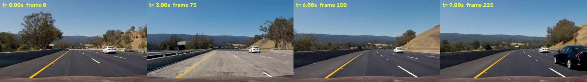
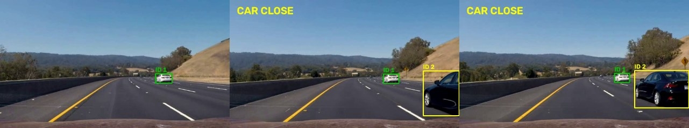
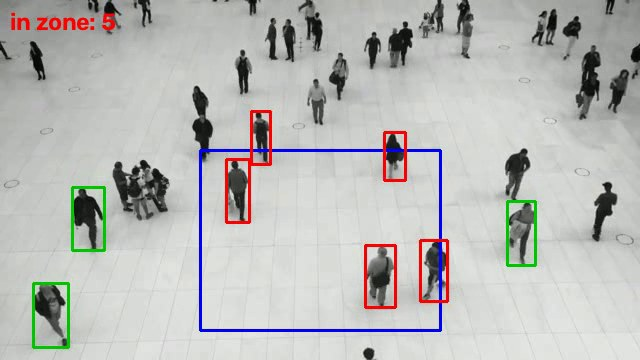
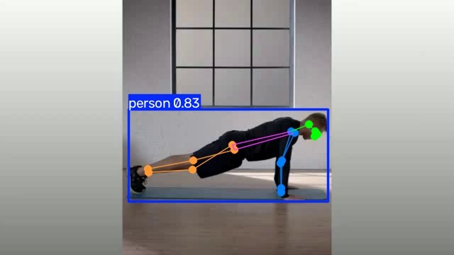
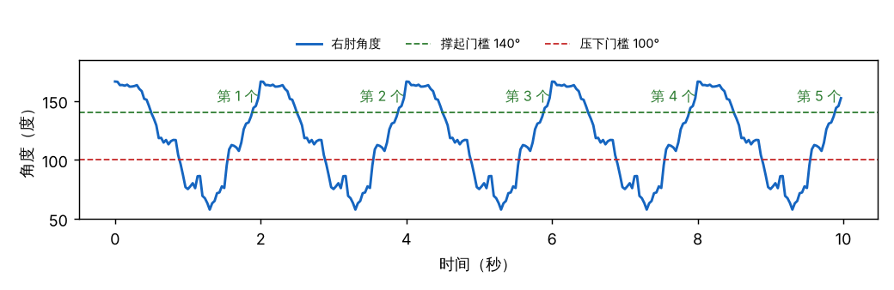
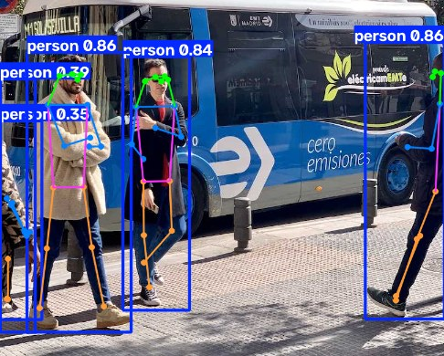
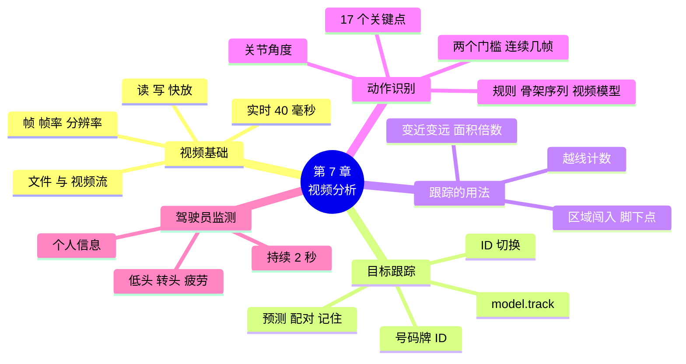

# 第 7 章 视频分析：让模型看懂动态画面

!!! abstract "本章学时"
    理论 4 学时（线上 2 + 线下 2）· 实验 4 学时（本章共 4 个实验，★ 必做 3 个）

## 学习目标

学完本章，你应该能够：

1. **说出**帧、帧率、分辨率的含义，**计算**一段视频有多少帧（记忆、应用）；
2. **运行并修改**给定代码，用 OpenCV 读视频、抽帧、写视频（应用）；
3. **解释**目标跟踪怎样给目标发号码牌、遮挡和漏检为什么会让号码牌换号（理解）；
4. **使用**跟踪结果做区域闯入提醒，并用框的面积变化**判断**目标在变近还是变远（应用、分析）；
5. **解释**为什么动作识别要看一段时间，用关节角度和“连续几帧”规则实现健身计数（理解、应用）。

!!! info "先修要求"
    学习本章前，你需要掌握：

    - [实验 3-3 车道线检测](../03-features/index.md#3-3)：`cv2.VideoCapture` 和逐帧读取视频的写法；
    - [5.1 目标检测的输出](../05-detection/index.md#51) 和 [5.2.1 交并比](../05-detection/index.md#521)；
    - [5.7 读懂结果对象](../05-detection/index.md#57)：`r.boxes`、`.tolist()`；
    - 第 2～6 章的 Python 小课堂：函数、`for`、`if`、列表、字典。

??? abstract "本章概念清单（12 个，点击查看定义和例子）"
    1. [帧](../../appendix/glossary.md#g-帧)
    2. [帧率](../../appendix/glossary.md#g-帧率)
    3. [压缩](../../appendix/glossary.md#g-压缩)
    4. [ID](../../appendix/glossary.md#g-ID)
    5. [ID 切换](../../appendix/glossary.md#g-ID-切换)
    6. [越线计数](../../appendix/glossary.md#g-越线计数)
    7. [区域闯入](../../appendix/glossary.md#g-区域闯入)
    8. [人体关键点](../../appendix/glossary.md#g-人体关键点)
    9. [动作识别](../../appendix/glossary.md#g-动作识别)
    10. [驾驶员监测系统](../../appendix/glossary.md#g-驾驶员监测系统)
    11. [集合](../../appendix/glossary.md#g-集合)
    12. [端到端](../../appendix/glossary.md#g-端到端)

## 情景导入

小林的“智能辅助驾驶助手”已经能在一张照片里框出车和人、分出路面、看出远近。他兴冲冲地把行车记录仪拍的一段视频交给程序，结果屏幕上的框一闪一闪，车的编号也对不上。

“老王，同一辆车，这一帧找到了，下一帧又没了；而且我想知道前车是不是越来越近，可程序每一帧都是‘从头看’，根本不记得上一帧发生了什么。”

“这就是视频和照片最大的不同，”老王说，“视频是一串连续的画面，要回答的问题都跟‘时间’有关：这辆车是不是刚才那辆？它是在靠近还是远离？行人是不是正在走进车道？你得给每辆车发个‘号码牌’，一直盯着它，这叫**目标跟踪**。”

“那驾驶员低头看手机的提醒呢？也是看一帧就行吗？”

“不行。司机低一下头看仪表很正常，连续低头两三秒才危险。动作要看一段时间，不能看一张照片就下结论。”

这一章，我们先学会读写视频，然后给行车视频里的车发号码牌，判断前车变近变远、行人有没有进入危险区域；再用人体关键点数俯卧撑，最后尝试做一个驾驶员分心提醒。

## 7.1 视频就是一串图片 { #71 }

### 7.1.1 帧、帧率、分辨率 { #711 }

小时候玩过的“手翻书”，每页画一个稍有变化的小人，快速翻动就像动起来了。视频也是这样：一张张图片快速播放。每一张叫一[**帧**](../../appendix/glossary.md#g-帧 "视频中的一张图片"){ .term }，每秒播放多少张叫[**帧率**](../../appendix/glossary.md#g-帧率 "每秒播放或拍摄多少帧"){ .term }（单位 fps，frames per second）。

| 概念 | 含义 | 实验 7-1 的视频 |
|---|---|---|
| 帧 | 视频中的一张图片 | 一张 640×360 的彩色图 |
| 帧率 | 每秒多少帧 | 25 fps |
| 分辨率 | 每一帧的宽 × 高 | 640×360 |
| 总帧数 | 一共多少张 | 300 |
| 时长 | 总帧数 ÷ 帧率 | 300 ÷ 25 = 12 秒 |



*图 7-1　实验 7-1：从 12 秒的高速公路行车视频中取出第 0、3、6、9 秒的 4 帧，左上角是程序加上的时间和帧号（视频来自 Udacity，MIT 许可）*

**算一算** 一帧 640×360 的彩色图有 640 × 360 × 3 = 691 200 个数（每个数 1 字节），约 0.66 MB。300 帧就是约 198 MB。可这个 mp4 文件只有约 4 MB，因为视频文件经过了[**压缩**](../../appendix/glossary.md#g-压缩 "利用相邻帧大部分内容相同等特点，把视频文件变小的方法；读出来的每一帧仍是完整图片"){ .term }：相邻两帧大部分内容几乎一样，只需要记下“变化了的地方”。所以视频文件很小，但读出来的每一帧都是完整的图片。

常见的帧率：电影 24 fps，网络视频和行车记录仪 25 或 30 fps，高速摄像 120 fps 以上。行车记录仪 1080p、30 fps 录一分钟，就有 1800 张 1920×1080 的图片要处理。

### 7.1.2 视频文件和视频流 { #712 }

| 来源 | 例子 | OpenCV 打开方式 |
|---|---|---|
| 视频文件 | 手机拍的 mp4、行车记录仪存卡的视频 | `cv2.VideoCapture("a.mp4")` |
| 电脑摄像头 | 笔记本自带摄像头 | `cv2.VideoCapture(0)`（0 是第一个摄像头） |
| 网络视频流 | 监控摄像头的 rtsp 地址 | `cv2.VideoCapture("rtsp://…")` |

视频文件可以“慢慢处理”，处理一帧用 1 秒也没关系；视频流是实时的，处理不过来就会积压。辅助驾驶面对的是视频流，所以特别在乎速度（7.2.3 节）。

## 7.2 用 OpenCV 处理视频 { #72 }

### 7.2.1 读视频：一帧一帧地取 { #721 }

第 3 章做车道线视频时已经用过这个套路：

```python
cap = cv2.VideoCapture("../data/videos/highway_12s.mp4")   # 打开视频
fps = cap.get(cv2.CAP_PROP_FPS)                            # 帧率
n = int(cap.get(cv2.CAP_PROP_FRAME_COUNT))                 # 总帧数
while True:
    ok, frame = cap.read()             # 读下一帧；读完了 ok 就是 False
    if not ok:
        break                          # 跳出循环
    # ……在这里处理 frame，和处理一张图片完全一样……
cap.release()                          # 用完关掉
```

`frame` 就是一张普通的图片（第 1 章的数字表），前面几章学过的裁剪、调色、检测、分割，都可以原样用在每一帧上。

### 7.2.2 写视频：把处理好的帧存起来 { #722 }

```python
fourcc = cv2.VideoWriter_fourcc(*"mp4v")                       # 编码格式，mp4 用 mp4v
writer = cv2.VideoWriter("out.mp4", fourcc, fps, (w, h))      # 文件名、编码、帧率、(宽, 高)
writer.write(frame)                                             # 每处理完一帧就写一帧
writer.release()                                                # 最后一定要 release
```

两个容易错的地方：尺寸写成 `(宽, 高)`，和 `frame.shape` 的 `(高, 宽, 3)` 顺序相反；写入的每一帧大小必须和这里写的一致，否则会得到一个打不开的空文件。

**算一算** 实验 7-1 第 4 步把 300 帧按 50 fps 写出去，时长 = 300 ÷ 50 = 6 秒，就是 2 倍速播放。帧没有变，变的只是“每秒放几张”。

### 7.2.3 速度：辅助驾驶为什么要实时 { #723 }

25 fps 的视频，每帧之间只有 1000 ÷ 25 = 40 毫秒。要“实时”，处理一帧必须在 40 毫秒之内。编者的 CPU 上，yolo26n 检测一帧约 0.1～0.3 秒，跟不上实时。常用的提速办法：

| 办法 | 做法 | 代价 |
|---|---|---|
| 跳帧 | 每 2～3 帧处理一次，中间的帧沿用结果 | 反应变慢一点 |
| 缩小尺寸 | `imgsz=320`，或先 `cv2.resize` | 远处的小目标更难找到 |
| 选小模型 | n 号模型，不用 x 号 | 精度略低 |
| 用 GPU 或专用芯片 | 车上用专门的 AI 芯片 | 成本 |

真正的车载系统用专门的 AI 芯片，每秒能处理几十帧到上百帧，第 9 章还会讲导出 ONNX 提速。

## 7.3 目标跟踪：给每个目标发号码牌 { #73 }

### 7.3.1 检测不够，还要跟踪 { #731 }

检测器每一帧都是“从头看”：这一帧画面里有 3 辆车，它只知道“有 3 个框”，不知道这 3 辆是不是上一帧那 3 辆。**目标跟踪**给每个目标发一个号码牌（[**ID**](../../appendix/glossary.md#g-ID "跟踪器给每个目标发的号码牌，在后面的帧里保持不变"){ .term }），在后面的帧里一直用同一个号码，这样才能回答：

- 这辆车开了多远、多快？在变近还是变远？
- 路口一共过去了多少辆车？（每个号码只数一次）
- 这个行人是不是正在走进车道？

### 7.3.2 跟踪器怎样配对 { #732 }

主流的跟踪方法叫“先检测、再跟踪”：每一帧先用检测器找出所有框，再由跟踪器把框和已有的号码牌配对。<sup class="cite">[[1]](#ref7-1)</sup> 每一帧做三件事：

1. **预测**：根据每个号码牌过去几帧的运动，推算它这一帧大概在哪（以前每帧向右移 3 像素，这一帧就再往右 3 像素）；
2. **配对**：把预测位置和这一帧的检测框按交并比配对，最像的配成一对，号码牌跟着走；
3. **处理配不上的**：没配上任何号码牌的新框，发一个新号码；没配上框的号码牌先“记住”几帧，等它重新出现，超过时间才删除。

比喻：老师点名时，看到座位上的人就对上名字；有人请假（被遮挡）先不划掉，等他回来；来了新同学就加一个名字。

<iframe class="sim-frame" src="../../sims/track-ids/main.html" height="640" loading="lazy" title="跟踪号码牌"></iframe>
动画：跟踪号码牌。车开到桥下被挡住，或检测器偶尔漏检时，比较“只看重叠”和“预测位置 + 记住几帧”两种方法，看号码牌会不会换号。
{ .sim-caption }

在动画中，漏检率 10%、有桥遮挡时，“只看重叠”的方法出现了 122 个号码牌（真实只有 5 辆车），换号 117 次；改用“预测位置 + 记住 45 帧”，号码牌正好 5 个，一次也没换。号码牌换了，就会出现“一辆车被数成两辆”的错误，这叫 [**ID 切换**](../../appendix/glossary.md#g-ID-切换 "同一个目标在跟踪过程中号码牌变了，常由遮挡或漏检引起，会造成重复计数"){ .term }，是衡量跟踪好坏的重要指标。

常用的跟踪器有 ByteTrack（把低置信度的框也拿来配对，减少漏跟）<sup class="cite">[[2]](#ref7-2)</sup>、BoT-SORT（加上外观特征和相机运动补偿）<sup class="cite">[[3]](#ref7-3)</sup> 等。本书所用 Ultralytics 版本默认的跟踪器是 2025 年提出的 TrackTrack，默认“记住” 30 帧。你只需要知道它们都是“预测 + 配对 + 记住”的思路即可。

### 7.3.3 用 Ultralytics 跟踪 { #733 }

把检测时的 `model(…)` 换成 `model.track(…)`，结果里就多了每个框的号码牌 `r.boxes.id`：

```python
model = YOLO("yolo26n.pt")
for r in model.track("../data/videos/highway_12s.mp4", stream=True, persist=True,
                     classes=[2, 5, 7], verbose=False):     # 2 car、5 bus、7 truck
    if r.boxes.id is None:                                  # 这一帧没跟踪到任何目标
        continue
    print(r.boxes.id.int().tolist(), r.boxes.xyxy.int().tolist())
```

| 参数 | 作用 |
|---|---|
| `stream=True` | 一帧一帧地给结果，不会把整段视频的结果都堆在内存里 |
| `persist=True` | 记住上一帧的号码牌（跟踪必须加） |
| `classes=[2, 5, 7]` | 只要这几类（COCO 编号） |
| `tracker="bytetrack.yaml"` | 换一种跟踪器（不写就用默认的） |



*图 7-2　实验 7-2：第 150、200、230 帧。远处的白车一直是 ID 1；第 182 帧从右侧超车进入画面的黑车得到 ID 2，框的高度超过画面的 1/4，标黄并显示“CAR CLOSE”*

## 7.4 跟踪的用法：计数、闯入、变近 { #74 }

有了号码牌，很多“和时间有关”的问题就好办了。

| 用法 | 做法 | 场景 |
|---|---|---|
| [**越线计数**](../../appendix/glossary.md#g-越线计数 "目标的号码牌从线的一边移到另一边时计数加一，每个号码只算一次"){ .term } | 号码牌的中心点从线的一边跑到另一边，计数加一（每个号码只算一次） | 路口车流量、商场客流 |
| [**区域闯入**](../../appendix/glossary.md#g-区域闯入 "目标进入划定的多边形区域时发出提醒"){ .term } | 划一个多边形区域，号码牌的“脚下”点进入区域就提醒 | 行人进入车道、工地危险区 |
| 变近变远 | 比较同一个号码牌 1 秒前后框的面积 | 前车碰撞预警 |
| 停留时间 | 号码牌在区域里连续出现了多少帧 | 违停检测、排队时长 |

### 7.4.1 区域闯入 { #741 }

判断一个点在不在多边形里，OpenCV 有现成的函数：

```python
zone = np.array([[200, 150], [440, 150], [440, 330], [200, 330]])   # 区域的四个角
foot = ((x1 + x2) // 2, y2)                                          # 框底边中点 = 脚下
inside = cv2.pointPolygonTest(zone, foot, False) >= 0                # 在里面或边上返回 ≥ 0
```

为什么用“脚下”而不用框的中心？人站在地上，判断他“走进了哪块地面”看的是脚的位置；框的中心在人的腰部，人走到区域边上时，腰部可能已经“进去”了，脚还在外面。



*图 7-3　实验 7-2 第 4 步：蓝色是划定的区域，脚下进入区域的人标红框（视频来自 Ultralytics 示例，俯拍的人比较小，有些人没有被检测到）*

### 7.4.2 变近还是变远 { #742 }

第 5 章说过“框越大越近”。对同一个号码牌，比较 1 秒前和现在框的面积：

> 面积变化倍数 = 现在的面积 ÷ 1 秒前的面积

大于 1.2 算“变近”，小于 0.8 算“变远”，中间算“差不多”（阈值可以调）。

**算一算** 实验 7-2 中，黑车（ID 2）第 232 帧框面积 15 726，第 257 帧（1 秒后）11 779，倍数 = 11 779 ÷ 15 726 ≈ 0.75 < 0.8，判断为“变远”：它超车之后正在开走。再看它刚出现时：第 182 帧面积 4168，1 秒后 15 666，倍数 3.76，程序判断“变近”。其实那是车刚从画面右边“钻进来”，只露出车头，框自然越来越大。所以刚进入画面、贴着边缘的框，最好先不做判断。

真实的前车碰撞预警会算“碰撞时间”：照现在的接近速度，还有几秒会撞上，小于 2～3 秒就报警。框的面积变化正是估计碰撞时间的线索之一。

## 7.5 动作识别：动作是一段时间 { #75 }

### 7.5.1 姿态估计：17 个人体关键点 { #751 }

第 1 章介绍过**姿态估计**：找出人体的关节位置。Ultralytics 的姿态模型 `yolo26n-pose.pt` 在 COCO 数据集上训练，每个人找 17 个[**人体关键点**](../../appendix/glossary.md#g-人体关键点 "姿态估计找出的人体关节等位置，COCO 格式共 17 个"){ .term }：

| 编号 | 关键点 | 编号 | 关键点 | 编号 | 关键点 |
|---|---|---|---|---|---|
| 0 | 鼻子 | 6 | 右肩 | 12 | 右髋 |
| 1、2 | 左眼、右眼 | 7、8 | 左肘、右肘 | 13、14 | 左膝、右膝 |
| 3、4 | 左耳、右耳 | 9、10 | 左腕、右腕 | 15、16 | 左踝、右踝 |
| 5 | 左肩 | 11 | 左髋 | | |

```python
model = YOLO("yolo26n-pose.pt")                  # 名字带 -pose 的是姿态估计模型
r = model(frame)[0]
kp = r.keypoints.xy[0].tolist()                  # 第一个人的 17 个点 (x, y)
print(kp[6], kp[8], kp[10])                      # 右肩、右肘、右腕
```



*图 7-4　实验 7-3 第 1 步：姿态估计找出的关键点和骨架连线（视频来自 Ultralytics 示例）*

三个关键点可以算出一个关节的角度：以肘为顶点，肩-肘-腕的夹角。手臂伸直时接近 180 度，弯到最低时约 60～70 度。算角度的函数在实验 7-3 中给出，照着用即可。

### 7.5.2 只看一帧够不够 { #752 }

俯卧撑做到一半，肘角 120 度。他是正在往下压，还是正在往上撑？只看这一帧，说不清。[**动作识别**](../../appendix/glossary.md#g-动作识别 "根据一段时间内的画面或关键点变化，判断人在做什么动作"){ .term }和图像分类最大的不同就在这里：动作发生在一段时间里，要看一串帧才能判断。

把每一帧的肘角连成曲线（图 7-5），一个俯卧撑就是曲线上的一个“谷”：从高处（撑起）降到低处（压下）再回到高处。



*图 7-5　实验 7-3：右肘角度随时间变化（10 秒，5 个俯卧撑），角度从约 160 度降到约 60 度再回升，每回到撑起门槛以上一次就数一个*

计数的规则用两个门槛和一个“状态”：

1. 现在是“撑起”状态，角度降到 100 度以下 → 变成“压下”；
2. 现在是“压下”状态，角度回到 140 度以上 → 变成“撑起”，计数加一。

为什么要两个门槛，不用一个 120 度？因为关键点会“抖”：角度在 120 度上下跳一跳，单门槛就会被数成好几次。两个门槛之间留出一段“缓冲区”，在缓冲区里跳动不会改变状态。再加上“连续 3 帧都满足才切换状态”，偶尔一两帧识别错也不会误数。

<iframe class="sim-frame" src="../../sims/action-timeline/main.html" height="600" loading="lazy" title="动作是一段时间"></iframe>
动画：动作是一段时间。拖动时间轴，看肘角曲线和计数；调两个门槛、“连续几帧”和关键点抖动，看什么情况下会数错。
{ .sim-caption }

编者在动画中实测：把两个门槛调成 120 和 110 度（缓冲区很窄），加 20 度抖动，“连续 1 帧”数出 15 个，“连续 3 帧”就回到正确的 5 个。

### 7.5.3 动作识别的三种做法 { #753 }

| 做法 | 输入 | 怎么判断 | 优点 | 缺点 | 例子 |
|---|---|---|---|---|---|
| 关节角度规则 | 关键点 | 人写规则：角度、距离、持续时间 | 简单，不用训练，好解释 | 每个动作都要人想规则 | 俯卧撑、深蹲计数（实验 7-3） |
| 骨架序列分类 | 一串帧的关键点 | 把关键点序列交给模型学 | 不用手写规则，速度快 | 要收集、标注动作数据 | 摔倒检测、交警手势识别 |
| 视频动作识别模型 | 一段视频画面 | 模型直接看一段视频 | 能利用物体、场景等信息 | 模型大、算得慢 | 识别“打电话”“抽烟”“打篮球” |

第二种做法的代表是 2018 年香港中文大学团队提出的 ST-GCN，把人体骨架看成一张“图”，同时学习关节之间的空间关系和随时间的变化。<sup class="cite">[[5]](#ref7-5)</sup> 第三种做法的代表是 I3D 等视频模型，它们在 Kinetics 等包含几百类动作的视频数据集上训练。<sup class="cite">[[6]](#ref7-6)</sup>

### 7.5.4 驾驶员分心与疲劳提醒 { #754 }

辅助驾驶不只看车外，也看车内。[**驾驶员监测系统**](../../appendix/glossary.md#g-驾驶员监测系统 "用车内摄像头判断驾驶员是否分心、疲劳并发出提醒的系统"){ .term }用对着司机的摄像头，判断司机有没有：

| 危险行为 | 可以用的线索 |
|---|---|
| 低头看手机 | 鼻子和两肩的相对位置、头部朝向 |
| 长时间转头 | 鼻子偏离两肩中线、一只耳朵看不见 |
| 疲劳、打瞌睡 | 眼睛闭合的时间比例、打哈欠的嘴部张开 |
| 打电话、抽烟 | 手在耳边或嘴边、手里的物体（检测） |

关键是“持续时间”：低头看一眼仪表是正常的，连续 2 秒以上才提醒。实验 7-4 就用这个思路做一个简化版。欧盟从 2024 年起要求所有新车配备驾驶员疲劳和注意力提醒功能，国内很多新车型也已标配。

!!! warning "辅助，不是替代"
    驾驶员监测只能“提醒”，驾驶员始终要对驾驶负责。车内摄像头拍到的是驾驶员的面部和身体，属于个人信息，其中人脸属于敏感个人信息，采集和保存要遵守《个人信息保护法》，第 9 章会专门讨论。

## 7.6 视频内容理解（了解） { #76 }

前面几节都是“针对一个具体问题写一个具体程序”。另一种思路是把视频交给多模态大模型，直接用文字提问：“这段行车视频里发生了什么？”“有没有危险驾驶行为？”大模型会抽取若干帧，结合画面给出文字描述或摘要。

| | 专门的视觉程序（本章） | 多模态大模型 |
|---|---|---|
| 擅长 | 实时、精确的数字：几辆车、多少度、几秒 | 开放的问题：发生了什么、为什么 |
| 速度 | 每帧几十毫秒 | 一段视频几秒到几十秒 |
| 可靠性 | 规则清楚，错了能查原因 | 可能“编造”画面里没有的东西 |
| 适合 | 车上实时提醒 | 事后整理行车记录、写事故摘要 |

两者常常配合：专门的程序实时发现“可疑片段”，再交给大模型写成人能看懂的报告。

## 7.7 Python 小课堂：while 循环、集合和更多字典写法 { #77 }

**1. `while True` 和 `break`**

```python
while True:                  # “一直重复”，直到遇到 break
    ok, frame = cap.read()
    if not ok:               # 读不到了（视频结束）
        break                # 跳出循环
```

`for` 适合“次数已知”（处理列表里的每一个），`while` 适合“不知道要几次，直到某个条件成立”。读视频用 `while`，因为一开始不一定知道有多少帧。

**2. 集合：自动去重**

```python
entered = set()              # 空集合
entered.add(5)
entered.add(5)               # 同一个号码再加一次也只算一个
print(len(entered))          # 1
```

[**集合**](../../appendix/glossary.md#g-集合 "Python 中元素不重复的容器，用 set() 创建、add() 添加"){ .term }和列表很像，但里面的元素不会重复。统计“进入过区域的人数”时，同一个人在区域里待了 30 帧，号码只记一次。

**3. 字典的 `setdefault`**

```python
history = {}
history.setdefault(1, []).append(2048)    # 号码 1 还没有记录：先放一个空列表，再追加
history.setdefault(1, []).append(1919)    # 已经有了：直接追加
print(history)                            # {1: [2048, 1919]}
```

**4. 计数器变量**

```python
streak = streak + 1 if want else 0        # 满足条件就加 1，否则清零
```

这是“连续几帧”规则的核心：一个变量记“已经连续满足了几次”，一旦中断就从 0 开始。实验 7-3、7-4 都用到它。

## 7.8 本章常见报错对照 { #78 }

| 报错原文（最后一行） | 用大白话说 | 怎么改 |
|---|---|---|
| 视频文件 0 KB 或打不开 | `VideoWriter` 的尺寸和帧大小不一致，或忘了 `release()` | 尺寸写 `(宽, 高)`；最后 `writer.release()` |
| `cap.read()` 第一次就返回 `False` | 视频路径不对，或格式不支持 | 检查路径；先 `print(cap.isOpened())` |
| `AttributeError: 'NoneType' object has no attribute 'int'` | 这一帧没跟踪到目标，`r.boxes.id` 是 `None` | 先 `if r.boxes.id is None: continue` |
| `ModuleNotFoundError: No module named 'lap'` | 跟踪需要的一个小工具没装 | `pip install lap`（Ultralytics 一般会自动安装） |
| `WARNING ⚠️ not enough matching points` | 跟踪器做相机运动补偿时，画面里能用的特征点太少 | 只是提醒，不影响结果 |
| 号码牌接着上一段视频编号 | 同一个模型连续跟踪两段视频 | 换视频时重新 `YOLO(…)` 加载模型 |
| 程序跑得很慢 | 每帧都做检测，CPU 跟不上 | 跳帧、缩小 `imgsz`、用 GPU（7.2.3 节） |

## 7.9 前沿视窗：端到端智能驾驶 { #79 }

本章的辅助驾驶助手是“一步一步”搭起来的：检测找车 → 跟踪发号码 → 规则判断变近 → 给出提醒。传统的自动驾驶系统也是这样分模块：感知、跟踪、预测、规划、控制，每一块由不同的团队开发。

[**端到端**](../../appendix/glossary.md#g-端到端 "用一个模型直接从输入学到最终输出，中间步骤一起训练，不再分成独立的模块"){ .term }的思路是：用一个大模型直接从摄像头视频学到“该怎么开”，中间的模块一起训练。2023 年上海人工智能实验室等团队提出的 UniAD 把检测、跟踪、建图、预测和规划放进一个网络，以“规划得好”为最终目标一起训练，获得了 CVPR 2023 最佳论文奖。<sup class="cite">[[7]](#ref7-7)</sup> 2024 年起，国内多家车企也在智能驾驶中采用端到端方案。

不过端到端模型像一个“黑箱”，出了错不容易找原因；而本章这种分步做法，每一步的结果都能拿出来检查。理解了检测、跟踪、动作识别这些“零件”，才能看懂端到端模型在学什么、可能在哪里出错。

## 本章实验

!!! abstract "实验总览"
    | 实验 | 类型 | 建议时长 | 内容 |
    |---|---|---|---|
    | 实验 7-1 | ★ 必做 | 35 分钟 | 读视频、抽帧、写视频 |
    | 实验 7-2 | ★ 必做 | 50 分钟 | 行车视频跟踪与提醒 |
    | 实验 7-3 | ★ 必做 | 45 分钟 | 健身计数器 |
    | 实验 7-4 | ☆ 选做 | 60 分钟（含录视频） | 驾驶员分心提醒 |

    代码见配套资源 `labs/ch07/` 目录，每个实验都有 `.py` 和 `.ipynb` 两种文件，内容相同。所有实验都在 `labs/ch07/` 文件夹里运行，CPU 即可。用到的视频都在 `labs/data/videos/` 中（行车视频来自 Udacity，MIT 许可；行人和俯卧撑视频来自 Ultralytics 示例）。视频处理比图片慢，编者 CPU 上实验 7-2 整体运行约 2 分钟，实验 7-3 约 1 分钟。

### 实验 7-1 ★ 读视频、抽帧、写视频 { #7-1 }

**实验目的**

1. 读出视频的帧率、总帧数、分辨率，算出时长；
2. 每秒抽一帧存成图片；
3. 给每一帧加上时间文字，写成新视频；改写入帧率做快放。

**实验环境**：云端 Notebook 或本机，CPU 即可。

**实验数据**：`labs/data/videos/highway_12s.mp4`（高速公路，12 秒）。

**实验步骤与代码**

第一档 · 跑通：打开 `lab7_1_video_io.ipynb`，依次运行四个单元格。

第 1～2 步，读信息、每秒存一张：

```python
cap = cv2.VideoCapture(path)
fps = cap.get(cv2.CAP_PROP_FPS)                  # 帧率
n = int(cap.get(cv2.CAP_PROP_FRAME_COUNT))       # 总帧数
i, saved = 0, 0
while True:
    ok, frame = cap.read()
    if not ok:
        break
    if i % int(fps) == 0:                        # 每隔 fps 帧（1 秒）存一张  ← 改这里
        cv2.imwrite(str(out_dir / f"frame_{i:04d}.jpg"), frame)
        saved += 1
    i += 1
```

`f"frame_{i:04d}.jpg"` 把帧号补足 4 位（0025），文件按名字排序时顺序才对。

第 3 步，加文字写新视频：

```python
writer = cv2.VideoWriter("lab7_1_out.mp4", fourcc, fps, (w, h))
while True:
    ok, frame = cap.read()
    if not ok:
        break
    text = f"t={i / fps:5.2f}s  frame {i}"         # 当前时间和帧号
    cv2.putText(frame, text, (10, 30), cv2.FONT_HERSHEY_SIMPLEX, 0.8, (0, 255, 255), 2)
    writer.write(frame)
    i += 1
writer.release()                                 # 一定要 release
```

第 4 步把帧率改成 `fps * 2` 写一遍，得到 2 倍速视频。完整代码：`labs/ch07/lab7_1_video_io.py`（`.ipynb` 同名）

**运行结果**

```text
帧率 25.0，共 300 帧，640×360，时长 12.0 秒
读了 300 帧，存了 12 张图片
新视频已保存：lab7_1_out.mp4，共 300 帧
2 倍速视频： 300 帧，时长 6.0 秒
```

`lab7_1_frames` 文件夹里有 `frame_0000.jpg`、`frame_0025.jpg`……`frame_0275.jpg` 共 12 张（图 7-1 取了其中 4 张）。

第二档 · 改一改：

1. 改成每 0.5 秒存一张（提示：`i % int(fps / 2) == 0`），应该存多少张？
2. 第 4 步改成 0.5 倍速（慢放），时长是多少？
3. 在第 3 步只写入前 5 秒（提示：`if i >= 5 * fps: break`），做一段剪辑。

第三档 · 挑战（选做）：把每一帧缩小到 320×180 再写入（`cv2.resize`），比较新视频和原视频的文件大小。

**实验记录表**

| 项目 | 记录 |
|---|---|
| 帧率、总帧数、分辨率、时长 | 25、300、640×360、12.0 秒 |
| 每秒一张 / 每 0.5 秒一张 存了几张 | 12 / |
| 2 倍速、0.5 倍速的时长 | 6.0 秒 / |
| 缩小后视频大小（挑战） | |

**常见问题排查**

| 现象 | 原因 | 解决办法 |
|---|---|---|
| 新视频 0 KB 或打不开 | 尺寸写反、或没有 `release()` | `(w, h)` 宽在前；最后 `writer.release()` |
| 帧率读出来是 0 | 有些摄像头或视频流读不到帧率 | 自己指定，如 `fps = 25` |
| 文字不显示中文 | `cv2.putText` 不支持中文 | 用英文和数字 |

**思考与练习**

1. 行车记录仪 1080p（1920×1080）、30 fps 录 1 分钟，如果不压缩，大约有多少 MB？（提示：参考 7.1.1 节的“算一算”。）
2. 为什么快放、慢放不需要改变帧，只需要改写入帧率？

**实验报告要求**

提交 4 张抽出的帧和新视频的一张截图，填写实验记录表，回答“思考与练习”。

### 实验 7-2 ★ 行车视频跟踪与提醒 { #7-2 }

**实验目的**

1. 用 `model.track` 给行车视频中的车发号码牌，记录每个号码牌出现的帧数；
2. 比较 1 秒前后框的面积，判断变近、变远；
3. 把“很近”的提醒画进视频；
4. 在行人视频中划定区域，统计进入区域的人数。

**实验环境**：云端 Notebook 或本机，CPU 即可。跟踪需要 `lap` 工具包，Ultralytics 第一次跟踪时一般会自动安装；没装上就手动 `pip install lap`。

**实验数据**：`labs/data/videos/highway_12s.mp4`、`people_2s.mp4`。

**实验步骤与代码**

第一档 · 跑通：打开 `lab7_2_track.ipynb`，依次运行四个单元格。

第 1 步，跟踪并记录每个号码牌每一帧框的面积：

```python
history = {}                                      # 号码牌 → [(帧号, 面积), …]
for i, r in enumerate(model.track(video, stream=True, persist=True, classes=[2, 5, 7], verbose=False)):
    if r.boxes.id is None:
        continue
    for tid, (x1, y1, x2, y2) in zip(r.boxes.id.int().tolist(), r.boxes.xyxy.tolist()):
        history.setdefault(tid, []).append((i, (x2 - x1) * (y2 - y1)))
```

第 2 步，每隔 1 秒比较面积：

```python
for tid, h in history.items():
    for k in range(fps, len(h), fps):             # 每隔 1 秒看一次
        (f0, a0), (f1, a1) = h[k - fps], h[k]     # 1 秒前和现在
        ratio = a1 / a0
        trend = "变近" if ratio > 1.2 else ("变远" if ratio < 0.8 else "差不多")  # ← 改这里
```

第 3 步把框高超过画面 1/4 的车标黄、写进视频；第 4 步区域闯入的核心代码见 7.4.1 节。完整代码：`labs/ch07/lab7_2_track.py`（`.ipynb` 同名）

**运行结果**

```text
车 1：从第 0 帧出现到第 299 帧，共 300 帧
车 2：从第 182 帧出现到第 299 帧，共 118 帧
车 1 第  25 帧：面积   2048 →   1919，×0.94 差不多
车 1 第  50 帧：面积   1919 →   1772，×0.92 差不多
……（中间省略）
车 1 第 275 帧：面积   1267 →   1192，×0.94 差不多
车 2 第 207 帧：面积   4168 →  15666，×3.76 变近
车 2 第 232 帧：面积  15666 →  15726，×1.00 差不多
车 2 第 257 帧：面积  15726 →  11779，×0.75 变远
车 2 第 282 帧：面积  11779 →   8410，×0.71 变远
有车很近的帧数： 58 ，约 2.3 秒
进入过区域的人数： 5  号码牌： [1, 2, 4, 5, 6]
```

结果见图 7-2、图 7-3。前方的白车（ID 1）12 秒里面积缓慢变小，一直“差不多”，说明它和我们车速相近、略快一点。黑车（ID 2）从右侧超车，刚出现时框被画面边缘切掉一半，面积“暴涨”3.76 倍，被误判为“变近”（7.4.2 节已分析）；之后它开到前面，越来越远。

第二档 · 改一改：

1. 把第 2 步的阈值 1.2 和 0.8 改成 1.1 和 0.9，白车的判断会变吗？
2. 第 3 步把 `h / 4` 改成 `h / 3`，“很近”的帧数变成多少？
3. 第 4 步把区域改成画面左半边（`[[0, 0], [320, 0], [320, 360], [0, 360]]`），进入过区域的人数是多少？
4. 在 `model.track(…)` 中加上 `tracker="bytetrack.yaml"`，号码牌有变化吗？

第三档 · 挑战（选做）：把高速公路视频的帧倒过来（先把所有帧读进一个列表，再 `frames[::-1]` 写成新视频），模拟“黑车从远处向我们靠近”，看第 2 步能不能判断出“变近”。

**实验记录表**

| 号码牌 | 出现的帧 | 面积变化情况 | 程序判断 | 你看视频的判断 |
|---|---|---|---|---|
| 1（白车） | 0～299 | 2048 → 1192，缓慢变小 | 差不多 | |
| 2（黑车） | 182～299 | 先暴涨后变小 | 变近 → 变远 | |
| 区域闯入人数 | | | 5 | |

**常见问题排查**

| 现象 | 原因 | 解决办法 |
|---|---|---|
| `r.boxes.id` 报 `NoneType` | 这一帧没有跟踪到目标 | 先判断 `if r.boxes.id is None` |
| 号码牌接着上一段视频编号 | 同一个模型跟踪了两段视频 | 换视频时重新加载模型（代码第 4 步已这样做） |
| 运行很慢 | 每帧检测 + 跟踪，第 3 步又跑一遍 | 正常，约 2 分钟；可把 `imgsz` 改为 320 |
| 出现 `not enough matching points` 警告 | 相机运动补偿找不到足够的特征点 | 不影响结果，可以忽略 |

**思考与练习**

1. 用“进入过区域的号码牌个数”统计人数，如果跟踪器频繁换号（参考“跟踪号码牌”动画），统计结果会偏大还是偏小？
2. 黑车刚进入画面时被误判为“变近”，你能想出什么规则避免这种误判？（提示：框是否贴着画面边缘。）

**实验报告要求**

提交跟踪视频的截图（含号码牌和“CAR CLOSE”提示）和区域闯入截图，填写实验记录表，回答“思考与练习”。

### 实验 7-3 ★ 健身计数器 { #7-3 }

**实验目的**

1. 用姿态估计找出人体 17 个关键点；
2. 用三个关键点算关节角度；
3. 用“两个门槛 + 连续几帧”规则数俯卧撑；
4. 画出角度曲线，理解“动作是一段时间”。

**实验环境**：云端 Notebook 或本机，CPU 即可。

**实验数据**：`labs/data/videos/pushup_5reps.mp4`。原始的 Ultralytics 示例视频只有 2 秒、正好一个完整的俯卧撑，编者把它首尾相接重复 5 次，模拟连续做 5 个（生成脚本 `labs/data/make_pushup_video.py`）。你也可以用手机录一段自己做俯卧撑或深蹲的视频（侧面拍，全身入镜）。

**实验步骤与代码**

第一档 · 跑通：打开 `lab7_3_pushup_counter.ipynb`，依次运行四个单元格。

第 2 步，算角度的函数（照着用即可）：

```python
def angle(a, b, c):
    ba = np.array(a) - np.array(b)               # 从关节指向 a 的箭头
    bc = np.array(c) - np.array(b)               # 从关节指向 c 的箭头
    cos = np.dot(ba, bc) / (np.linalg.norm(ba) * np.linalg.norm(bc))
    return float(np.degrees(np.arccos(np.clip(cos, -1, 1))))   # 换算成角度
```

第 3 步，逐帧计数：

```python
UP, DOWN, N = 140, 100, 3                         # 撑起、压下门槛，连续帧数  ← 改这里
state, streak, count, angles = "up", 0, 0, []
for r in model(video, stream=True, verbose=False):
    k = r.keypoints.xy[0].tolist()
    a = angle(k[6], k[8], k[10])                  # 右肩-右肘-右腕
    angles.append(a)
    want = "down" if (state == "up" and a < DOWN) else ("up" if (state == "down" and a > UP) else None)
    streak = streak + 1 if want else 0            # 满足条件的帧连续累计，否则清零
    if streak >= N:                               # 连续 N 帧都满足，才算真的换了状态
        state, streak = want, 0
        if state == "up":                         # 从“压下”回到“撑起”，算完成一个
            count += 1
```

（完整代码中还处理了“这一帧没找到人”的情况。）第 4 步把角度画成曲线，存为 `lab7_3_angles.png`。完整代码：`labs/ch07/lab7_3_pushup_counter.py`（`.ipynb` 同名）

**运行结果**

```text
6 右肩 [410, 186]
8 右肘 [398, 227]
10 右腕 [396, 266]
右肘角度： 165 度（手臂伸直约 180 度）
第 60 帧完成第 1 个
第 120 帧完成第 2 个
第 180 帧完成第 3 个
第 240 帧完成第 4 个
第 300 帧完成第 5 个
一共 5 个俯卧撑
角度最小 62 最大 166 ，曲线已保存
```

结果见图 7-4、图 7-5。视频里人的右侧对着镜头，所以用右臂（6、8、10 号点）。编者一开始用左臂（5、7、9 号点）试过：左臂被身体挡住，角度最小只到 92 度，从没低于 100 度的“压下”门槛，结果数出 0 个。被挡住的关节，关键点就不可靠。

**算一算** 视频 30 帧/秒，每 60 帧完成一个，即每个俯卧撑 60 ÷ 30 = 2 秒。

第二档 · 改一改：

1. 把 `k[6], k[8], k[10]` 改回左臂 `k[5], k[7], k[9]`，看看结果，并用“被挡住”解释；
2. 把 `N` 分别改成 1 和 10，计数有没有变化？这段视频动作标准、关键点稳定，`N` 的作用不明显，可以在“动作是一段时间”动画里加抖动再试；
3. 用自己录的深蹲视频，改成算膝关节角度（右髋 12、右膝 14、右踝 16），门槛该设成多少？

第三档 · 挑战（选做）：把计数和当前角度用 `cv2.putText` 写到每一帧上，存成视频，做一个真正的“健身计数器”。

**实验记录表**

| 设置 | 角度范围 | 计数 | 是否正确 |
|---|---|---|---|
| 右臂，140 / 100，N = 3 | 62～166 | 5 | 正确 |
| 左臂，140 / 100，N = 3 | | | |
| 右臂，N = 1 / N = 10 | | | |
| 自己的视频（深蹲 / 俯卧撑） | | | |

**常见问题排查**

| 现象 | 原因 | 解决办法 |
|---|---|---|
| 计数一直是 0 | 角度到不了门槛（关节被挡、拍摄角度不对） | 打印角度范围，换一侧关节或调门槛 |
| 计数偏多 | 门槛太近、关键点抖动 | 拉开两个门槛的距离，增大 `N` |
| `IndexError` | 某一帧没找到人 | 完整代码已处理：没找到人就跳过这一帧 |
| 自己的视频效果差 | 正面拍摄看不出肘部弯曲；人太小 | 侧面拍，全身入镜，光线充足 |

**思考与练习**

1. 只看第 15 帧和第 45 帧，两帧的肘角差不多，你能判断他在往下压还是往上撑吗？程序是怎么判断的？
2. 把动作计数做成手机 App 给学生体育课用，还要考虑哪些问题？（提示：动作标不标准、拍摄角度、隐私。）

**实验报告要求**

提交关键点图和角度曲线图，填写实验记录表，回答“思考与练习”。

### 实验 7-4 ☆ 驾驶员分心提醒 { #7-4 }

**实验目的**

1. 用鼻子和两肩的关键点设计“低头”“转头”的判断规则；
2. 实现“持续 2 秒以上才提醒”的逻辑；
3. 用自己录的模拟开车视频测试并调整阈值。

**实验环境**：云端 Notebook 或本机，CPU 即可；需要用手机录一段视频。

**实验数据**：第 1 步用 Ultralytics 安装包自带的两张示例图片；第 3 步用自己录的视频 `my_drive.mp4`：坐在椅子上，手机固定在正前方略高处，录上半身约 30 秒，中间做几次“低头看手机 3 秒”“向右转头 3 秒”和“低头看一眼马上抬头”。只录自己，不要录别人。

**实验步骤与代码**

第一档 · 跑通：打开 `lab7_4_distraction.ipynb`，依次运行三个单元格。

第 1 步，判断头部状态的函数：

```python
def head_state(k):
    nose, ls, rs = np.array(k[0]), np.array(k[5]), np.array(k[6])   # 鼻子、左肩、右肩
    mid = (ls + rs) / 2                           # 两肩中点
    sw = np.linalg.norm(ls - rs)                  # 肩宽
    if sw < 20:                                   # 肩膀没拍全或人太远
        return "看不清", 0.0, 0.0
    drop = (mid[1] - nose[1]) / sw                # 鼻子比肩膀高几个肩宽：越小越像低头
    turn = (nose[0] - mid[0]) / sw                # 鼻子偏离中线几个肩宽：越大越像转头
    if drop < 0.35:                               # 阈值  ← 改这里
        return "低头", drop, turn
    if abs(turn) > 0.4:                           # 阈值  ← 改这里
        return "转头", drop, turn
    return "正常", drop, turn
```

为什么要除以肩宽？人离镜头近，所有距离都变大；离得远，都变小。除以肩宽，变成“几个肩宽”，就和远近无关了。

第 2 步，用一串模拟结果测试“持续 2 秒”：

```python
states = ["正常"] * 30 + ["低头"] * 20 + ["正常"] * 10 + ["低头"] * 60 + ["正常"] * 20
need = 2 * fps                                    # 连续 2 秒 = 50 帧
run, alerts = 0, []
for i, s in enumerate(states):
    run = run + 1 if s != "正常" else 0           # 连续“不正常”的帧数
    if run == need:                               # 刚好满 2 秒的那一帧发出提醒
        alerts.append(i)
```

第 3 步对自己的视频逐帧判断，连续 2 秒低头或转头就在画面上标红“ALERT”，存成 `lab7_4_out.mp4`。完整代码：`labs/ch07/lab7_4_distraction.py`（`.ipynb` 同名）

**运行结果**（第 1、2 步，编者实测）

```text
bus.jpg     框 [49, 395, 239, 906]  低头指标 0.64  转头指标 +0.25 → 正常
bus.jpg     框 [666, 377, 810, 882]  低头指标 0.00  转头指标 +0.00 → 看不清
bus.jpg     框 [224, 403, 345, 866]  低头指标 0.65  转头指标 +0.15 → 正常
zidane.jpg  框 [733, 41, 1127, 711]  低头指标 0.70  转头指标 +0.33 → 正常
zidane.jpg  框 [155, 209, 1031, 715]  低头指标 0.21  转头指标 +0.53 → 低头
模拟 140 帧；在第 [109] 帧发出提醒，即 [4.4] 秒
```

`bus.jpg` 中两个正面走来的人都判断为“正常”，低头指标约 0.65；最右边只露出半个身子的人肩宽不到 20 像素，判断为“看不清”。`zidane.jpg` 中左边的人身体前倾、头压得很低，低头指标只有 0.21，判断为“低头”。模拟数据中，第一次低头只有 20 帧（0.8 秒），不提醒；第二次连续 60 帧，在满 50 帧（第 109 帧，4.4 秒）时提醒。



*图 7-6　实验 7-4 第 1 步：bus.jpg 中两个正面走来的人，鼻子明显高于两肩连线，判断为“正常”（示例图片随 Ultralytics 安装包提供）*

第 3 步编者没有自己的录像，阈值 0.35 和 0.4 是根据示例图片定的，**请你用自己的视频调整**：先打印每一帧的低头指标和转头指标，看正常坐姿、低头、转头时各是多少，再把阈值定在中间。

第二档 · 改一改：

1. 把第 2 步的 `need` 改成 1 秒（25 帧），模拟数据会在第几帧提醒？提醒几次？
2. 在第 3 步打印每一帧的两个指标，填写实验记录表，重新确定阈值；
3. 只有“低头”才提醒、“转头”不提醒，应该怎样改？

第三档 · 挑战（选做）：加一个“提醒冷却”：提醒过一次后 5 秒内不再重复提醒。

**实验记录表**

| 你的动作 | 低头指标范围 | 转头指标范围 | 程序判断 | 是否提醒 |
|---|---|---|---|---|
| 正常坐姿 | | | | |
| 低头看手机 3 秒 | | | | |
| 向右转头 3 秒 | | | | |
| 低头看一眼马上抬头 | | | | 不应提醒 |
| 你定的阈值 | 低头 < | 转头 > | | |

**常见问题排查**

| 现象 | 原因 | 解决办法 |
|---|---|---|
| 一直“看不清” | 肩膀没拍进画面 | 镜头拉远，上半身全部入镜 |
| 正常坐着也判断为“低头” | 手机放得太高，俯拍时鼻子显得离肩膀近 | 手机放在和脸差不多高的位置；或按自己的视频调阈值 |
| 转头判断不出 | 转头角度小，鼻子偏移不够 | 调小转头阈值，或加上“一只耳朵看不见”的条件 |

**思考与练习**

1. 本实验只用了鼻子和两肩。真实的驾驶员监测系统还会看眼睛闭合、视线方向。哪些情况会让本实验的规则失效？（提示：戴口罩、戴墨镜、侧身拿东西。）
2. 车内摄像头一直拍着驾驶员，数据应该怎样处理才能保护个人信息？

**实验报告要求**

提交自己视频的处理结果截图（含 ALERT 提示）和实验记录表，说明你是怎样确定阈值的，回答“思考与练习”。

## 本章小结

- 视频是一串图片：**帧**、**帧率**、分辨率。时长 = 总帧数 ÷ 帧率。视频文件经过压缩，读出来的每一帧是完整的图片。
- OpenCV 读视频用 `VideoCapture` + `while` 循环，写视频用 `VideoWriter`，尺寸写 `(宽, 高)`，最后要 `release()`。实时处理要求每帧在 40 毫秒（25 fps）以内，可以跳帧、缩小尺寸、选小模型。
- **目标跟踪**给每个目标发号码牌，每帧做“预测、配对、记住”三件事。遮挡和漏检会造成 **ID 切换**，“记住”的时间要比遮挡时间长。Ultralytics 用 `model.track(…, persist=True)`，结果在 `r.boxes.id`。
- 跟踪的用法：越线计数、区域闯入（看“脚下”点在不在多边形里）、比较 1 秒前后框的面积判断变近变远。刚进入画面的框不可靠。
- **姿态估计**找出 17 个**人体关键点**，三个点可以算一个关节角度。**动作识别**要看一段时间：俯卧撑计数用“两个门槛 + 连续几帧”规则。动作识别从易到难有关节角度规则、骨架序列分类、视频动作识别模型三种做法。
- 驾驶员分心提醒看“持续时间”：连续低头、转头 2 秒以上才提醒。车内摄像头涉及个人信息，只能“辅助”，不能替代驾驶员。



**下一章预告**

前几章我们一直在教计算机“看懂”图片和视频。下一章换个方向，让计算机“画”图：用 Stable Diffusion 根据一句话生成雨天、雪天、夜间的道路图片，给辅助驾驶补充少见场景的训练数据；用 AI 把模糊的小图变清楚、修补有划痕的老照片。也会讨论生成内容为什么必须标识。

## 参考文献

正文中的上标编号（如<sup class="cite">[[1]](#ref7-1)</sup>）对应下面的文献。带链接的可以直接打开；书籍可在图书馆或电子书平台查阅。

<div class="refs" markdown>

**经典论文**

- <span id="ref7-1"></span>[1] BEWLEY A, GE Z, OTT L, et al. Simple Online and Realtime Tracking[C]//2016 IEEE International Conference on Image Processing. Phoenix: IEEE, 2016: 3464-3468.
    <span class="ref-note">SORT 的论文，提出“先检测、再跟踪”的经典做法：用运动预测加交并比配对，对应 7.3.2 节。</span>
- <span id="ref7-2"></span>[2] ZHANG Y, SUN P, JIANG Y, et al. ByteTrack: Multi-Object Tracking by Associating Every Detection Box[C]//European Conference on Computer Vision (ECCV 2022). Cham: Springer, 2022: 1-21.
    <span class="ref-note">ByteTrack 的论文，把低置信度的检测框也用来配对，减少漏跟，对应 7.3.2 节。</span>
- <span id="ref7-3"></span>[3] AHARON N, ORFAIG R, BOBROVSKY B Z. BoT-SORT: Robust Associations Multi-Pedestrian Tracking[EB/OL]. (2022-06-29)[2026-10-31]. <https://arxiv.org/abs/2206.14651>.
    <span class="ref-note">BoT-SORT 的论文，加入外观特征和相机运动补偿，对应 7.3.2 节。</span>
- <span id="ref7-4"></span>[4] CAO Z, SIMON T, WEI S E, et al. Realtime Multi-Person 2D Pose Estimation Using Part Affinity Fields[C]//2017 IEEE Conference on Computer Vision and Pattern Recognition. Honolulu: IEEE, 2017: 7291-7299.
    <span class="ref-note">OpenPose 的论文，让多人姿态估计达到实时，是人体关键点应用普及的起点，对应 7.5.1 节。</span>
- <span id="ref7-5"></span>[5] YAN S, XIONG Y, LIN D. Spatial Temporal Graph Convolutional Networks for Skeleton-Based Action Recognition[C]//Proceedings of the AAAI Conference on Artificial Intelligence. New Orleans: AAAI Press, 2018: 7444-7452.
    <span class="ref-note">香港中文大学团队的 ST-GCN，用骨架序列做动作识别的代表方法，对应 7.5.3 节。</span>
- <span id="ref7-6"></span>[6] CARREIRA J, ZISSERMAN A. Quo Vadis, Action Recognition? A New Model and the Kinetics Dataset[C]//2017 IEEE Conference on Computer Vision and Pattern Recognition. Honolulu: IEEE, 2017: 6299-6308.
    <span class="ref-note">提出 I3D 视频动作识别模型和 Kinetics 数据集，对应 7.5.3 节。</span>
- <span id="ref7-7"></span>[7] HU Y, YANG J, CHEN L, et al. Planning-oriented Autonomous Driving[C]//2023 IEEE/CVF Conference on Computer Vision and Pattern Recognition. Vancouver: IEEE, 2023: 17853-17862.
    <span class="ref-note">UniAD 的论文，把感知、预测、规划放进一个网络端到端训练，获 CVPR 2023 最佳论文奖，对应 7.9 节。</span>

**在线资源**

- <span id="ref7-8"></span>[8] Ultralytics. Multi-Object Tracking / Pose Estimation[EB/OL]. [2026-10-31]. <https://docs.ultralytics.com/modes/track/>.
    <span class="ref-note">Ultralytics 官方文档中跟踪和姿态估计的用法说明，实验 7-2～7-4 的写法以此为准。</span>

</div>

## 课后练习

选择题和判断题可以直接点击选项作答，系统会马上告诉你对错，并展开答案与解析；多选题选好后点“提交答案”。简答和实操题请先自己作答，再点开“答案与解析”核对。每道题的解析下方都有“回看”链接，做错了可以直接跳回正文复习。

**一、单项选择题**

<div class="quiz" data-answer="B" markdown>

**1.** 一段视频帧率 30 fps，共 900 帧，时长是（　　）。

- A. 900 秒
- B. 30 秒
- C. 27 秒
- D. 3 秒

</div>

??? tip "答案与解析"
    **答案：B**

    时长 = 总帧数 ÷ 帧率 = 900 ÷ 30 = 30 秒。

    考查：帧与帧率 · 认知层次：应用 · [回看 7.1.1](#711)
    { .quiz-meta }

<div class="quiz" data-answer="C" markdown>

**2.** 创建 `cv2.VideoWriter` 时，第 4 个参数应写成（　　）。

- A. `frame.shape`
- B. `(高, 宽)`
- C. `(宽, 高)`
- D. `(高, 宽, 3)`

</div>

??? tip "答案与解析"
    **答案：C**

    `VideoWriter` 的尺寸是 `(宽, 高)`，和 `frame.shape` 的 `(高, 宽, 3)` 顺序相反。写错会得到打不开的视频。

    考查：写视频 · 认知层次：记忆 · [回看 7.2.2](#722)
    { .quiz-meta }

<div class="quiz" data-answer="A" markdown>

**3.** 把 300 帧按 75 fps 写成新视频，播放效果是（　　）。

- A. 4 秒，比原来快
- B. 12 秒，和原来一样
- C. 75 秒，比原来慢
- D. 视频打不开

</div>

??? tip "答案与解析"
    **答案：A**

    时长 = 300 ÷ 75 = 4 秒。原视频 25 fps 时长 12 秒，现在 3 倍速。

    考查：帧率与快放 · 认知层次：应用 · [回看 7.2.2](#722)
    { .quiz-meta }

<div class="quiz" data-answer="D" markdown>

**4.** 目标跟踪和目标检测相比，多给出了（　　）。

- A. 框的位置
- B. 类别
- C. 置信度
- D. 跨帧不变的号码牌（ID）

</div>

??? tip "答案与解析"
    **答案：D**

    检测每一帧只给框、类别和置信度；跟踪在此基础上给每个目标一个跨帧保持的号码牌。

    考查：跟踪的作用 · 认知层次：理解 · [回看 7.3.1](#731)
    { .quiz-meta }

<div class="quiz" data-answer="B" markdown>

**5.** 一辆车在桥下被挡住 40 帧后重新出现，要让它保持原来的号码牌，跟踪器“丢失后记住”的帧数应该（　　）。

- A. 设为 0
- B. 大于 40
- C. 小于 10
- D. 和帧率相等

</div>

??? tip "答案与解析"
    **答案：B**

    记住的时间比遮挡时间长，车重新出现时号码牌还在，才能配上。“跟踪号码牌”动画中，最慢的车穿过桥约 32 帧，记住 20 帧会换号，45 帧就不会。

    考查：遮挡与 ID 切换 · 认知层次：应用 · [回看 7.3.2](#732)
    { .quiz-meta }

<div class="quiz" data-answer="C" markdown>

**6.** 判断行人是否进入危险区域，通常用框的哪个点？（　　）

- A. 左上角
- B. 中心
- C. 底边中点（脚下）
- D. 右上角

</div>

??? tip "答案与解析"
    **答案：C**

    人站在地面上，看他走进了哪块地面要看脚的位置。框的中心在腰部，人到区域边缘时容易误判。

    考查：区域闯入 · 认知层次：理解 · [回看 7.4.1](#741)
    { .quiz-meta }

<div class="quiz" data-answer="A" markdown>

**7.** 俯卧撑计数用两个门槛（压下 100 度、撑起 140 度），而不只用一个 120 度，主要是为了（　　）。

- A. 角度在门槛附近抖动时不被重复计数
- B. 让程序跑得更快
- C. 让关键点更准确
- D. 可以同时数两个人

</div>

??? tip "答案与解析"
    **答案：A**

    两个门槛之间形成缓冲区，关键点在缓冲区里上下抖动不会改变状态，避免一次动作被数成好几次。

    考查：动作计数规则 · 认知层次：理解 · [回看 7.5.2](#752)
    { .quiz-meta }

<div class="quiz" data-answer="D" markdown>

**8.** 驾驶员分心提醒要求“连续 2 秒以上低头才提醒”，原因是（　　）。

- A. 2 秒内模型算不出来
- B. 法律规定必须是 2 秒
- C. 摄像头每 2 秒才拍一帧
- D. 低头看一眼仪表是正常的，持续低头才危险

</div>

??? tip "答案与解析"
    **答案：D**

    动作要看一段时间。短暂低头很正常，频繁提醒会让司机反感甚至关掉功能；持续低头才是危险信号。

    考查：动作的持续时间 · 认知层次：理解 · [回看 7.5.4](#754)
    { .quiz-meta }

**二、多项选择题**

<div class="quiz quiz-multi" data-answer="ABC" markdown>

**9.** 让视频处理达到实时的办法有（　　）。

- A. 跳帧处理
- B. 缩小图片尺寸
- C. 选更小的模型
- D. 提高视频帧率

</div>

??? tip "答案与解析"
    **答案：ABC**

    提高帧率意味着每秒要处理更多帧，更难实时。

    考查：处理速度 · 认知层次：应用 · [回看 7.2.3](#723)
    { .quiz-meta }

<div class="quiz quiz-multi" data-answer="ABD" markdown>

**10.** 跟踪器每一帧要做的事情包括（　　）。

- A. 预测每个号码牌这一帧大概在哪
- B. 把预测位置和检测框按交并比配对
- C. 重新训练检测模型
- D. 给没配上的新框发新号码

</div>

??? tip "答案与解析"
    **答案：ABD**

    跟踪器不训练检测模型，它只处理检测器给出的框：预测、配对、处理配不上的（发新号或暂时记住）。

    考查：跟踪器原理 · 认知层次：理解 · [回看 7.3.2](#732)
    { .quiz-meta }

<div class="quiz quiz-multi" data-answer="BCD" markdown>

**11.** 下列说法正确的有（　　）。

- A. 只看一帧就能判断俯卧撑是在往下压还是往上撑
- B. 骨架序列分类需要收集和标注动作数据
- C. 关节角度规则不需要训练，但每个动作都要人想规则
- D. 视频动作识别模型能利用画面中的物体和场景信息

</div>

??? tip "答案与解析"
    **答案：BCD**

    同一个角度可能出现在下压和撑起两个阶段，只看一帧分不清，所以 A 错。

    考查：动作识别的三种做法 · 认知层次：分析 · [回看 7.5.3](#753)
    { .quiz-meta }

**三、判断题**

<div class="quiz quiz-judge" data-answer="√" markdown>

**12.** 视频文件经过压缩，但用 OpenCV 读出来的每一帧都是完整的图片。

</div>

??? tip "答案与解析"
    **答案：√**

    压缩只影响文件大小；`cap.read()` 返回的 `frame` 是完整的数字表，可以像处理照片一样处理。

    考查：视频压缩 · 认知层次：理解 · [回看 7.1.1](#711)
    { .quiz-meta }

<div class="quiz quiz-judge" data-answer="×" markdown>

**13.** 用 `model.track` 跟踪时，可以不加 `persist=True`。

</div>

??? tip "答案与解析"
    **答案：×**

    逐帧调用跟踪时，`persist=True` 让模型记住上一帧的号码牌；不加的话每次都从头编号，起不到跟踪的作用。

    考查：Ultralytics 跟踪写法 · 认知层次：记忆 · [回看 7.3.3](#733)
    { .quiz-meta }

<div class="quiz quiz-judge" data-answer="×" markdown>

**14.** 框的面积在 1 秒内变大了 3 倍，一定说明这辆车在快速靠近。

</div>

??? tip "答案与解析"
    **答案：×**

    车刚从画面边缘进入时，框被画面切掉一部分，面积会“暴涨”（实验 7-2 中黑车 ×3.76）。贴着画面边缘的框不能直接用来判断远近。

    考查：变近变远的判断 · 认知层次：分析 · [回看 7.4.2](#742)
    { .quiz-meta }

<div class="quiz quiz-judge" data-answer="√" markdown>

**15.** 被身体挡住的关节，姿态估计给出的关键点可能不可靠。

</div>

??? tip "答案与解析"
    **答案：√**

    实验 7-3 中左臂被挡住，肘角最小只到 92 度，结果一个都没数出来；换成对着镜头的右臂就数对了。

    考查：关键点的可靠性 · 认知层次：理解 · [回看 实验 7-3](#7-3)
    { .quiz-meta }

<div class="quiz quiz-judge" data-answer="√" markdown>

**16.** 车内驾驶员监测摄像头拍到的人脸属于敏感个人信息。

</div>

??? tip "答案与解析"
    **答案：√**

    人脸等生物识别信息属于《个人信息保护法》规定的敏感个人信息，采集、存储、使用都有严格要求。

    考查：个人信息保护 · 认知层次：记忆 · [回看 7.5.4](#754)
    { .quiz-meta }

**四、简答题**

**17.** 用自己的话说明跟踪器的“预测、配对、记住”三件事，并说明为什么遮挡会导致 ID 切换。

??? tip "答案与解析"
    **参考答案：**

    预测：根据目标过去的运动推算它这一帧的位置；配对：把预测位置和这一帧的检测框按交并比配对，配上的继续用原号码；记住：没配上框的号码牌暂时保留几帧，等目标重新出现。遮挡时检测器看不见目标，如果遮挡时间超过“记住”的时间，号码牌被删除，目标重新出现时就被当成新目标，发一个新号码，造成 ID 切换。

    评分要点：三件事各 1 分；遮挡导致换号的原因 2 分。

    考查：跟踪原理 · 认知层次：理解 · [回看 7.3.2](#732)
    { .quiz-meta }

**18.** 实验 7-3 中，如果把“连续几帧”从 3 改成 30，会出现什么问题？结合本视频每个俯卧撑约 2 秒说明。

??? tip "答案与解析"
    **参考答案：**

    视频 30 帧/秒，连续 30 帧就是 1 秒。一个俯卧撑约 2 秒，角度低于 100 度的“压下”时段只有不到 1 秒，可能达不到连续 30 帧，状态切换不过去，导致漏数；即使数到，也要等 1 秒后才确认，最后一个动作可能视频已经结束而来不及计数。连续帧数要比动作中每个阶段的时长短得多。

    评分要点：说出压下时段可能不足 30 帧导致漏数（2 分）；说出确认延迟或末尾漏数（2 分）。

    考查：连续几帧规则 · 认知层次：分析 · [回看 7.5.2](#752)
    { .quiz-meta }

**19.** 比较专门的视觉程序和多模态大模型在视频分析中各自的优缺点，并说明辅助驾驶的实时提醒应该用哪一种。

??? tip "答案与解析"
    **参考答案：**

    专门的视觉程序（检测、跟踪、规则）速度快、数字精确、规则清楚、出错能查原因，但只能回答事先设计好的问题；多模态大模型能回答开放问题、写摘要，但速度慢，还可能编造画面里没有的内容。实时提醒要求每帧几十毫秒且结果可靠，应该用专门的视觉程序；大模型适合事后整理行车记录。

    评分要点：两者优缺点各 2 分，结论 2 分。

    考查：视频内容理解 · 认知层次：评价 · [回看 7.6](#76)
    { .quiz-meta }

**五、实操题**

**20.** 修改实验 7-2 第 4 步，统计“同一时刻区域里最多有几个人”，并打印出现最多人数的帧号。

??? tip "答案与解析"
    **参考做法：**

    ```python
    best, best_frame = 0, -1
    for i, r in enumerate(model2.track(video2, stream=True, persist=True, classes=[0], verbose=False)):
        # ……原来的代码，算出 inside_now……
        if inside_now > best:                     # 比之前的最多人数还多
            best, best_frame = inside_now, i
    print("区域里最多同时有", best, "人，出现在第", best_frame, "帧")
    ```

    要点：用两个变量记“目前最大值”和“它出现在哪一帧”，每一帧比较一次；循环要加 `enumerate` 才能拿到帧号。结果以自己的运行为准。

    评分要点：记录最大值（2 分）；记录帧号（2 分）；运行结果（1 分）。

    考查：跟踪结果的统计 · 认知层次：应用 · [回看 实验 7-2](#7-2)
    { .quiz-meta }
