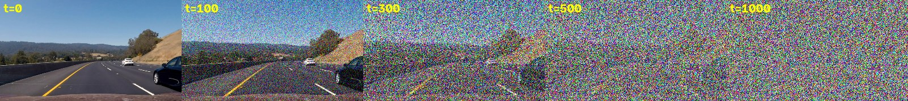
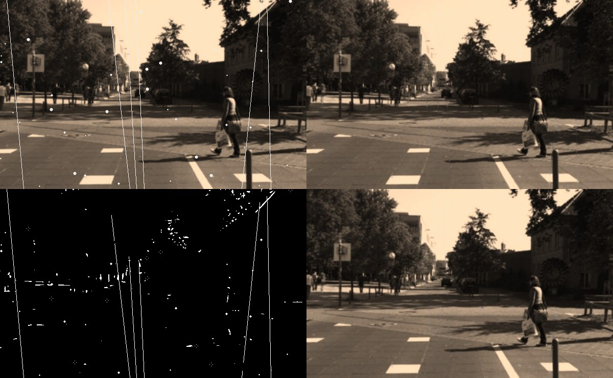
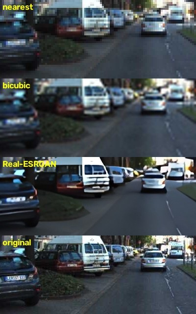
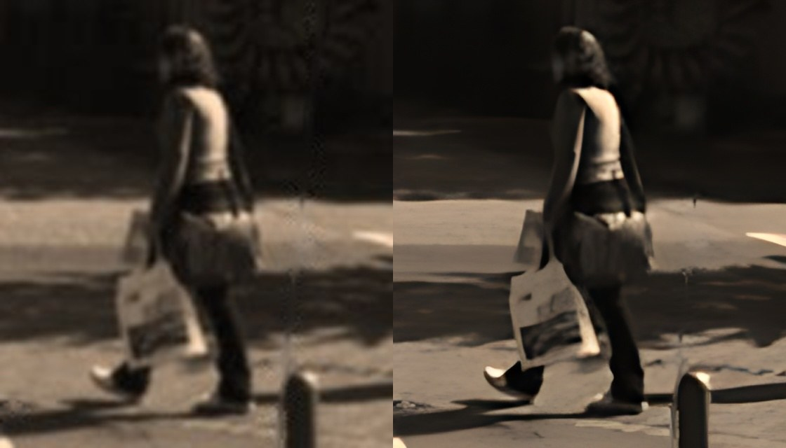
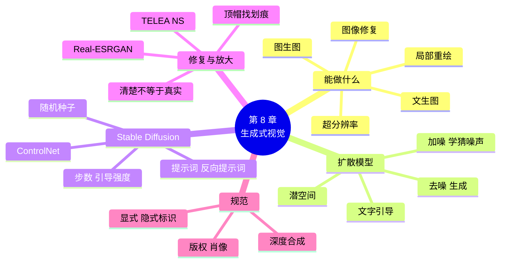

# 第 8 章 生成式视觉：Stable Diffusion 与图像修复

!!! abstract "本章学时"
    理论 4 学时（线上 2 + 线下 2）· 实验 4 学时（本章共 4 个实验，★ 必做 3 个）

## 学习目标

学完本章，你应该能够：

1. **说出**生成式视觉的几种常见任务：文生图、图生图、局部重绘、图像修复、超分辨率（记忆）；
2. **解释**扩散模型“训练时学猜噪声、生成时一步步去噪”的思路（理解）；
3. **运行并修改**给定代码，用插值和超分辨率放大图片、用 OpenCV 修补老照片，并**比较**效果（应用、分析）；
4. **调整**提示词、步数、引导强度、随机种子，生成指定场景的道路图片（应用）；
5. **判断**生成内容在什么场合必须标识，说出相关法规的要求（评价）。

!!! info "先修要求"
    学习本章前，你需要掌握：

    - [2.2.2 缩放](../02-image-processing/index.md#222)：插值放大；
    - [2.5 滤波去噪](../02-image-processing/index.md#25)：噪声是什么；
    - [6.2 掩膜](../06-segmentation/index.md#62)：用掩膜指定“要处理哪一块”；
    - [4.6 训练](../04-classification/index.md#46)：训练数据和增强。

??? abstract "本章概念清单（14 个，点击查看定义和例子）"
    1. [文生图](../../appendix/glossary.md#g-文生图)
    2. [图生图](../../appendix/glossary.md#g-图生图)
    3. [局部重绘](../../appendix/glossary.md#g-局部重绘)
    4. [图像修复](../../appendix/glossary.md#g-图像修复)
    5. [超分辨率](../../appendix/glossary.md#g-超分辨率)
    6. [生成对抗网络](../../appendix/glossary.md#g-生成对抗网络)
    7. [扩散模型](../../appendix/glossary.md#g-扩散模型)
    8. [潜空间](../../appendix/glossary.md#g-潜空间)
    9. [提示词](../../appendix/glossary.md#g-提示词)
    10. [反向提示词](../../appendix/glossary.md#g-反向提示词)
    11. [引导强度](../../appendix/glossary.md#g-引导强度)
    12. [随机种子](../../appendix/glossary.md#g-随机种子)
    13. [顶帽运算](../../appendix/glossary.md#g-顶帽运算)
    14. [深度合成](../../appendix/glossary.md#g-深度合成)

## 情景导入

小林训练的检测器在晴天表现不错，可一到雨天、夜里就频频漏检。

“问题出在训练数据上，”老王说，“KITTI 是德国夏天拍的，几乎没有雨天和雪天。你要是去拍，得等下雨、等下雪，还得冒着危险开出去。”

“那怎么办？”

“现在可以让 AI‘画’出来。给它一张晴天的路口照片，告诉它‘改成大雨、路面有积水和反光’，它就能生成一张雨天的版本。很多做辅助驾驶的公司都用这种办法补充少见场景的数据。”

小林眼睛一亮：“那我家那张泛黄、有划痕的老照片，是不是也能让 AI 修一修？”

“能。修补划痕、把模糊的小图变清楚，都是生成式视觉的拿手好戏。不过要记住，AI 画出来、修出来的东西，有些是它‘猜’的，不是真实的。发到网上还得按规定标明是 AI 生成的。”

前七章我们一直在教计算机“看懂”图片，这一章换个方向，让计算机“画”图。

## 8.1 从“认图”到“画图” { #81 }

### 8.1.1 生成式视觉能做什么 { #811 }

| 任务 | 输入 | 输出 | 辅助驾驶中的用途 | 生活中的例子 |
|---|---|---|---|---|
| [**文生图**](../../appendix/glossary.md#g-文生图 "根据一段文字描述生成一张新图片"){ .term } | 一段文字（提示词） | 一张新图 | 生成少见场景的训练图片 | 海报、插画、表情包 |
| [**图生图**](../../appendix/glossary.md#g-图生图 "以一张图片为起点，按文字描述修改风格或内容，同时保留大致构图"){ .term } | 一张图 + 文字 | 保留构图、改了风格或内容的图 | 晴天照片改成雨天、雪天、夜间 | 照片转动漫风格 |
| [**局部重绘**](../../appendix/glossary.md#g-局部重绘 "只在遮罩区域内按文字描述重新生成，其他区域不变"){ .term } | 一张图 + 遮罩 + 文字 | 只改遮罩区域的图 | 在路上“放”一个锥桶、一只动物 | 去掉照片里的路人 |
| [**图像修复**](../../appendix/glossary.md#g-图像修复 "根据周围内容填补图片中缺损或被遮挡的区域"){ .term } | 有缺损的图 + 遮罩 | 补好的图 | 修补被雨滴、污渍挡住的画面 | 修补老照片划痕 |
| [**超分辨率**](../../appendix/glossary.md#g-超分辨率 "把低分辨率图片放大并补出细节，使其看起来更清楚的技术"){ .term } | 一张小图 | 放大并变清楚的图 | 远处的小目标放大后再识别 | 老照片、老视频变高清 |

前三种通常由扩散模型（8.2 节）完成；图像修复既有传统方法（8.4 节），也可以用扩散模型；超分辨率常用专门的模型（8.5 节）。

### 8.1.2 生成模型的发展 { #812 }

| 年份 | 代表 | 特点 |
|---|---|---|
| 2014 | [**生成对抗网络**](../../appendix/glossary.md#g-生成对抗网络 "由生成器和判别器两个网络互相对抗训练、生成逼真样本的模型"){ .term }（GAN）<sup class="cite">[[1]](#ref8-1)</sup> | 一个“画家”网络和一个“鉴定师”网络互相较劲，画家越画越像真的。能生成逼真的人脸，但训练不稳定 |
| 2020 | 扩散模型 DDPM<sup class="cite">[[2]](#ref8-2)</sup> | 学会一步步去噪，生成质量高、训练稳定 |
| 2022 | Stable Diffusion<sup class="cite">[[3]](#ref8-3)</sup> | 在缩小的“潜空间”里做扩散，普通显卡就能跑，并且开源，引爆了 AI 绘画 |
| 2023 起 | ControlNet、各种国产文生图平台、视频生成 | 能按线稿、姿势控制画面；从图片走向视频 |

## 8.2 扩散模型：先学去噪，再从噪声里“洗”出图 { #82 }

### 8.2.1 加噪：训练时做什么 { #821 }

想象把一张清楚的照片，每次撒一点点“雪花”（随机噪声），撒 1000 次，最后完全变成一片雪花，看不出原来是什么。



*图 8-1　加噪过程：第 0、100、300、500、1000 步（编者按扩散模型的公式计算，照片来自 Udacity 行车视频）*

[**扩散模型**](../../appendix/glossary.md#g-扩散模型 "训练时学会从带噪声的图中猜出噪声，生成时从纯噪声出发一步步去噪得到新图的生成模型"){ .term }训练时，随机取一张照片和一个步数，把照片加上对应步数的噪声，然后让模型看着这张带噪声的图，猜出“加进去的噪声长什么样”。猜得越准，损失越小。用几亿张图训练之后，模型就学会了：无论给它一张多“花”的图，它都能猜出里面哪些是噪声。

**算一算** 加噪的公式是：第 t 步的图 = √ᾱ × 原图 + √(1 − ᾱ) × 噪声。ᾱ（读作 alpha bar）随步数增大从 1 降到接近 0。按常用的设置，第 100 步 ᾱ ≈ 0.90，原图还占 90%；第 300 步 ᾱ ≈ 0.40；第 500 步 ᾱ ≈ 0.08；第 1000 步 ᾱ 几乎是 0，只剩噪声。

### 8.2.2 去噪：生成时做什么 { #822 }

生成一张新图时，反过来做：

1. 从一张纯噪声出发（[**随机种子**](../../appendix/glossary.md#g-随机种子 "决定随机数起点的整数；在扩散模型中决定起始噪声，种子相同则结果可以复现"){ .term }决定这张噪声长什么样）；
2. 让模型猜出图里的噪声，减掉一点，得到一张“稍微清楚一点”的图；
3. 重复几十步，一张图就慢慢“洗”出来了。

去噪时，先出现的是大块的明暗和颜色（上面亮是天空、下面暗是路面），然后才出现车道线、车辆的轮廓，最后几步修细节。所以**步数**太少，细节就不够。

<iframe class="sim-frame" src="../../sims/diffusion-noise/main.html" height="620" loading="lazy" title="加噪与去噪"></iframe>
动画：加噪与去噪。拖动步数看照片变成噪声，切换到“去噪”方向，看图片从噪声中“浮现”的顺序。
{ .sim-caption }

### 8.2.3 文字怎样引导画面 { #823 }

只会去噪的模型，会洗出“随便一张图”。要让它画“雨天的路口”，就要在每一步猜噪声时，把文字也告诉它：“请朝着‘雨天的路口’的方向去噪。”Stable Diffusion 用一个文字编码器（与第 4 章 CLIP 同类的模型）把提示词变成一串数字，作为每一步去噪的“导航”。

另外，Stable Diffusion 不在原图大小上做扩散，而是先把图压缩到一个小得多的[**潜空间**](../../appendix/glossary.md#g-潜空间 "把图片压缩后的小尺寸表示空间，在其中做扩散可以大大减少计算量"){ .term }（512×512 的图压成 64×64 的“缩略表示”），在这里加噪、去噪，最后再还原成大图。计算量小了几十倍，普通显卡也能跑。<sup class="cite">[[3]](#ref8-3)</sup>

## 8.3 Stable Diffusion 怎么用 { #83 }

### 8.3.1 五个参数 { #831 }

| 参数 | 含义 | 常用值 | 一般规律 |
|---|---|---|---|
| [**提示词**](../../appendix/glossary.md#g-提示词 "给模型的指令和输入，在文生图中是对想要画面的文字描述"){ .term }（prompt） | 想要什么 | 一句或几句描述 | 越具体越好：主体、场景、天气、光线、风格、画质 |
| [**反向提示词**](../../appendix/glossary.md#g-反向提示词 "告诉生成模型不想要哪些内容的文字"){ .term }（negative prompt） | 不想要什么 | 模糊、变形、文字、水印 | 用来排除常见毛病 |
| 去噪步数（steps） | 洗几次 | 20～30 | 太少细节不够；超过 30 以后变化不大，只是更慢 |
| [**引导强度**](../../appendix/glossary.md#g-引导强度 "生成时多大程度上听从提示词的参数，太低跑题、太高生硬"){ .term }（guidance scale） | 多听提示词的话 | 7～8 | 太低不听话、画面跑题；太高颜色过饱和、生硬 |
| 随机种子（seed） | 起点的那张噪声 | 任意整数 | 种子相同、其他参数也相同，结果就相同；换种子换一张图 |

### 8.3.2 写提示词的方法 { #832 }

一个好的提示词，按“主体 + 场景 + 细节 + 风格 + 画质”来写。以生成雨天路口为例：

| 部分 | 例子 |
|---|---|
| 主体 | a city street intersection（城市路口） |
| 视角 | seen from a car dashboard camera（行车记录仪视角） |
| 场景细节 | cars and traffic lights, heavy rain, wet road, reflections（车辆、红绿灯、大雨、湿路面、反光） |
| 风格与画质 | realistic photo（写实照片） |
| 反向提示词 | cartoon, painting, blurry, distorted, low quality, text, watermark |

开源模型大多用英文提示词效果更好；国产在线平台（通义万相、即梦、可图等）对中文提示词支持很好，可以直接写“行车记录仪视角的城市路口，大雨，路面积水反光，写实照片”。

做对比实验时，要**固定随机种子**，每次只改一个参数，才能看出这个参数的作用。这和做物理实验时“控制变量”是一个道理。

### 8.3.3 图生图、局部重绘、ControlNet { #833 }

| 方式 | 做法 | 关键参数 |
|---|---|---|
| 图生图 | 把一张照片加上一部分噪声，再按提示词去噪 | 改动幅度（strength）：0.3 只改风格和色调，0.7 连内容都会大改 |
| 局部重绘 | 只在遮罩（白色区域）里加噪、去噪，其他地方不动 | 遮罩画得准不准；第 6 章的分割可以自动生成遮罩 |
| ControlNet | 额外给一张“控制图”（线稿、边缘图、人体姿势、深度图），画面结构严格按控制图走<sup class="cite">[[4]](#ref8-4)</sup> | 控制强度 |

ControlNet 特别适合辅助驾驶的数据生成：用第 3 章的 Canny 边缘图或第 6 章的深度图做控制图，生成的雨天、雪天图片里，车和车道线的位置和原图一模一样，原图的标注框可以直接用在新图上。

### 8.3.4 用生成数据训练辅助驾驶模型 { #834 }

| 好处 | 风险 |
|---|---|
| 补充少见场景：暴雨、大雪、浓雾、夜间、逆光 | 生成的图和真实照片有差别，模型可能学到“生成图的特征” |
| 补充危险场景：行人突然冲出、路上有障碍物 | 生成的细节可能不合理（车道线断开、车少一个轮子） |
| 不用冒险拍摄，成本低 | 标注要重新检查；不能完全代替真实数据 |

业内常见的做法是：真实数据为主，生成数据为辅，并且用真实数据做最终测试。很多公司还会搭建“仿真环境”，在虚拟世界里测试辅助驾驶系统，这也离不开生成技术。

## 8.4 图像修复：把缺的地方补上 { #84 }

### 8.4.1 传统修补：用周围的像素“填” { #841 }

**图像修复**（inpainting）的输入是一张有缺损的图和一张遮罩（白色表示要修的地方）。OpenCV 自带两种传统算法：

| 算法 | 思路 | 写法 |
|---|---|---|
| TELEA | 从缺损区域的边缘开始，一圈一圈往里填，每个像素取周围已知像素的加权平均<sup class="cite">[[5]](#ref8-5)</sup> | `cv2.inpaint(img, mask, 3, cv2.INPAINT_TELEA)` |
| NS | 沿着边缘的走向（等亮度线）把周围的颜色“流”进来 | `cv2.inpaint(img, mask, 3, cv2.INPAINT_NS)` |

传统修补适合细小的缺损：划痕、斑点、小文字水印。缺损一大，它只能“抹平”，补不出原来的内容（比如补不出一个被挡住的人脸）。补大块缺损要用扩散模型的局部重绘。



*图 8-2　实验 8-2：左上为有划痕的老照片，右上为 TELEA 修补后；左下为顶帽运算自动找到的划痕，右下为 NS 修补后（照片由编者用 KITTI 照片模拟做旧，CC BY-NC-SA 3.0）*

### 8.4.2 遮罩从哪里来 { #842 }

修补的难点往往不是“补”，而是“找出要补的地方”。实验 8-2 中，编者试了两种自动找划痕的办法：

| 方法 | 找到的像素 | 和标准答案的交并比 | 问题 |
|---|---|---|---|
| 亮度大于 225 就算划痕 | 27 726 | 0.10 | 天空、白色斑马线也被当成划痕 |
| 顶帽运算：比周围亮 60 以上的细小东西 | 3452 | 0.50 | 天空里的划痕和背景差不多亮，找不出来 |

[**顶帽运算**](../../appendix/glossary.md#g-顶帽运算 "原图减去开运算结果，提取比周围亮的细小结构的形态学操作"){ .term }的意思是“原图减去把细小亮东西抹掉后的图”，剩下的就是细小的亮东西，正好对应细划痕和斑点；大块的天空、斑马线被保留在“抹掉后的图”里，相减后就没了。但它也只找全了 75%。所以真实的修图软件都让用户自己用画笔涂遮罩，或者结合 SAM（第 6 章）点一下选中要修的地方。

## 8.5 超分辨率：把小图变清楚 { #85 }

### 8.5.1 插值放大为什么会糊 { #851 }

第 2 章学过用 `cv2.resize` 放大图片。放大 4 倍，就要凭空多出 15 倍的像素，插值只能用周围像素“平均”出来：

| 方法 | 做法 | 效果 |
|---|---|---|
| 最近邻 | 直接复制最近的像素 | 一格一格的马赛克 |
| 双三次 | 用周围 16 个像素加权平均 | 平滑，但发糊 |

### 8.5.2 超分辨率：让模型“猜”细节 { #852 }

**超分辨率**模型看过大量“小图—大图”对，学会了“这种模糊的边缘，原来大概是一条清楚的线”“这种纹理，原来大概是树叶”。放大时，它根据学到的经验把细节“补”上去。

本书用的 Real-ESRGAN 是腾讯 ARC 实验室等团队 2021 年发布的超分辨率模型，专门用模拟的“真实世界退化”（模糊、噪声、压缩痕迹）训练，对老照片、网络图片效果很好。<sup class="cite">[[6]](#ref8-6)</sup> 实验中用的是它的轻量版 realesr-general-x4v3，只有约 5 MB，在 CPU 上放大一张 100×40 的小图只要 0.08 秒。



*图 8-3　实验 8-1：一张 100×40 的小图放大 4 倍。从上到下：最近邻、双三次、Real-ESRGAN 超分辨率、原图（标准答案）*

<iframe class="sim-frame" src="../../sims/sr-compare/main.html" height="560" loading="lazy" title="放大对比滑块"></iframe>
动画：放大对比滑块。左右拖动黄线，比较插值和超分辨率；把右边换成“原图”，看超分辨率猜出的细节对不对。
{ .sim-caption }

### 8.5.3 清楚不等于真实 { #853 }

实验 8-1 用两个数字评价放大效果：

| 方法 | 平均误差（越小越接近原图） | 清晰度（边缘越多越大） |
|---|---|---|
| 最近邻 | 10.3 | 791.8 |
| 双三次 | 9.2 | 32.2 |
| 超分辨率 | 11.8 | 666.5 |
| 原图 | 0 | 1008.4 |

**算一算** 超分辨率的清晰度 666.5 是双三次 32.2 的约 20 倍，看起来清楚多了；但它的平均误差 11.8 反而最大，比双三次的 9.2 还大。为什么？因为它“补”的细节是猜的：图 8-3 中，超分辨率画出的车牌、车窗线条很锐利，但和原图对不上。最近邻的“清晰度”也很高，那是马赛克方块的边缘，不是真的清楚。

这告诉我们两件事：

1. **数字指标要和眼睛看结合起来**，单看一个数会被误导；
2. **超分辨率能让照片好看，但不能当作证据**。把模糊的车牌、人脸“超分”出来，得到的是模型猜的样子，不能用来认定是谁、是哪辆车。

## 8.6 生成内容的标识与版权 { #86 }

### 8.6.1 生成的图必须标识 { #861 }

AI 生成的图片越来越逼真，“以假乱真”带来了诈骗、谣言等风险。我国已出台一系列规定：

| 规定 | 施行时间 | 和本章相关的要求 |
|---|---|---|
| 《互联网信息服务深度合成管理规定》 | 2023 年 1 月 10 日 | 提供人脸生成、替换、编辑等可能导致公众混淆的服务，要作显著标识 |
| 《生成式人工智能服务管理暂行办法》 | 2023 年 8 月 15 日 | 生成式 AI 服务要对生成的图片、视频进行标识 |
| 《人工智能生成合成内容标识办法》 | 2025 年 9 月 1 日 | 生成合成的内容要加**显式标识**（如图上的“AI 生成”字样）和**隐式标识**（文件里的元数据或数字水印）；发布到网络平台时，平台要核验并提示用户 |

[**深度合成**](../../appendix/glossary.md#g-深度合成 "利用深度学习等技术生成或编辑文本、图像、音频、视频的技术"){ .term }指用深度学习等技术生成或编辑文本、图像、音频、视频，AI 换脸、AI 配音都属于它。在实验 8-3、8-4 中生成的图片，如果要发到网上，要标明“AI 生成”。用生成的图片训练模型时，也要在数据集说明里注明哪些是生成的，避免以后被当成真实数据使用。

### 8.6.2 版权和肖像 { #862 }

| 问题 | 要注意 |
|---|---|
| AI 生成的图有没有版权 | 2023 年北京互联网法院审理的“AI 文生图”案中，法院认为用户在提示词、参数上投入了独创性的智力劳动，生成的图片可以构成作品。但各国做法不同，仍在讨论中 |
| 能不能模仿某位画家的风格 | 风格本身一般不受保护，但不要冒用画家的名字发布、不要直接复制作品 |
| 能不能生成真人照片 | 不要用他人的照片生成、编辑图片，涉及肖像权和个人信息；更不能做 AI 换脸 |
| 模型本身的许可 | Stable Diffusion 1.5 等开源模型有各自的使用许可，商用前要看清楚 |

## 8.7 工具与平台 { #87 }

| 类型 | 例子 | 适合 |
|---|---|---|
| 国产在线平台 | 通义万相（阿里）、即梦（字节跳动）、可图（快手）、文心一格（百度） | 不写代码、中文提示词，快速出图 |
| 本地图形界面 | Stable Diffusion WebUI、ComfyUI | 有显卡的电脑上自由组合各种模型和插件 |
| 写代码 | Hugging Face 的 diffusers 库 | 批量生成、做实验、接入自己的程序（实验 8-3、8-4） |

```python
from diffusers import StableDiffusionPipeline
pipe = StableDiffusionPipeline.from_pretrained("stable-diffusion-v1-5/stable-diffusion-v1-5",
                                               torch_dtype=torch.float16).to("cuda")
g = torch.Generator("cuda").manual_seed(42)                  # 固定随机种子
img = pipe("a city street intersection, heavy rain, realistic photo",
           negative_prompt="blurry, low quality", num_inference_steps=25,
           guidance_scale=7.5, generator=g).images[0]
img.save("rain.png")
```

五个参数在代码里一目了然：提示词、反向提示词、步数、引导强度、随机种子。生成需要 GPU，在云端 Notebook 的 GPU 环境中运行。

## 8.8 Python 小课堂：PIL 图片和 OpenCV 图片 { #88 }

本章第一次用到另一种图片格式。diffusers 等很多 AI 库用 PIL（Pillow 库）的图片对象，而前几章一直用 OpenCV 的数字表。两者可以互相转换：

| | OpenCV | PIL |
|---|---|---|
| 读图 | `img = cv2.imread("a.jpg")` | `img = Image.open("a.jpg")` |
| 本质 | NumPy 数字表，形状 (高, 宽, 3) | 图片对象，`img.size` 是 (宽, 高) |
| 颜色顺序 | BGR | RGB |
| 存图 | `cv2.imwrite("b.jpg", img)` | `img.save("b.jpg")` |
| 缩放 | `cv2.resize(img, (宽, 高))` | `img.resize((宽, 高))` |

```python
from PIL import Image
import numpy as np, cv2
pil = Image.fromarray(cv2.cvtColor(bgr, cv2.COLOR_BGR2RGB))     # OpenCV → PIL：先转成 RGB
bgr2 = cv2.cvtColor(np.array(pil), cv2.COLOR_RGB2BGR)           # PIL → OpenCV：转回 BGR
```

**字典的遍历**：实验 8-3 用一个字典存四种天气的写法，`for name, w in weathers.items():` 一次取出“键”和“值”，比写四段重复代码清楚得多。

## 8.9 本章常见报错对照 { #89 }

| 报错原文（最后一行） | 用大白话说 | 怎么改 |
|---|---|---|
| `torch.cuda.OutOfMemoryError` | 显存不够 | 用 `torch_dtype=torch.float16`；把图片尺寸改小；关掉其他占显存的程序 |
| `AssertionError: Torch not compiled with CUDA enabled` | 电脑没有 GPU 或没装 GPU 版 PyTorch | 到云端 Notebook 的 GPU 环境运行 |
| 下载模型很慢或失败 | 国内访问 Hugging Face 不稳定 | 终端先执行 `export HF_ENDPOINT=https://hf-mirror.com`，或从魔搭社区下载 |
| 生成的图是全黑的 | 安全过滤器把结果判为不适宜内容 | 修改提示词；正常的道路场景一般不会触发 |
| `cv2.error: … inpaint … mask` | 遮罩不是单通道 8 位图，或大小和原图不同 | 遮罩用 `cv2.imread(…, 0)` 读成灰度，`dtype` 为 `uint8` |
| 修补后划痕边缘还有一圈亮线 | 遮罩比划痕细 | 用 `cv2.dilate` 把遮罩向外扩 1～2 像素 |
| `FileNotFoundError: realesr-general-x4v3.pth` 或下载失败 | 超分辨率模型没下载下来 | 检查网络后重试，或从老师处拷贝放进 `labs/ch08` |

## 8.10 前沿视窗：会“想象”路况的世界模型 { #810 }

文生图之后，生成模型很快走向了视频。2024 年，OpenAI 的 Sora、快手的可灵等视频生成模型，可以根据一句话生成一段几秒到几十秒的逼真视频。

辅助驾驶领域更进一步，出现了“世界模型”：给它前几秒的行车视频和“接下来要左转”这样的动作，它就能生成接下来几秒的画面会是什么样子。2023 年英国 Wayve 公司发布的 GAIA-1 就是这样的模型，能生成雨天、夜间、其他车辆突然变道等各种情况的行车视频。<sup class="cite">[[7]](#ref8-7)</sup> 这样一来，辅助驾驶系统可以在“想象出来的”危险场景里反复练习和测试，而不用真的去冒险。

当然，世界模型生成的视频也会出现不符合物理规律的地方（车穿过车、影子方向不对）。用它们测试和训练时，仍然要以真实道路数据为准。

## 本章实验

!!! abstract "实验总览"
    | 实验 | 类型 | 建议时长 | 内容 |
    |---|---|---|---|
    | 实验 8-1 | ★ 必做 | 35 分钟 | 把模糊小图变清楚 |
    | 实验 8-2 | ★ 必做 | 45 分钟 | 修补老照片 |
    | 实验 8-3 | ★ 必做 | 45 分钟 | 提示词练习 |
    | 实验 8-4 | ☆ 选做 | 45 分钟 | 图生图与局部重绘 |

    代码见配套资源 `labs/ch08/` 目录，每个实验都有 `.py` 和 `.ipynb` 两种文件，内容相同，都在 `labs/ch08/` 文件夹里运行。实验 8-1、8-2 用 CPU 即可，第一次运行会下载约 5 MB 的超分辨率模型；同文件夹的 `sr_model.py` 是调用模型的小工具，直接用即可。实验 8-3、8-4 需要 GPU（显存 4 GB 以上），在云端 Notebook 的 GPU 环境或线下课的 A40 服务器上运行；也可以用国产在线平台完成实验 8-3。

!!! warning "实验 8-3、8-4 待实测"
    编者的编写环境无法下载 Stable Diffusion 模型，实验 8-3、8-4 的代码已检查过语法和参数，但“运行结果”尚未实测，暂以实验记录表的形式留空，待在云端 GPU 上实测后补充截图。使用本书的老师请在课前先运行一遍。

### 实验 8-1 ★ 把模糊小图变清楚 { #8-1 }

**实验目的**

1. 用最近邻、双三次插值和 Real-ESRGAN 把一张小图放大 4 倍；
2. 用平均误差和清晰度两个数字比较效果；
3. 通过和原图对比，理解超分辨率的细节是“猜”出来的。

**实验环境**：云端 Notebook 或本机，CPU 即可。

**实验数据**：`labs/data/images/drive_city.jpg` 中 400×160 的一块（KITTI，CC BY-NC-SA 3.0）。

**实验步骤与代码**

第一档 · 跑通：打开 `lab8_1_super_res.ipynb`，依次运行四个单元格。

第 1～2 步，缩小再放大：

```python
from sr_model import upscale                    # 同文件夹里的超分辨率小工具
big = cv2.imread("../data/images/drive_city.jpg")[160:320, 300:700]   # 400×160 的一块  ← 改这里
small = cv2.resize(big, (100, 40), interpolation=cv2.INTER_AREA)       # 缩小到 1/4
up_nearest = cv2.resize(small, (400, 160), interpolation=cv2.INTER_NEAREST)
up_cubic = cv2.resize(small, (400, 160), interpolation=cv2.INTER_CUBIC)
up_sr = upscale(small)                          # Real-ESRGAN，放大 4 倍
```

第 3 步，两个评价函数：

```python
def mean_error(a, b):
    return float(np.abs(a.astype(int) - b.astype(int)).mean())   # 每个数平均差多少

def sharpness(img):
    gray = cv2.cvtColor(img, cv2.COLOR_BGR2GRAY)
    return float(cv2.Laplacian(gray, cv2.CV_64F).var())         # 边缘越多，数越大
```

`astype(int)` 先把 0～255 的整数换成普通整数再相减，否则 `uint8` 相减会“绕圈”（3 − 5 得到 254）。`cv2.Laplacian` 是第 3 章边缘检测的“亲戚”，边缘越多，它的方差越大。

第 4 步把四张图上下拼在一起存为 `lab8_1_compare.jpg`。完整代码：`labs/ch08/lab8_1_super_res.py`（`.ipynb` 同名）

**运行结果**

```text
原图 (160, 400, 3)  小图 (40, 100, 3)
超分辨率用时 0.08 秒，结果 (160, 400, 3)
最近邻    平均误差  10.3   清晰度   791.8
双三次    平均误差   9.2   清晰度    32.2
超分辨率   平均误差  11.8   清晰度   666.5
原图     平均误差   0.0   清晰度  1008.4
对比图已保存：lab8_1_compare.jpg
```

结果见图 8-3 和 8.5.3 节的分析。

第二档 · 改一改：

1. 把第 1 步的裁剪区域换成 `street_crossing.jpg` 中有行人的一块，再比一次；
2. 把缩小倍数改成 1/2（`(200, 80)`），然后用双三次放大 2 倍，和 4 倍时比，平均误差变化多少？（超分辨率模型固定放大 4 倍，可以放大后再缩小一半。）
3. 用超分辨率把 `small` 连续放大两次（16 倍），看看会出现什么奇怪的东西。

第三档 · 挑战（选做）：找一张自己手机里的旧截图或网络小图，用 `upscale` 放大，和双三次比较。

**实验记录表**

| 方法 | 平均误差 | 清晰度 | 你看起来的感觉（1～5 分） |
|---|---|---|---|
| 最近邻 | 10.3 | 791.8 | |
| 双三次 | 9.2 | 32.2 | |
| 超分辨率 | 11.8 | 666.5 | |
| 你选的图（超分辨率） | | | |

**常见问题排查**

| 现象 | 原因 | 解决办法 |
|---|---|---|
| `ModuleNotFoundError: No module named 'sr_model'` | 没有在 `labs/ch08` 文件夹里运行 | 进入 `labs/ch08` 再运行 |
| 下载模型失败 | 网络问题 | 重试，或从老师处拷贝 `realesr-general-x4v3.pth` |
| 放大一张大图很慢、内存不够 | 超分辨率的计算量随像素数增长 | 先裁一小块；或用 GPU |

**思考与练习**

1. 超分辨率的清晰度比双三次高很多，平均误差却更大。用你自己的话解释原因。
2. 有人说：“用超分辨率把监控里模糊的车牌放大，就能看清是哪辆车。”你同意吗？为什么？

**实验报告要求**

提交对比图，填写实验记录表，回答“思考与练习”。

### 实验 8-2 ★ 修补老照片 { #8-2 }

**实验目的**

1. 用顶帽运算自动找划痕，和标准答案遮罩比较；
2. 用 TELEA 和 NS 两种算法修补划痕；
3. 把修好的局部用超分辨率放大。

**实验环境**：云端 Notebook 或本机，CPU 即可。

**实验数据**：`labs/data/images/old_photo.jpg`（编者把一张 KITTI 照片做成泛黄、带白色划痕和斑点的“老照片”）和 `old_photo_mask.png`（划痕位置的标准答案遮罩）。

**实验步骤与代码**

第一档 · 跑通：打开 `lab8_2_restore.ipynb`，依次运行四个单元格。

第 1 步，顶帽运算找划痕：

```python
gray = cv2.cvtColor(old, cv2.COLOR_BGR2GRAY)
kernel = cv2.getStructuringElement(cv2.MORPH_RECT, (5, 5))
tophat = cv2.morphologyEx(gray, cv2.MORPH_TOPHAT, kernel)  # 原图 − 抹掉细小亮东西后的图
auto = tophat > 60                                         # 比周围亮 60 以上  ← 改这里
truth = cv2.imread("../data/images/old_photo_mask.png", 0) > 0   # 标准答案遮罩
inter, union = (auto & truth).sum(), (auto | truth).sum()  # 第 6 章的掩膜交并比
```

第 2 步，修补：

```python
mask = cv2.dilate(truth.astype(np.uint8) * 255, np.ones((3, 3), np.uint8))   # 遮罩向外扩 1 像素
telea = cv2.inpaint(old, mask, 3, cv2.INPAINT_TELEA)       # 3 是参考周围多大范围
ns = cv2.inpaint(old, mask, 3, cv2.INPAINT_NS)
```

第 3 步检查划痕处修补前后的亮度；第 4 步把照片中的行人裁出来，用双三次和超分辨率各放大 4 倍。完整代码：`labs/ch08/lab8_2_restore.py`（`.ipynb` 同名）

**运行结果**

```text
自动找到 3452 个像素，标准答案 2783 个，交并比 0.50，找全了 75%
遮罩像素数（扩大后）： 8415
修补前   划痕处平均亮度 234.9   全图平均亮度  89.3
TELEA 划痕处平均亮度  99.0   全图平均亮度  87.6
NS    划痕处平均亮度  98.1   全图平均亮度  87.6
裁剪 (160, 140, 3) → 放大后 (640, 560, 3)
```

修补前划痕处平均亮度 234.9（接近白色），修补后降到约 99，和周围融为一体（图 8-2）。TELEA 和 NS 在这张照片上效果几乎一样。



*图 8-4　实验 8-2 第 4 步：修补后的行人部分放大 4 倍，左为双三次插值，右为超分辨率*

第二档 · 改一改：

1. 第 1 步把阈值 60 改成 30 和 100，“找全了”的比例和交并比怎样变化？
2. 第 2 步去掉 `cv2.dilate`，直接用原遮罩修补，放大看划痕边缘有没有残留的亮线；
3. 把 `inpaint` 的参考范围 3 改成 15，有什么变化？

第三档 · 挑战（选做）：在照片上画一个 60×60 的白色方块（`old[100:160, 200:260] = 255`），再用修补算法补，看看传统方法能不能补出原来的内容。

**实验记录表**

| 设置 | 找到的像素 | 交并比 | 找全了 | 修补后效果 |
|---|---|---|---|---|
| 顶帽 > 60 | 3452 | 0.50 | 75% | |
| 顶帽 > 30 | | | | |
| 顶帽 > 100 | | | | |
| 不扩大遮罩 | | | | |
| 60×60 方块（挑战） | | | | |

**常见问题排查**

| 现象 | 原因 | 解决办法 |
|---|---|---|
| `cv2.error` 提到 mask | 遮罩不是 8 位单通道图 | `astype(np.uint8)`，并确认和原图一样大 |
| 修补后有一圈亮边 | 遮罩没盖住划痕边缘 | `cv2.dilate` 扩大遮罩 |
| 自动找划痕把斑马线也找出来了 | 斑马线也比周围亮 | 顶帽的核不要太大（5×5），阈值调高 |

**思考与练习**

1. 为什么顶帽运算找不出天空里的划痕？
2. 传统修补适合什么样的缺损？大块缺损应该用什么方法？

**实验报告要求**

提交修补前后对比图和放大对比图，填写实验记录表，回答“思考与练习”。

### 实验 8-3 ★ 提示词练习 { #8-3 }

**实验目的**

1. 用 Stable Diffusion 生成同一个路口的晴天、雨天、夜间、雾天画面；
2. 固定随机种子，分别改变步数和引导强度，观察规律；
3. 体会随机种子的作用，学会“控制变量”做对比。

**实验环境**：云端 Notebook 的 GPU 环境（显存 4 GB 以上），或线下课的 A40 服务器。第一次运行要下载约 4 GB 的模型。**不写代码的做法**：在通义万相、即梦、可图等国产在线平台上，用中文提示词完成同样的四种天气和参数对比（平台一般提供“随机种子”“引导强度”等高级设置）。

**实验数据**：无，全部由提示词生成。

**实验步骤与代码**

第一档 · 跑通：打开 `lab8_3_prompts.ipynb`，依次运行四个单元格。

第 2 步，四种天气：

```python
base = "a city street intersection seen from a car dashboard camera, cars and traffic lights, realistic photo"
negative = "cartoon, painting, blurry, distorted, low quality, text, watermark"
weathers = {"sunny": "sunny day, clear sky", "rain": "heavy rain, wet road, reflections",
            "night": "at night, street lights, headlights", "fog": "dense fog, low visibility"}
for name, w in weathers.items():
    g = torch.Generator("cuda").manual_seed(42)           # 固定随机种子，只让天气不同
    img = pipe(f"{base}, {w}", negative_prompt=negative,
               num_inference_steps=25, guidance_scale=7.5, generator=g).images[0]
    img.save(f"lab8_3_{name}.png")
```

第 3 步把步数改为 5、15、30，引导强度改为 1、4、12；第 4 步换随机种子 1、2、3。完整代码：`labs/ch08/lab8_3_prompts.py`（`.ipynb` 同名）

**运行结果**：待实测（见本节开头的说明）。请把生成的图片贴在实验报告中，并填写下表。

第二档 · 改一改：

1. 把提示词改成中文，看看开源模型能不能听懂；在国产在线平台上再试中文；
2. 删掉反向提示词，生成的图有什么变化？
3. 加上“a pedestrian crossing the road”（有行人过马路），检查生成的行人是否合理（手、脚、影子）。

第三档 · 挑战（选做）：把生成的雨天、夜间图片交给第 5 章训练的检测器，看看它能不能找出图中的车和人。

**实验记录表**

| 对比项 | 设置 | 观察到的变化 |
|---|---|---|
| 天气 | 晴 / 雨 / 夜 / 雾（种子 42） | |
| 步数 | 5 / 15 / 30 | |
| 引导强度 | 1 / 4 / 12 | |
| 随机种子 | 1 / 2 / 3 | |
| 不合理的细节 | | 例：车道线断开、车少轮子、文字乱码 |

**常见问题排查**

| 现象 | 原因 | 解决办法 |
|---|---|---|
| 显存不够 | 模型或图片太大 | 用 `float16`；关闭其他程序 |
| 每次结果都不一样，没法比 | 没有固定随机种子 | 每次生成前都重新 `manual_seed(42)` |
| 下载模型失败 | 网络问题 | `export HF_ENDPOINT=https://hf-mirror.com`，或改用在线平台 |

**思考与练习**

1. 为什么做参数对比时，每次都要重新设定同一个随机种子？
2. 生成的雨天图片用来训练检测器，有什么好处和风险？

**实验报告要求**

提交至少 10 张生成图（标明参数），填写实验记录表，回答“思考与练习”。生成图如需在网上展示，请标明“AI 生成”。

### 实验 8-4 ☆ 图生图与局部重绘 { #8-4 }

**实验目的**

1. 用图生图把晴天行车照片改成雪天，比较不同改动幅度；
2. 用遮罩做局部重绘，只改画面中的一块。

**实验环境**：云端 Notebook 的 GPU 环境（显存 4 GB 以上）。要下载两个模型，各约 4 GB。

**实验数据**：`labs/data/images/drive_highway.jpg`（Udacity，MIT）。

**实验步骤与代码**

第一档 · 跑通：打开 `lab8_4_img2img.ipynb`，依次运行四个单元格。

第 2 步，图生图：

```python
photo = Image.open("../data/images/drive_highway.jpg").convert("RGB").resize((768, 432))
prompt = "highway in heavy snow, snow covered road and hills, winter, realistic dashcam photo"
for strength in [0.3, 0.5, 0.7]:                          # 改动幅度  ← 改这里
    g = torch.Generator("cuda").manual_seed(42)
    out = pipe(prompt, image=photo, strength=strength, guidance_scale=7.5,
               num_inference_steps=30, generator=g).images[0]
    out.save(f"lab8_4_snow_{strength}.png")
```

第 3～4 步，画一个白色矩形遮罩盖住右下角的黑色轿车，再用局部重绘模型换成“一辆红色皮卡”：

```python
mask = Image.new("L", photo.size, 0)                      # 全黑 = 都不改
mask.paste(255, (640, 230, 768, 400))                     # 白色矩形 = 要重画的地方
out = inpaint("a red pickup truck on the highway, realistic photo", image=photo, mask_image=mask,
              width=768, height=432, num_inference_steps=30, generator=g).images[0]
```

完整代码：`labs/ch08/lab8_4_img2img.py`（`.ipynb` 同名）

**运行结果**：待实测（见本节开头的说明）。

第二档 · 改一改：

1. 把 strength 改成 0.9，还能认出原来的高速公路吗？
2. 用第 6 章实验 6-3 的 SAM 得到黑色轿车的精确掩膜，代替矩形遮罩做局部重绘，效果有什么不同？

**实验记录表**

| 设置 | 观察到的变化 | 构图（路、车、山）保留了吗 |
|---|---|---|
| strength 0.3 | | |
| strength 0.5 | | |
| strength 0.7 | | |
| 局部重绘（矩形遮罩） | | |
| 局部重绘（SAM 掩膜，第二档） | | |

**常见问题排查**

| 现象 | 原因 | 解决办法 |
|---|---|---|
| 图生图结果和原图几乎一样 | strength 太小 | 调大到 0.5 以上 |
| 局部重绘的边缘很突兀 | 遮罩边缘太硬 | 把遮罩羽化（第 6 章），或画大一点 |
| 尺寸报错 | 宽高不是 8 的倍数 | 用 768×432、512×512 等 8 的倍数 |

**思考与练习**

1. 图生图的 strength 和 8.2 节的“加噪步数”有什么关系？
2. 用局部重绘在真实行车照片里“放”一辆不存在的车，发到网上会有什么问题？

**实验报告要求**

提交生成的图片（标明参数）和实验记录表，回答“思考与练习”。

## 本章小结

- 生成式视觉包括**文生图**、**图生图**、**局部重绘**、**图像修复**和**超分辨率**。辅助驾驶用它补充雨天、雪天、夜间等少见场景的数据。
- 生成模型从**生成对抗网络**发展到**扩散模型**。扩散模型训练时学“看带噪声的图猜噪声”，生成时从纯噪声出发一步步去噪；先出现大块明暗，再出现细节。Stable Diffusion 在**潜空间**里扩散，普通显卡也能跑。
- 五个参数：**提示词**、**反向提示词**、步数、**引导强度**、**随机种子**。做对比要固定随机种子、一次只改一个参数。ControlNet 能按边缘图、深度图控制画面结构。
- 传统图像修复（TELEA、NS）用周围像素填补细小缺损，难点在于找出遮罩；大块缺损要用局部重绘。
- **超分辨率**让模型“猜”细节：看起来更清楚，但和原图的误差可能更大。清楚不等于真实，超分辨率的结果不能当作证据。
- 生成合成的内容要按《人工智能生成合成内容标识办法》加显式和隐式标识；不要用他人照片做**深度合成**；注意模型许可和版权。



**下一章预告**

到这里，“智能辅助驾驶助手”的各个零件都齐了：检测车和人、分出路面、估计远近、跟踪和提醒。最后一章，我们把它们组装成一个能在网页上使用的小工具，上传一张行车照片就能看到结果；还会做一个增强现实小实验，了解场景重建、模型加速和国产方案，讨论视觉应用的伦理与法规，并完成综合项目。

## 参考文献

正文中的上标编号（如<sup class="cite">[[1]](#ref8-1)</sup>）对应下面的文献。带链接的可以直接打开；书籍可在图书馆或电子书平台查阅。

<div class="refs" markdown>

**经典论文**

- <span id="ref8-1"></span>[1] GOODFELLOW I, POUGET-ABADIE J, MIRZA M, et al. Generative Adversarial Nets[C]//Advances in Neural Information Processing Systems 27. Montreal: Curran Associates, 2014: 2672-2680.
    <span class="ref-note">生成对抗网络（GAN）的论文，对应 8.1.2 节。</span>
- <span id="ref8-2"></span>[2] HO J, JAIN A, ABBEEL P. Denoising Diffusion Probabilistic Models[C]//Advances in Neural Information Processing Systems 33. Vancouver: Curran Associates, 2020: 6840-6851.
    <span class="ref-note">扩散模型 DDPM 的论文，提出“加噪—学猜噪声—逐步去噪”的方法，对应 8.2 节。</span>
- <span id="ref8-3"></span>[3] ROMBACH R, BLATTMANN A, LORENZ D, et al. High-Resolution Image Synthesis with Latent Diffusion Models[C]//2022 IEEE/CVF Conference on Computer Vision and Pattern Recognition. New Orleans: IEEE, 2022: 10684-10695.
    <span class="ref-note">潜空间扩散模型的论文，即 Stable Diffusion 的基础，对应 8.1.2 节和 8.2.3 节。</span>
- <span id="ref8-4"></span>[4] ZHANG L, RAO A, AGRAWALA M. Adding Conditional Control to Text-to-Image Diffusion Models[C]//2023 IEEE/CVF International Conference on Computer Vision. Paris: IEEE, 2023: 3836-3847.
    <span class="ref-note">ControlNet 的论文，用边缘图、姿势、深度图等控制生成画面的结构，对应 8.3.3 节。</span>
- <span id="ref8-5"></span>[5] TELEA A. An Image Inpainting Technique Based on the Fast Marching Method[J]. Journal of Graphics Tools, 2004, 9(1): 23-34.
    <span class="ref-note">OpenCV 中 TELEA 修补算法的出处，对应 8.4.1 节和实验 8-2。</span>
- <span id="ref8-6"></span>[6] WANG X, XIE L, DONG C, et al. Real-ESRGAN: Training Real-World Blind Super-Resolution with Pure Synthetic Data[C]//2021 IEEE/CVF International Conference on Computer Vision Workshops. Montreal: IEEE, 2021: 1905-1914.
    <span class="ref-note">Real-ESRGAN 的论文，腾讯 ARC 实验室等团队用模拟退化训练真实场景超分辨率模型，实验 8-1、8-2 使用其轻量版，对应 8.5.2 节。</span>
- <span id="ref8-7"></span>[7] HU A, RUSSELL L, YEO H, et al. GAIA-1: A Generative World Model for Autonomous Driving[EB/OL]. (2023-09-29)[2026-10-31]. <https://arxiv.org/abs/2309.17080>.
    <span class="ref-note">Wayve 公司的驾驶世界模型，能生成各种路况的行车视频，对应 8.10 节。</span>

**法规与在线资源**

- <span id="ref8-8"></span>[8] 国家互联网信息办公室，工业和信息化部，公安部，国家广播电视总局. 人工智能生成合成内容标识办法[Z]. 2025-03-07.
    <span class="ref-note">规定生成合成内容的显式标识和隐式标识，2025 年 9 月 1 日起施行，对应 8.6.1 节。</span>
- <span id="ref8-9"></span>[9] 国家互联网信息办公室，工业和信息化部，公安部. 互联网信息服务深度合成管理规定[Z]. 2022-11-25.
    <span class="ref-note">深度合成服务的管理规定，2023 年 1 月 10 日起施行，对应 8.6.1 节。</span>
- <span id="ref8-10"></span>[10] Hugging Face. Diffusers Documentation[EB/OL]. [2026-10-31]. <https://huggingface.co/docs/diffusers>.
    <span class="ref-note">diffusers 库的官方文档，实验 8-3、8-4 的写法以此为准。</span>

</div>

## 课后练习

选择题和判断题可以直接点击选项作答，系统会马上告诉你对错，并展开答案与解析；多选题选好后点“提交答案”。简答和实操题请先自己作答，再点开“答案与解析”核对。每道题的解析下方都有“回看”链接，做错了可以直接跳回正文复习。

**一、单项选择题**

<div class="quiz" data-answer="B" markdown>

**1.** 把一张晴天的行车照片改成雪天，同时保留道路和车辆的位置，最合适的是（　　）。

- A. 文生图
- B. 图生图
- C. 超分辨率
- D. 传统图像修复

</div>

??? tip "答案与解析"
    **答案：B**

    图生图在原图基础上加一部分噪声再按提示词去噪，能保留构图、改变天气等内容。

    考查：生成式视觉的任务 · 认知层次：应用 · [回看 8.1.1](#811)
    { .quiz-meta }

<div class="quiz" data-answer="C" markdown>

**2.** 扩散模型训练时，模型要学会的是（　　）。

- A. 给图片分类
- B. 找出图中的物体
- C. 看一张带噪声的图，猜出加进去的噪声
- D. 把图片放大 4 倍

</div>

??? tip "答案与解析"
    **答案：C**

    训练时给照片加上某一步的噪声，让模型猜噪声；生成时用学到的本领从纯噪声一步步去噪。

    考查：扩散模型原理 · 认知层次：理解 · [回看 8.2.1](#821)
    { .quiz-meta }

<div class="quiz" data-answer="A" markdown>

**3.** 用同样的提示词、步数和引导强度，想得到和上次一模一样的图，需要（　　）。

- A. 使用相同的随机种子
- B. 增加步数
- C. 提高引导强度
- D. 加上反向提示词

</div>

??? tip "答案与解析"
    **答案：A**

    随机种子决定起点的那张噪声。种子和其他参数都相同，生成结果就相同。

    考查：随机种子 · 认知层次：理解 · [回看 8.3.1](#831)
    { .quiz-meta }

<div class="quiz" data-answer="D" markdown>

**4.** 引导强度设得过高，最可能出现的情况是（　　）。

- A. 画面完全不听提示词
- B. 生成速度变快
- C. 图片尺寸变小
- D. 颜色过饱和、画面生硬

</div>

??? tip "答案与解析"
    **答案：D**

    引导强度表示多听提示词的话。太低容易跑题，太高则颜色过饱和、生硬，一般用 7～8。

    考查：引导强度 · 认知层次：理解 · [回看 8.3.1](#831)
    { .quiz-meta }

<div class="quiz" data-answer="B" markdown>

**5.** Stable Diffusion 在“潜空间”里做扩散，主要好处是（　　）。

- A. 生成的图更大
- B. 计算量小得多，普通显卡也能跑
- C. 不需要提示词
- D. 不需要随机种子

</div>

??? tip "答案与解析"
    **答案：B**

    512×512 的图压成 64×64 的潜空间表示再扩散，计算量小了几十倍。

    考查：潜空间 · 认知层次：理解 · [回看 8.2.3](#823)
    { .quiz-meta }

<div class="quiz" data-answer="C" markdown>

**6.** 实验 8-1 中，超分辨率的清晰度远高于双三次，平均误差却更大，原因是（　　）。

- A. 超分辨率程序出错了
- B. 清晰度的算法不对
- C. 超分辨率补出的细节是模型猜的，和原图并不一致
- D. 双三次插值使用了原图

</div>

??? tip "答案与解析"
    **答案：C**

    超分辨率让边缘锐利、细节丰富，但这些细节来自模型的经验，和原图对不上，所以误差反而更大。

    考查：清楚不等于真实 · 认知层次：分析 · [回看 8.5.3](#853)
    { .quiz-meta }

<div class="quiz" data-answer="A" markdown>

**7.** OpenCV 的 `cv2.inpaint` 最适合修补（　　）。

- A. 老照片上细细的划痕和斑点
- B. 被完全挡住的半张人脸
- C. 照片中缺失的一整辆车
- D. 模糊的车牌

</div>

??? tip "答案与解析"
    **答案：A**

    传统修补用周围像素填补，适合细小缺损；大块缺损补不出原来的内容，要用扩散模型的局部重绘。模糊车牌是超分辨率的问题，而且结果不能当证据。

    考查：传统图像修复 · 认知层次：应用 · [回看 8.4.1](#841)
    { .quiz-meta }

<div class="quiz" data-answer="D" markdown>

**8.** 按照《人工智能生成合成内容标识办法》，AI 生成的图片应当（　　）。

- A. 只能自己看，不能发布
- B. 必须改成黑白
- C. 只要不商用就不用标识
- D. 添加显式标识和隐式标识

</div>

??? tip "答案与解析"
    **答案：D**

    该办法 2025 年 9 月 1 日起施行，要求生成合成内容添加显式标识（如“AI 生成”字样）和隐式标识（元数据或数字水印）。

    考查：生成内容标识 · 认知层次：记忆 · [回看 8.6.1](#861)
    { .quiz-meta }

**二、多项选择题**

<div class="quiz quiz-multi" data-answer="ABC" markdown>

**9.** 用生成的图片补充辅助驾驶训练数据，可能的风险有（　　）。

- A. 生成图和真实照片有差别
- B. 生成的细节可能不合理
- C. 原来的标注可能对不上生成图
- D. 生成图一定比真实照片更好

</div>

??? tip "答案与解析"
    **答案：ABC**

    生成数据只能辅助，真实数据为主，最终测试也要用真实数据。

    考查：生成数据的用处与风险 · 认知层次：评价 · [回看 8.3.4](#834)
    { .quiz-meta }

<div class="quiz quiz-multi" data-answer="ABD" markdown>

**10.** 做参数对比实验时，正确的做法有（　　）。

- A. 固定随机种子
- B. 一次只改一个参数
- C. 每次同时改提示词和步数，节省时间
- D. 记录每张图的全部参数

</div>

??? tip "答案与解析"
    **答案：ABD**

    同时改两个参数，就分不清变化是哪个参数引起的。这是“控制变量”的基本要求。

    考查：控制变量 · 认知层次：应用 · [回看 8.3.2](#832)
    { .quiz-meta }

<div class="quiz quiz-multi" data-answer="AC" markdown>

**11.** 关于去噪生成的过程，正确的有（　　）。

- A. 从一张纯噪声开始
- B. 先出现细节，最后出现大块明暗
- C. 步数太少，细节可能不够
- D. 每一步都要重新输入一张照片

</div>

??? tip "答案与解析"
    **答案：AC**

    去噪时先出现大块明暗和颜色，再出现轮廓和细节。文生图不需要输入照片。

    考查：去噪过程 · 认知层次：理解 · [回看 8.2.2](#822)
    { .quiz-meta }

**三、判断题**

<div class="quiz quiz-judge" data-answer="×" markdown>

**12.** 用超分辨率把监控中模糊的车牌放大后，就可以作为认定车辆的证据。

</div>

??? tip "答案与解析"
    **答案：×**

    超分辨率补出的细节是模型猜的，可能和真实情况不同，不能当作证据。

    考查：超分辨率的局限 · 认知层次：评价 · [回看 8.5.3](#853)
    { .quiz-meta }

<div class="quiz quiz-judge" data-answer="√" markdown>

**13.** ControlNet 可以用边缘图或深度图控制生成画面的结构。

</div>

??? tip "答案与解析"
    **答案：√**

    用原图的边缘图做控制，生成的雨天、雪天图片中车和车道线位置不变，原来的标注框可以继续使用。

    考查：ControlNet · 认知层次：记忆 · [回看 8.3.3](#833)
    { .quiz-meta }

<div class="quiz quiz-judge" data-answer="×" markdown>

**14.** 图生图的 strength 越大，生成的图越像原图。

</div>

??? tip "答案与解析"
    **答案：×**

    strength 越大，加的噪声越多，改动越大，越不像原图。

    考查：图生图 · 认知层次：理解 · [回看 8.3.3](#833)
    { .quiz-meta }

<div class="quiz quiz-judge" data-answer="√" markdown>

**15.** 修补划痕前，把遮罩向外扩大 1～2 个像素，可以避免划痕边缘残留亮线。

</div>

??? tip "答案与解析"
    **答案：√**

    划痕边缘往往有一圈过渡的亮像素，遮罩比划痕略大才能把它们一起修掉。

    考查：遮罩处理 · 认知层次：应用 · [回看 实验 8-2](#8-2)
    { .quiz-meta }

<div class="quiz quiz-judge" data-answer="×" markdown>

**16.** 只要不收费，就可以用同学的照片做 AI 换脸发到网上。

</div>

??? tip "答案与解析"
    **答案：×**

    用他人照片做深度合成涉及肖像权和个人信息，不论是否收费都需要本人同意，并且要按规定标识。

    考查：深度合成与肖像 · 认知层次：评价 · [回看 8.6.2](#862)
    { .quiz-meta }

**四、简答题**

**17.** 用自己的话描述扩散模型“训练”和“生成”各做什么，并说明随机种子在生成中的作用。

??? tip "答案与解析"
    **参考答案：**

    训练时，给照片加上随机步数的噪声，让模型看着带噪声的图猜出噪声，用大量图片反复训练。生成时，从一张纯噪声出发，每一步让模型猜出噪声并减掉一点，重复几十步，同时用提示词引导去噪方向，最后得到一张新图。随机种子决定起点的那张噪声，种子不同生成的图就不同，种子相同、参数相同则结果相同。

    评分要点：训练 2 分，生成 2 分，随机种子 2 分。

    考查：扩散模型 · 认知层次：理解 · [回看 8.2](#82)
    { .quiz-meta }

**18.** 为了给辅助驾驶检测器补充雨天数据，你打算用生成的图片。请写出你的做法（用什么方法生成、怎样保证标注可用、怎样检验效果），并说明注意事项。

??? tip "答案与解析"
    **参考答案：**

    做法：用图生图或 ControlNet（以原图的边缘图或深度图做控制）把晴天照片改成雨天，这样车辆位置不变，原来的标注框可以继续使用；生成后人工抽查，剔除车辆变形、车道线断开的图片，并检查标注框是否仍对得上。检验：把生成数据加入训练，用**真实的**雨天照片测试，比较加入前后的 mAP。注意事项：真实数据为主、生成数据为辅；在数据集说明中注明哪些是生成数据；注意模型的使用许可。

    评分要点：生成方法 2 分，标注 1 分，用真实数据检验 2 分，注意事项 1 分。

    考查：生成数据的使用 · 认知层次：评价 · [回看 8.3.4](#834)
    { .quiz-meta }

**19.** 比较传统图像修复（`cv2.inpaint`）和扩散模型局部重绘的适用场景。

??? tip "答案与解析"
    **参考答案：**

    传统修复用周围像素一圈圈填补，速度快、不需要 GPU、结果可预期，适合细小的划痕、斑点、小水印；缺损一大就只能“抹平”。局部重绘按提示词重新生成遮罩区域，能补出大块内容（换掉一辆车、补出被挡的背景），但需要 GPU，结果是生成的、可能不真实，发布时要标识。

    评分要点：两者各 3 分。

    考查：图像修复方法 · 认知层次：分析 · [回看 8.4.1](#841)
    { .quiz-meta }

**五、实操题**

**20.** 修改实验 8-1，把 `street_crossing.jpg` 中 `[170:330, 400:800]` 这一块缩小 4 倍再用三种方法放大，记录平均误差和清晰度，并判断结论是否和书中一致。

??? tip "答案与解析"
    **参考做法：**

    ```python
    big = cv2.imread("../data/images/street_crossing.jpg")[170:330, 400:800]   # 160×400
    small = cv2.resize(big, (100, 40), interpolation=cv2.INTER_AREA)
    ```

    其余代码不变。编者的结果：最近邻平均误差 11.7、清晰度 946.3；双三次 10.3、35.6；超分辨率 12.1、559.0。结论和书中一致：超分辨率清晰度远高于双三次，平均误差却最大。可以打开“放大对比滑块”动画中的“行人过马路”画面对照。

    评分要点：正确修改裁剪（2 分）；记录数据（2 分）；结论（1 分）。

    考查：超分辨率评价 · 认知层次：应用 · [回看 实验 8-1](#8-1)
    { .quiz-meta }
