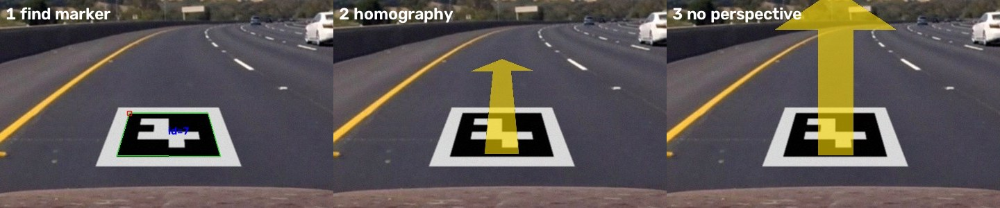
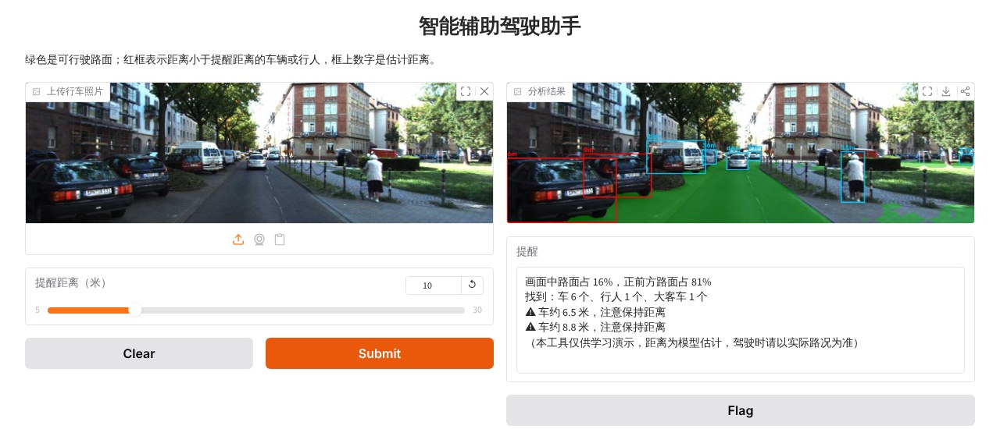
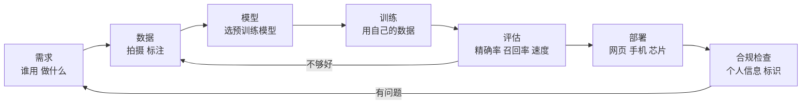
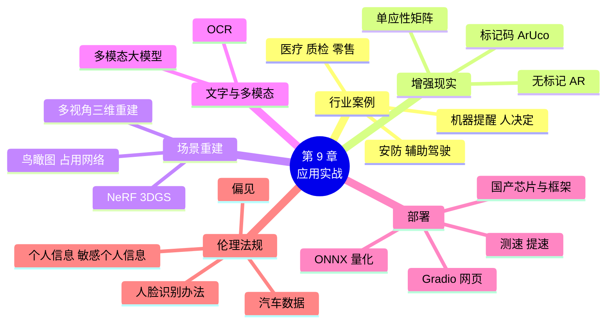

# 第 9 章 视觉应用实战与综合项目

!!! abstract "本章学时"
    理论 4 学时（线上 2 + 线下 2）· 实验 4 学时（本章共 4 个实验，★ 必做 3 个）

## 学习目标

学完本章，你应该能够：

1. **说出**常见视觉应用（安防、辅助驾驶、医疗、质检、零售、增强现实）各用了哪些步骤和模型（记忆）；
2. **解释**增强现实“找标记、算单应性矩阵、变形贴图”的原理，说出场景重建的几种做法（理解）；
3. **运行并修改**给定代码，用 Gradio 把智能辅助驾驶助手做成网页，用 ArUco 标记码做增强现实（应用）；
4. **测量和比较**模型在不同输入尺寸下的速度，说出几种加速和部署的办法（分析）；
5. **判断**一个视觉应用是否符合个人信息保护等法规的要求，完成一个综合项目和合规自查（评价、创造）。

!!! info "先修要求"
    学习本章前，你需要掌握：

    - [5.1.3 用 YOLO 检测一张行车照片](../05-detection/index.md#513) 和 [5.4 置信度门槛](../05-detection/index.md#54)；
    - [6.5 深度估计](../06-segmentation/index.md#65) 和 [实验 6-2 分出可行驶路面](../06-segmentation/index.md#6-2)；
    - [7.2.3 速度：辅助驾驶为什么要实时](../07-video/index.md#723)；
    - [3.5.1 关键点与特征匹配](../03-features/index.md#351)。

??? abstract "本章概念清单（14 个，点击查看定义和例子）"
    1. [增强现实](../../appendix/glossary.md#g-增强现实)
    2. [标记码](../../appendix/glossary.md#g-标记码)
    3. [单应性矩阵](../../appendix/glossary.md#g-单应性矩阵)
    4. [多视角三维重建](../../appendix/glossary.md#g-多视角三维重建)
    5. [神经辐射场](../../appendix/glossary.md#g-神经辐射场)
    6. [三维高斯泼溅](../../appendix/glossary.md#g-三维高斯泼溅)
    7. [鸟瞰图](../../appendix/glossary.md#g-鸟瞰图)
    8. [占用网络](../../appendix/glossary.md#g-占用网络)
    9. [文字识别](../../appendix/glossary.md#g-文字识别)
    10. [模型部署](../../appendix/glossary.md#g-模型部署)
    11. [ONNX](../../appendix/glossary.md#g-ONNX)
    12. [量化](../../appendix/glossary.md#g-量化)
    13. [敏感个人信息](../../appendix/glossary.md#g-敏感个人信息)
    14. [偏见](../../appendix/glossary.md#g-偏见)

## 情景导入

学期快结束了，小林把前八章做的程序一个个摆在桌面上：找车道线的、认车型的、检测车辆行人的、分路面的、估远近的、跟踪提醒的……

“每个都能跑，可每次演示都得打开 Notebook、改图片路径、一格格运行，”小林有点发愁，“我爸想试试，我总不能让他学 Python 吧？”

老王笑了：“这就是从‘作业’到‘应用’的最后一步。把这些零件装进一个网页，你爸用手机拍张照片上传，就能看到结果。用 Gradio，十几行代码就够了。”

“那要是装到车上呢？”

“那就要考虑更多了：够不够快？车上的芯片能不能跑？拍到的路人和车牌怎么处理？法律允许吗？出了错谁负责？”老王顿了顿，“真正的视觉产品，模型只占一小半，剩下的都是这些问题。”

这一章，我们先看看各行各业的视觉应用是怎样“配”出来的，再把智能辅助驾驶助手做成网页，做一个增强现实小实验，了解场景重建、模型加速和国产方案，最后讨论伦理与法规，完成自己的综合项目。

## 9.1 视觉应用的“配方”：行业案例拆解 { #91 }

### 9.1.1 六个行业，一样的零件 { #911 }

前八章学的分类、检测、分割、跟踪、姿态、生成，就像厨房里的基本食材。各行各业的视觉应用，大多是把这几样“配”在一起，再加上本行业的规则。

| 行业 | 典型应用 | 用到的步骤和模型 | 对应本书 |
|---|---|---|---|
| 安防监控 | 人流统计、区域闯入报警、遗留物检测 | 检测人 → 跟踪发号码 → 越线计数 / 区域判断 | 第 5、7 章 |
| 辅助驾驶与自动驾驶 | 前车碰撞预警、车道偏离报警、行人提醒、红绿灯识别 | 检测车人和信号灯 → 分割路面和车道线 → 估计距离 → 跟踪 → 规则判断 | 第 3、5、6、7 章 |
| 医疗影像 | 肺结节筛查、眼底病变筛查、病理切片分析 | 分类（有没有病变）→ 检测或分割（病变在哪、多大） | 第 4、6 章 |
| 工业质检 | 屏幕划痕、焊点缺陷、零件尺寸测量 | 图像预处理 → 分类或检测缺陷 → 轮廓测量尺寸 | 第 2、3、5 章 |
| 智慧零售 | 无人货柜、货架缺货检测、客流分析 | 检测商品 → 分类认品牌 → 计数；检测人 → 跟踪 | 第 4、5、7 章 |
| 增强现实 | AR 导航、虚拟试穿、AR 测量 | 找标记或平面 → 算单应性矩阵或相机位置 → 把虚拟物体贴上去 | 本章 9.2 节 |

拆解一个应用，可以问三个问题：

1. **输入是什么？** 一张照片、一段视频，还是多个摄像头？
2. **要回答什么？** 是什么（分类）、在哪里（检测）、精确轮廓（分割）、去哪了（跟踪）、在做什么（动作）？
3. **答案怎么用？** 只是显示，还是要报警、计数、控制机器？用得越“重”，对准确率和速度的要求就越高。

### 9.1.2 同一个任务，要求可以差很多 { #912 }

同样是“检测行人”，不同场合的要求完全不同：

| 场合 | 漏检的后果 | 误检的后果 | 速度要求 | 更看重 |
|---|---|---|---|---|
| 商场客流统计 | 少数几个人，影响不大 | 多数几个人，影响不大 | 几秒出一次结果就行 | 便宜 |
| 小区周界闯入报警 | 坏人进来没发现 | 半夜频繁误报，保安烦 | 1 秒内 | 精确率和召回率都要高 |
| 辅助驾驶行人提醒 | 可能撞人 | 频繁误报，驾驶员会关掉功能 | 每秒十几帧以上 | 召回率，同时误报不能太多 |
| 医疗影像筛查 | 病人错过治疗 | 多做一次检查 | 不急 | 召回率，最后由医生确认 |

这就是第 5 章讲的“多报还是少报”在真实场景里的样子。医疗和辅助驾驶的共同点是：**机器负责提醒，人负责决定**。机器筛出可疑的地方请医生看，机器提醒前方有人请驾驶员注意，最终的判断和责任都在人身上。

### 9.1.3 本书的辅助驾驶助手在哪一层 { #913 }

回顾 [1.5.1 节](../01-intro/index.md#151)：本书的智能辅助驾驶助手只做 0 级的“看懂和提醒”。下面把它和市面上真实的辅助驾驶系统做个对比：

| | 本书的助手 | 量产车上的驾驶辅助系统 |
|---|---|---|
| 摄像头 | 一张照片或一段视频 | 6～11 个摄像头，加毫米波雷达，部分车型有激光雷达 |
| 速度 | CPU 上每张约 0.2 秒 | 专用芯片，每秒处理几十帧 |
| 模型 | 通用预训练模型 + 少量 KITTI 训练 | 用海量本地道路数据训练，经过大量道路测试 |
| 能做什么 | 显示框、路面、距离，给出文字提醒 | 预警，并在 1～2 级中帮助控制方向和速度 |
| 谁负责 | 只供学习，不能用于真实驾驶 | 驾驶员始终负全责，必须手握方向盘、眼睛看路 |

## 9.2 增强现实：把虚拟的东西贴到现实里 { #92 }

### 9.2.1 什么是增强现实 { #921 }

[**增强现实**](../../appendix/glossary.md#g-增强现实 "把计算机生成的文字、图片、三维模型叠加到真实画面上，使其看起来像存在于现实中的技术"){ .term }（Augmented Reality，AR）是把计算机生成的文字、图片、三维模型叠加到真实画面上，让它们看起来像“长”在现实里一样。和它相对的是虚拟现实（VR），VR 把人完全放进一个虚拟世界。

| 例子 | 叠加了什么 | 要先“看懂”什么 |
|---|---|---|
| 手机地图的 AR 步行导航 | 路面上的箭头 | 地面在哪、手机朝哪个方向 |
| 汽车 AR 抬头显示（AR-HUD） | 前挡风玻璃上的导航箭头、前车提示框 | 车道、前车的位置 |
| 虚拟试妆、试戴眼镜 | 口红颜色、眼镜模型 | 人脸关键点 |
| AR 测量尺 | 尺子和长度数字 | 地面或桌面在哪 |
| 博物馆 AR 讲解 | 文物复原的样子、讲解文字 | 展品在哪 |

不管哪种 AR，都离不开同一个问题：**虚拟的东西应该贴在画面的哪里、变成什么形状**，才能和真实场景对得上。

### 9.2.2 标记码：给计算机一个好认的“记号” { #922 }

让计算机在任意场景里找到一个平面并不容易。最简单的办法是放一个专门设计的[**标记码**](../../appendix/glossary.md#g-标记码 "专门设计、便于计算机找到并识别编号和方向的黑白方块图案"){ .term }（Fiducial Marker）：一个黑白方块组成的图案，像一个简化的二维码。

OpenCV 自带的 ArUco 码就是一种标记码。<sup class="cite">[[1]](#ref9-1)</sup> 它有几个好处：

- **好找**：黑色粗边框很容易用第 3 章的轮廓方法找出来；
- **认得出是几号**：里面 4×4 或更多的格子编码了一个号码，不同的码可以代表不同的东西；
- **分得清方向**：图案故意设计成不对称，转 90° 就成了另一个图案，所以程序知道哪个角是“左上角”；
- **四个角很准**：找到四个角的像素坐标，就能算出这个平面在画面中的样子。

`DICT_4X4_50` 表示“4×4 格子、一共 50 种码”的字典。生成码和找码要用同一个字典，就像用同一本密码本。

### 9.2.3 单应性矩阵：四对点决定一切 { #923 }

一张纸平放在路面上，从车里看过去会变成梯形：近的一边宽、远的一边窄。把一张正方形的图变成这个梯形，需要的变换就叫透视变换，描述它的 3×3 数字表叫[**单应性矩阵**](../../appendix/glossary.md#g-单应性矩阵 "描述一个平面从一张图到另一张图透视变换关系的 3×3 矩阵，由四对对应点确定"){ .term }（Homography Matrix），通常记作 H。

只要知道**四对对应点**（纸上的四个角 ↔ 照片里的四个角），就能算出 H。之后纸上的任何一点，都能用 H 算出它在照片里的位置。OpenCV 里只要两行：

```python
H = cv2.getPerspectiveTransform(纸上的四个角, 照片里的四个角)   # 由四对点算出 H
warped = cv2.warpPerspective(纸, H, (照片宽, 照片高))             # 按 H 把整张纸变形
```



*图 9-1　实验 9-2 的三步：① 找到 7 号标记码和它的四个角；② 按单应性矩阵把导航箭头“贴”在路面上；③ 对比：只缩放平移、不做透视，箭头像是立在路上（编者合成的路面照片，底图来自 Udacity 行车视频，MIT 许可）*

**算一算** 单应性矩阵最简单的情况是只缩放和平移。比如纸上的点 (x, y) 先放大 2 倍，再向右移 100、向下移 50，照片上的点就是 (2x + 100, 2y + 50)，写成 H 就是：

| | | |
|---|---|---|
| 2 | 0 | 100 |
| 0 | 2 | 50 |
| 0 | 0 | 1 |

纸上的 (10, 20) 变成 (2×10 + 100, 2×20 + 50) = (120, 90)。透视变换时第三行不再是 (0, 0, 1)，算出来还要除以一个随位置变化的数，这就是“近大远小”的来源。我们不用手算，交给 OpenCV 就行。

<iframe class="sim-frame" src="../../sims/ar-homography/main.html" height="760" loading="lazy" title="增强现实贴图"></iframe>
动画：增强现实贴图。拖动四个红点，看箭头、方格纸怎样跟着变形；试试“不做透视”和“把 3、4 号角弄反”。
{ .sim-caption }

### 9.2.4 没有标记码怎么办 { #924 }

现实中不可能到处贴标记码。手机 AR 和汽车 AR-HUD 用的是“无标记”的办法：

- **找平面**：在连续的画面中跟踪很多关键点（第 3 章），算出哪些点在同一个平面上，那就是地面或桌面；
- **定位相机**：同时估计手机自己在空间中怎样移动、转动，这叫 SLAM（同时定位与建图）；
- **用其他传感器**：手机的陀螺仪、汽车的定位和车道线检测结果，都能帮助判断“箭头该贴在哪”。

思路和标记码一样：先找到真实世界里的一个平面和它在画面中的样子，再把虚拟内容按透视关系贴上去。

## 9.3 场景重建：从照片到三维世界（了解） { #93 }

[6.5.3 节](../06-segmentation/index.md#653) 用一张照片估计出了每个像素的远近。这一节看看怎样用更多照片，把整个场景“搬”进计算机。

### 9.3.1 多视角三维重建：拍一圈照片 { #931 }

我们的两只眼睛从略微不同的角度看同一个东西，大脑就能判断远近。计算机也一样：[**多视角三维重建**](../../appendix/glossary.md#g-多视角三维重建 "利用从不同角度拍摄的多张照片，恢复物体或场景三维结构的方法"){ .term }（Multi-view 3D Reconstruction）围着一个物体或场景从很多角度拍照片，然后：

1. 在每张照片里找关键点（第 3 章），在不同照片之间配对，找出“这是同一个点”；
2. 根据同一个点在不同照片里的位置差，反推出每张照片是在哪里、朝哪个方向拍的，以及这个点在三维空间里的位置；
3. 得到成千上万个三维点（叫“点云”），再连成表面，贴上照片的颜色，就是一个三维模型。

这种方法叫“从运动恢复结构”（SfM），常用的开源工具是 COLMAP。<sup class="cite">[[2]](#ref9-2)</sup> 文物数字化、电商商品 3D 展示、无人机航拍做城市三维地图，都用到它。

### 9.3.2 NeRF 与三维高斯泼溅：拍段视频就能转着看 { #932 }

传统三维重建得到的模型常常有破洞、表面粗糙。2020 年出现的[**神经辐射场**](../../appendix/glossary.md#g-神经辐射场 "用神经网络记住空间中每个点的颜色和不透明度，从而能从任意角度画出场景画面的方法"){ .term }（Neural Radiance Fields，NeRF）换了个思路：不去拼点和面，而是训练一个神经网络，让它记住“空间中每个点是什么颜色、有多不透明”。<sup class="cite">[[3]](#ref9-3)</sup> 训练好以后，从任何角度“看”过去，网络都能画出那个角度的画面，效果非常逼真。缺点是训练和画图都很慢。

2023 年的[**三维高斯泼溅**](../../appendix/glossary.md#g-三维高斯泼溅 "用大量半透明彩色椭球表示三维场景、可以快速画出新视角画面的场景重建方法"){ .term }（3D Gaussian Splatting，3DGS）用几十万到几百万个半透明的彩色“小椭球”来表示场景，画图时把它们“泼”到屏幕上，既逼真又快，普通显卡就能每秒画上百帧。<sup class="cite">[[4]](#ref9-4)</sup> 现在用手机拍一段绕着走的视频，就能在一些 App 里生成可以自由转动视角的三维场景，地图 App 的实景三维、虚拟看房都在用类似的技术。

### 9.3.3 自动驾驶的“上帝视角”：鸟瞰图与占用网络 { #933 }

车上有前、后、左、右多个摄像头，每个摄像头只看到一部分。开车需要的是一张“从天上往下看”的周围地图。

[**鸟瞰图**](../../appendix/glossary.md#g-鸟瞰图 "把车上多个摄像头的画面统一变换成从上往下看的俯视地图的表示方法"){ .term }（Bird's-Eye View，BEV）就是把多个摄像头的画面统一变换到这样一张俯视图上，在上面标出车道线、车辆、行人的位置。2022 年提出的 BEVFormer 等方法用深度学习直接从多个摄像头“生成”鸟瞰图，成为很多智能驾驶系统的基础。<sup class="cite">[[5]](#ref9-5)</sup> 智能驾驶屏幕上那张“周围车辆示意图”，就是鸟瞰图的一种显示。

鸟瞰图是平面的，看不出物体有多高。[**占用网络**](../../appendix/glossary.md#g-占用网络 "把车周围空间切成小方块，判断每个方块是否被物体占据的感知方法，不需要认出物体类别"){ .term }（Occupancy Network）更进一步：把车周围的空间切成很多小方块，判断每个小方块“有没有被东西占着”。好处是不用认出这是什么东西：路上掉下的纸箱、侧翻的车、施工的围挡，就算训练时没见过，只要它占了空间，系统就知道不能撞上去。

### 9.3.4 几种“看远近”的方法比一比 { #934 }

| 方法 | 输入 | 输出 | 本书位置 |
|---|---|---|---|
| 单目深度估计 | 一张照片 | 每个像素的远近（深度图） | 第 6 章、实验 6-4、实验 9-1 |
| 标记码 + 单应性矩阵 | 一张照片里的一个平面 | 这个平面在画面中的样子 | 本章 9.2 节、实验 9-2 |
| 多视角三维重建 | 很多张不同角度的照片 | 点云、三维模型 | 本章 9.3.1 节 |
| NeRF、3DGS | 一段绕着拍的视频 | 可以自由转视角的场景 | 本章 9.3.2 节 |
| 鸟瞰图、占用网络 | 车上多个摄像头 | 俯视地图、占用的空间 | 本章 9.3.3 节 |

## 9.4 看懂文字与“看图说话” { #94 }

### 9.4.1 文字识别 OCR { #941 }

[**文字识别**](../../appendix/glossary.md#g-文字识别 "检测图片中文字的位置并识别出文字内容的技术"){ .term }（Optical Character Recognition，OCR）是把图片里的文字变成可以复制、搜索的文本。它通常分两步：先**检测**文字在哪里（和第 5 章找车一样画框），再**识别**框里写的是什么字。

| 应用 | 例子 |
|---|---|
| 车牌识别 | 停车场自动抬杆、高速公路收费 |
| 证件识别 | 拍身份证、银行卡自动填表 |
| 拍照翻译、拍照搜题 | 手机相机对准外文菜单或题目 |
| 路牌、限速牌识别 | 辅助驾驶显示当前限速 |

国产开源的 PaddleOCR（百度飞桨）对中文支持很好，几行代码就能识别照片中的中文。车牌、身份证号都属于个人信息，做 OCR 应用时要注意 9.7 节的要求。

### 9.4.2 多模态大模型：直接问图 { #942 }

[1.8 节](../01-intro/index.md#18) 介绍过多模态大模型：上传一张照片，用一句话提问，它就能用文字回答。比如上传一张行车照片，问“前方有哪些需要注意的情况”，它会回答“前方右侧有一位老人正在过马路，左侧停着一排车，可能有人开车门”。

多模态大模型很方便，但用在辅助驾驶这类场合要注意：

- **慢**：回答一个问题要几秒，而行车提醒要在零点几秒内做出；
- **会“编”**：可能说出图里没有的东西，而且说得很肯定；
- **难检查**：检测模型的结果是一个个框和数字，可以逐个核对；一段文字回答很难量化评估。

所以现在的做法通常是：需要快和准的部分（找车、找人、量距离）用本书学的专门模型；需要“理解场景、解释原因”的部分再交给大模型。多模态大模型的调用方法，在《人工智能开发框架技术》第 8 章有详细介绍。

## 9.5 把模型做成网页小工具 { #95 }

### 9.5.1 Gradio：十几行代码做网页 { #951 }

Gradio 是一个专门为 AI 模型做网页界面的 Python 库。<sup class="cite">[[6]](#ref9-6)</sup> 你只要告诉它三件事：

1. **做什么**：一个 Python 函数，比如 `analyze(图片, 提醒距离)`；
2. **输入是什么**：图片上传框、滑块、文本框……
3. **输出是什么**：图片、文字……

它就会自动生成一个网页：有上传按钮、提交按钮，结果显示在右边。

```python
demo = gr.Interface(
    fn=analyze,                                                  # 做什么：调用 analyze 函数
    inputs=[gr.Image(type="numpy", label="上传行车照片"),           # 输入 1：图片
            gr.Slider(5, 30, value=10, step=1, label="提醒距离（米）")],  # 输入 2：滑块
    outputs=[gr.Image(label="分析结果"), gr.Textbox(label="提醒")],  # 输出：一张图 + 一段文字
    title="智能辅助驾驶助手",
)
demo.launch()                                                    # 启动网页
```

`inputs` 有几个，`analyze` 就要有几个参数，顺序一一对应；`analyze` 返回几个值，`outputs` 就要有几个。`gr.Image(type="numpy")` 让上传的图片以 NumPy 数字表的形式交给函数，注意它是 **RGB** 顺序，交给 OpenCV 之前要转成 BGR。



*图 9-2　实验 9-1 做出的智能辅助驾驶助手网页：左边上传照片、拖动提醒距离，右边显示路面（绿色）、车辆行人框、估计距离和提醒文字（编者截图，照片来自 KITTI，CC BY-NC-SA 3.0）*

### 9.5.2 让别人也能用 { #952 }

| 方式 | 做法 | 谁能访问 |
|---|---|---|
| 只在自己电脑上 | `demo.launch()` | 只有自己，网址是 `http://127.0.0.1:7860` |
| 同一个局域网 | `demo.launch(server_name="0.0.0.0")` | 同一个 Wi-Fi 下的同学，用你电脑的 IP 地址访问 |
| 临时公开链接 | `demo.launch(share=True)` | 任何拿到链接的人，链接有效期有限 |
| 部署到云平台（了解） | 上传到魔搭社区创空间、Hugging Face Spaces 等 | 长期在线，任何人都能访问 |

!!! warning "公开之前想一想"
    网页公开以后，任何人都能上传图片。别人上传的照片里可能有人脸、车牌，你的程序如果把它们保存下来，就是在收集他人的个人信息。公开前请对照 9.7 节和实验 9-3 的合规自查表检查一遍。

## 9.6 让模型跑得更快 { #96 }

### 9.6.1 速度怎么算 { #961 }

速度有两种说法：**每张多少毫秒**（越小越快）和**每秒多少张**（fps，越大越快），两者互为倒数：每秒张数 = 1000 ÷ 每张毫秒数。

**算一算** 实验 9-4 中，编者在 4 核 CPU 上测得检测 26 毫秒、道路分割 61 毫秒、深度估计 128 毫秒，合计 215 毫秒，1000 ÷ 215 ≈ 4.7 张/秒。车速 60 千米/小时约等于每秒 16.7 米，每处理一张图，车就开出了 16.7 × 0.215 ≈ 3.6 米。这就是为什么车上必须用更快的芯片和更小的模型。

测速时要注意两点：

- **先热身**：第一次运行要加载模型、分配内存，比后面慢得多，不能算进去；
- **多跑几次取平均**：每次的用时会有波动。

### 9.6.2 四种提速办法 { #962 }

| 办法 | 做法 | 代价 |
|---|---|---|
| 选小模型 | n 号模型，不用 s、m、l、x 号（[5.3.3 节](../05-detection/index.md#533)） | 精度略低 |
| 缩小输入尺寸 | `imgsz=320` 代替默认的 640 | 远处的小目标容易漏掉 |
| 换推理格式 | 导出为 ONNX、TensorRT、OpenVINO 等格式，用专门的推理引擎运行 | 要多一步导出，有的格式只能在特定硬件上用 |
| 量化 | 把模型参数从 32 位小数换成 8 位整数 | 精度可能下降一点 |

实验 9-4 中，同一个检测模型把输入尺寸从 640 缩小到 320，每张从 26.5 毫秒降到 12.2 毫秒，快了一倍多，但找到的目标从 8 个变成 6 个：远处两辆很小的车漏掉了，大客车也被认成了小汽车。

[**模型部署**](../../appendix/glossary.md#g-模型部署 "把训练好的模型放到实际使用的设备或服务上运行的过程"){ .term }（Model Deployment）就是把训练好的模型放到实际要用的地方运行：服务器、手机、摄像头、汽车。训练时用的 PyTorch 格式方便修改，但不一定跑得最快、也不一定能在每种设备上运行。[**ONNX**](../../appendix/glossary.md#g-ONNX "一种通用的神经网络模型文件格式，不同框架和推理工具都能读取"){ .term }（Open Neural Network Exchange）是一种通用的模型格式，像图片里的 JPG 一样，各家的推理工具都能读。<sup class="cite">[[10]](#ref9-10)</sup> Ultralytics 导出只要一行：

```python
model.export(format="onnx")         # 生成 yolo26n.onnx
onnx_model = YOLO("yolo26n.onnx")   # 用法和原来完全一样
```

[**量化**](../../appendix/glossary.md#g-量化 "用更少的比特存储模型参数，以降低内存和计算需求"){ .term }（Quantization）是用更少的位数存储模型的参数。比如把 32 位小数换成 8 位整数，模型大小变成约四分之一，在支持整数运算的芯片上速度也能快好几倍。

### 9.6.3 车载芯片与国产方案 { #963 }

真正的汽车不会用笔记本电脑的 CPU 跑模型，而是用专门的 AI 芯片。国内已经有多家企业做出了车载 AI 芯片和计算平台，比如地平线的征程系列芯片、华为的 MDC 智能驾驶计算平台、黑芝麻智能的华山系列芯片。手机、摄像头里也都有专门做 AI 计算的单元。

模型要在这些芯片上跑，通常要先转换成芯片厂商支持的格式。Ultralytics 的 `export` 支持多种国产格式和平台，例如：

| `format=` | 适合 |
|---|---|
| `"paddle"` | 百度飞桨（PaddlePaddle）的推理工具 |
| `"ncnn"` | 腾讯开源的手机端推理框架 ncnn |
| `"mnn"` | 阿里巴巴开源的轻量推理框架 MNN |
| `"rknn"` | 瑞芯微芯片（常见于开发板、摄像头） |
| `"ascend"` | 华为昇腾 AI 芯片 |

如果想从头用国产框架开发，百度飞桨提供了一整套视觉工具：PaddleX 是低代码开发工具，选一个任务、准备好数据就能训练和部署；PaddleDetection 提供 PP-YOLOE 等检测模型；PaddleOCR 做文字识别。它们的思路和本书的 Ultralytics 一样：加载预训练模型 → 用自己的数据训练 → 评估 → 导出部署。<sup class="cite">[[11]](#ref9-11)</sup>

## 9.7 伦理与法规 { #97 }

视觉技术“看”得越清楚，越容易碰到他人的隐私和权利。这一节把全书各章提到的法规集中梳理一遍。

### 9.7.1 人脸、车牌、行踪都是个人信息 { #971 }

《中华人民共和国个人信息保护法》（2021 年 11 月 1 日施行）规定，与已识别或可识别的自然人有关的信息都是个人信息。<sup class="cite">[[7]](#ref9-7)</sup> 其中，生物识别（人脸、指纹、声纹）、医疗健康、金融账户、行踪轨迹以及不满十四周岁未成年人的个人信息，属于[**敏感个人信息**](../../appendix/glossary.md#g-敏感个人信息 "一旦泄露或被非法使用，易导致人格尊严受损或人身、财产安全受危害的个人信息"){ .term }，处理时要有特定目的和充分必要性，并取得个人的单独同意。

对视觉应用来说，要特别注意：

- 照片和视频里清楚的**人脸**是生物识别信息；
- **车牌**能关联到车主，属于个人信息；
- 连续的行车视频加上时间和位置，能还原一个人的**行踪轨迹**；
- 在公共场所安装图像采集、个人身份识别设备，应当为维护公共安全所必需，并设置显著的提示标识，收集的图像只能用于维护公共安全。

### 9.7.2 人脸识别的专门规定 { #972 }

《人脸识别技术应用安全管理办法》由国家互联网信息办公室和公安部发布，2025 年 6 月 1 日起施行。<sup class="cite">[[8]](#ref9-8)</sup> 和本课相关的要求有：

| 要求 | 举例 |
|---|---|
| 有其他办法能达到同样目的时，不得把人脸识别作为唯一的验证方式 | 小区门禁要同时提供刷卡、密码等方式 |
| 个人不同意刷脸的，应当提供其他合理、便捷的方式 | 不能“不刷脸就不让进” |
| 公共场所安装人脸识别设备，应当为维护公共安全所必需，并设置显著提示标识 | 商场不能为了统计“回头客”偷偷识别顾客 |
| 不得在宾馆客房、公共浴室、更衣室、卫生间等私密空间内部安装 | |
| 人脸信息原则上存储在人脸识别设备内，不得通过互联网对外传输（法律另有规定或取得个人单独同意的除外） | |
| 存储人脸信息达到 10 万人的，应当向省级以上网信部门备案 | |

### 9.7.3 汽车里的数据 { #973 }

智能汽车的摄像头既拍车外的路人和车牌，也可能拍车内的驾驶员和乘客（第 7 章的驾驶员监测）。《汽车数据安全管理若干规定（试行）》（2021 年 10 月 1 日施行）提出了四条原则：<sup class="cite">[[9]](#ref9-9)</sup>

1. **车内处理**：除非确有必要，数据不向车外提供；
2. **默认不收集**：除非驾驶员自己设置，每次驾驶时默认不收集；
3. **精度范围适用**：根据功能需要，确定摄像头、雷达等的覆盖范围和分辨率；
4. **脱敏处理**：尽可能进行匿名化、去标识化处理。

它还把“包含人脸信息、车牌信息等的车外视频、图像数据”列为重要数据。这就是为什么第 3 章实验 3-4 要给行车照片的人脸和车牌打码。

另外，驾驶辅助功能的宣传也受到监管：2025 年 4 月，工业和信息化部要求车企规范驾驶辅助功能的宣传，不得夸大和虚假宣传，要清楚告知功能的使用条件和局限。这和本书一再强调的“辅助不是自动”是一致的。

### 9.7.4 深度合成与算法偏见 { #974 }

- **深度合成**：用他人照片做 AI 换脸、生成逼真的假人像，需要本人同意，并按规定加标识（[8.6 节](../08-generative/index.md#86)）。
- [**偏见**](../../appendix/glossary.md#g-偏见 "模型对某些群体系统性地产生不公平或不准确判断的现象"){ .term }（Bias）：模型对某些群体系统性地表现更差。视觉模型的偏见常常来自训练数据不均衡：训练照片大多是白天、晴天、欧美城市，到了夜间、雨天、国内的电动车和三轮车多的路口，表现就会下降；人脸、姿态模型对不同肤色、体型、穿着的人，准确率也可能不同。检查偏见的办法是**分组评估**：把测试数据按天气、时间、人群分组，分别算精确率和召回率，看有没有哪一组明显偏低。更多讨论见《人工智能导论》第 9 章。

### 9.7.5 一张自查清单 { #975 }

做任何视觉应用之前，可以先问自己五个问题：

1. **拍了谁？** 画面里有没有人脸、车牌？能不能不拍、少拍、拍得模糊一点？
2. **存了什么？** 是否只保存结果（数字、统计），而不保存原始画面？
3. **给了谁？** 数据会不会传到网上、交给别人？
4. **对谁不公平？** 有没有某类人、某种场景的结果明显更差？
5. **错了怎么办？** 结果错了会造成什么后果？谁来最终判断？有没有提醒使用者“仅供参考”？

实验 9-3 的合规自查表就是按这几个问题设计的。

## 9.8 一个视觉项目的完整流程 { #98 }

### 9.8.1 七步走 { #981 }



| 步骤 | 要回答的问题 | 本书对应 |
|---|---|---|
| 需求 | 谁用？输入输出是什么？做到什么程度算好？ | 本章 9.1 节 |
| 数据 | 从哪来？要多少？怎么标注？有没有个人信息？ | 第 4、5 章，实验 5-4 |
| 模型 | 能不能直接用预训练模型？选检测、分割还是姿态？选多大的？ | 第 4～7 章 |
| 训练 | 怎么划分训练集和验证集？训练几轮？过拟合了吗？ | 实验 4-3、5-3 |
| 评估 | 精确率、召回率、mAP 多少？在难的场景（夜间、遮挡）表现如何？速度够吗？ | 第 5 章，实验 9-4 |
| 部署 | 在哪里运行？网页、手机还是车载芯片？ | 本章 9.5、9.6 节 |
| 合规检查 | 是否涉及个人信息？是否需要标识？结果错了的后果？ | 本章 9.7 节 |

### 9.8.2 新手常踩的坑 { #982 }

| 坑 | 表现 | 怎么避免 |
|---|---|---|
| 一上来就训练 | 花了半天标注、训练，结果预训练模型本来就能做 | 先用预训练模型试一试，确实不够再训练 |
| 只在“好”的图上测试 | 演示时很准，换一张图就不行 | 测试图要包含难的情况：夜间、遮挡、远处、侧面 |
| 测试图混进训练集 | 评估结果特别好，实际用起来很差 | 训练、验证、测试的图严格分开 |
| 只看准不准，不看快不快 | 视频处理一分钟只能跑几帧 | 一开始就测速度，见实验 9-4 |
| 门槛凭感觉定 | 换个场景就频繁误报 | 用一批测试图试几个门槛，记录精确率和召回率再定 |
| 最后才想合规 | 做完才发现数据不能用 | 收集数据之前就做合规检查 |

## 9.9 Python 小课堂：函数当参数、默认参数和 try { #99 }

本章的代码用到三个新写法。

**函数也可以当参数传来传去**。`gr.Interface(fn=analyze, ...)` 里的 `analyze` 后面没有括号：这里不是“调用”函数，而是把函数本身交给 Gradio，等用户点了“提交”，Gradio 再去调用它。

```python
def hello(name):
    return "你好，" + name
f = hello            # 没有括号：f 现在就是 hello 这个函数
print(f("小林"))      # 有括号：调用它，打印“你好，小林”
```

**默认参数**：`def analyze(img_rgb, near_m=10):` 里的 `near_m=10` 表示调用时如果不给第二个参数，就用 10。所以 `analyze(img)` 和 `analyze(img, 10)` 是一样的，`analyze(img, 15)` 则把提醒距离改成 15 米。

**try…except：出错了也不中断**。实验 9-4 的第 4 步需要联网安装 onnx，可能失败。放在 `try` 里，出错时程序不会停下来，而是跳到 `except` 里打印原因，前面的结果都还在。

```python
try:
    det.export(format="onnx")           # 可能出错的代码
except Exception as e:                  # 出错就到这里，e 是错误信息
    print("导出没成功：", e)
```

**测时间**：`time.perf_counter()` 返回一个精确的“秒表读数”，做事之前读一次、做完再读一次，相减就是用了多少秒。

## 9.10 本章常见报错对照 { #910 }

| 报错原文（最后一行） | 用大白话说 | 怎么改 |
|---|---|---|
| `ModuleNotFoundError: No module named 'gradio'` | 没装 Gradio | 终端执行 `pip install gradio` |
| 网页上点“提交”后显示 `Error` | 函数里出错了，详细原因在终端里 | 看终端最后几行；常见原因是没上传图片就提交，在函数开头判断 `if img_rgb is None` |
| `OSError: Cannot find empty port in range: 7860-7860` | 7860 端口被上一次运行的网页占着 | 先在原来的终端按 Ctrl+C 结束，或 `demo.launch(server_port=7861)` |
| 网页上的颜色红蓝颠倒 | 忘了 RGB 和 BGR 的转换 | 进函数时 `cv2.cvtColor(img, cv2.COLOR_RGB2BGR)`，返回前再转回来 |
| `AttributeError: module 'cv2' has no attribute 'aruco'` | OpenCV 版本太旧或装的是精简版 | `pip install -U opencv-python`（4.7 及以上都带 ArUco） |
| 找到的码是 `None` | 没找到标记码 | 检查字典是否和生成时一样；标记码要有白边、不能太小、不能反光 |
| `IndexError: tuple index out of range`（在 `corners[0]` 这一行） | 照片里没找到码，`corners` 是空的 | 先判断 `if ids is not None:` 再取角点 |
| 导出 ONNX 时报 `No module named 'onnx'` 或下载失败 | 没装 onnx，自动安装又失败了 | 终端执行 `pip install onnx onnxruntime` 后再运行 |

## 9.11 前沿视窗：会“看、想、做”的视觉-语言-动作模型 { #911 }

第 7 章的前沿视窗介绍了端到端智能驾驶：一个模型直接从摄像头画面学“怎么开”。最近几年，研究者又把多模态大模型的“理解和推理”能力加了进来。

2023 年，谷歌提出 RT-2，把一个会“看图说话”的大模型继续训练，让它不仅能输出文字，还能直接输出机器人的动作，比如“把香蕉放到写着 3 的纸上”。<sup class="cite">[[12]](#ref9-12)</sup> 这类模型被称为“视觉-语言-动作”（VLA）模型：看到画面（视觉），理解指令和场景（语言），给出动作。2025 年起，国内多家车企和机器人公司也开始在辅助驾驶、人形机器人上尝试 VLA 模型，希望它们遇到没见过的复杂情况时，能像人一样“想一想”再行动，并能用语言解释自己为什么这样做。

不过，这类模型越强大，“它为什么这样做”“出错了怎么办”的问题就越重要。本书从像素、卷积、检测、分割一路学上来，就是为了让你在使用这些“黑箱”时，知道它们的每一步可能在哪里出错。

## 本章实验

!!! abstract "实验总览"
    | 实验 | 类型 | 建议时长 | 内容 |
    |---|---|---|---|
    | 实验 9-1 | ★ 必做 | 45 分钟 | 智能辅助驾驶助手网页 |
    | 实验 9-2 | ★ 必做 | 40 分钟 | 增强现实小实验 |
    | 实验 9-3 | ★ 必做 | 课内 45 分钟 + 课外 | 综合项目 |
    | 实验 9-4 | ☆ 选做 | 35 分钟 | 让程序跑得更快 |

    代码见配套资源 `labs/ch09/` 目录，每个实验都有 `.py` 和 `.ipynb` 两种文件，内容相同，都在 `labs/ch09/` 文件夹里运行，CPU 即可。实验 9-1 和 9-3 会打开一个网页，在本机运行最方便；在云端 Notebook 中运行时，把 `demo.launch()` 改成 `demo.launch(share=True)`，用生成的临时链接打开。第一次运行会自动下载道路分割和深度估计模型（与第 6 章相同）。

!!! warning "实验 9-4 第 4 步待实测"
    编者的编写环境无法安装 onnx，实验 9-4 第 4 步（导出 ONNX 并测速）的代码已检查过语法，运行结果尚未实测，记录表中相应位置留空。使用本书的老师请在课前先运行一遍。

### 实验 9-1 ★ 智能辅助驾驶助手网页 { #9-1 }

**实验目的**

1. 把第 5、6 章的检测、道路分割、深度估计三个模型组装成一个函数；
2. 用 Gradio 把这个函数做成网页，上传照片就能看到结果；
3. 调整提醒距离，观察提醒的变化，思考规则的不足。

**实验环境**：本机或云端 Notebook，CPU 即可。

**实验数据**：`labs/data/images/` 中的三张行车照片 `drive_city.jpg`、`street_crossing.jpg`（KITTI，CC BY-NC-SA 3.0）和 `drive_highway.jpg`（Udacity，MIT 许可），也可以上传自己的照片。

**实验步骤与代码**

第一档 · 跑通：在 `labs/ch09` 文件夹中运行 `python lab9_1_assistant_app.py`，等终端出现 `Running on local URL:  http://127.0.0.1:7860`，在浏览器打开这个网址。点下方“Examples”中的第一张图，再点“Submit”。用完在终端按 Ctrl+C 结束。

第 1 步，加载三个模型：

```python
det_model = YOLO("yolo26n.pt")          # 第 5 章：检测车和人
sem_model = YOLO("yolo26n-sem.pt")      # 第 6 章：道路语义分割
depth_model = YOLO("yolo26n-depth.pt")  # 第 6 章：深度估计
```

第 2 步，核心函数 `analyze`（节选）：

```python
def analyze(img_rgb, near_m=10):
    if img_rgb is None:                                        # 还没上传照片
        return None, "请先上传一张行车照片"
    img = cv2.cvtColor(img_rgb, cv2.COLOR_RGB2BGR)            # 网页给的是 RGB，OpenCV 用 BGR
    sem = sem_model(img, verbose=False)[0].semantic_mask.data.cpu().numpy()
    depth = depth_model(img, verbose=False)[0].depth.data.cpu().numpy()
    det = det_model(img, verbose=False)[0]
    out = img.copy()
    out[sem == 0] = (0.6 * out[sem == 0] + 0.4 * np.array([0, 200, 0])).astype(np.uint8)  # 路面涂绿
    ...                                                       # 对每个框：取框内深度的中位数，近的画红框
    return cv2.cvtColor(out, cv2.COLOR_BGR2RGB), report(sem, items, near_m)
```

每个部分都是前面学过的：`semantic_mask` 中 0 号类别是路面（实验 6-2），`depth` 是每个像素的估计距离（实验 6-4），框里深度的中位数就是这个目标的距离。第 3 步的 `report` 函数把结果写成提醒文字；第 4 步就是 9.5.1 节的 `gr.Interface`。完整代码：`labs/ch09/lab9_1_assistant_app.py`（`.ipynb` 同名）

**运行结果**

网页如图 9-2 所示。三张示例照片（提醒距离 10 米）的提醒文字：

```text
== drive_city
画面中路面占 16%，正前方路面占 81%
找到：车 6 个、行人 1 个、大客车 1 个
⚠ 车约 6.5 米，注意保持距离
⚠ 车约 8.8 米，注意保持距离
== street_crossing
画面中路面占 25%，正前方路面占 83%
找到：行人 12 个、车 1 个
⚠ 行人约 8.4 米，注意保持距离
⚠ 行人约 8.5 米，注意保持距离
== drive_highway
画面中路面占 35%，正前方路面占 99%
找到：车 2 个
⚠ 车约 6.1 米，注意保持距离
```

每段最后还有一行“（本工具仅供学习演示，距离为模型估计，驾驶时请以实际路况为准）”。编者 CPU 上每张约 0.2～0.3 秒出结果。

注意高速公路这张：被提醒的“6.1 米的车”其实是右侧相邻车道上的黑色轿车，并不在本车正前方。这说明只按距离提醒还不够，还要看目标在不在本车道上。

第二档 · 改一改：

1. 把网页上的提醒距离拖到 15 米，`drive_city.jpg` 多了哪个提醒？（编者结果：多了“行人约 11.2 米”。）
2. 把第 1 步的检测模型换成第 5 章自己训练的 `best.pt`（复制到 `labs/ch09` 文件夹），比较找到的目标有什么不同。注意：KITTI 训练的模型类别名是 `car`、`pedestrian` 等，要相应修改 `WANT` 字典。
3. 在 `report` 中加一条规则：正前方路面占比低于 50% 时，提示“前方可行驶区域较少，请减速”（参考实验 6-2）。

第三档 · 挑战（选做）：

1. 只对“正前方区域”（画面下方中间，参考 `report` 中的 `front`）里的目标发出距离提醒，解决高速公路照片中相邻车道误提醒的问题；
2. 把输入改成 `gr.Video`，逐帧调用 `analyze`（参考实验 7-1 读写视频的写法），输出处理好的视频。

**实验记录表**

| 照片 | 提醒距离 | 找到的目标 | 提醒了几个 | 提醒得对吗？不对的原因 |
|---|---|---|---|---|
| drive_city | 10 米 | 车 6、行人 1、大客车 1 | 2 | |
| drive_city | 15 米 | | | |
| drive_highway | 10 米 | 车 2 | 1 | |
| 自己的照片 | | | | |

**常见问题排查**

| 现象 | 原因 | 解决办法 |
|---|---|---|
| 浏览器打不开 `127.0.0.1:7860` | 程序还没启动完，或在云端运行 | 等终端出现网址再打开；云端改用 `share=True` |
| 点 Submit 后一直转圈 | 第一次运行在下载模型 | 看终端的下载进度，耐心等待 |
| 显示 `Error` | 函数里出错 | 看终端最后几行报错，对照 9.10 节 |
| 结果图颜色发蓝 | RGB、BGR 没转换 | 检查函数开头和返回前的 `cvtColor` |

**思考与练习**

1. 为什么用框里深度的**中位数**而不是平均数作为目标的距离？（提示：框里除了车，还有什么？）
2. 网页最后一行写着“仅供学习演示”。如果有人真的把这个网页装到车上用，可能出现哪些危险？

**实验报告要求**

提交三张示例图和一张自己照片的网页截图，填写实验记录表，回答“思考与练习”。

### 实验 9-2 ★ 增强现实小实验 { #9-2 }

**实验目的**

1. 生成一个 ArUco 标记码，并在照片中找到它和它的四个角；
2. 用四对对应点算出单应性矩阵，把导航箭头“贴”到路面上；
3. 比较透视变形和只缩放平移的效果。

**实验环境**：云端 Notebook 或本机，CPU 即可。第三档需要打印机或第二部手机。

**实验数据**：`labs/data/images/marker_road.jpg`，编者用 `labs/data/make_marker_scene.py` 把一块 7 号标记码合成到高速公路照片（Udacity，MIT 许可）的路面上，模拟测试场地平放的标定牌。

**实验步骤与代码**

第一档 · 跑通：打开 `lab9_2_ar_marker.ipynb`，依次运行五个单元格。

第 1～2 步，生成标记码，在照片中找它：

```python
aruco = cv2.aruco
dictionary = aruco.getPredefinedDictionary(aruco.DICT_4X4_50)   # 4×4 格子的码，共 50 种
marker = aruco.generateImageMarker(dictionary, 7, 240)          # 7 号码，240×240 像素
marker = cv2.copyMakeBorder(marker, 40, 40, 40, 40, cv2.BORDER_CONSTANT, value=255)  # 加白边
cv2.imwrite("lab9_2_marker.png", marker)
img = cv2.imread("../data/images/marker_road.jpg")
detector = aruco.ArucoDetector(dictionary, aruco.DetectorParameters())
corners, ids, rejected = detector.detectMarkers(img)
quad = corners[0].reshape(4, 2)                                  # 四个角：左上、右上、右下、左下
```

第 3 步，在一张 480×1000 的“纸”上画箭头，标记码占纸底部中间 240×240 的一块，算出纸 → 照片的单应性矩阵：

```python
canvas = np.zeros((1000, 480, 3), np.uint8)
ox, oy = 120, 760                                                 # 标记码左上角在纸上的位置
arrow = np.array([[200, 990], [280, 990], [280, 300], [380, 300], [240, 80], [100, 300], [200, 300]])
cv2.fillPoly(canvas, [arrow], (0, 220, 255))                      # 黄色直行箭头
src = np.float32([[ox, oy], [ox + 240, oy], [ox + 240, oy + 240], [ox, oy + 240]])
H = cv2.getPerspectiveTransform(src, quad.astype(np.float32))     # 纸上的点 → 照片上的点
```

第 4 步，变形并半透明地贴上去：

```python
warped = cv2.warpPerspective(canvas, H, (w, h))
mask = warped.sum(axis=2) > 0                                     # 箭头所在的像素
ar = img.copy()
ar[mask] = (0.4 * img[mask] + 0.6 * warped[mask]).astype(np.uint8)
```

第 5 步只按标记码的外接矩形缩放、平移（`cv2.warpAffine`），作为对比。完整代码：`labs/ch09/lab9_2_ar_marker.py`（`.ipynb` 同名）

**运行结果**

```text
标记码大小： (320, 320)
找到的码： [7]
四个角的像素坐标：
 [[606. 563.]
 [719. 563.]
 [737. 625.]
 [588. 624.]]
单应性矩阵 H：
 [[  0.246  -0.375 598.927]
 [ -0.016  -0.21  479.91 ]
 [ -0.     -0.001   1.   ]]
箭头盖住的像素数： 5383
```

三张结果图见图 9-1。上面两个角的 y 坐标是 563，下面两个是 624 左右，而且上边（606～719，宽 113）比下边（588～737，宽 149）窄：这正是平放在地上的正方形“近大远小”的样子。

第二档 · 改一改：

1. 把第 2 步的字典换成 `aruco.DICT_5X5_50` 再运行，找到的码是什么？为什么？（编者结果：`None`，没找到。）
2. 把第 4 步的 `0.4`、`0.6` 改成 `0.7`、`0.3`，箭头有什么变化？
3. 修改 `arrow` 的坐标，把直行箭头改成向左转的箭头（提示：箭头的头部向左上方画）。

第三档 · 挑战（选做）：把 `lab9_2_marker.png` 打印出来（或显示在另一部手机上），平放在桌上，从斜上方拍一张照片，改第 2 步的图片路径再运行。再试试从侧面、从更远处拍，看看什么情况下找不到标记码。

**实验记录表**

| 测试 | 找到的码 | 箭头是否贴合 | 说明 |
|---|---|---|---|
| 书中照片，`DICT_4X4_50` | [7] | 是 | |
| 书中照片，`DICT_5X5_50` | | | |
| 自己拍的照片（正上方） | | | |
| 自己拍的照片（侧面很斜） | | | |

**常见问题排查**

| 现象 | 原因 | 解决办法 |
|---|---|---|
| `AttributeError: … no attribute 'aruco'` | OpenCV 太旧 | `pip install -U opencv-python` |
| 找到的码是 `None` | 字典不对、码太小、没有白边、反光 | 换成生成时的字典；拍近一点；打印时保留白边；避开灯光反射 |
| `IndexError`（在 `corners[0]` 这一行） | 没找到码 | 同上；先判断 `if ids is not None:` |
| 箭头歪到了奇怪的地方 | 四个角顺序和纸上的四个角对不上 | 两边都按“左上、右上、右下、左下”的顺序 |

**思考与练习**

1. 为什么必须是**四对**点才能算出单应性矩阵？三对行不行？（提示：打开“增强现实贴图”动画，只拖动一个角，看看贴图怎样变化。）
2. 汽车的 AR 抬头显示没法在路上贴标记码，它可能用什么信息来决定导航箭头贴在哪里？

**实验报告要求**

提交三张结果图（找到标记码、透视贴图、不做透视）和自己拍照的结果，填写实验记录表，回答“思考与练习”。

### 实验 9-3 ★ 综合项目 { #9-3 }

**实验目的**

1. 综合运用全书的知识，独立（或 2～3 人一组）完成一个能演示的视觉小应用；
2. 按“需求 → 数据 → 模型 → 训练 → 评估 → 部署 → 合规检查”的流程开展项目；
3. 写出项目报告，完成合规自查表。

**实验环境**：本机或云端 Notebook，CPU 即可；如需训练模型，可使用云端 GPU。

**实验数据**：根据选题准备。自己拍摄时，只拍自己或获得同意的同学，避免拍到无关路人的脸和车牌。

**选题（四选一，也可以自选，自选题需老师同意）**

| 选题 | 要做什么 | 可以参考 | 基本要求 | 加分项 |
|---|---|---|---|---|
| A. 智能辅助驾驶助手 | 在实验 9-1 基础上改进 | 实验 6-2、7-2、9-1 | 只对本车道目标提醒；支持视频输入 | 加入车道线检测（实验 3-3）；用自己训练的检测器 |
| B. 安防计数 | 统计视频中通过某条线的人数，或进入某个区域的人数 | 实验 7-2 | 网页上传视频，输出计数结果和标注视频 | 可以在网页上调整计数线的位置 |
| C. 健身计数 | 统计视频中俯卧撑、深蹲或开合跳的次数 | 实验 7-3 | 至少支持一种动作，计数误差不超过 1 次 | 支持两种以上动作；提示“动作不标准” |
| D. 证件照工具 | 上传自拍，换成红、蓝、白底，裁成标准尺寸 | 实验 2-1、6-1 | 能换三种底色，裁成一寸照尺寸 | 用分割模型抠图，头发边缘自然 |

**实验步骤**

第一档 · 跑通（课内）：

1. 运行 `lab9_3_project_template.py`，打开网页，确认模板能用（默认功能是数图中的人和车）；
2. 选定题目，按 `labs/ch09/项目报告模板.md` 的“一、需求”写清楚：谁用、输入输出、做到什么程度算好；
3. 把参考实验中的核心代码搬进模板的 `analyze` 函数，改好标了 `# ← 改这里` 的地方，让网页能跑出第一个结果。

模板的核心部分：

```python
model = YOLO("yolo26n.pt")      # ← 改这里：检测、姿态、分割或自己训练的模型

def analyze(img_rgb, conf=0.25):
    if img_rgb is None:
        return None, "请先上传一张图片"
    img = cv2.cvtColor(img_rgb, cv2.COLOR_RGB2BGR)
    r = model(img, conf=conf, verbose=False)[0]
    names = [r.names[int(c)] for c in r.boxes.cls]
    # ← 改这里：把你的项目规则写在这里（越线计数、角度计数、换底色……）
    text = f"人 {names.count('person')} 个，车 {names.count('car')} 辆"
    out = cv2.cvtColor(r.plot(), cv2.COLOR_BGR2RGB)
    return out, text + "\n" + NOTICE
```

第二档 · 完善（课外）：

1. 准备至少 10 个测试样本（照片或视频），其中至少 3 个是“难”的情况（光线暗、遮挡、角度偏）；
2. 记录每个测试的正确结果和程序结果，算出正确率和平均用时；
3. 根据错误调整参数或规则，记录调整前后的变化；
4. 填写合规自查表。

第三档 · 挑战（选做）：完成选题表中的加分项；或把网页部署到魔搭社区创空间等平台，让同学用手机访问。

**运行结果**

模板直接运行时，上传 `street_crossing.jpg` 得到“人 12 个，车 1 辆”。项目的运行结果由各组自行记录在项目报告中。

**项目评分标准（满分 100 分）**

| 项目 | 分值 | 评分要点 |
|---|---|---|
| 功能完成度 | 30 | 达到选题的基本要求 20 分；完成加分项最多 10 分 |
| 测试与评估 | 20 | 测试样本数量和难度合理，正确率和用时记录完整，能分析错误原因 |
| 代码质量 | 10 | 能运行；关键地方有注释；参数集中放在前面 |
| 现场演示 | 15 | 网页能现场运行；能讲清每一步用了什么模型和规则 |
| 项目报告 | 15 | 按模板完成，流程图清楚，问题与改进有具体内容 |
| 合规自查 | 10 | 自查表逐项填写，对涉及的个人信息有具体处理措施 |

**合规自查表（节选，完整版见 `项目报告模板.md`）**

| 检查项 | 是 / 否 / 不涉及 |
|---|---|
| 数据里有人脸、车牌等个人信息吗？是否获得同意或做了打码？ | |
| 采集的数据是否只用于本项目，项目结束后是否删除？ | |
| 结果会不会对某一类人（肤色、性别、年龄、穿着）明显更差？测过吗？ | |
| 界面上是否写明“仅供学习演示，结果可能有误”？ | |
| （辅助驾驶类）是否说明本工具只做提醒、不能代替驾驶员？ | |

**常见问题排查**

| 现象 | 原因 | 解决办法 |
|---|---|---|
| 参考实验的代码搬过来就报错 | 图片是 RGB 还是 BGR、变量名不一致 | 对照模板，进函数先转 BGR，返回前转回 RGB |
| 视频处理太慢，网页超时 | 视频太长、每帧都处理 | 先用 10 秒以内的短视频；跳帧处理；缩小 `imgsz` |
| 组员的代码合不到一起 | 各写各的，函数名、参数不一致 | 先约定好函数的输入和输出，再分工 |

**思考与练习**

1. 你的项目中，哪一步最容易出错？是模型认错了，还是规则写得不好？
2. 如果要把你的项目真正给别人用，还需要补充哪些工作？

**实验报告要求**

提交项目代码、网页运行截图、项目报告（含合规自查表），并在最后一次课上现场演示 5 分钟。

### 实验 9-4 ☆ 让程序跑得更快 { #9-4 }

**实验目的**

1. 学会正确测量模型的速度（热身、多次取平均）；
2. 比较不同输入尺寸的速度和找到的目标数；
3. 测出整个辅助驾驶助手的速度，导出 ONNX 格式再比较。

**实验环境**：本机或云端 Notebook，CPU 即可。第 4 步需要联网安装 onnx。

**实验数据**：`labs/data/images/drive_city.jpg`。

**实验步骤与代码**

第一档 · 跑通：打开 `lab9_4_speed.ipynb`，依次运行四个单元格。

第 1 步，测速函数：

```python
def speed(model, imgsz=640, n=20):
    for _ in range(3):                                   # 热身：前几次比较慢，不算
        model(img, imgsz=imgsz, verbose=False)
    t0 = time.perf_counter()
    for _ in range(n):
        r = model(img, imgsz=imgsz, verbose=False)[0]
    ms = (time.perf_counter() - t0) / n * 1000           # 平均每张多少毫秒
    return ms, r
```

`for _ in range(3)` 中的 `_` 表示“这个循环变量用不到”，只是让循环跑 3 次。

第 2 步对同一个模型分别用 640、480、320 的输入尺寸测速；第 3 步分别测检测、分割、深度三个模型并相加；第 4 步导出 ONNX 再测（见 9.6.2 节和 9.9 节的 `try`）。完整代码：`labs/ch09/lab9_4_speed.py`（`.ipynb` 同名）

**运行结果**（编者的 4 核 CPU，每次运行会略有不同）

```text
输入尺寸      每张毫秒    每秒张数    找到目标
640             26.5      37.8         8
480             17.2      58.0         8
320             12.2      82.1         6
检测：26 毫秒
分割：61 毫秒
深度：128 毫秒
三个模型合计 215 毫秒/张，约 4.7 张/秒
```

第 4 步（ONNX）的结果待实测。

输入尺寸减半（640 → 320），像素数变成四分之一，速度快了一倍多；但漏掉了两辆宽度只有 37 像素的远处小车。三个模型中最慢的是深度估计，占了一半以上的时间。

第二档 · 改一改：

1. 在第 2 步的尺寸列表里加上 256 和 800，速度和找到的目标数怎样变化？
2. 把检测模型换成 `yolo26s.pt`（s 号，比 n 号大），和 n 号比较速度和找到的目标数。
3. 如果车上的助手要达到每秒 10 张，三个模型合计最多能用多少毫秒？你会优先给哪个模型提速？

第三档 · 挑战（选做）：用 `model.export(format="ncnn")` 导出腾讯 ncnn 格式，或 `format="openvino"` 导出 OpenVINO 格式，比较速度。

**实验记录表**

| 模型 / 格式 | 输入尺寸 | 每张毫秒 | 每秒张数 | 找到目标 |
|---|---|---|---|---|
| yolo26n（PyTorch） | 640 | 26.5 | 37.8 | 8 |
| yolo26n（PyTorch） | 320 | 12.2 | 82.1 | 6 |
| yolo26n（ONNX） | 640 | 待实测 | | |
| yolo26s（PyTorch） | 640 | | | |

**常见问题排查**

| 现象 | 原因 | 解决办法 |
|---|---|---|
| 每次测的时间差很多 | 电脑同时在做别的事；没热身 | 关掉其他程序；多跑几次取平均 |
| 导出 ONNX 失败 | 没装 onnx，自动安装失败 | `pip install onnx onnxruntime` |
| ONNX 版找到的目标和原来不一样 | 导出时尺寸不同，或计算精度的细微差别 | 导出和运行用同一个 `imgsz`；差一两个低置信度的框属于正常 |

**思考与练习**

1. 为什么测速前要先“热身”？不热身会对结果有什么影响？
2. 有同学说：“把输入尺寸改成 160，速度又能快好几倍，辅助驾驶就够用了。”你同意吗？

**实验报告要求**

填写实验记录表，回答“思考与练习”。

## 本章小结

- 各行各业的视觉应用都是用分类、检测、分割、跟踪、姿态等“零件”加上行业规则配出来的。同样的任务，在不同场合对漏检、误检、速度的要求差别很大。医疗和辅助驾驶中，**机器负责提醒，人负责决定**。
- **增强现实**把虚拟内容按透视关系贴到真实画面上。**标记码**好找、能认号码、分得清方向；四对对应点决定一个**单应性矩阵**，用它就能把任意图片变形贴上去。
- 场景重建（了解）：**多视角三维重建**拍一圈照片得到点云；**神经辐射场**和**三维高斯泼溅**用视频重建可以自由转视角的场景；自动驾驶用**鸟瞰图**和**占用网络**表示周围空间。
- **文字识别**分检测和识别两步；多模态大模型能直接问图，但慢、会编、难检查，适合解释而不是实时提醒。
- Gradio 用“函数 + 输入 + 输出”十几行代码就能把模型做成网页。
- 速度 = 每张毫秒数或每秒张数，测速要热身、取平均。提速办法：小模型、小尺寸、换推理格式（**ONNX** 等）、**量化**。**模型部署**到车载芯片要转换格式，国产有飞桨、ncnn、MNN、昇腾等方案。
- 人脸、车牌、行踪属于个人信息，人脸是**敏感个人信息**；《人脸识别技术应用安全管理办法》《汽车数据安全管理若干规定（试行）》有具体要求；还要注意深度合成和**偏见**。
- 一个视觉项目的完整流程：需求 → 数据 → 模型 → 训练 → 评估 → 部署 → 合规检查。



**全书结语**

从第 1 章把一张行车照片变成一张数字表，到这一章把检测、分割、深度估计装进一个网页，你已经走完了计算机视觉应用的主要环节：处理图片、提取特征、分类、检测、分割、跟踪、动作识别、生成、部署。

计算机视觉的模型每年都在更新，今天的 YOLO26 过几年也会被新的模型取代。但本书反复用到的几种思路不会过时：先用预训练模型试一试；用精确率和召回率说话；在难的情况下测试；一次只改一个参数；机器提醒、人来决定；做之前先想清楚拍了谁、存了什么。带着这些习惯，无论遇到什么新模型、新任务，你都能很快上手。

## 参考文献

正文中的上标编号（如<sup class="cite">[[1]](#ref9-1)</sup>）对应下面的文献。带链接的可以直接打开；书籍可在图书馆或电子书平台查阅。

<div class="refs" markdown>

**经典论文**

- <span id="ref9-1"></span>[1] GARRIDO-JURADO S, MUÑOZ-SALINAS R, MADRID-CUEVAS F J, et al. Automatic Generation and Detection of Highly Reliable Fiducial Markers under Occlusion[J]. Pattern Recognition, 2014, 47(6): 2280-2292.
    <span class="ref-note">ArUco 标记码的论文，OpenCV 的 aruco 模块即基于此，对应 9.2.2 节和实验 9-2。</span>
- <span id="ref9-2"></span>[2] SCHÖNBERGER J L, FRAHM J M. Structure-from-Motion Revisited[C]//2016 IEEE Conference on Computer Vision and Pattern Recognition. Las Vegas: IEEE, 2016: 4104-4113.
    <span class="ref-note">开源三维重建工具 COLMAP 的论文，对应 9.3.1 节。</span>
- <span id="ref9-3"></span>[3] MILDENHALL B, SRINIVASAN P P, TANCIK M, et al. NeRF: Representing Scenes as Neural Radiance Fields for View Synthesis[C]//Computer Vision – ECCV 2020. Cham: Springer, 2020: 405-421.
    <span class="ref-note">神经辐射场的论文，对应 9.3.2 节。</span>
- <span id="ref9-4"></span>[4] KERBL B, KOPANAS G, LEIMKÜHLER T, et al. 3D Gaussian Splatting for Real-Time Radiance Field Rendering[J]. ACM Transactions on Graphics, 2023, 42(4): 139.
    <span class="ref-note">三维高斯泼溅的论文，对应 9.3.2 节。</span>
- <span id="ref9-5"></span>[5] LI Z, WANG W, LI H, et al. BEVFormer: Learning Bird's-Eye-View Representation from Multi-Camera Images via Spatiotemporal Transformers[C]//Computer Vision – ECCV 2022. Cham: Springer, 2022: 1-18.
    <span class="ref-note">南京大学、上海人工智能实验室等提出的多摄像头鸟瞰图方法，对应 9.3.3 节。</span>
- <span id="ref9-6"></span>[6] ABID A, ABDALLA A, ABID A, et al. Gradio: Hassle-Free Sharing and Testing of ML Models in the Wild[EB/OL]. (2019-06-06)[2026-10-31]. <https://arxiv.org/abs/1906.02569>.
    <span class="ref-note">Gradio 的论文，对应 9.5 节和实验 9-1。</span>

**法规**

- <span id="ref9-7"></span>[7] 全国人民代表大会常务委员会. 中华人民共和国个人信息保护法[Z]. 2021-08-20.
    <span class="ref-note">2021 年 11 月 1 日起施行；第二十六条规定公共场所图像采集设备，第二十八条规定敏感个人信息，对应 9.7.1 节。</span>
- <span id="ref9-8"></span>[8] 国家互联网信息办公室，公安部. 人脸识别技术应用安全管理办法[Z]. 2025-03-13.
    <span class="ref-note">2025 年 6 月 1 日起施行，对应 9.7.2 节。</span>
- <span id="ref9-9"></span>[9] 国家互联网信息办公室，国家发展和改革委员会，工业和信息化部，等. 汽车数据安全管理若干规定（试行）[Z]. 2021-08-16.
    <span class="ref-note">2021 年 10 月 1 日起施行，提出车内处理、默认不收集、精度范围适用、脱敏处理四条原则，对应 9.7.3 节。</span>

**在线资源**

- <span id="ref9-10"></span>[10] ONNX. Open Neural Network Exchange[EB/OL]. [2026-10-31]. <https://onnx.ai/>.
    <span class="ref-note">ONNX 格式的官方网站，对应 9.6.2 节和实验 9-4。</span>
- <span id="ref9-11"></span>[11] 飞桨 PaddlePaddle. PaddleX 文档[EB/OL]. [2026-10-31]. <https://paddlepaddle.github.io/PaddleX/>.
    <span class="ref-note">飞桨低代码开发工具，包含检测、分割、文字识别等产线，对应 9.6.3 节。</span>

**前沿**

- <span id="ref9-12"></span>[12] BROHAN A, BROWN N, CARBAJAL J, et al. RT-2: Vision-Language-Action Models Transfer Web Knowledge to Robotic Control[EB/OL]. (2023-07-28)[2026-10-31]. <https://arxiv.org/abs/2307.15818>.
    <span class="ref-note">视觉-语言-动作模型 RT-2，对应 9.11 节。</span>

</div>

## 课后练习

选择题和判断题可以直接点击选项作答，系统会马上告诉你对错，并展开答案与解析；多选题选好后点“提交答案”。简答和实操题请先自己作答，再点开“答案与解析”核对。每道题的解析下方都有“回看”链接，做错了可以直接跳回正文复习。

**一、单项选择题**

<div class="quiz" data-answer="C" markdown>

**1.** 小区周界的闯入报警系统，最可能用到的步骤组合是（　　）。

- A. 图像分类 → 超分辨率
- B. 文生图 → 局部重绘
- C. 检测人 → 跟踪 → 判断是否进入区域
- D. 深度估计 → 三维高斯泼溅

</div>

??? tip "答案与解析"
    **答案：C**

    闯入报警要知道“有人”（检测）、“是同一个人”（跟踪）、“进了区域”（规则判断），对应第 5、7 章。

    考查：行业案例拆解 · 认知层次：应用 · [回看 9.1.1](#911)
    { .quiz-meta }

<div class="quiz" data-answer="B" markdown>

**2.** 用 `cv2.getPerspectiveTransform` 计算单应性矩阵，至少需要（　　）对对应点。

- A. 2
- B. 4
- C. 8
- D. 100

</div>

??? tip "答案与解析"
    **答案：B**

    单应性矩阵由四对对应点决定，`getPerspectiveTransform` 正好接收两组各四个点。标记码的四个角正好提供四对点。

    考查：单应性矩阵 · 认知层次：记忆 · [回看 9.2.3](#923)
    { .quiz-meta }

<div class="quiz" data-answer="D" markdown>

**3.** ArUco 标记码的图案故意设计成不对称的，主要是为了（　　）。

- A. 更好看
- B. 打印时省墨
- C. 让检测速度更快
- D. 让程序分得清哪个角是左上角

</div>

??? tip "答案与解析"
    **答案：D**

    不对称的图案旋转后会变成另一个图案，程序因此知道码的方向和四个角的顺序。角的顺序弄反，贴图就会扭曲（可以在“增强现实贴图”动画中试试）。

    考查：标记码 · 认知层次：理解 · [回看 9.2.2](#922)
    { .quiz-meta }

<div class="quiz" data-answer="A" markdown>

**4.** 下面关于 `gr.Interface(fn=analyze, inputs=[图片, 滑块], outputs=[图片, 文本框])` 的说法，正确的是（　　）。

- A. `analyze` 应该有两个参数，返回两个值
- B. `analyze` 应该有一个参数，返回四个值
- C. `analyze` 后面必须加括号写成 `analyze()`
- D. 上传的图片交给 `analyze` 时是 BGR 顺序

</div>

??? tip "答案与解析"
    **答案：A**

    `inputs` 有几个，函数就有几个参数；`outputs` 有几个，函数就返回几个值。`fn=analyze` 是把函数本身交给 Gradio，不加括号。`gr.Image(type="numpy")` 给的是 RGB。

    考查：Gradio 用法 · 认知层次：应用 · [回看 9.5.1](#951)
    { .quiz-meta }

<div class="quiz" data-answer="C" markdown>

**5.** 一个程序处理一张图要 250 毫秒，它每秒能处理（　　）张。

- A. 0.25
- B. 2.5
- C. 4
- D. 25

</div>

??? tip "答案与解析"
    **答案：C**

    每秒张数 = 1000 ÷ 每张毫秒数 = 1000 ÷ 250 = 4。

    考查：速度换算 · 认知层次：应用 · [回看 9.6.1](#961)
    { .quiz-meta }

<div class="quiz" data-answer="B" markdown>

**6.** 实验 9-4 中把输入尺寸从 640 改成 320 后，速度快了一倍多，但找到的目标变少了。少掉的最可能是（　　）。

- A. 离得最近的大车
- B. 远处很小的车
- C. 画面中间的行人
- D. 所有的车

</div>

??? tip "答案与解析"
    **答案：B**

    图片缩小后，远处原本只有几十个像素宽的小目标变得更小，模型就容易漏掉。编者的结果中漏掉的正是两辆宽约 37 像素的远处小车。

    考查：输入尺寸与精度 · 认知层次：分析 · [回看 实验 9-4](#9-4)
    { .quiz-meta }

<div class="quiz" data-answer="D" markdown>

**7.** 按照《人脸识别技术应用安全管理办法》，下面做法中**不符合**要求的是（　　）。

- A. 小区门禁同时提供刷脸和刷卡两种方式
- B. 车站为维护公共安全安装人脸识别设备，并设置显著提示标识
- C. 用户不同意刷脸时，提供输入密码的方式
- D. 健身房只允许刷脸进门，不同意刷脸就不能进

</div>

??? tip "答案与解析"
    **答案：D**

    有其他方式能达到同样目的时，不得把人脸识别作为唯一的验证方式；个人不同意刷脸的，应当提供其他合理、便捷的方式。

    考查：人脸识别法规 · 认知层次：评价 · [回看 9.7.2](#972)
    { .quiz-meta }

<div class="quiz" data-answer="A" markdown>

**8.** 自动驾驶中，能发现“训练时没见过的障碍物”（如路上掉落的纸箱）的方法是（　　）。

- A. 占用网络
- B. 图像分类
- C. 超分辨率
- D. 文字识别

</div>

??? tip "答案与解析"
    **答案：A**

    占用网络只判断空间中的小方块“有没有被占着”，不需要认出是什么东西，所以没见过的障碍物也能发现。

    考查：鸟瞰图与占用网络 · 认知层次：理解 · [回看 9.3.3](#933)
    { .quiz-meta }

**二、多项选择题**

<div class="quiz quiz-multi" data-answer="ABD" markdown>

**9.** 让检测模型跑得更快的办法有（　　）。

- A. 换成更小的 n 号模型
- B. 缩小输入尺寸
- C. 把置信度门槛调高
- D. 导出为 ONNX 等推理格式或进行量化

</div>

??? tip "答案与解析"
    **答案：ABD**

    置信度门槛只决定保留哪些框，模型的计算量不变，几乎不影响速度。

    考查：提速办法 · 认知层次：理解 · [回看 9.6.2](#962)
    { .quiz-meta }

<div class="quiz quiz-multi" data-answer="ABC" markdown>

**10.** 下列信息中，属于敏感个人信息的有（　　）。

- A. 清楚的人脸照片
- B. 一个人连续多日的行踪轨迹
- C. 银行卡账户信息
- D. 一段只有路面、没有人和车的行车视频

</div>

??? tip "答案与解析"
    **答案：ABC**

    生物识别、行踪轨迹、金融账户都属于敏感个人信息。只有路面的视频不能识别特定的人。

    考查：敏感个人信息 · 认知层次：理解 · [回看 9.7.1](#971)
    { .quiz-meta }

<div class="quiz quiz-multi" data-answer="ACD" markdown>

**11.** 关于多模态大模型用在辅助驾驶中，正确的说法有（　　）。

- A. 回答一个问题往往要几秒，难以满足实时提醒
- B. 它不会出错，可以完全代替检测模型
- C. 它可能说出图里没有的东西
- D. 适合用来解释场景，而快和准的部分交给专门模型

</div>

??? tip "答案与解析"
    **答案：ACD**

    多模态大模型慢、会“编”、结果难以量化评估，目前更适合解释和理解，实时的检测、测距仍由专门模型完成。

    考查：多模态大模型 · 认知层次：评价 · [回看 9.4.2](#942)
    { .quiz-meta }

**三、判断题**

<div class="quiz quiz-judge" data-answer="×" markdown>

**12.** 生成标记码用 `DICT_4X4_50`，检测时用 `DICT_5X5_50` 也能找到。

</div>

??? tip "答案与解析"
    **答案：×**

    生成和检测必须用同一个字典，就像用同一本密码本。实验 9-2 中换成 `DICT_5X5_50` 后找到的码是 `None`。

    考查：标记码字典 · 认知层次：应用 · [回看 实验 9-2](#9-2)
    { .quiz-meta }

<div class="quiz quiz-judge" data-answer="√" markdown>

**13.** 测量模型速度时，应该先运行几次“热身”，不计入时间。

</div>

??? tip "答案与解析"
    **答案：√**

    第一次运行要加载模型、分配内存，明显比后面慢，计入会让结果偏慢。

    考查：测速方法 · 认知层次：理解 · [回看 9.6.1](#961)
    { .quiz-meta }

<div class="quiz quiz-judge" data-answer="×" markdown>

**14.** 用 `demo.launch(share=True)` 生成的公开链接只有自己能打开，所以不用考虑别人上传照片里的个人信息。

</div>

??? tip "答案与解析"
    **答案：×**

    `share=True` 生成的链接任何拿到的人都能打开。别人上传的照片可能含有人脸、车牌，如果程序保存了它们，就是在收集他人的个人信息。

    考查：网页发布与个人信息 · 认知层次：评价 · [回看 9.5.2](#952)
    { .quiz-meta }

<div class="quiz quiz-judge" data-answer="√" markdown>

**15.** 三维高斯泼溅既能逼真地还原场景，又能在普通显卡上快速画出新视角的画面。

</div>

??? tip "答案与解析"
    **答案：√**

    三维高斯泼溅用大量半透明彩色小椭球表示场景，画图时直接“泼”到屏幕上，比 NeRF 快得多。

    考查：场景重建 · 认知层次：记忆 · [回看 9.3.2](#932)
    { .quiz-meta }

<div class="quiz quiz-judge" data-answer="×" markdown>

**16.** 实验 9-1 的助手在高速公路照片上提醒“车约 6.1 米”，说明本车正前方 6 米处有车，提醒完全正确。

</div>

??? tip "答案与解析"
    **答案：×**

    这辆车在右侧相邻车道，并不在本车正前方。只按距离提醒、不看目标是否在本车道上，就会出现这种不必要的提醒。

    考查：规则的局限 · 认知层次：分析 · [回看 实验 9-1](#9-1)
    { .quiz-meta }

**四、简答题**

**17.** 用自己的话说明增强现实把一张导航箭头“贴”到路面上的三个步骤，并说明为什么不能只把箭头缩放后贴上去。

??? tip "答案与解析"
    **参考答案：**

    三个步骤：① 在画面中找到标记码（或路面平面），得到它的四个角在照片里的坐标；② 用箭头图上对应的四个点和照片上的四个角，算出单应性矩阵 H；③ 用 H 把箭头图变形（`warpPerspective`），叠加到照片上。只缩放、平移不能表现“近大远小”的透视，箭头看起来像立在路上，而不是躺在路面上。

    评分要点：三个步骤各 1.5 分，透视的解释 1.5 分。

    考查：增强现实原理 · 认知层次：理解 · [回看 9.2](#92)
    { .quiz-meta }

**18.** 某商场想在入口安装摄像头，用人脸识别统计“老顾客回头率”。请从法规角度分析这个方案存在的问题，并提出一个更合适的做法。

??? tip "答案与解析"
    **参考答案：**

    问题：人脸是生物识别信息，属于敏感个人信息，处理需要特定目的、充分必要并取得个人单独同意；公共场所安装人脸识别设备应当为维护公共安全所必需，统计回头率是商业目的，不符合要求；顾客也无法选择不被识别。更合适的做法：只用检测加跟踪统计客流人数，不识别身份、不保存人脸；或者通过会员卡、扫码等顾客主动参与的方式统计回头客，并明确告知。

    评分要点：指出敏感个人信息 2 分，指出公共场所和目的问题 2 分，合理替代方案 2 分。

    考查：伦理与法规 · 认知层次：评价 · [回看 9.7](#97)
    { .quiz-meta }

**19.** 一个视觉项目的完整流程包括哪几步？以“健身计数”项目为例，每一步各写一句话说明要做什么。

??? tip "答案与解析"
    **参考答案：**

    需求：给在家锻炼的人统计俯卧撑次数，上传视频输出次数，误差不超过 1 次。数据：自己和同意的同学录 10 段以上不同角度、不同速度的视频，记录真实次数。模型：用预训练的姿态估计模型 yolo26n-pose，不需要训练。训练：本项目不需要；如果效果不好，可以调整关键点和角度门槛。评估：对比每段视频的程序计数和真实次数，算正确率和平均用时，看侧面、光线暗时是否出错。部署：用 Gradio 做成网页。合规检查：视频含人脸和身体，只用于本项目，不公开、项目结束删除，界面注明结果仅供参考。

    评分要点：七步齐全 2 分，每步结合项目说明 4 分。

    考查：项目流程 · 认知层次：应用 · [回看 9.8](#98)
    { .quiz-meta }

**五、实操题**

**20.** 修改实验 9-1 的 `report` 函数，使其只对“正前方区域”内的目标发出距离提醒（正前方区域的定义与 `front` 相同：画面下方 40%、左右居中 30% 宽度）。写出修改后的关键代码，并说明 `drive_highway.jpg` 的提醒会有什么变化。

??? tip "答案与解析"
    **参考做法：**

    在 `analyze` 中记录每个框的中心点，`items.append((dist, WANT[name], (x1 + x2) / 2, y2))`，然后在 `report` 中判断：

    ```python
    def in_front(cx, by, w, h):
        return w * 0.35 <= cx <= w * 0.65 and by >= h * 0.6   # 中心在中间、底边在下方
    near = sorted((d, n) for d, n, cx, by in items if d < near_m and in_front(cx, by, w, h))
    ```

    统计数量的部分改成 `for _, n, _, _ in items`。修改后，`drive_highway.jpg` 中右侧相邻车道 6.1 米处的车不在正前方区域，不再提醒。这时原来的提示“10 米内没有车辆和行人”就不准确了（画面里其实有车，只是不在正前方），应把它改成“正前方 10 米内没有车辆和行人”。

    评分要点：正确判断中心点位置（2 分）；只对正前方目标提醒（2 分）；说明结果变化（1 分）。

    考查：规则改进 · 认知层次：创造 · [回看 实验 9-1](#9-1)
    { .quiz-meta }
